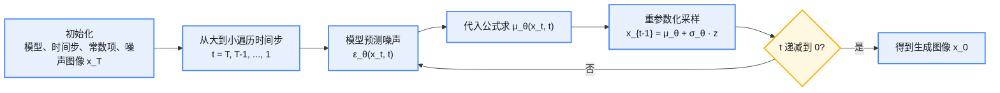

# Diffusion Model

diffusion 的通用思想是：1. **正向扩散（Forward diffusion）**：把干净的数据不断加噪，最终变成纯噪声；2. **逆向扩散（Reverse diffusion）**：学习怎么一步步去噪，从噪声恢复出原来的数据。

一些生成模型的对比：


<div style="text-align:center; margin:1em 0;">

<p style="color:#888; font-size:0.92em; margin:0.25em 0 0;">生成模型对比<br>Image source: <a href="https://zhuanlan.zhihu.com/p/525106459">https://zhuanlan.zhihu.com/p/525106459</a></p>
</div>


diffusion 和其他模型的最大区别在于其 **latent 和原空间的尺寸大小相同**；diffusion 和 GAN 类似，都是给定噪声 $x_t$ 然后生成图片 $x_0$。

Diffusion Models 是一个泛称，不特指某一篇论文或一个具体公式。它可以有**不同的加噪方式**、**不同的采样方式**、**不同的网络结构**，只要遵循“加噪+去噪”的流程，就是 diffusion。**DDPM**（Denoising Diffusion Probabilistic Models）是最早、最标准、最基础的一种扩散模型。

GAN 的缺陷：训练不稳定，容易受噪声影响。

## 前向加噪

原始图像 $x_0$ 通过 $T$ 次累积添加高斯噪声得到图像 $x_1, x_2, \dots, x_T$，正向加噪公式表示为：

<div style="text-align:center">

$$q(x_t \mid x_{t-1}) = \mathcal{N}(x_t; \sqrt{1-\beta_t}\, x_{t-1}, \beta_t I) \qquad (1)$$

</div>

其中：

* $t$ 时刻的图像只与 $t-1$ 时刻相关，可以看作马尔可夫过程；随着 $t$ 的增加，图像 $x_t$ 越接近纯噪声。
* 服从均值为 $\sqrt{1-\beta_t}\,x_{t-1}$、方差为 $\beta_t I$ 的高斯分布；其中 $\beta_t$ 是超参数，一般随 $T$ 递增，如由 0.0001 到 0.02 线性插值；$I$ 表示单位矩阵。
* $q$ 表示某一种概率分布。换言之，$x_t$ 是从该高斯分布中采样得到的。由于采样过程不可导，所以采用重参数化（reparameterization）：

从高斯分布采样出 $z$ 可以表示为 $z \sim \mathcal{N}(z; u_\theta, \sigma_\theta^2 I)$，重参数表示为：

<div style="text-align:center">

$$z = u_\theta + \sigma_\theta \odot \epsilon \qquad (2)$$

</div>

其中 $\theta$ 表示网络参数，均值和方差由网络参数推导；$\epsilon$ 为与模型参数无关的随机噪声，从标准正态分布中采样，因此完全独立于模型参数。

**特性：任何时刻的 $x_t$ 都可以由 $x_0$ 和 $\beta$ 推断出来。**

设 $\alpha_t = 1 - \beta_t$，$\bar{\alpha}_t = \prod_{i=1}^{t} \alpha_i$。利用重参数化把每一步的噪声逐步展开、叠加（高斯噪声之和仍是高斯噪声），可以得到 closed-form 形式：

<div style="text-align:center">

$$x_t = \sqrt{\bar{\alpha}_t}\, x_0 + \sqrt{1-\bar{\alpha}_t}\, z_t, \qquad z_t \sim \mathcal{N}(0, I) \qquad (3)$$

</div>

即任意时刻 $x_t$ 都可以直接从 $x_0$ 采样得到，无需逐步迭代。

## 反向去噪

反向去噪可以表示为 $q(x_{t-1} \mid x_t)$：逆向过程无法简单推算，可以通过网络的学习能力进行预测：

<div style="text-align:center">

$$p_\theta(x_{t-1} \mid x_t) = \mathcal{N}(x_{t-1}; \mu_\theta(x_t, t), \Sigma_\theta(x_t, t)) \qquad (4)$$

</div>

其中 $\theta$ 表示网络参数。

### $\mu_\theta$ 的推导（粗略推导过程）

根据贝叶斯公式把逆向过程转化为前向形式，可以推导得到（以 $x_0$ 为条件的后验）：

<div style="text-align:center">

$$q(x_{t-1} \mid x_t, x_0) = \mathcal{N}(x_{t-1}; \tilde{\mu}_t(x_t, x_0), \tilde{\beta}_t I) \qquad (5)$$

</div>

其中：

<div style="text-align:center">

$$\tilde{\mu}_t(x_t, x_0) = \frac{\sqrt{\alpha_{t-1}}(1-\alpha_t)}{1-\bar{\alpha}_t} x_0 + \frac{\sqrt{\alpha_t}(1-\alpha_{t-1})}{1-\bar{\alpha}_t} x_t, \qquad \tilde{\beta}_t = \frac{1-\bar{\alpha}_{t-1}}{1-\bar{\alpha}_t} \beta_t \qquad (6)$$

</div>

又根据上面的特性（用 $x_0 = \frac{1}{\sqrt{\bar{\alpha}_t}}(x_t - \sqrt{1-\bar{\alpha}_t}\, z_t)$ 代入消去 $x_0$），并把未知的 $z_t$ 换成网络预测的 $z_\theta(x_t, t)$，最终得到逆向过程的均值：

<div style="text-align:center">

$$\mu_\theta(x_t, t) = \frac{1}{\sqrt{\alpha_t}}\left(x_t - \frac{\beta_t}{\sqrt{1-\bar{\alpha}_t}} z_\theta(x_t, t)\right) \qquad (7)$$

</div>

逆向采样时，从 $p_\theta(x_{t-1} \mid x_t)$ 采样：均值用网络预测的 $\mu_\theta(x_t, t)$，方差有两种选择——DDPM 用未学习的 $\sigma_\theta^2(x_t, t)$（可取 $\beta_t$ 或 $\tilde{\beta}_t$）：

<div style="text-align:center">

$$x_{t-1} = \mu_\theta(x_t, t) + \sigma_\theta(x_t, t)\, z, \qquad z \sim \mathcal{N}(0, I) \qquad (8)$$

</div>

反向去噪流程：



## 损失函数

> 省略很多推导过程……

<div style="text-align:center">

$$L = \mathbb{E}_{x_0, t, \epsilon}\left[\left\|\epsilon - \epsilon_\theta\left(\sqrt{\bar{\alpha}_t}\, x_0 + \sqrt{1-\bar{\alpha}_t}\, \epsilon,\ t\right)\right\|^2\right] \qquad (9)$$

</div>

其中 $\alpha_t$ 是与 $\beta_t$ 相关的系数（见上面），$t$ 是时间，$x_0$ 是输入，$z_t$ 是标准高斯采样，$z_\theta$ 是逆向预测的高斯噪声。

对应的训练步骤（每一步的 loss 计算）：

1. 采样输入 $x_0$，随机取时间步 $t \sim U\{1, \dots, T\}$；
2. 采样标准高斯噪声 $\epsilon \sim \mathcal{N}(0, I)$；
3. 计算 $\left\|\epsilon - \epsilon_\theta(\sqrt{\bar{\alpha}_t}\, x_0 + \sqrt{1-\bar{\alpha}_t}\, \epsilon,\ t)\right\|^2$ 作为 MSE loss。

**总结：** DDPM 通过构造一个逐步加噪的过程（前向），逆向利用网络预测高斯噪声，进而得到相应的均值和方差，再利用重参数化得到 $x_{t-1}$ 的图像；整体损失函数是预测噪声与采样的标准高斯之间的距离，通过 MSE loss 训练。最终通过一步步去噪，把纯噪声还原成图像。

## DDPM 改进方法
* DDIM：改进推理速度
1. 将方差引入均值中：$\sigma_t(\eta)^2 = \eta\, \beta_t$
2. 随机性换性能：$\eta=0$ 时是确定性过程，$\eta=1$ 时变为 DDPM

* Improved-DDPM：改进训练不稳
1. 可学习方法
2. 更好的 noise schedule
* CFG：改进不可控
1. Classifier-Free Guidance（无分类器引导）
2. 在推理阶段，用“有条件 − 无条件”的差分，放大条件方向上的去噪，
引导生成结果更符合条件（如文本 prompt）
* Latent Diffusion：改进算力需求
1. 用 VAE 压缩像素图像到 latent 空间

2. 在 latent 空间做 diffusion
* Reward Guidance：改进不对齐
1. 用 RL 去微调

## 为什么 DDPM 需要 1000 个 step

ODE（常微分方程）：没有随机性，系统的变化是完全确定的。

SDE（随机微分方程）：在 ODE 的基础上加上随机噪声。

* 从建模角度看，DDPM 是离散化的 SDE，步数越多对连续过程的近似越好
* 前向过程是一个马尔可夫链，通过逐步加入小噪声将数据分布推向标准高斯

* 反向过程中，对 $\mu_\theta$ 的估计假设了 $x_{t-1}$ 与 $x_t$ 非常接近，跨步太大时高斯近似就不成立了


## diffusion 加速版本（DDIM）

DDPM 的高质量生成依赖于较大的 $T$（一般为 1000 或以上），这导致 diffusion 的生成过程非常缓慢。在 denoising diffusion implicit model（**DDIM**）中提出了一种牺牲多样性来换取更快推断的手段。

DDIM 的主要思路：

1. 将方差引入到均值中；
2. 随机性换取性能：DDIM 进一步定义了 $\sigma_t(\eta)^2 = \eta\, \beta_t$。当 $\eta = 0$ 时，diffusion 的 sample 过程会丧失所有随机性，得到一个确定性的（deterministic）结果；而 $\eta = 1$ 时 DDIM 等价于 DDPM（使用 $\beta_t$ 作为方差的版本）。

**关于方差的选择：**

<div style="text-align:center">

$$\sigma_t^2 = \beta_t, \qquad \sigma_t^2 = \tilde{\beta}_t = \frac{1-\bar{\alpha}_{t-1}}{1-\bar{\alpha}_t}\beta_t \quad \text{(DDPM)}; \qquad \sigma_t(\eta)^2 = \eta\, \beta_t \quad \text{(DDIM)} \qquad (10)$$

</div>

DDPM：近似 SDE

    * 反向分布 $p(x_{t-1} \mid x_t)$
    * 假设 $x_{t-1} \approx x_t$

DDIM：近似 ODE
    * 假设 $(x_t, x_{t-1})$ 来自同一条确定性轨迹
    * 不关心 $x_{t-1} \mid x_t$ 的真实随机分布


**DDIM 核心公式**（省略推导过程……）：

<div style="text-align:center">

$$x_{t-1} = \sqrt{\bar{\alpha}_{t-1}}\, \hat{x}_0 + \sqrt{1-\bar{\alpha}_{t-1}}\left(\eta z + \sqrt{1-\eta^2}\, \epsilon_\theta(x_t, t)\right), \qquad z \sim \mathcal{N}(0, I) \qquad (11)$$

</div>

公式看起来复杂，实则不然。DDIM 的本质是：先估计干净样本 $\hat{x}_0$，再从 $\hat{x}_0$ 直接跳到 $x_{t-1}$。
第一项是确定性信号：$\sqrt{\bar{\alpha}_{t-1}}\, \hat{x}_0$

第二项是随机部分：$\sqrt{1-\bar{\alpha}_{t-1}}\left(\eta z + \sqrt{1-\eta^2}\, \epsilon_\theta(x_t, t)\right)$

$\hat{x}_0$ 是模型估计出的干净图像，但并不是模型直接预测的，而是通过模型预测的噪声反推出来的。

<div style="text-align:center">

$$\hat{x}_0 = \frac{x_t - \sqrt{1-\bar{\alpha}_t}\, \epsilon_\theta(x_t, t)}{\sqrt{\bar{\alpha}_t}} \qquad (12)$$

</div>

* 模型从 $x_t$ 预测出的“干净图像”
* 由噪声预测模型反推得到
* 是 DDIM 中“确定反向轨迹”的核心锚点

**$\eta$ 控制随机性：**
* $\eta=1$：等价于 DDPM

* $\eta=0$：确定性采样，是 ODE 的离散形式

DDIM 仍然不能实现单步采样：
1. 单步会破坏高斯分布假设
2. 轨迹是非线性的，需要多步拟合
3. ODE 求解器需要迭代一定步数才能获得准确结果

## 代码分析

地址：[https://github.com/zoubohao/DenoisingDiffusionProbabilityModel-ddpm-/tree/main](https://github.com/zoubohao/DenoisingDiffusionProbabilityModel-ddpm-/tree/main)

### 网络结构

#### TimeEmbedding 模块


<div style="text-align:center; margin:1em 0;">

<p style="color:#888; font-size:0.92em; margin:0.25em 0 0;">TimeEmbedding 模块</p>
</div>


#### resblock 模块

各个子模块：


<div style="text-align:center; margin:1em 0;">

<p style="color:#888; font-size:0.92em; margin:0.25em 0 0;">resblock 子模块</p>
</div>


<div style="text-align:center; margin:1em 0;">

<p style="color:#888; font-size:0.92em; margin:0.25em 0 0;">attention 模块</p>
</div>


<div style="text-align:center; margin:1em 0;">

<p style="color:#888; font-size:0.92em; margin:0.25em 0 0;">res 模块</p>
</div>


<div style="text-align:center; margin:1em 0;">

<p style="color:#888; font-size:0.92em; margin:0.25em 0 0;">unet 网络结构</p>
</div>


### 训练细节

#### GaussianDiffusionTrainer 模块（训练）

**输入参数：**

1. 模型
2. 时间 $T$
3. beta0
4. betaT

**初始化：**

1. 初始化 beta：在 beta0 与 betaT 之间插值 $T$ 个值
2. $\alpha = 1 - \beta$，$\bar{\alpha} = \prod_{i=0}^{T-1}\alpha_i$
3. 初始化两个参数：$p_1 = \sqrt{\bar{\alpha}}$ 和 $p_2 = 1 - \sqrt{\bar{\alpha}}$

**forward 过程：**

1. 生成维度与输入维度**第 0 维**相同的随机时间戳矩阵 $t$，时间戳在 $T$ 的范围内，维度为 `[batch_size]`
2. 生成与输入维度相同的标准高斯随机矩阵 noise，维度为 `[w, h]`
3. 根据 $t$ 获取参数矩阵 1：$p_1[t]$，参数矩阵 2：$p_2[t]$；获取后维度也为 $T$，所以需要进行扩展，以便和输入以及 2 中生成的噪声进行相乘

```python
    #p1'
    out = torch.gather(v, index=t, dim=0).float().to(device) #获取索引
    #p2'
    return out.view([t.shape[0]] + [1] * (len(x_shape) - 1)) # reshape 成可广播形状，用于与输入张量 x 执行逐元素运算
```

4. 加噪与 loss 计算

$x_t = p_1'[t] \cdot x_0 + p_2'[t] \cdot noise$

$x_0$ 是输入的原始图像，$x_t$ 作为网络的输入，网络输出与 $noise$ 进行 MSE 计算 loss。

noise 参与网络输入的重参数，也参与了 loss 的计算；noise 是随机采样的标准高斯分布。

#### GaussianDiffusionSampler 模块（推理）

**输入参数：**

1. 模型
2. 时间 $T$
3. beta0
4. betaT

**初始化：**

1. 初始化 beta：在 beta0 与 betaT 之间插值 $T$ 个值
2. $\alpha = 1 - \beta$，$\bar{\alpha} = \prod_{i=0}^{T-1}\alpha_i$
3. 构造前一步时间 $\bar{\alpha}_{prev} = \prod_{i=-1}^{T-2}\alpha_i$，index = -1 对应的值是 1

```python
alphas_bar_prev = F.pad(alphas_bar, [1, 0], value=1)[:T]
# 在 index=0 处填充 1，并取前 T 个数值
```

4. 初始化三个参数：$c_1 = \sqrt{1/\alpha}$、$c_2 = c_1 \cdot (1-\sqrt{\alpha})/\sqrt{1-\bar{\alpha}}$、$p_{var} = \beta \cdot (1-\bar{\alpha}_{prev})/(1-\bar{\alpha})$

**forward 过程：**

遍历 $T-1 \dots 0$（逆向遍历），表示为 time_step：

1. 生成 batch_size 维度的时间戳

```python
t = x_t.new_ones([x_T.shape[0], ], dtype=torch.long) * time_step
```

用于取索引。

2. 计算均值和方差

方差的计算（方差不参与训练）：

    1. 拼接 $var = \mathrm{cat}(p_{var}[1], \beta[1:])$
    2. 取索引 $var = var[t]$

均值的计算可以表示为：

<div style="text-align:center">

$$mean = c_1[t] \cdot x_t - c_2[t] \cdot \mathrm{eps} \qquad (13)$$

</div>

其中 $x_t$ 是输入的噪声图像，eps 是网络的预测输出：

<div style="text-align:center">

$$\mathrm{eps} = model(x_t, t) \qquad (14)$$

</div>

3. 更新 $x_t$

<div style="text-align:center">

$$x_t = mean + \sqrt{var} \cdot noise \qquad (15)$$

</div>

其中 noise 是随机标准高斯噪声，之后进行下一步的迭代。

### Condition Diffusion

上面的是无条件的 diffusion；代码中还有一种 condition diffusion，下面分析主要差异。

#### 条件扩散

条件扩散模型（Conditional Diffusion Model）是在标准扩散模型（DDPM）的基础上，引入**外部条件（Conditioning）来控制生成结果**的分布。

|条件类型|举例|
|:---|:---|
|文本|“一只戴墨镜的猫”（text-to-image）|
|图像|边缘图、草图、遮挡图（image-to-image）|
|类别标签|`cat`, `dog`, `car`（class-conditional）|
|音频|TTS 任务中条件语音合成|
|结构数据|人体骨架点、布局图等|

条件也会作为网络的输入，条件输入的实现方式有几种：

1. 输入拼接（early fusion）：将条件 $c$ 和图像拼接后一起输入网络，比如将图像边缘图 + 噪声图拼接成多通道输入。
2. 编码器 + 注意力机制（如文本）：用一个条件编码器（如 CLIP、BERT）生成嵌入，再通过 Cross-Attention 注入到 UNet 的中间层（这正是 **Stable Diffusion** 用的方法）。

#### Condition UNet

##### Condition Embedding

标签直接通过 `nn.Embedding` 进行嵌入，其中 index=0 作为 padding 位置保留：

```python
nn.Embedding(num_embeddings=num_labels + 1, embedding_dim=d_model, padding_idx=0),
```


<div style="text-align:center; margin:1em 0;">

<p style="color:#888; font-size:0.92em; margin:0.25em 0 0;">Condition Embedding</p>
</div>


##### resblock

标签向量直接与输入和时间戳向量一起求和：


<div style="text-align:center; margin:1em 0;">

<p style="color:#888; font-size:0.92em; margin:0.25em 0 0;">条件 resblock</p>
</div>


标签经过向量嵌入后，一起送入残差模块：


<div style="text-align:center; margin:1em 0;">

<p style="color:#888; font-size:0.92em; margin:0.25em 0 0;">条件 unet 总体结构</p>
</div>


##### 训练

训练 forward 过程与 GaussianDiffusionTrainer 类似，只是加了 label，作为网络的额外输入。训练时对 label 做随机性处理：

```python
labels = labels.to(device) + 1
if np.random.rand() < 0.1: #掩盖掉一部分
    labels = torch.zeros_like(labels).to(device)
```

##### 推理

推理主体过程没什么变化，推理 forward 过程只区别于均值的计算：

<div style="text-align:center">

$$mean = c_1[t] \cdot x_t - c_2[t] \cdot \mathrm{eps} \qquad (16)$$

</div>

无条件 diffusion 中 eps 是网络的预测输出：$\mathrm{eps} = model(x_t, t)$。

有条件 diffusion 中 eps 的计算：

```python
eps = self.model(x_t, t, labels)
nonEps = self.model(x_t, t, torch.zeros_like(labels).to(labels.device))
eps = (1. + self.w) * eps - self.w * nonEps
```

由两部分组成：

1. 带标签输入时模型的输出；
2. 标签置 0（无条件）时模型的输出；
3. 两者以权重 self.w 权衡。

置于 0 表示无条件；前面标签在进行 embedding 时对 label=0 进行了处理。self.w 越大，越强化条件。

**这是 Classifier-Free Guidance（CFG）** 的采样策略，是条件扩散模型中非常常见的技巧，用于**提升生成质量和对条件的控制能力**。无需额外的判别器或分类器，所以称为 **Classifier-Free**。

**Classifier-Free Guidance** 的核心思想是：用一个模型，**同时学习有条件和无条件**生成，然后在推理时混合两者来“强化条件”的影响。优势是：

1. 强化条件控制，比完全使用标签更容易生成与条件匹配的图像；
2. 提升生成质量，抑制无关信息，增强图像清晰度、语义一致性（特别是文本条件）。

##### CG 与 CFG

**传统的 Classifier Guidance（有分类器）：** 在早期的扩散模型中，为了引导生成的样本更符合条件（如图像类别），研究者使用**一个额外的分类器**来“指导”扩散过程：在每一步的采样过程中，引入一个已经训练好的分类器计算梯度，来调整噪声预测的方向，使图像更符合目标类别。

缺点：

* 需要训练一个额外的分类器，增加成本；
* 分类器必须对扩散过程中的每个中间图像都能分类，非常难训练；
* 分类器可能导致对抗性失真或 artifacts。

**Classifier-Free Guidance（无分类器）：** CFG 的核心思路是：

> **不需要任何外部分类器**，而是让扩散模型自己同时学会有条件和无条件的生成。

具体方法：

* 在训练阶段，随机将一部分带条件的数据（如文本 prompt）置空（即不给条件），训练模型同时学会**条件生成**和**无条件生成**；
* 在推理时，利用上面说的线性插值方式，组合两个输出来自行引导生成。

---

* 有分类器（传统方式）：相当于你在画画时旁边站着一个老师不断指点你，“这里像不像猫？”，“那里颜色对不对？”
* 无分类器（CFG）：你自己同时练习“照着图画”和“随便画”，然后最后在两种画法之间自己找平衡。
