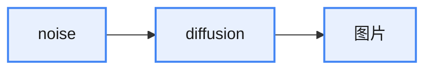
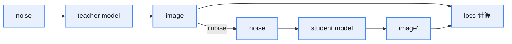
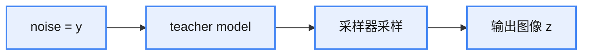
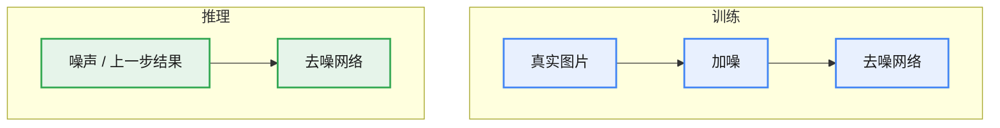

# DMD 系列：一步生成蒸馏

DMD 的目标是单步生成，它从分布角度考虑生成器的学习过程，通过最小化真实分布与生成分布之间的 KL 散度蒸馏损失来对齐两个分布，并结合回归损失进一步约束生成器的输出，使其在保持分布一致性的同时提升样本的质量和多样性。

DMD2 在 DMD1 的基础上完成核心优化：去除原有的回归损失，避免繁琐的 data pair 构建；使用双时间戳训练模式，让 fake score function 学得更充分；同时加入 GAN loss，使用真实图片，弥补 real score function 的缺陷。从损失函数与训练范式层面进行双重改造，同时解决了模型训练阶段与推理阶段的 mismatch 问题，让 DMD 相关模型的生成表现与规律拟合效果更优。

解耦 DMD（Decoupled DMD）通过将原始 DMD 目标函数拆分为两部分，实现了对扩散蒸馏机制的重新定义：其中 CA（CFG Augmentation）作为核心生成引擎，负责驱动多步到少步的高质量生成；而 DM（Distribution Matching）仅充当正则化器，维持训练稳定并抑制伪影，且可被更简单的统计约束或 GAN 正则替代。论文进一步揭示 re-noising timestep（再加噪时间步）对 CA 影响显著——不同噪声水平控制模型学习的结构层级：高噪声强化全局语义，低噪声补充细节，从而确定 CA 在生成过程中的有效范围。通过约束 re-noising timestep 的采样，进一步提升了学生模型的性能。

## DMD（分布匹配蒸馏）

### 背景与动机

生成式扩散模型的推理链路为：

* 问题：diffusion 推理过程要推理很多步，非常耗时
* 解决方法：蒸馏
* 目标：实现单步推理

蒸馏的整体思路：

* 直接学习 image-image mapping 比较困难
* student model 单步生成的效果不行

### 核心思想：匹配分布

* 学习 teacher model 与 student model 的分布，而不是直接学习图像；从分布的角度看，网络更好学
* 衡量分布之间的距离：KL 散度

$$D_{KL}(p_{fake} \parallel p_{real}) = \mathbb{E}_{x \sim p_{fake}}\left[\log \frac{p_{fake}(x)}{p_{real}(x)}\right] = \mathbb{E}_{\substack{z \sim \mathcal{N}(0; I) \\ x = G_\theta(z)}}\left[-(\log p_{real}(x) - \log p_{fake}(x))\right] \qquad (1)$$

其中 $p_{fake}$ 是学生模型生成的分布，$p_{real}$ 是教师模型生成的分布。

### KL 散度的梯度

$$\nabla_\theta D_{KL} = \mathbb{E}_{\substack{z \sim \mathcal{N}(0; I) \\ x = G(z)}}\left[-\left(s_{\mathrm{real}}(x) - s_{\mathrm{fake}}(x)\right) \cdot \nabla_\theta G_\theta(z)\right] \qquad (2)$$

其中：

* $s_{\mathrm{real}}(x) = \nabla_x \log p_{\mathrm{real}}(x)$、$s_{\mathrm{fake}}(x) = \nabla_x \log p_{\mathrm{fake}}(x)$ 分别是两个分布的得分函数（score function）

$s_{\mathrm{real}} - s_{\mathrm{fake}}$ 直接量化了生成样本在"真实分布"与"生成分布"中的梯度差异：差值越大，说明两个分布中的密度变化规律越不一致。

* $s_{\mathrm{real}}(x)$ 指向"提高真实分布概率最快的方向"
* $s_{\mathrm{fake}}(x)$ 指向"更像当前学生模型自己"的方向（注意公式是负号）
* 合并 $-(s_{\mathrm{real}}(x) - s_{\mathrm{fake}}(x))$ 表示在最小化 KL 时：往 teacher 高概率方向移动，同时抑制 student 过度自信（熵塌缩）

实际训练过程：$s_{\mathrm{real}}$ 是教师模型的预测，$s_{\mathrm{fake}}$ 通过一个单独的网络预测（fake score model）。

> 这里的 real & fake 类似 GAN 的概念，在 DMD2 中这部分就被换成了 GAN。

### 回归损失

使用分布匹配损失仍会使模型只学会产生真实数据的一部分，即仍有 model collapse 现象，所以 DMD 采用回归损失作为正则项。

构建数据集 $D = \{(z, y)\}$：输入噪声 $y$ 经 teacher model 多步生成，采样器采样后输出图像 $z$（diffusion 模型没有 model collapse 现象）。

计算回归 loss：

$$L_{reg} = \mathbb{E}_{(z, y) \sim D}\left[\mathcal{L}(G_\theta(y), z)\right] \qquad (3)$$

$G_\theta(y)$ 是学生模型生成的图像，$z$ 是教师模型多步生成的图像。

引用论文结论（One-step Diffusion with Distribution Matching Distillation）：

DMD 论文结论 Image source: <a href="https://arxiv.org/abs/2311.18828">https://arxiv.org/abs/2311.18828</a>

最终损失为：

$$L = D_{KL} + \lambda_{reg} L_{reg} \qquad (4)$$

### 总体框架

DMD 总体框架 Image source: <a href="https://arxiv.org/abs/2311.18828">https://arxiv.org/abs/2311.18828</a>

### 总体训练流程

准备条件：

* 选择一个教师模型
* 准备好 data pair（用于计算回归损失）

DMD 总体训练流程

DMD2 解决的问题：DMD1 中，回归损失的计算需要用到 data pair，存在一些问题：

* 收集困难：需要 teacher model 多步生成，费时
* 不能泛化：换一种任务又要换一个 data pair
* 违背分布匹配的初衷：强制模仿教师模型的具体采样路径，而不是匹配分布

### 双时间戳更新

回归损失原本用于解决 model collapse 问题。model collapse 问题的来源是**训练不稳定**，而训练不稳定的来源是 fake score function 不是很准。原因是：

* fake score function 是在线训练的，训练数据来源是学生模型生成的图片
* 生成一张图 → 训练一步 → fake score function 没有完全学会生成器的输出

解决方法：让 fake score function 学得更久一些——每训练 5 步 fake score function，对应训练一次学生模型。

DMD2 双时间戳更新 Image source: <a href="https://arxiv.org/abs/2405.14867">https://arxiv.org/abs/2405.14867</a>

### GAN loss

DMD1 中训练数据中没有真实图片，都是生成的图片，这样会导致 real score function 的估计不是那么准。

解决方法：加入 GAN loss——搭建一个判别器对学生模型生成的图片进行判别，以弥补 real score function 不准的缺陷：discriminator（生成的图片，真实图片）。

值得注意的是：

1. 如果只用 GAN loss、不用分布损失，不好进行条件分类引导
2. 用上 GAN loss 训出来的模型甚至要优于 Teacher model！

### 多步扩展

在某些场景下，单步生成的图片可能不够好，可以将 DMD2 扩展到多步以提高性能表现。

实际中，对于一个训练了 1000 步的教师模型，DMD2 的 4 步模型使用 {999, 749, 499, 249} 的 Scheduler。

### 解决训练与推理的 mismatch

训练与推理阶段，去噪网络的输入来源不一致：

解决方法：**backward simulation**——训练时不使用**真实图片 + 噪声**，而是先使用学生模型跑几步生成带噪图片，再以带噪图片作为输入进行训练。

### 总体框架

DMD2 总体框架 Image source: <a href="https://arxiv.org/abs/2405.14867">https://arxiv.org/abs/2405.14867</a>

## Decoupled DMD

在 DMD 的基础上，重新解释 DMD 有效的原因，并进行改进。

**DMD 核心点：KL 散度梯度**

$$\nabla_\theta D_{KL} = \mathbb{E}_{\substack{z \sim \mathcal{N}(0; I) \\ x = G(z)}}\left[-\left(s_{\mathrm{cond}}^{\mathrm{real}}(x) - s_{\mathrm{cond}}^{\mathrm{fake}}(x)\right) \cdot \nabla_\theta G_\theta(z)\right] \qquad (5)$$

**改进：CFG 加权得分替换真实得分**

然而，上述公式在实践中通常表现不佳。为了解决这一问题，研究者们引入了一个微妙但关键的修改：

$$\nabla_\theta D_{KL} = \mathbb{E}_{\substack{z \sim \mathcal{N}(0; I) \\ x = G(z)}}\left[-\left(s_{\mathrm{cfg}}^{\mathrm{real}}(x) - s_{\mathrm{cond}}^{\mathrm{fake}}(x)\right) \cdot \nabla_\theta G_\theta(z)\right] \qquad (6)$$

原本的"真实得分" $s_{\mathrm{cond}}^{\mathrm{real}}$ 被替换为 CFG 加权的得分 $s_{\mathrm{cfg}}^{\mathrm{real}}$，定义为：

$$\nabla_\theta D_{KL} = \mathbb{E}_{\substack{z \sim \mathcal{N}(0; I) \\ x = G(z)}}\left[-\left(\underbrace{\left(s_{\mathrm{cond}}^{\mathrm{real}}(x) - s_{\mathrm{cond}}^{\mathrm{fake}}(x)\right)}_{\Delta^{\mathrm{real}-\mathrm{fake}}} + (\alpha - 1)\underbrace{\left(s_{\mathrm{cond}}^{\mathrm{real}}(x) - s_{\mathrm{uncond}}^{\mathrm{real}}(x)\right)}_{\Delta_{\mathrm{cfg}}^{\mathrm{real}}}\right) \cdot \nabla_\theta G_\theta(z)\right] \qquad (7)$$

其中：

* Distribution Matching（DM）：$\Delta^{\mathrm{real}-\mathrm{fake}}$
* CFG Augmentation（CA）：$\Delta_{\mathrm{cfg}}^{\mathrm{real}}$

这个分解使得 DMD 的目标函数可以重新表述为两个项的加和，这就是 "Decoupled" 的由来。

### DM & CA 的作用

仅使用 CA 进行训练时：

1. 表现出极强的效果，生成结果在内容上与使用完整 DMD 模型高度相似
2. 不稳定：随着训练的进行，结果会变得过饱和、噪声变多、训练崩溃
3. 加入 DM 训练后，结果变得稳定

结论：

1. CA 是少步生成的关键
2. DM 在训练时起到正则化的作用（这点有点反常识，一般会认为分布匹配才是生成好的关键）

### 正则项评估

* 方法：在 CA 的前提下，使用最简单的正则项约束生成器输出的均值和方差
* 结果：CA 长时间运行，生成图像质量保持稳定

不过，这种简单的正则效果不如 DM 正则；还有一种正则做法是**真实图片 + GAN** （DMD2 的做法），但是 GAN 的训练会出现不稳定的情况。

DM 的正则效果很好，约束的强度大于简单的正则，同时训练更加稳定。

### τ 对 CA 的影响

$\tau$：re-noising timestep（再加噪时间步）。

* 方法：探索不同 $\tau$ 对 CA 训练的影响，只使用 CA 进行训练
* 结果：
  1. 当 $\tau$ 限制在高噪声区间（例如 [0.0, 0.05]）时，CA 主要通过增强低频信息进行调整
  2. 随着 $\tau$ 范围向更"干净"的时间步扩展，生成的图像逐渐获得更多高频细节
  3. 当 $\tau$ 仅限于干净的时间步区间（例如 [0.7, 1.0]）时，训练会崩溃

结论：

1. 当 CA 应用于某一特定噪声水平 $\tau$ 时，它主要增强该噪声水平对应的图像内容
2. 如果低频的整体结构尚未确定，高频细节的增强是没有意义的

关键结论：在多步生成中，生成器当前处于时间步 $t$，其输入 $z_t$ 已经包含了低于 $t$ 的噪声级别所对应的已解析信息，此时再使用包含 $\tau &lt; t$ 的 re-noising 范围进行 CA 是没有必要的。

目标更新为：

$$\nabla_\theta D_{KL} = \mathbb{E}_{\substack{z \sim \mathcal{N}(0; I) \\ x = G(z)}}\left[-\left((s_{\mathrm{cond}}^{\mathrm{real}}(x) - s_{\mathrm{cond}}^{\mathrm{fake}}(x)) + (\alpha - 1)(s_{\mathrm{cond}}^{\mathrm{real}}(x_{\tau_{CA}}) - s_{\mathrm{uncond}}^{\mathrm{real}}(x_{\tau_{CA}}))\right) \cdot \nabla_\theta G_\theta(z)\right] \qquad (8)$$

其中 re-noising 时间步的采样范围变为：

$$\tau_{CA} \sim u(t, 1) \qquad (9)$$

文章实验也表明：性能收益并不是来自"解耦"本身，而是来自于对 re-noising timestep 的限制。

### DMD 与 Decoupled-DMD 的流程图对比

DMD 与 Decoupled-DMD 流程图对比

