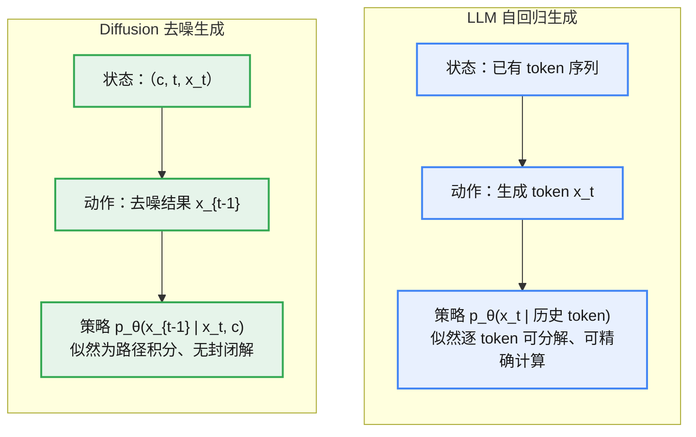
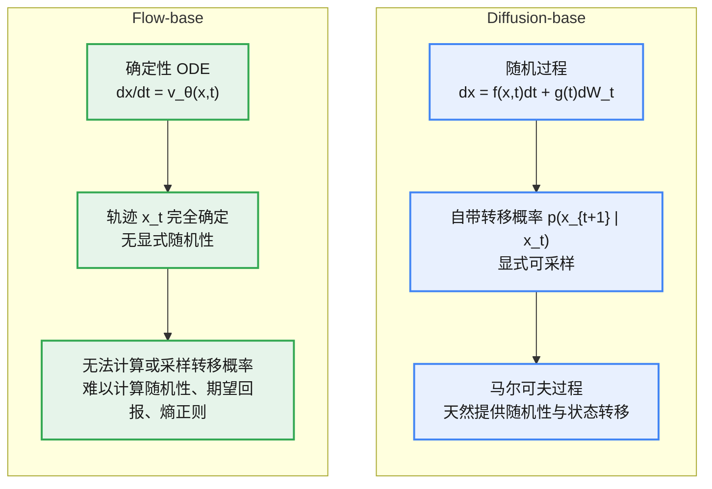
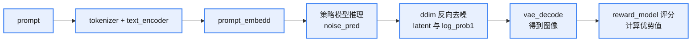
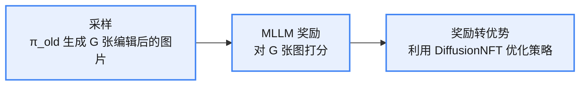

扩散模型凭借其强大的分布建模能力，可用于解决传统强化学习难以解决的序列决策问题；同时，强化学习也可以用于优化扩散模型。本篇总结强化学习在扩散模型生成领域上的优化方法。

# LLM RL 和 Diffusion 的区别

LLM 与 Diffusion 都属于生成模型，都可以套用策略梯度的框架进行强化学习。两者的差异主要体现在生成方式上：LLM 是自回归的、逐 token 生成；Diffusion 是多步去噪的、连续的生成过程。这种差异直接决定了策略建模方式、似然是否可解析计算，以及重要性采样比能否精确得到。

策略梯度的统一视角：

<div style="text-align:center">

$$\nabla_\theta J(\theta) = \mathbb{E}_{\tau \sim p(\tau;\theta)}\left[\sum_{t=0}^{T-1}\nabla_\theta \log \pi_\theta(a_t \mid s_t)\,R(\tau)\right] \qquad (1)$$

</div>

## LLM：自回归建模

LM 的生成方式是自回归的：

<div style="text-align:center">

$$p(x) = \prod_t p(x_t \mid x_{&lt;t}) \qquad (2)$$

</div>

每一步生成都可以映射为 MDP 中的一步：

* **state**：当前 token 序列 $x_{&lt;t}$
* **action**：生成的 token $x_t$
* **policy**：$p_\theta(x_t \mid x_{&lt;t})$

关键性质：**似然可分解、可解析计算**。$p_\theta(x)$ 逐 token 分解为条件概率之积，可以直接计算，因此策略梯度可以写成 token 级别的 REINFORCE 形式：

<div style="text-align:center">

$$\nabla_\theta J(\theta) = \mathbb{E}\left[R(x)\,\nabla_\theta \log p_\theta(x)\right] \qquad (3)$$

</div>

其中 $\log p_\theta(x) = \sum_t \log p_\theta(x_t \mid x_{&lt;t})$；重要性采样比 $\frac{p_\theta(x)}{p_{\theta_{\text{old}}}(x)}$ 也可以逐 token 精确计算，这正是 PPO / GRPO 可以直接应用于 LLM 的原因。

## Diffusion：去噪建模

Diffusion 的生成方式是多步去噪：

<div style="text-align:center">

$$x_{t-1} = f_\theta(x_t, t) + \sigma_t \epsilon \qquad (4)$$

</div>

一条可能的生成路径是 $x_T \to x_0$，而 $x_0$ 的似然是所有可能路径的总和：

<div style="text-align:center">

$$p(x_0) = \sum_{\text{所有路径}} p(\text{路径}) = \int p(x_0, z_{1:T})\,dz_1\,dz_2\cdots dz_T \qquad (5)$$

</div>

关键性质：**似然不可解析计算**。$p(x_0)$ 是一个高维积分，没有封闭解，无法直接写出 $p_\theta(x_0)$ 或重要性采样比。因此 Diffusion RL 只能采用近似手段：

* 用路径联合概率 $p_\theta(x_{0:T})$ 代替 $p_\theta(x_0)$（如 Diffusion-DPO 转而优化目标函数的下界）；
* 用 ELBO 或 score / velocity 上的回归目标近似 $\log \pi_\theta(x_0 \mid c)$（如 AWM 用 flow-matching 的 ELBO 近似序列似然）。

## 对比总结

| 对比维度 | LLM RL | Diffusion RL |
|:---|:---|:---|
| 生成方式 | 自回归，逐 token 生成 | 多步去噪，路径 $x_T \to x_0$ |
| 状态 state | 已有 token 序列 $x_{&lt;t}$ | 三元组 $(c, t, x_t)$ |
| 动作 action | 下一个 token $x_t$ | 下一步去噪结果 $x_{t-1}$ |
| 策略 $\pi$ | $p_\theta(x_t \mid x_{&lt;t})$ | $p_\theta(x_{t-1} \mid x_t, c)$ |
| 似然可计算性 | 可分解、可解析计算 | 高维积分，无封闭解 |
| 重要性采样比 | 逐 token 精确计算 | 需用路径联合概率或 ELBO 近似 |
| 代表性算法 | PPO / GRPO / DPO | DDPO / Diffusion-DPO / DRaFT / AWM / DiffusionNFT |



# Diffusion-base 和 Flow-base 与 RL 的兼容性

Diffusion 与 Flow Matching 是两种不同的生成建模方式，它们与强化学习的兼容性也因此不同。

## Diffusion-base

Diffusion 模型的本质是一个**随机过程**，通常定义为：

<div style="text-align:center">

$$dx = f(x, t)\,dt + g(t)\,dW_t \qquad (6)$$

</div>

其中 $dW_t$ 是 Wiener 过程（随机噪声）。

这意味着：

* Diffusion 自带一个「转移概率分布」$p(x_{t+1} \mid x_t)$；
* 这个分布是显式可采样的，甚至在离散时间下可以直接写为 $x_{t+1} = \sqrt{\alpha_t}\,x_t + \sqrt{1-\alpha_t}\,\epsilon$；
* 所以 diffusion 模型本质上定义了一个**马尔可夫过程**。

在强化学习里，同样依赖转移概率 $p(s_{t+1} \mid s_t, a_t)$。因此 diffusion 模型天然地提供了：

1. 随机性
2. 状态转移概率
3. 可微分的采样路径（通过重参数化技巧 reparameterization trick）

## Flow-base

Flow Matching 走的是另一条路：

<div style="text-align:center">

$$\frac{dx}{dt} = v_\theta(x, t) \qquad (7)$$

</div>

它是一个确定性 ODE，这有两个直接后果：

1. 没有显式随机性：给定起点 $x_0$，轨迹 $x_t$ 是完全确定的。
2. 无法显式计算或采样转移概率：

   * Diffusion 的转移概率有闭式表达；
   * Flow Matching 只有确定性轨迹，没有概率扩散项；
   * 所以在 RL 中你无法直接计算策略的随机性、期望回报或熵正则项（entropy regularization）。

两种建模方式与 RL 的兼容性对比：



# Diffusion-base + RL

代表性算法：

1. DDPO
2. Diffusion-DPO
3. 可微分奖励微调（DRaFT）

## DDPO（Denoising Diffusion Policy Optimization）

> paper: [arXiv:2305.13301](https://arxiv.org/abs/2305.13301)

主要思路：将去噪过程建模为一个多步 MDP（马尔可夫决策过程），然后利用策略优化算法优化扩散模型。


<div style="text-align:center; margin:1em 0;">

<p style="color:#888; font-size:0.92em; margin:0.25em 0 0;">DDPO 算法流程图</p>
</div>


### 多步 MDP 建模

MDP 可以形式化为 $(S, A, \rho_0, P, R)$，分别表示状态空间、动作空间、初始状态分布、状态转移矩阵、奖励函数。

强化学习的目标是最大化累积收益：

<div style="text-align:center">

$$J_{RL}(\pi) = \mathbb{E}_{\tau \sim p(\tau \mid \pi)}\left[\sum_{t=0}^{T}R(s_t, a_t)\right] \qquad (8)$$

</div>

DDPO 按照如下方式将扩散模型的多步去噪过程与 MDP 联系起来：

* **状态 state**：$s_t = (c, t, x_t)$，每一步的状态 ==（条件变量，去噪时间步，当前时间步的去噪结果）。
* **策略 policy**：$\pi(a_t \mid s_t) = p_\theta(x_{t-1} \mid x_t, c)$，策略 == 给定当前状态时下一步去噪结果的条件分布。
* **动作 action**：$a_t = x_{t-1}$，动作 == 下一步的去噪结果。
* **状态转移**：$P(s_{t+1} \mid s_t, a_t) = (\delta_c, \delta_{t-1}, \delta_{x_{t-1}})$，在去噪过程中，采样出下一步去噪结果后，状态的转移是确定性的，因此这里用三个 $\delta$ 分布（Dirac delta）来表示状态转移。
* **初始状态分布**：$\rho_0(s_0) = (\rho(c), \delta_T, \mathcal{N}(0, I))$，条件变量 $c$ 服从其先验分布，时间步 $T$ 是确定的（用 $\delta_T$ 表示），$x_T$ 服从标准高斯分布。
* **奖励函数**：$R(s_t, a_t) = \begin{cases} r(x_0, c) & t = 0 \\ 0 & \text{其他} \end{cases}$，在去噪过程中，只有**最终**的去噪结果会依据奖励模型获得分数，去噪中间过程的奖励值定义为 0。

上述 MDP 的时间戳是从 0 到 $T$，对应去噪过程的时间戳则是从 $T$ 到 0。

### 策略梯度

<div style="text-align:center">

$$\nabla_\theta J_{DDPO} = \mathbb{E}\left[\text{clip}\left(\frac{p_\theta(x_{t-1} \mid x_t, c)}{p_{\theta_{\text{old}}}(x_{t-1} \mid x_t, c)}, 1-\epsilon, 1+\epsilon\right)\nabla_\theta \log p_\theta(x_{t-1} \mid x_t, c)\,r(x_0, c)\right] \qquad (9)$$

</div>

### 代码逻辑


<div style="text-align:center; margin:1em 0;">

<p style="color:#888; font-size:0.92em; margin:0.25em 0 0;">DDPO 代码流程图（采样）</p>
</div>


<div style="text-align:center; margin:1em 0;">

<p style="color:#888; font-size:0.92em; margin:0.25em 0 0;">DDPO 代码流程图（训练）</p>
</div>


实现步骤：

**采样阶段**

1. 产生 prompt，经过 tokenizer 和 text_encoder 得到 prompt_embedd；
2. 确定推理步数，输入 prompt_embedd，用策略模型推理出预测噪声 noise_pred；
3. 根据预测噪声和时间戳 $t$ 经过 ddim 反向去噪，推理出 $t-1$ 步的 latent 和似然概率 log_prob1；
4. ddim 最终推理出的 latent 经过 vae_decode 得到图像；
5. 图像送到 reward_model 进行奖励评分，进一步计算优势值；
6. 循环上述步骤 num_batches_per_epoch 次。

采样完成后，得到的数据有：prompt_embedd、timesteps、每一步的 latent、每一步的似然概率、优势值。



**训练阶段**

1. 遍历 sample 数据；
2. 遍历时间戳 $t$，将 $t$ 对应的 latent 输入到去噪模型，模型预测出噪声 noise_pred2；
3. noise_pred2 经过 ddim 反向去噪，得到对应的似然概率 log_prob2；
4. 根据 log_prob1 和 log_prob2 计算重要性采样比值，结合优势函数计算 loss；
5. loss 反向传播。

## Diffusion-DPO

> paper: [arXiv:2311.12908](https://arxiv.org/abs/2311.12908)

将 DPO 运用到 diffusion 中。DPO（Direct Preference Optimization）是直接偏好优化算法，损失函数可以表示为：

<div style="text-align:center">

$$L = -\mathbb{E}_{c, x_0^w, x_0^l \sim \mathcal{D}}\left[\log \sigma\left(\beta \log \frac{p_\theta(x_0^w \mid c)}{p_{ref}(x_0^w \mid c)} - \beta \log \frac{p_\theta(x_0^l \mid c)}{p_{ref}(x_0^l \mid c)}\right)\right] \qquad (10)$$

</div>

其中 $x_0^w$ 表示优质图片（win），$x_0^l$ 表示劣质图片（lose）。相比 PPO，DPO 的训练过程不显式建立奖励模型——DPO 已经把奖励直接吸收到优化目标中，隐式构建了奖励模型。

在将 DPO 应用于扩散模型时会带来一些挑战。观察上式可以发现，难点在于 $x_0$ 的采样概率 $p(x_0 \mid c)$ 不可直接计算——计算 $p(x_0 \mid c)$ 需要对所有导向 $x_0$ 的采样路径 $(x_1, \dots, x_T)$ 积分。为了克服这个问题，原论文转而优化目标函数的下界，得到的损失函数为：

<div style="text-align:center">

$$L = -\mathbb{E}_{c, x_0^w, x_0^l}\left[\log \sigma\left(\beta \log \frac{p_\theta(x_{0:T}^w)}{p_{ref}(x_{0:T}^w)} - \beta \log \frac{p_\theta(x_{0:T}^l)}{p_{ref}(x_{0:T}^l)}\right)\right] \qquad (11)$$

</div>

推导到这里，又出现了两个难点：

1. $T$ 往往很大（原论文设定 $T = 1000$），这导致利用蒙特卡洛采样方法估计损失函数时，对 $x_T$ 的采样不充分；
2. 逆过程的联合概率在计算机数值精度上无法计算：$T$ 太大会导致 $p_\theta(x_{1:T}) = p_\theta(x_T)\prod_{i=1}^{T}p_\theta(x_{t-1} \mid x_t)$ 几乎等于 0（数值下溢）。

论文又进行了改进与近似，最后得到的损失函数是：

<div style="text-align:center">

$$L = -\mathbb{E}\left[\log \sigma\left(-\beta T\,w(\lambda_t)\left(\left\|\epsilon^w - \epsilon_\theta(x_t^w, t)\right\|_2^2 - \left\|\epsilon^w - \epsilon_{ref}(x_t^w, t)\right\|_2^2 - \left\|\epsilon^l - \epsilon_\theta(x_t^l, t)\right\|_2^2 + \left\|\epsilon^l - \epsilon_{ref}(x_t^l, t)\right\|_2^2\right)\right)\right] \qquad (12)$$

</div>

其中 $x_t^* = a_t\,x_0^* + \sigma_t\,\epsilon^*$，$\epsilon^* \sim \mathcal{N}(0, I)$，由前向扩散过程 $q(x_t^* \mid x_0^*)$ 得到；$\lambda_t = a_t^2 / \sigma_t^2$ 是信噪比，$w(\lambda)$ 为调节权重的函数。

观察上式可以发现，$\epsilon_{ref}$ 在训练时不会修改，因此对损失函数有影响的只有 $\left\|\epsilon^w - \epsilon_\theta(x_t^w, t)\right\|_2^2$ 和 $\left\|\epsilon^l - \epsilon_\theta(x_t^l, t)\right\|_2^2$：前者越小、同时后者越大，损失就越小。可以定性地认为 Diffusion-DPO 的训练过程是在改善 $(x_0^w, c)$ 的去噪过程，同时破坏 $(x_0^l, c)$ 的去噪过程。

## DRaFT（Direct Reward Fine-Tuning）

> paper: [arXiv:2309.17400](https://arxiv.org/abs/2309.17400)

DRaFT 能够基于给定的可微分奖励函数，直接优化扩散模型。由于能够端到端地直接计算扩散模型的梯度，与 DDPO 相比，DRaFT 具有更高的优化效率，但 DRaFT 要求奖励函数是可微分的。


<div style="text-align:center; margin:1em 0;">

<p style="color:#888; font-size:0.92em; margin:0.25em 0 0;">DRaFT 算法流程图<br>Image source: <a href="https://arxiv.org/abs/2309.17400">https://arxiv.org/abs/2309.17400</a></p>
</div>


DRaFT 的目标是对预训练扩散模型的参数进行微调，以最大化可微分的奖励函数。目标函数如下：

<div style="text-align:center">

$$J(\theta) = \mathbb{E}\left[r(\text{sample}(\theta, c, x_T), c)\right] \qquad (13)$$

</div>

其中 $\text{sample}(\theta, c, x_T)$ 表示给定提示文本 $c$ 下的采样过程（$T \to 0$）。通过计算 $\nabla_\theta r(\text{sample}(\theta, c, x_T), c)$ 并使用梯度上升优化上式所示的目标函数。计算这个梯度需要沿采样链对多个扩散模型调用进行反向传播，类似于在递归神经网络中进行反向传播。

变种：

* **DRaFT-K**

  在最后 $K$ 个采样步骤处截断反向传播，可以显著提高优化速度和总体性能，原论文将这种方法命名为 DRaFT-K。截断后，可通过减少 U-Net 的反传数量来降低每一步的计算开销。令人惊讶的是，这种方法还提高了每步的生成效率。

* **DRaFT-LV**

  原作者发现，简单地设置 $K = 1$（只通过最后一个采样步进行反向传播），即可在奖励和计算开销之间实现最好的权衡。原作者进一步提出了一种通过降低奖励梯度估计方差来提升 DRaFT-1 效率的方法，并将这种低方差估计方法命名为 DRaFT-LV。

  DRaFT-LV 的核心思想是：使用前向扩散过程产生额外的样本来训练，而不是重新生成新的图像。具体来说，DRaFT-LV 对生成的图像进行 $n$ 次加噪，并将这些样本的奖励梯度相加。尽管 DRaFT-LV 通过 U-Net 和奖励模型增加了 $n$ 个额外的前向和反向传播，但在实践中，与正常采样需要访问 $T$ 次 U-Net 相比，这是相当小的开销。实验发现，设定 $n = 2$ 的 DRaFT-LV 效率比 DRaFT-1 高 2 倍左右，同时仅增加约 10% 的计算开销。

# Flow-base + RL

代表性算法：

1. flow-GRPO
2. AWM
3. DiffusionNFT

## flow-GRPO

> paper: [arXiv:2505.05470](https://arxiv.org/abs/2505.05470)

flow-GRPO 是 DDPO 在 flow-base 模型上的应用，把确定性 ODE 转为 SDE。


<div style="text-align:center; margin:1em 0;">

<p style="color:#888; font-size:0.92em; margin:0.25em 0 0;">Flow-GRPO 算法流程图</p>
</div>


### ODE 到 SDE

原始 ODE：

<div style="text-align:center">

$$dx_t = v_t\,dt \qquad (14)$$

</div>

构造等价的 SDE：

<div style="text-align:center">

$$dx_t = \left[v_t(x_t) - \frac{\sigma_t^2}{2}\nabla_{x_t}\log p_t(x_t)\right]dt + \sigma_t\,dw \qquad (15)$$

</div>

对于 Rectified Flow，可以具体写为：

<div style="text-align:center">

$$dx_t = \left[v_t(x_t) + \frac{\sigma_t^2}{2t}\left(x_t + (1-t)v_t(x_t)\right)\right]dt + \sigma_t\,dw \qquad (16)$$

</div>

离散后的更新规则（核心公式）：

<div style="text-align:center">

$$x_{t+\Delta t} = x_t + \left[v_\theta(x_t, t) + \frac{\sigma_t^2}{2t}\left(x_t + (1-t)v_\theta(x_t, t)\right)\right]\Delta t + \sigma_t\sqrt{\Delta t}\,\epsilon \qquad (17)$$

</div>

其中 $\epsilon \sim \mathcal{N}(0, I)$ 注入随机性；文章采用 $\sigma_t = \alpha\sqrt{\frac{t}{1-t}}$，其中 $\alpha$ 是控制噪声强度的超参数。

### Denoising Reduction（去噪步数缩减）

在样本生成阶段，可以**显著减少去噪步骤**的数量，而在推理阶段仍保持原始的完整去噪步数。

实验中，训练时将时间步数设置为 $T = 10$，推理时使用 SD3.5-M 的默认设置 $T = 40$。实验结果表明，这种方法可以在**不牺牲推理阶段图像质量**的前提下大幅加快训练速度。

### 消融实验

* **KL 散度**


<div style="text-align:center; margin:1em 0;">

<p style="color:#888; font-size:0.92em; margin:0.25em 0 0;">Flow-GRPO KL 散度消融<br>Image source: <a href="https://arxiv.org/abs/2505.05470">https://arxiv.org/abs/2505.05470</a></p>
</div>


* **去噪步数缩减**


<div style="text-align:center; margin:1em 0;">

<p style="color:#888; font-size:0.92em; margin:0.25em 0 0;">Flow-GRPO 去噪步数缩减消融<br>Image source: <a href="https://arxiv.org/abs/2505.05470">https://arxiv.org/abs/2505.05470</a></p>
</div>


* **噪声水平的影响**

  噪声水平越大，越能增强图像的多样性与探索性。


<div style="text-align:center; margin:1em 0;">

<p style="color:#888; font-size:0.92em; margin:0.25em 0 0;">Flow-GRPO 噪声水平消融<br>Image source: <a href="https://arxiv.org/abs/2505.05470">https://arxiv.org/abs/2505.05470</a></p>
</div>


* **群体大小的影响**

  当群体大小 $G$ 减少至 12 或 6 时，训练过程变得不稳定并最终崩溃；而当 $G = 24$ 时，训练过程始终保持稳定。

### 代码逻辑

代码大体逻辑与 DDPO 类似，关键不同点：

1. 引入参考模型，策略、参考模型都用 FSDP wrapped；
2. 反向不再是 ddim，而是转化后的 SDE（核心公式）；
3. 计算 KL 散度。


<div style="text-align:center; margin:1em 0;">

<p style="color:#888; font-size:0.92em; margin:0.25em 0 0;">Flow-GRPO 代码流程图（采样）</p>
</div>


<div style="text-align:center; margin:1em 0;">

<p style="color:#888; font-size:0.92em; margin:0.25em 0 0;">Flow-GRPO 代码流程图（训练）</p>
</div>


说明：

**1. flow-GRPO 在去噪的每一步都进行策略优化**

采样时针对去噪的每一步进行，每一步都有对应的 reward；那么训练时每一步都在更新，采样时的 reward 是不是不能正确反映更新后的 reward？去噪过程中，中间结果的 reward 都是 0，只有最终去噪结果有 reward？因为更新了，所以最终去噪结果会一样？

具体逻辑如下：反向去噪的每一步 reward 都是 0，只有最终的图像经过 reward 打分。

**采样阶段**

1. prompt + 随机噪声经过反向采样，从 $T \to T-1$ 步，得到 latent 和对应的对数似然；
2. 重复步骤 1，直到第 0 步，得到最终的图像；
3. 图像经过 reward_fn 打分，进一步转为优势。

**训练阶段**

1. 遍历采样数据集，遍历训练时间步；
2. 根据当前时间步，获取采样阶段得到的 latent，利用当前策略计算对数似然。注意：这里的 $x_{T-1}$ 不是重新经过 ddim 采样得到的，而是直接利用采样阶段得到的 latent；
3. 根据第 2 步得到的似然与采样时的似然，计算重要性采样比值；
4. 重要性采样比值结合优势函数得到 loss，更新策略网络。

**2. 每个 prompt 会生成多个 image，最后训练使用哪个轨迹？**

`num_image_per_prompt` 参数会影响 dataloader 的 sample：

```python
train_sampler = DistributedKRepeatSampler(
    dataset=train_dataset,
    batch_size=config.sample.train_batch_size,  # This is per-GPU batch size
    k=config.sample.num_image_per_prompt,
    num_replicas=world_size,
    rank=rank,
    seed=config.seed,
    banned_prompts=None,
)
```

这个 sampler 会重复 $k$ 次 prompt idx 的生成，同时也会进行打乱，分给不同的 rank，每个 rank 分到 batch_size 个。

比如：`indexs = [1, 2, 3]`，重复 $k$ 次之后变为 `[1, 1, 2, 2, 3, 3]`，打乱之后变为 `[3, 1, 1, 3, 2, 2]`。虽然被打乱了，但最后会收集不同 rank 的数据，根据 prompt_id 进行区分，进而计算优势函数。

这个 sampler 如何保证所有数据都被覆盖？看一下 iter 函数：

```python
def __iter__(self):
    while True:
        # Generate a deterministic random sequence to ensure all replicas are synchronized
        g = torch.Generator()
        g.manual_seed(self.seed + self.epoch)

        # Randomly select m unique samples
        indices = torch.randperm(len(self.dataset), generator=g)[:self.m].tolist()

        # Repeat each sample k times to generate n*b total samples
        repeated_indices = [idx for idx in indices for _ in range(self.k)]

        # Shuffle to ensure uniform distribution
        shuffled_indices = torch.randperm(len(repeated_indices), generator=g).tolist()
        shuffled_samples = [repeated_indices[i] for i in shuffled_indices]

        # Split samples to each replica
        per_card_samples = []
        for i in range(self.num_replicas):
            start = i * self.batch_size
            end = start + self.batch_size
            per_card_samples.append(shuffled_samples[start:end])

        # Return current replica's sample indices
        yield per_card_samples[self.rank]
```

1. 首先拿到 $m$ 条数据；
2. 针对这 $m$ 条数据做 $k$ 次重复；
3. 再针对 batch 进行 rank 分发。

$m$ 是怎么来的？

```python
# Compute the number of unique samples needed per iteration
self.total_samples = self.num_replicas * self.batch_size
assert self.total_samples % self.k == 0, f"k can not divide n*b, k{k}-num_replicas{num_replicas}-batch_size{batch_size}"
self.m = self.total_samples // self.k  # Number of unique samples
self.epoch = 0
```

总共采样数 == 卡数 × batch_size，比如 6 卡、bs = 2，那就是 12 个数目，12 个都是独一无二的。那么 $m$ = 总采样数 / 重复次数；假设重复次数是 12，那么 $m = 1$。最后分发就是：取 1 个 prompt，重复 12 次，每个 rank 分 2 个数据。

那最后用的是哪个轨迹？采样的时候，每个数据都会被收集到：

```python
samples.append(
    {
        "prompt_ids": prompt_ids,
        "prompt_embeds": collected_data["prompt_embeds"],
        "prompt_embeds_mask": collected_data["prompt_embeds_mask"],
        "negative_prompt_embeds": collected_data["negative_prompt_embeds"],
        "negative_prompt_embeds_mask": collected_data["negative_prompt_embeds_mask"],
        "image_latents": collected_data["image_latents"],
        "timesteps": timesteps,
        "latents": latents[
            :, :-1
        ],  # each entry is the latent before timestep t
        "next_latents": latents[
            :, 1:
        ],  # each entry is the latent after timestep t
        "log_probs": log_probs,
        "rewards": rewards,
    }
)
```

也就是说，即使 prompt 一样，优势也不一样，所有轨迹都会参与训练，每个轨迹都有意义。

## AWM（Advantage Weighted Matching）

> paper: [arXiv:2509.25050](https://arxiv.org/abs/2509.25050)

### DDPO 方法的不一致性

后训练对数似然与预训练目标 $\left\|v_\theta(x_t, t) - (\epsilon - x_0)\right\|^2$ 不一致。

两者的关键差异在于：

* 预训练基于**干净条件**（clean conditioning）的前向过程；
* DDPO 基于**带噪条件**（noisy conditioning）的反向离散化过程。

论文证明了 DDPO 实际上是一种**带有噪声目标**的隐式得分/流匹配形式，这会导致方差增加并减缓收敛速度。


<div style="text-align:center; margin:1em 0;">

<p style="color:#888; font-size:0.92em; margin:0.25em 0 0;">AWM 与 DDPO 比较<br>Image source: <a href="https://arxiv.org/abs/2509.25050">https://arxiv.org/abs/2509.25050</a></p>
</div>


**证明 1：DDPO 的似然目标等价于带噪的得分匹配**

<div style="text-align:center">

$$\mathbb{E}_{x_{t-\Delta t}, x_t}\left[\left\|s_\theta(x_t, t) - \nabla_{x_t}\log p(x_t \mid x_{t-\Delta t})\right\|^2\right] \qquad (18)$$

</div>

**证明 2：优化带噪的得分匹配目标等价于标准的得分匹配目标**

<div style="text-align:center">

$$\mathbb{E}_{x_t}\mathbb{E}_{x_s \mid x_t}\left[\left\|s_\theta(x_t, t) - \nabla_{x_t}\log p(x_t \mid x_s)\right\|^2\right] \iff \mathbb{E}_{x_t}\left[\left\|s_\theta(x_t, t) - \nabla_{x_t}\log p(x_t)\right\|^2\right] \qquad (19)$$

</div>

**证明 3：带噪条件下的得分匹配优化方差大于干净条件下的得分匹配优化**

<div style="text-align:center">

$$\text{Cov}\left(\nabla_{x_t}\log p(x_t \mid x_s) \;\middle|\; x_t\right) \geq \text{Cov}\left(\nabla_{x_t}\log p(x_t \mid x_0) \;\middle|\; x_t\right) \qquad (20)$$

</div>


<div style="text-align:center; margin:1em 0;">

<p style="color:#888; font-size:0.92em; margin:0.25em 0 0;">带噪与干净效果对比<br>Image source: <a href="https://arxiv.org/abs/2509.25050">https://arxiv.org/abs/2509.25050</a></p>
</div>


标准干净数据目标：

<div style="text-align:center">

$$\mathbb{E}_{x_0, x_t}\left[w(t)\left\|D_\theta(x_t, t) - x_0\right\|^2\right] \qquad (21)$$

</div>

带噪版本目标：

<div style="text-align:center">

$$\mathbb{E}_{x_s, x_t}\left[w(t)\left\|D_\theta(x_t, t) - \left(x_t - \frac{t^2}{t^2 - s^2}(x_t - x_s)\right)\right\|^2\right] \qquad (22)$$

</div>

DDPO 的强化学习目标与预训练阶段使用的得分匹配、流匹配目标存在根本差异。

### AWM 目标函数


<div style="text-align:center; margin:1em 0;">

<p style="color:#888; font-size:0.92em; margin:0.25em 0 0;">AWM 算法流程图<br>Image source: <a href="https://arxiv.org/abs/2509.25050">https://arxiv.org/abs/2509.25050</a></p>
</div>


GRPO 的目标为：

<div style="text-align:center">

$$J(\theta) = \mathbb{E}_{c, \{x_i\}_{i=1}^{G} \sim \pi_{\theta}^{\text{old}}}\left[\frac{1}{G}\sum_{i=1}^{G}\frac{\pi_\theta(x_i \mid c)}{\pi_\theta^{\text{old}}(x_i \mid c)}A_i - \beta\,D_{\mathrm{KL}}\left(\pi_\theta \,\|\, \pi_{\mathrm{ref}}\right)\right] \qquad (23)$$

</div>

把序列似然用 score / flow-matching 的 ELBO 近似：

<div style="text-align:center">

$$\log \pi_\theta(x_0 \mid c) \approx -\mathbb{E}_t\left[w(t)\left\|v_\theta(x_t, t, c) - (\epsilon - x_0)\right\|^2\right] \qquad (24)$$

</div>

在样本级上的（近似）梯度更新可写为：

<div style="text-align:center">

$$\nabla_\theta \log \hat{\pi}_\theta(x_i \mid c) \cdot A_i = -\nabla_\theta\,\mathbb{E}_t\left[w(t)\left\|v_\theta(x_t, t, c) - (\epsilon - x_0)\right\|^2\right]\cdot A_i \qquad (25)$$

</div>

KL 约束在速度空间的近似（可解析）：

<div style="text-align:center">

$$\mathrm{KL} \approx \mathbb{E}_t\left[w(t)\left\|v_\theta(x_t, t, c) - v_{\mathrm{ref}}(x_t, t, c)\right\|^2\right] \qquad (26)$$

</div>

与 flow-GRPO 的对比结果：


<div style="text-align:center; margin:1em 0;">

<p style="color:#888; font-size:0.92em; margin:0.25em 0 0;">AWM 与 Flow-GRPO 效果对比<br>Image source: <a href="https://arxiv.org/abs/2509.25050">https://arxiv.org/abs/2509.25050</a></p>
</div>


### 代码逻辑

采样阶段和 flow-GRPO 一致，训练阶段有区别：

1. 使用"干净数据"；
2. 去掉了 train_timesteps 的循环。


<div style="text-align:center; margin:1em 0;">

<p style="color:#888; font-size:0.92em; margin:0.25em 0 0;">AWM 代码流程图</p>
</div>


## DiffusionNFT（Negative-aware FineTuning）

> paper: [arXiv:2509.16117](https://arxiv.org/abs/2509.16117)

论文认为：

* 基于似然的方法（flow-GRPO、DDPO），由于存在预训练与后训练的不一致性，效果并不好；
* 基于奖励加权的方法，不能很好地利用负样本。

### Negative-aware FineTuning

**数据划分**

强化学习的策略需要满足最优性条件：

<div style="text-align:center">

$$\mathbb{E}_{\pi^{*}(\cdot \mid c)}\left[r(x_0, c)\right] > \mathbb{E}_{\pi^{\text{old}}(\cdot \mid c)}\left[r(x_0, c)\right] \qquad (27)$$

</div>

论文将数据集分为 positive dataset 和 negative dataset，两种数据集的分布表示为：

<div style="text-align:center">

$$\pi^{+}(x_0 \mid c) = \pi^{\text{old}}(x_0 \mid o=1, c) = \frac{p(o=1 \mid x_0, c)\,\pi^{\text{old}}(x_0 \mid c)}{p_{\pi^{\text{old}}}(o=1 \mid c)} = \frac{r(x_0, c)\,\pi^{\text{old}}(x_0 \mid c)}{p_{\pi^{\text{old}}}(o=1 \mid c)} \qquad (28)$$

</div>

<div style="text-align:center">

$$\pi^{-}(x_0 \mid c) = \pi^{\text{old}}(x_0 \mid o=0, c) = \frac{p(o=0 \mid x_0, c)\,\pi^{\text{old}}(x_0 \mid c)}{p_{\pi^{\text{old}}}(o=0 \mid c)} = \frac{(1 - r(x_0, c))\,\pi^{\text{old}}(x_0 \mid c)}{1 - p_{\pi^{\text{old}}}(o=1 \mid c)} \qquad (29)$$

</div>

其中 $c$ 是条件变量，$\pi^{\text{old}}$ 是预训练模型，$r$ 是奖励函数（用奖励函数表示最优分布，$r(x_0, c) = p(o=1 \mid x_0, c)$，有参考文献依据）。由于 $\pi^{+} > \pi^{*} > \pi^{-}$，所以可以认为 $\pi^{*} = \pi^{+}$。

**训练目标与损失函数定义**

论文使用两个方向决定优化方向，训练目标（training target）定义为：

<div style="text-align:center">

$$v^{*}(x_t, c, t) = v^{\text{old}}(x_t, c, t) + \frac{1}{\beta}\Delta(x_t, c, t) \qquad (30)$$

</div>

其中 $\Delta$ 是一个指引项，引导 $v$ 朝最优方向优化。

论文的证明：考虑与策略三元组 $\pi^{+}, \pi^{-}, \pi_{\text{old}}$ 对应的三个扩散模型速度预测器 $v^{+}, v^{-}, v_{\text{old}}$，它们之间的方向性差异具有如下比例关系：

<div style="text-align:center">

$$\Delta = \left[1 - \alpha(x_t)\right]\left[v^{\text{old}}(x_t, c, t) - v^{-}(x_t, c, t)\right] = \alpha(x_t)\left[v^{+}(x_t, c, t) - v^{\text{old}}(x_t, c, t)\right] \qquad (31)$$

</div>

其中：

<div style="text-align:center">

$$\alpha(x_t) = \frac{\pi^{+}(x_t \mid c)}{\pi^{-}(x_t \mid c)}\,\mathbb{E}_{\pi^{\text{old}}(x_0 \mid c)}\left[r(x_0, c)\right] \qquad (32)$$

</div>

损失函数的定义：

<div style="text-align:center">

$$L = \mathbb{E}\left[r\left\|v^{+}(x_t, c, t) - v\right\|_2^2 + (1-r)\left\|v^{-}(x_t, c, t) - v\right\|_2^2\right] \qquad (33)$$

</div>

其中：

<div style="text-align:center">

$$v^{+}(x_t, t, c) = (1-\beta)v^{\text{old}}(x_t, t, c) + \beta\,v_\theta(x_t, t, c) \qquad (34)$$

</div>

<div style="text-align:center">

$$v^{-}(x_t, t, c) = (1+\beta)v^{\text{old}}(x_t, t, c) - \beta\,v_\theta(x_t, t, c) \qquad (35)$$

</div>

理解这个损失函数：

* **探索**：当样本是好样本时，让模型往新方向探索：$v^{+}(x_t, t, c) = (1-\beta)v^{\text{old}}(x_t, t, c) + \beta\,v_\theta(x_t, t, c) = v^{\text{old}} + \beta\left(v_\theta - v^{\text{old}}\right)$；
* **利用**：当样本是负样本时，让模型往反方向利用：$v^{-}(x_t, t, c) = (1+\beta)v^{\text{old}}(x_t, t, c) - \beta\,v_\theta(x_t, t, c) = v^{\text{old}} - \beta\left(v_\theta - v^{\text{old}}\right)$。

当 $r$ 接近 1 时，损失近似为 $L \approx \left\|v^{+} - v\right\|_2^2 = \left\|v^{\text{old}} + \beta\left(v_\theta - v^{\text{old}}\right) - v\right\|_2^2$，让模型更接近 $v_\theta$ 而不是 $v^{\text{old}}$。

当 $r$ 接近 0 时，损失近似为 $L \approx \left\|v^{-} - v\right\|_2^2 = \left\|v^{\text{old}} - \beta\left(v_\theta - v^{\text{old}}\right) - v\right\|_2^2$，让模型更接近 $v^{\text{old}}$ 而不是 $v_\theta$。

示意图：


<div style="text-align:center; margin:1em 0;">

<p style="color:#888; font-size:0.92em; margin:0.25em 0 0;">NFT 目标函数示意图<br>Image source: <a href="https://arxiv.org/abs/2509.16117">https://arxiv.org/abs/2509.16117</a></p>
</div>


**奖励归一化**

<div style="text-align:center">

$$r(x_0, c) = \frac{1}{2} + \frac{1}{2}\,\text{clip}\left(\frac{r_{\text{raw}}(x_0, c) - \mathbb{E}_{\pi_{\text{old}}(\cdot \mid c)}\left[r_{\text{raw}}(x_0, c)\right]}{Z_c}, -1, 1\right) \qquad (36)$$

</div>

$Z_c$ 表示全局奖励的标准差。

**自适应损失加权**

常见加权方式为 $w(t)\left\|v_\theta(x_t, c, t) - v\right\|_2^2$，论文将其替代为：

<div style="text-align:center">

$$\frac{\left\|x_\theta(x_t, c, t) - x_0\right\|_2^2}{\text{sg}\left(\text{mean}\left(\text{abs}\left(x_\theta(x_t, c, t) - x_0\right)\right)\right)} \qquad (37)$$

</div>

其中 $x_\theta = x_t - t\,v_\theta$。

**soft update**

对于 off-policy，hard update 每次迭代直接更新：$\pi_{\text{old}} \leftarrow \pi_\theta$；soft update 的更新表示为指数移动平均（EMA）：

<div style="text-align:center">

$$\theta_{\text{old}} \leftarrow \eta_i\,\theta_{\text{old}} + (1-\eta_i)\,\theta \qquad (38)$$

</div>

其中 $\eta$ 平衡学习速度和稳定性：$\eta = 0$ 表示 on-policy，学习速度快，但可能不稳定；$\eta = 1$ 表示完全稳定，但学习速度慢。

**CFG**

CFG 的功能可以通过强化学习后训练有效地学习或替代，这与最近的研究相呼应：这些研究实现了通过后训练、在没有 CFG 的情况下依然表现强劲。

**性能对比**

与 flow-GRPO 对比：


<div style="text-align:center; margin:1em 0;">

<p style="color:#888; font-size:0.92em; margin:0.25em 0 0;">NFT 与 Flow-GRPO 效果对比<br>Image source: <a href="https://arxiv.org/abs/2509.16117">https://arxiv.org/abs/2509.16117</a></p>
</div>


### 整体框架


<div style="text-align:center; margin:1em 0;">

<p style="color:#888; font-size:0.92em; margin:0.25em 0 0;">NFT 算法框架图<br>Image source: <a href="https://arxiv.org/abs/2509.16117">https://arxiv.org/abs/2509.16117</a></p>
</div>


### 代码实现

相比于 AWM，更改了 loss 的计算方式，策略损失由正向和负向组成：


<div style="text-align:center; margin:1em 0;">

<p style="color:#888; font-size:0.92em; margin:0.25em 0 0;">NFT 代码流程图（采样）</p>
</div>


<div style="text-align:center; margin:1em 0;">

<p style="color:#888; font-size:0.92em; margin:0.25em 0 0;">NFT 代码流程图（训练）</p>
</div>


### 消融实验

* **Negative Loss**

  负样本感知组件（Negative-aware component）在 **DiffusionNFT** 中至关重要。如果去掉针对负策略的损失项，会发现 **reward 在在线训练阶段几乎立刻崩塌（collapse）**。

  这表明负样本信号在扩散强化学习中起到了关键作用。这一现象与在大语言模型（LLM）中的观察结果**完全不同**——在 LLM 任务中，即使没有负样本损失，仅仅使用 **Rejection Fine-Tuning（RFT）** 仍然是一个很强的基线方法。

* **采样器**


<div style="text-align:center; margin:1em 0;">

<p style="color:#888; font-size:0.92em; margin:0.25em 0 0;">采样器消融<br>Image source: <a href="https://arxiv.org/abs/2509.16117">https://arxiv.org/abs/2509.16117</a></p>
</div>


* **自适应损失加权**


<div style="text-align:center; margin:1em 0;">

<p style="color:#888; font-size:0.92em; margin:0.25em 0 0;">自适应损失加权消融<br>Image source: <a href="https://arxiv.org/abs/2509.16117">https://arxiv.org/abs/2509.16117</a></p>
</div>


* **引导强度 beta**


<div style="text-align:center; margin:1em 0;">

<p style="color:#888; font-size:0.92em; margin:0.25em 0 0;">引导强度 beta 消融<br>Image source: <a href="https://arxiv.org/abs/2509.16117">https://arxiv.org/abs/2509.16117</a></p>
</div>


* **EMA 参数**


<div style="text-align:center; margin:1em 0;">

<p style="color:#888; font-size:0.92em; margin:0.25em 0 0;">EMA 参数消融<br>Image source: <a href="https://arxiv.org/abs/2509.16117">https://arxiv.org/abs/2509.16117</a></p>
</div>


### NFT 和 AWM 的统一

从梯度角度看 NFT 与 AWM 的相似之处。

AWM 的损失函数为：

<div style="text-align:center">

$$L_{AWM} = A\left\|v_\theta - v_{gt}\right\|^2 \qquad (39)$$

</div>

AWM 损失梯度：

<div style="text-align:center">

$$\nabla_{v_\theta}L_{AWM} = 2A\left(v_\theta - v_{gt}\right) \qquad (40)$$

</div>

NFT 的损失函数为：

<div style="text-align:center">

$$L_{NFT} = r\left\|v^{+} - v_{gt}\right\|^2 + (1-r)\left\|v^{-} - v_{gt}\right\|^2 \qquad (41)$$

</div>

令 $\Delta = v_{\text{old}} - v_{gt}$，$\sigma_\theta = v_\theta - v_{\text{old}}$，则：

<div style="text-align:center">

$$L_{NFT} = r\left\|\Delta + \beta\sigma_\theta\right\|^2 + (1-r)\left\|\Delta - \beta\sigma_\theta\right\|^2 \qquad (42)$$

</div>

NFT 损失梯度：

<div style="text-align:center">

$$\begin{aligned}
\nabla_{v_\theta}L_{NFT} &= r\cdot 2\left(\Delta + \beta\sigma_\theta\right)\cdot\beta + (1-r)\cdot 2\left(\Delta - \beta\sigma_\theta\right)\cdot(-\beta) \\
&= 2\beta\left[(2r-1)\Delta + \beta\sigma_\theta\right] \\
&= 2\beta A\left(v_{\text{old}} - v_{gt}\right) + 2\beta^2\left(v_\theta - v_{\text{old}}\right)
\end{aligned} \qquad (43)$$

</div>

其中 NFT 对奖励进行了归一化：$A = 2r - 1$。

对比两个损失梯度可以发现：NFT 损失梯度的第一项 == AWM 损失梯度（当 $\beta$ 取 1 时效果较好，论文也证明了这一点）；第二项则为约束项，控制策略模型不偏离旧权重太远。

因此：**NFT = off-policy 版本的 AWM**。

## UniWorld-V2

> DiffusionNFT 在图像编辑领域上的应用，图片编辑的后训练框架。

> DiffusionNFT 在图像编辑领域上的应用，图片编辑的后训练框架。
> paper: [arXiv:2510.16888](https://arxiv.org/abs/2510.16888)

1. 主体采用 DiffusionNFT 作为策略优化方法；
2. 使用 MLLM 作为奖励模型；
3. 使用低方差组过滤机制（low-variance group filtering mechanism）降低 MLLM 噪声，提高稳定性。

总体框架：


<div style="text-align:center; margin:1em 0;">

<p style="color:#888; font-size:0.92em; margin:0.25em 0 0;">Edit-R1 算法框架图<br>Image source: <a href="https://arxiv.org/abs/2510.16888">https://arxiv.org/abs/2510.16888</a></p>
</div>


总体步骤：



1. **采样**：选择好采样器，给定图片和编辑指令，$\pi_{\text{old}}$ 产生 $G$ 张编辑后的图片 $\{x_0^i\}_{i=1}^{G}$；
2. **MLLM 奖励**：对 $\{x_0^i\}_{i=1}^{G}$ 图片产生奖励 $\{s^i\}_{i=1}^{G}$，prompt 由两部分组成：base_prompt + task prompt；
3. **策略优化**：将奖励 $\{s^i\}_{i=1}^{G}$ 转为优势 $\{r^i\}_{i=1}^{G}$，利用 DiffusionNFT 进行策略优化。

### MLLM 的选择

1. **CoT 与非 CoT**

   * 非 CoT：直接输出一个分数，response 长度 $n = 1$；
   * CoT：先生成 reasoning 再给分数，response 长度 $n > 1$；成本高，且评分分布会受到 reasoning 的干扰。

2. **多模态模型输出转为奖励的方式**

   * sampling-based 方法：$s(X) = \text{Parse}(R)$，先生成一段文字，再用规则解析出一个奖励数字（文字回答 → 规则解析 → 得分）。缺点是奖励极其稀疏，且忽视了模型的不确定性；
   * logits-based 方法：用所有分数的概率分布计算期望值（连续奖励）：

<div style="text-align:center">

$$s(X) = \sum_{r \in M} w(r)\,p(r_n = r \mid X, R_{&lt;n}) \qquad (44)$$

</div>

其中 $M$ 表示评分集合 $M = \{"0", "1", "2", "3", "4", "5"\}$，$w(r)$ 是将 token $r$ 映射为数值的函数。

得到分数后还需要进行归一化：

<div style="text-align:center">

$$s(X) = \frac{s(X) - \min w(r)}{\max w(r) - \min w(r)} \qquad (45)$$

</div>

Edit-R1 把 MLLM 当成"打分分布模型"，用 score token 的 logit 期望作为连续 reward，避免了 CoT、采样和 reward 微调的所有坑。

### Low-Std Group Filtering

当 MLLM 给同一组样本（in-group）打出的分数几乎一样（比如全都在 0.95 以上）时，这些极小的差异并不能真实反映质量差距。但在低方差情况下，用标准差做归一化会把这种无意义的小差异放大，最终得到的 reward 反映的是噪声而不是质量，从而误导训练。因此，过滤掉这些噪声 group 对训练稳定性至关重要。

如果一个 group 满足：

* mean $> \mu$
* variance $&lt; \sigma$

则该 group 的梯度直接丢弃，不参与优化。

当所有样本都"已经很好"时，reward 的相对差异是噪声而不是信号，而 NFT / RL 对 reward 又非常敏感。

一个具体、数值化的例子：

场景：prompt = "change the car to red"，这类任务很简单，大多数 sample 都能成功。

假设一组样本的 logit-based score 是：

```
[0.962, 0.967, 0.971, 0.974]
```

统计量：

* mean ≈ **0.9685**
* std ≈ **0.0045**（非常小）

但 NFT 要做的归一化是：

```
(0.962 - 0.9685) / 0.0045 ≈ -1.44
(0.974 - 0.9685) / 0.0045 ≈ +1.22
```

本来几乎没差别的样本，被"人为拉开"成巨大差距。

结果是：模型会被迫在"本来都对的样本之间乱调"。

这会导致：

* 梯度震荡
* mode collapse（模式坍缩）
* editing 质量不稳定

### 实验分析

1. 证明了 NFT 比 GRPO + flow 的方法更优；
2. **奖励模型规模（scale）的有效性**：小规模 reward model（如 3B、7B）会出现 reward hacking（奖励欺骗），更大规模的 reward model 可以有效减小奖励欺骗现象；
3. 用 pairwise accuracy 评估人类对齐偏好，证明评分方式的好坏。


<div style="text-align:center; margin:1em 0;">

<p style="color:#888; font-size:0.92em; margin:0.25em 0 0;">奖励方式效果对比图<br>Image source: <a href="https://arxiv.org/abs/2510.16888">https://arxiv.org/abs/2510.16888</a></p>
</div>


观察到，引入 CoT 反而降低了连续 reward 方法的性能。我们将其归因于一种"推理诱导偏置"，类似于序列生成中的 exposure bias：当模型生成较长的 reasoning chain 时，它可能会被自己生成的叙事"说服"，即便这个叙事是错误的，或已经偏离原始证据。

CoT 会让 MLLM 更关注自己写出来的文字理由，而不是图像中微妙但关键的视觉差异。

结果是：文字看起来很合理，但最终的 judgment 不再 grounded 在图像上。

Score Logit 的优势不在于"更聪明"，而在于它保留了模型对质量判断的不确定性，而这种不确定性恰恰是人类偏好的本质。

### 代码逻辑

和 DiffusionNFT 几乎一样，不同点在于：

1. sd3 → qwen-image-edit / flux；
2. low-std 过滤。

## 相关资料

**论文（arXiv）：**

* DDPO：[arXiv:2305.13301](https://arxiv.org/abs/2305.13301)
* Diffusion-DPO：[arXiv:2311.12908](https://arxiv.org/abs/2311.12908)
* DRaFT：[arXiv:2309.17400](https://arxiv.org/abs/2309.17400)
* flow-GRPO：[arXiv:2505.05470](https://arxiv.org/abs/2505.05470)
* AWM：[arXiv:2509.25050](https://arxiv.org/abs/2509.25050)
* DiffusionNFT：[arXiv:2509.16117](https://arxiv.org/abs/2509.16117)
* UniWorld-V2：[arXiv:2510.16888](https://arxiv.org/abs/2510.16888)

**博客 / 公众号：**

【1】DDPO 知乎：[https://zhuanlan.zhihu.com/p/717318647](https://zhuanlan.zhihu.com/p/717318647)

【2】AWM 知乎：[https://zhuanlan.zhihu.com/p/1958843370878277526](https://zhuanlan.zhihu.com/p/1958843370878277526)

【3】青稞AI：揭开 loss 看梯度 -- Diffusion RL 的实际优化目标：[https://mp.weixin.qq.com/s/n5xjZF_DtoorVtrt0L6j0g?t=mention&mt=doc&dt=sdk](https://mp.weixin.qq.com/s/n5xjZF_DtoorVtrt0L6j0g?t=mention&mt=doc&dt=sdk)

【4】机器之心 flow-grpo：首次！流匹配模型引入GRPO，GenEval几近满分，组合生图能力远超GPT-4o：[https://mp.weixin.qq.com/s/WDW5ecu7dn_rbdOZzVFKCQ?t=mention&mt=doc&dt=sdk](https://mp.weixin.qq.com/s/WDW5ecu7dn_rbdOZzVFKCQ?t=mention&mt=doc&dt=sdk)

【5】机器之心 DiffusionNFT：清华、NVIDIA、斯坦福提出DiffusionNFT：基于前向过程的扩散强化学习新范式，训练效率提升25倍：[https://mp.weixin.qq.com/s/1R0D7WN6-t6HBtQ4hpFjwA?t=mention&mt=doc&dt=sdk](https://mp.weixin.qq.com/s/1R0D7WN6-t6HBtQ4hpFjwA?t=mention&mt=doc&dt=sdk)
