# SD 系列工作解读

Stable Diffusion（SD）是一类基于 Latent Diffusion Model（LDM）的文本到图像生成模型，其核心思想是在低维潜空间而非像素空间中进行扩散与去噪，以显著降低计算成本并提升生成效率。从 SD 1.x、SD 2.x 到 SDXL，模型规模、文本编码器和生成质量不断演进。

早期扩散模型可通过 Classifier Guidance（CG）借助外部分类器在推理阶段引导生成类别，但代价高且不稳定；而 SD 实际采用的是更高效稳定的 Classifier-Free Guidance（CFG），通过同一 UNet 的"有条件/无条件"预测差分来实现可控生成。在条件注入方式上，SD 并非简单拼接文本特征，而是通过 cross-attention 将文本编码器（如 CLIP）的语义 token 精细地注入到 UNet 各层特征中，从而实现对主体、属性和风格的细粒度控制。

SDXL 在 SD1.5/2.0 的基础上采用了更大的模型、更多的控制条件。

SD3.0 以 Rectified Flow 取代传统扩散噪声预测，将生成过程建模为从噪声到数据的确定性流场 ODE，从而显著减少采样步数并提升推理效率；在架构上采用 MMDiT（Multi-Modal DiT），通过图像与文本双分支 Transformer 的深度融合，实现更强的跨模态对齐与语义组合能力；同时引入 pooled text embedding，用少量全局语义 token 对文本进行摘要式条件建模，作为稳定而高效的全局调制信号，在不引入 token 级计算开销的前提下增强复杂 prompt 的可控性与生成一致性。FLUX 在保持 Flow 建模的前提下，通过 pack_latent、fused DiT block 以及 3D RoPE 等工程级优化，极大提升了 GPU 利用率与少步采样下的构图与视觉一致性。

SDXL Turbo 是基于 SDXL 架构、通过蒸馏技术训练得到的快速生成模型，训练时同时优化**蒸馏损失**与**对抗损失**，能够在保持高质量生成的前提下实现单步生成，大幅提升推理速度。

## SD

### SD 版本演进

* SD1.1：CLIP + LDM
* SD1.2：在 SD1.1 的权重上继续训练
* SD1.3：在 SD1.2 的权重上继续训练（195k step）
* SD1.4：在 SD1.2 的权重上继续训练（225k step）
* SD1.5：在 SD1.2 的权重上继续训练（595k step）
* SD2.0：text-encoder 变为使用 OpenCLIP ViT-H
* SD2.1：基于 SD2.0，结构没变
* SDXL：更大的 latent 与 UNet + 双文本编码器
* SD3.0：使用 DiT、全 token 化

### LDM

LDM（Latent Diffusion Model）是对 DDPM 的改进。

**相比 DDPM 的改进**

1. 引入 VAE，在 latent 空间做 diffusion
2. 融入更多模态信息：类别、文本

**数据流**

### CG

DDPM 反向去噪过程表示为：

$$p_\theta(x_{t-1} \mid x_t) \sim \mathcal{N}(x_{t-1}; \mu_\theta(x_t, t), \sigma_t^2 I) \qquad (1)$$

加入类别控制 $y$ 后可以表示为（省略推导过程）：

$$p_\theta(x_{t-1} \mid x_t, y) \sim \mathcal{N}(x_{t-1}; \mu_\theta(x_t, t) + \sigma_t^2 \nabla_{x_t} \log p(y \mid x_t), \sigma_t^2 I) \qquad (2)$$

CG 类别控制等价于无条件 DDPM 加分类器梯度。对其进行重参数化可以得到：

$$x_{t-1} = \mu_\theta(x_t, t) + \gamma\, \sigma_t^2 \nabla_{x_t} \log p(y \mid x_t) + \sigma_t \cdot \epsilon \qquad (3)$$

关键问题：

1.分类器梯度如何求：

* 训练一个分类器：输入是带噪图像（noise）$x_t$，输出是类别的概率
* 计算分类器输出对 $x_t$ 的梯度 $\nabla_{x_t} \log p(y \mid x_t)$

2.分类器如何训练：

* 训练 diffusion 模块
* 根据 diffusion 的参数 $\bar{\alpha}_t$ 训练一个分类器，其中 $x_t = \sqrt{\bar{\alpha}_t}\, x_0 + \sqrt{1-\bar{\alpha}_t}\, \epsilon$

3.优劣势：

* 优点：不需要重训 DDPM，推理时只需加上分类器梯度
* 缺点：需要额外训分类器，推理还要算梯度，速度慢
* 分类器不好训

### CFG

以另外一种方式去求解分类器梯度 $\sigma_t^2 \nabla_{x_t} \log p(y \mid x_t)$。DDPM 的均值为 $\mu_\theta(x_t, t)$；加入类别条件后，均值变为：

$$\mu_\theta(x_t, t, y) = \mu_\theta(x_t, t) + \sigma_t^2 \nabla_{x_t} \log p(y \mid x_t) \qquad (4)$$

方法：同时求两个均值（带类别 $\mu_\theta(x_t, t, y)$ 与不带类别 $\mu_\theta(x_t, t)$），做差得到分类器梯度：

$$\sigma_t^2 \nabla_{x_t} \log p(y \mid x_t) = \mu_\theta(x_t, t, y) - \mu_\theta(x_t, t) \qquad (5)$$

即以差值的形式计算分类器梯度。关于两个均值的计算：

**均值计算**

1. 正常 DDPM 的均值公式如下：

$$\mu_\theta(x_t, t) = \frac{1}{\sqrt{\alpha_t}}\left(x_t - \frac{1-\alpha_t}{\sqrt{1-\bar{\alpha}_t}} \epsilon_\theta(x_t, t)\right) \qquad (6)$$

2. 加入类别信息后的均值变为：

$$\mu_\theta(x_t, t, y) = \frac{1}{\sqrt{\alpha_t}}\left(x_t - \frac{1-\alpha_t}{\sqrt{1-\bar{\alpha}_t}} \epsilon_\theta(x_t, t, y)\right) \qquad (7)$$

此时整个框架需要求解两个 MSE loss：

$$\mathcal{L}_1 = \mathrm{MSE}\left(\epsilon_t - \epsilon_\theta(x_t, t)\right), \qquad \mathcal{L}_2 = \mathrm{MSE}\left(\epsilon_t - \epsilon_\theta(x_t, t, y)\right) \qquad (8)$$

重参数化可以表示为：

$$x_{t-1} = \mu_\theta(x_t, t) + \gamma\left(\mu_\theta(x_t, t, y) - \mu_\theta(x_t, t)\right) + \sigma_t \cdot \epsilon \qquad (9)$$

**类别融合的方式**

类别融合：类别 $y$ 经 embedding 后，与 time embedding 一起融合到模型结构：

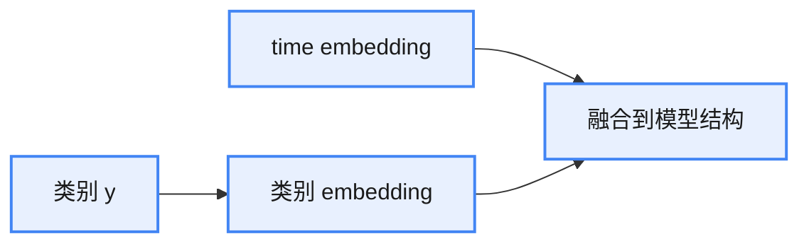

**cfg推理过程**

推理过程：从大到小遍历 timestep（$t = T, T-1, \dots, 1$），每一步依次做无条件预测与条件预测，组合均值后重参数化得到 $x_{t-1}$（见上面的公式）：

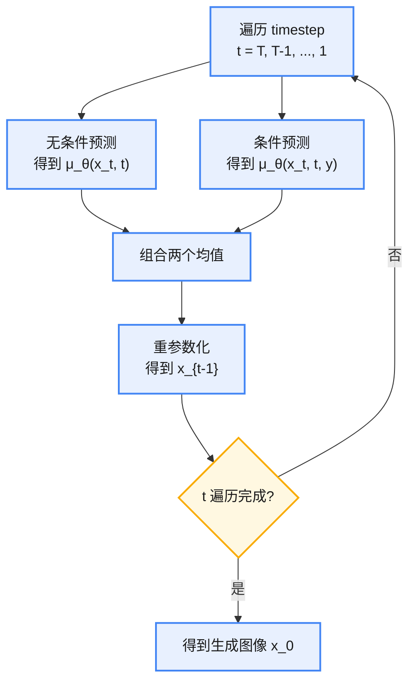

### Cross-Attention

文本与图像条件采用 cross-attention 的形式进行融合，结构如下：

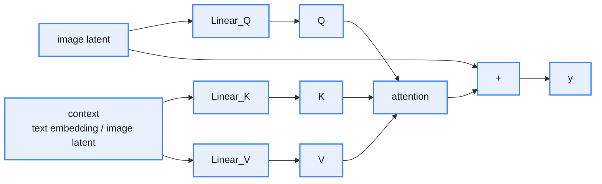

## SD XL

相比 SD1.5/2.0，SDXL 的主要改进如下：

* 更大的模型：使用更多的 transformer block（0.8B → 2.6B 参数）
* 更强的 VAE：使用 MAE、更大的 batch size 训练

### 双文本编码器

由单个 CLIP 文本编码器改为两个文本编码器：

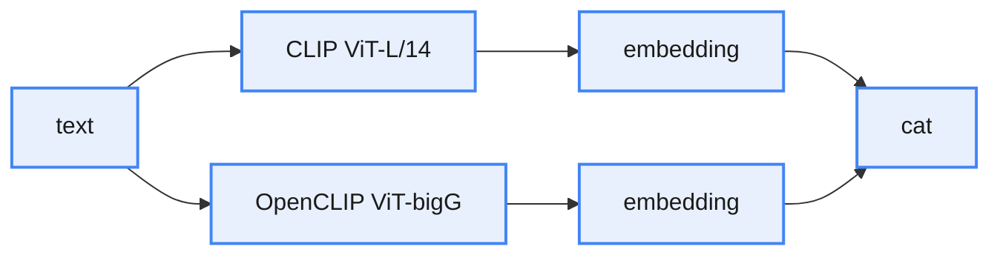

### 更多条件控制

* 针对小分辨率图像：进行 resize，但增加原始尺寸的分辨率信息（宽高）作为 condition：$(H_{\text{orig}}, W_{\text{orig}})$ ——"告诉模型原始尺寸大小"
* 针对预处理：预处理会进行 random crop，需要增加 crop 信息：$(crop_{\text{top}}, crop_{\text{left}})$ ——"告诉模型裁剪信息，推理时为 $(0, 0)$"
* 针对多分辨率：数据分桶，增加 bucket size 作为 condition：$(H_{\text{bucket}}, W_{\text{bucket}})$ ——"告诉模型生成图的尺寸"

各条件与文本、时间步的融合方式：

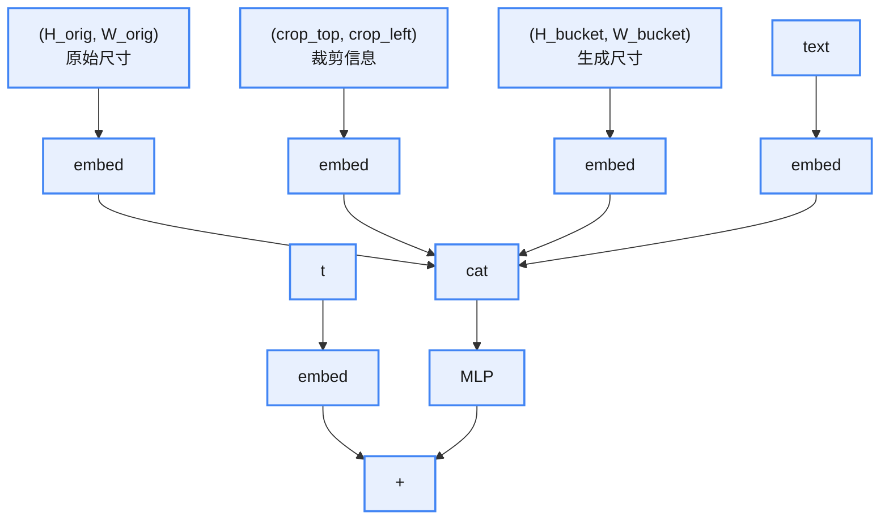

### base + refiner 级联结构

* base：高噪声 → 中噪声
* refiner：中噪声 → 低噪声，用于优化 base 生成不好的细节，结构和 base 一样

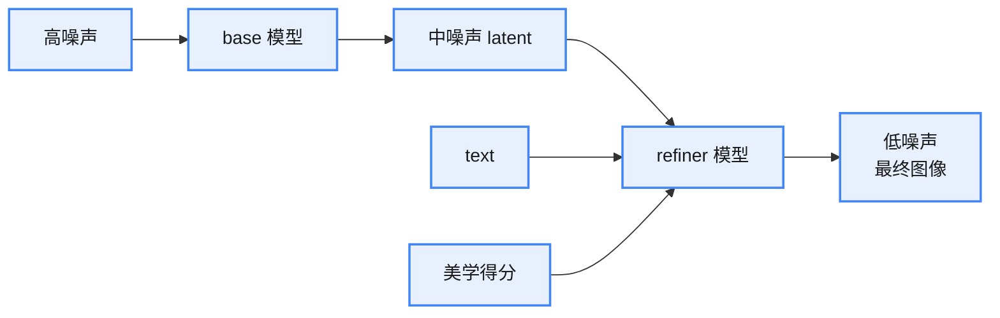

## SD 3.0

### Rectified Flow 直线流

Rectified Flow 是 Flow Matching 的一个特殊、最简单的实例——它选用了最简单的路径（线性插值）和最简单的目标速度场。

Flow Matching 学习一个连续时间的向量场 $v_\theta$，把一个简单分布（如高斯）连续地变换为数据分布。Flow Matching 不固定路径，只要求定义一条路径：

$$x_t = \phi(x_0, x_1, t), \qquad t \in [0, 1] \qquad (10)$$

其中：

* $x_0 \sim p_0$：源分布（如高斯噪声）
* $x_1 \sim p_1$：目标分布（真实数据）
* $\phi$：任意可微的插值路径（线性、曲线、非线性都可以）

路径一旦给定，就有真实速度：

$$u_t(x_0, x_1) = \frac{d\phi(x_0, x_1, t)}{dt} \qquad (11)$$

训练目标：

$$\mathcal{L}_{\text{FM}}(\theta) = \mathbb{E}\left[\left\|v_\theta(x_t, t) - u_t(x_0, x_1)\right\|^2\right] \qquad (12)$$

Rectified Flow 本质上做了一件事：选了一条"最简单"的路径：

* 路径：$x_t = (1 - t)x_0 + t x_1$
* 速度场：$u_t = x_1 - x_0$
* 目标：$\mathcal{L}_{\text{RF}}(\theta) = \mathbb{E}\left[\left\|v_\theta(x_t, t) - (x_1 - x_0)\right\|^2\right]$

直线流的含义：把复杂的概率流拉直（rectify），变成从 $x_0$ 指向 $x_1$ 的直线运动——噪声点 → 数据点，而不是 diffusion 那种"走一步退半步"的随机轨迹。

SD3.0 论文中推导出一个结论：学习速度等价于对 Diffusion 中的噪声预测做一个时间相关的加权。从概率角度可以推导出速度场为（省略推导过程）：

$$\begin{aligned}
v_\theta(x_t, t)
&= \frac{1}{\alpha_t} x_t - \left(\frac{\sigma_t}{\alpha_t} + 1\right)\varepsilon_\theta(x_t, t) \\
&= \underbrace{\frac{1}{\alpha_t} x_t}_{\text{确定项}} - \underbrace{\left(\frac{\sigma_t}{\alpha_t} + 1\right)\varepsilon_\theta(x_t, t)}_{\text{噪声预测} \times \text{权重}}
\end{aligned} \qquad (13)$$

目标变为（时间相关的噪声加权）：

$$\mathcal{L} = w(t) \cdot \left\|\varepsilon_\theta(x_t, t) - \varepsilon\right\|^2 \qquad (14)$$

其中 $w(t)$ 是时间相关的权重系数。

两种推导角度的对比：

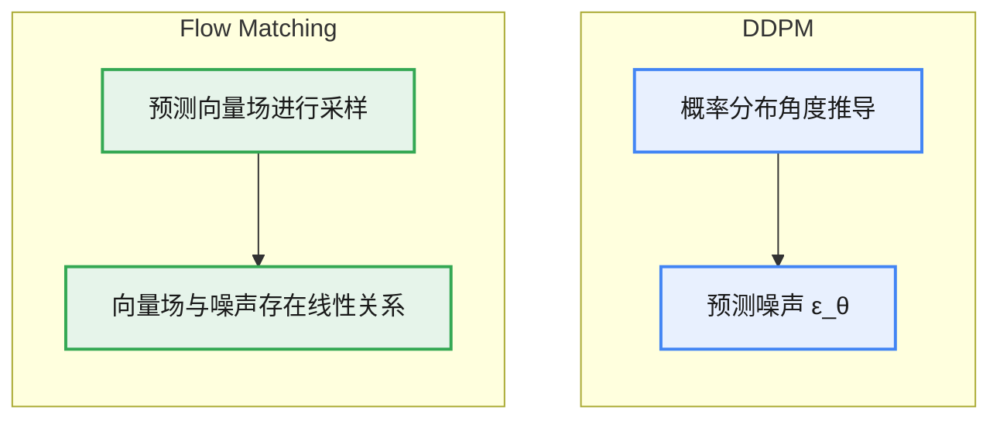

### MMDiT（Multi-Modal DiT）

SD3.0 采用 MMDiT 架构，将图像与文本双分支 Transformer 深度融合，实现更强的跨模态对齐与语义组合能力：

MMDiT 结构

pooled text embedding 是对整段文本 token embedding 的全局汇聚表示，用来表达"这句话整体在说什么"。

关键：作为全局条件向量。

只用 token embedding 的不足：

1. Transformer block 很深，全靠 cross-attention：成本高、不稳定
2. 全局语义如果只靠 token：容易"局部对齐、整体跑偏"
3. pooled embedding 提供：稳定的全局锚点

融合方式：pooled text embedding 与 time embedding 相加后，经 MLP（维度 $dim \to 6 \cdot dim$）得到 scale、shift，作用于 LayerNorm 之后的特征：

$$h = \mathrm{LN}(x), \qquad \text{output} = h \cdot (1 + \text{scale}) + \text{shift} \qquad (15)$$

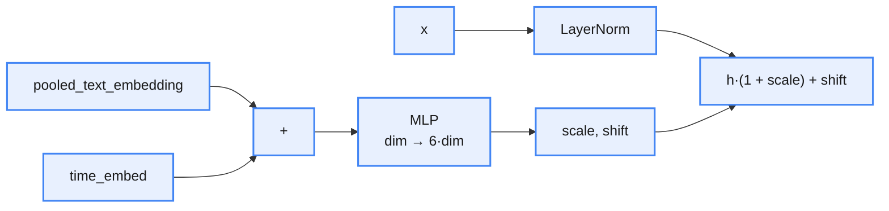

## FLUX

FLUX 在 SD3.0 的基础上进行改进，主要有以下版本：

* pro：最强模型
* dev：蒸馏模型
* schnell：时间戳蒸馏模型

相比 SD3.0 的主要改变：

* 文本编码器：三个 → 两个
* pack_latent
* Single-DiT
* 并行注意力
* RoPE 位置编码

### pack_latent

FLUX 对 latent 进行重新打包，减少 latent token 数量。SD3.0 与 FLUX1.0 的 latent 维度对比：

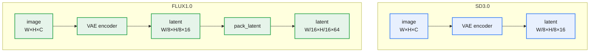

用更少但更语义化的 latent token，换取更稳定的 ODE 流和更强的构图一致性；而 SD3.0 更依赖 MMDiT 结构本身来消化细粒度 latent。

### Single-DiT

在 MMDiT 的基础上增加 Single-DiT 模块：先用 MMDiT block 实现两个模态信息的融合，然后再接 Single-DiT block 加深模型深度，增强模型学习能力的同时，还能节省一些参数：

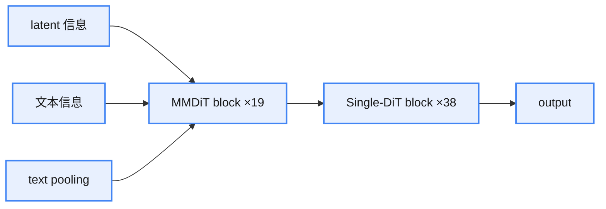

### 并行注意力

常规注意力机制：$x \to \mathrm{attention} \to \mathrm{MLP}$；并行注意力机制：$x \to \mathrm{attention} \to +$，同时 $x \to \mathrm{MLP} \to +$，两个分支相加：

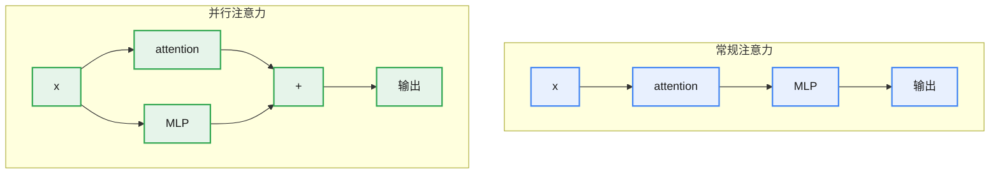

### RoPE 位置编码

相比传统的绝对位置编码，RoPE 更注重局部关系的建模。

* 传统编码：$x_i' = x_i + p_i$（无法直接感知两个 token 之间的相对位置信息）
* RoPE：给定一个位置 $i$，用一个旋转矩阵进行角度旋转（二维）

$$R_{\theta_i} = \begin{bmatrix} \cos \theta_i & -\sin \theta_i \\ \sin \theta_i & \cos \theta_i \end{bmatrix}, \qquad \theta_i = i \cdot w \qquad (16)$$

attention 表示为：

$$\mathrm{Attention}(Q, K) = \mathrm{softmax}\left(\frac{QK^T}{\sqrt{d}}\right) \qquad (17)$$

带入旋转因子可以得到：

$$\begin{aligned}
Q_i' &= Q_i R_{\theta_i} \\
K_j' &= K_j R_{\theta_j} \\
Q_i' K_j'^T &= Q_i R_{\theta_i}\left(K_j R_{\theta_j}\right)^T = Q_i R_{\theta_i} R_{\theta_j}^T K_j^T = Q_i R_{\theta_i - \theta_j} K_j^T
\end{aligned} \qquad (18)$$

（$R$ 为正交矩阵，$R_{\theta_j}^T = R_{-\theta_j}$，因此相对位置只取决于角度差 $\theta_i - \theta_j$。）

RoPE 多维度扩展：将高维向量划分成多个二维子空间，每个子空间用不同的旋转频率：

$$x = [x_1, x_2, x_3, x_4, \dots] \;\Rightarrow\; (x_1, x_2), (x_3, x_4), (x_5, x_6), \dots \qquad (19)$$

每一对都代表一个二维平面，对于第 $k$ 对，旋转角度为：

$$\theta_{i,k} = i \cdot w_k, \qquad w_k = \frac{1}{10000^{2k/d}} \qquad (20)$$

将所有子向量拼起来，得到整个 $x_i'$。

## SDXL Turbo

SDXL Turbo 是基于 SDXL 架构、通过蒸馏技术训练得到的快速生成模型，能够在保持高质量生成的前提下实现单步生成（或 4 步推理），大幅提升推理速度。

SDXL 训练流程：

SDXL 训练流程

SDXL-Turbo 蒸馏训练流程

训练过程需要训练一个额外的判别器（Discriminator），它仅在训练阶段存在，是对抗损失计算的核心，与学生模型、冻结的教师模型共同构成完整的训练框架。

#### 判别器

* 输入：融合图像、时间步、文本条件等信息，输出无 sigmoid 的真假分数
* 具体实现：在 DINO encoder 的不同层级上加上判别头

DINO encoder 结构

$$L_D = \mathbb{E}_{x_0}\left[\sum \max\left(0, 1 - D(F(x_0)) + \gamma R_1\right)\right] + \mathbb{E}_{x_\theta}\left[\sum \max\left(0, 1 + D(F(x_\theta))\right)\right] \qquad (21)$$

#### 生成器损失

让生成样本 $x_\theta$ 的分数尽量接近 1，欺骗判别器：

$$L_G = -\mathbb{E}_{x_\theta}\left[D(F(x_\theta))\right] \qquad (22)$$

#### 对抗 loss 代码实现

对抗 loss 代码实现

