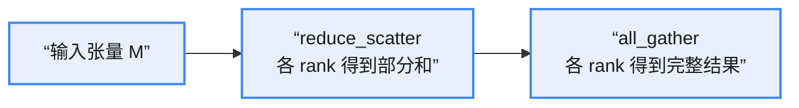

# 通信原语

通信原语示意图

# ring all_reduce

Ring AllReduce（环形全归约）是分布式深度学习训练中核心的通信算法，用于在多 GPU / 多节点间高效同步梯度（或参数），是数据并行训练的关键技术。

它解决了传统 all_reduce（全归约）的性能瓶颈：传统 all_reduce 依赖中心节点转发数据，易出现**通信拥塞**；而 Ring AllReduce 将所有计算节点组织成环形拓扑，通过“分块 + 环形传递”实现无中心、高并行的全局数据聚合，是目前主流框架（如 PyTorch、TensorFlow）默认的分布式通信策略。

**ring all_reduce 达到的效果**：

初始状态：每个节点持有自己的“本地数据”。

比如：

* 节点 A：[A0, A1, A2, A3]
* 节点 B：[B0, B1, B2, B3]
* 节点 C：[C0, C1, C2, C3]
* 节点 D：[D0, D1, D2, D3]

目标：所有节点最终拿到全局求和的完整张量：

`[A0+B0+C0+D0, A1+B1+C1+D1, A2+B2+C2+D2, A3+B3+C3+D3]`

**传统的 all_reduce 算法**：

* 多个节点（GPU）将本地梯度逐级 **Reduce（求和）**；
* 最终在某个（根）节点得到全局结果；
* 然后再 **Broadcast** 回所有节点。

# reduce_scatter

ring all_reduce 算法如下：

ring all_reduce = reduce_scatter + all_gather

下面以一个例子说明工作原理：

* N：设备数目，此例中为 4
* M：张量维度
* 对张量进行 chunk：M → chunk → M/N
* 假设 chunk 后的张量维度为 `[A_rank, B_rank, C_rank, D_rank]`

每个 rank 发送和接收的索引：

$$\mathrm{send\_idx} = (rank - s) \bmod N \qquad (1)$$

$$\mathrm{recv\_idx} = (rank - s - 1) \bmod N \qquad (2)$$

其中 rank 表示 device id，s 表示步数。

reduce_scatter 示意图

说明：A0 表示 rank 0 持有 A chunk 后的第 0 段数据。

步骤：

* step 1：rank 0 向 rank 1 发送 A0，rank 1 向 rank 2 发送 B1，rank 2 向 rank 3 发送 C2，rank 3 向 rank 0 发送 D3。注意：这里不是简单的顺序传递，而是跨 chunk 的通信。
>step 1 之后，rank 0 持有 [A0, B0, C0, D0+D3]，其余 rank 依此类推。
* step 2：rank 0 向 rank 1 发送 D0+D3，rank 1 向 rank 2 发送 A0+A1，其余 rank 依此类推。
> step 2 之后，rank 0 持有 [A0, B0, C0+C2+C3, D0+D3]。
* step 3：rank 0 向 rank 1 发送 C0+C2+C3，rank 1 向 rank 2 发送 D0+D1+D3，其余 rank 依此类推。
> step 3 之后，rank 0 持有完整的 B 数据，rank 1 持有完整的 C 数据，其余 rank 依此类推。

为了让对应的 rank 得到对应的完整数据，加上 shift：

$$\mathrm{send\_idx} = (rank - s + shift) \bmod N \qquad (3)$$

$$\mathrm{recv\_idx} = (rank - s - 1 + shift) \bmod N \qquad (4)$$

shift = 3。

带 shift 的 reduce_scatter 示意图

* step 1：rank 0 向 rank 1 发送 D0，rank 1 向 rank 2 发送 A1，rank 2 向 rank 3 发送 B2，rank 3 向 rank 0 发送 C3。
> step 1 之后，rank 0 持有 [A0, B0, C0+C3, D0]，其余 rank 依此类推。
* step 2：rank 0 向 rank 1 发送 C0+C3，rank 1 向 rank 2 发送 D1+D0，其余 rank 依此类推。
> step 2 之后，rank 0 持有 [A0, B0+B2+B3, C0+C3, D0]。
* step 3：rank 0 向 rank 1 发送 B0+B2+B3，rank 1 向 rank 2 发送 C0+C1+C3，其余 rank 依此类推。
> step 3 之后，rank 0 持有完整的 A 数据，rank 1 持有完整的 B 数据，其余 rank 依此类推。

reduce_scatter 之后，各个 rank 保留对应的数据，去除其他 rank 的数据。

# all_gather

all_gather 示意图

* step 1：rank 0 向 rank 1 发送 A，rank 1 向 rank 2 发送 B，rank 2 向 rank 3 发送 C，rank 3 向 rank 0 发送 D。
* step 2：rank 0 向 rank 1 发送 D，rank 1 向 rank 2 发送 A，rank 2 向 rank 3 发送 B，rank 3 向 rank 0 发送 C。
* step 3：rank 0 向 rank 1 发送 C，rank 1 向 rank 2 发送 D，rank 2 向 rank 3 发送 A，rank 3 向 rank 0 发送 B。

step 3 之后，所有 rank 都拿到所有其他 rank 的数据。

# 通信量分析

**1. reduce_scatter 阶段**：每个 rank 发送的数据量为 $\frac{M}{N}$，共需要 $N-1$ 次通信；接收和发送的数据量相同，因此单节点通信量为：

$$2 \times \frac{M}{N} \times (N-1) \qquad (5)$$

**2. reduce_scatter 的总通信量（逻辑总量）**：

$$2 \times \frac{M}{N} \times (N-1) \times N \qquad (6)$$

但这里的全局通信量是逻辑总量：由于环形拓扑是并行通信，实际网络中不会出现成倍的流量叠加，而是所有节点同时传输，因此有效通信量等价于单节点的通信量（这也是工程中常用的指标）。

**3. all_gather 阶段**：每个 rank 发送的数据量为 $\frac{M}{N}$，共需要 $N-1$ 次通信，通信量为：

$$2 \times \frac{M}{N} \times (N-1) \qquad (7)$$

**4. all_gather 之后**，每个 rank 得到的张量都是完整的 $M$。

**5. 综上**，ring all_reduce 的总通信量为：

$$4 \times \frac{M}{N} \times (N-1) \approx 4M \qquad (8)$$

当 $N$ 足够大时，总通信量约为 $4M$。
