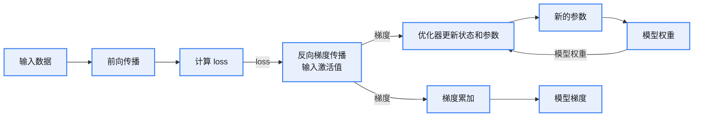
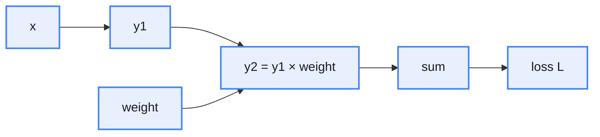

# 并行策略分类

<div style="text-align:center; margin:1em 0;">

<p style="color:#888; font-size:0.92em; margin:0.25em 0 0;">并行策略分类</p>
</div>

# 训练流程



说明：

* checkpoint 一定包含模型权重；
* 训练过程中必须开辟并使用梯度空间和优化器状态空间；
* 例如：在反向传播过程中，参数必须有对应的梯度缓冲区，用于梯度计算与（可能的）梯度累计。

# DDP

<div style="text-align:center; margin:1em 0;">

<p style="color:#888; font-size:0.92em; margin:0.25em 0 0;">DDP 图例表示</p>
</div>

<div style="text-align:center; margin:1em 0;">

<p style="color:#888; font-size:0.92em; margin:0.25em 0 0;">DDP 流程图</p>
</div>

1. 前向过程 + 反向过程是正常的传播过程；
2. 反向后需要对每个 rank 的梯度做 all_reduce 归约，得到**全局梯度**；
3. 优化器基于第 2 步得到的全局梯度进行状态更新和参数更新。

# ZeRO-1

ZeRO 也属于数据并行，是一种分片的数据并行策略。

<div style="text-align:center; margin:1em 0;">

<p style="color:#888; font-size:0.92em; margin:0.25em 0 0;">ZeRO-1 流程图</p>
</div>

1. 前向过程与反向过程和正常训练流程一致；
2. 反向后的梯度归约和 DDP 一致；
3. 优化器更新时，每个 rank 只有**部分的优化器状态**，基于这部分优化器状态和全局梯度：
   1. 更新当前 rank 的优化器状态；
   2. 更新当前 rank 的参数。
4. all_gather 聚合所有更新后的参数，继续迭代。

PS：上面的 all_reduce 是有冗余的——后面梯度更新只用了部分的梯度。

# ZeRO-2

<div style="text-align:center; margin:1em 0;">

<p style="color:#888; font-size:0.92em; margin:0.25em 0 0;">ZeRO-2 流程图</p>
</div>

1. 前向过程和正常训练流程一致；
2. 反向时，只更新当前 rank 的**部分梯度**；
3. 反向后，通过 reduce_scatter 得到**全局部分梯度**（对当前 rank 的部分梯度在不同 rank 上做归约）；
4. 优化器更新同 ZeRO-1，不过这里得到的就是局部梯度，所以不需要切片；
5. 更新完状态与参数之后，聚合所有更新好的参数，进行下一步迭代。

# ZeRO-3

<div style="text-align:center; margin:1em 0;">

<p style="color:#888; font-size:0.92em; margin:0.25em 0 0;">ZeRO-3 流程图</p>
</div>

1. 前向时，先 all_gather 得到所有的模型参数，计算激活值，计算完成之后立即拆分；
2. 反向时，all_gather 得到所有的模型参数，计算梯度值，进行梯度累加；
3. 反向后，通过 reduce_scatter 得到当前 rank 的**全局部分梯度**，同 ZeRO-2；
4. 梯度更新过程同 ZeRO-2，不同的是对更新完的梯度不需要再做聚合，因为下一次迭代的前向时会进行聚合。

# 通信量与显存比较

|**策略**|**显存（静态）**|**通信策略**|**通信量**|
|:---|:---|:---|:---|
|DDP|参数 4σ +<br/>梯度 4σ +<br/>优化器状态 8σ|反向后的 all_reduce|4 × 4σ × (N-1) / N|
|ZeRO-1|参数 4σ +<br/>梯度 4σ +<br/>优化器状态 8σ / N|反向后的 reduce_scatter +<br/>更新参数后的 all_gather|4 × 4σ × (N-1) / N|
|ZeRO-2|参数 4σ +<br/>梯度 4σ / N +<br/>优化器状态 8σ / N|反向后的 reduce_scatter +<br/>更新参数后的 all_gather|4 × 4σ × (N-1) / N|
|ZeRO-3|参数 4σ / N +<br/>梯度 4σ / N +<br/>优化器状态 8σ / N|前向前的 all_gather +<br/>反向前的 all_gather +<br/>反向后的 reduce_scatter|6 × 4σ × (N-1) / N|

## 分布式策略通信量比较

### DDP（分布式数据并行）

* 机制：每个进程维护完整的模型参数 $P$、梯度 $G$ 和优化器状态 $O$。反向传播后，通过 `AllReduce` 同步所有进程的梯度，再各自更新参数。
* 通信操作：仅梯度 AllReduce（**反向后**）。
* 通信量：all_reduce（等价于 reduce_scatter + all_gather）。

<div style="text-align:center">

$$DDP = \frac{2(N-1)}{N} \times G + \frac{2(N-1)}{N} \times G = \frac{4(N-1)}{N} \times G \qquad (1)$$

</div>

注意：这里忽略了第一次需要 broadcast 所有参数到各个 rank。

### ZeRO-1（优化器状态分片）

* 机制：仅优化器状态 $O$ 分片（每个进程 $O/N$），参数 $P$ 和梯度 $G$ 完整复制。反向传播后：
  1. 先通过环形 AllReduce 同步梯度（**反向后**），得到完整 $G_{global}$；
  2. 用 $G_{global}$ 更新本地优化器状态分片（**更新优化状态 state**），得到参数更新量的**分片** $\Delta P_i$（大小 $P/N$，因 $O$ 分片对应参数分片）；
  3. 最后通过环形 AllGather（**更新状态之后**）收集所有 $\Delta P_i$，得到完整 $\Delta P$（大小 $P$），并更新本地参数。
* 通信操作：
  * 梯度环形 AllReduce；
  * 参数更新量环形 AllGather。
* 通信量：reduce_scatter + all_gather × 2

<div style="text-align:center">

$$ZeRO\text{-}1 = \frac{2(N-1)}{N} \times G + \frac{2(N-1)}{N} \times G + \frac{2(N-1)}{N} \times G = \frac{6(N-1)}{N} \times G \qquad (2)$$

</div>

### ZeRO-2（梯度 + 优化器状态分片）

* 机制：优化器状态 $O$ 和梯度 $G$ 均分片，参数 $P$ 完整复制。反向传播后：
  1. 通过环形 ReduceScatter 聚合梯度分片，每个进程得到自己负责的参数分片的全局梯度 $G_{global,i}$（**反向后**）；
  2. 用 $G_{global,i}$ 更新本地 $O$ 分片，得到参数更新量分片 $\Delta P_i$（大小 $P/N$）；
  3. 通过环形 AllGather 收集所有 $\Delta P_i$（**更新状态之后**），得到完整 $\Delta P$，并更新本地参数。
* 通信操作：
  * 梯度环形 ReduceScatter；
  * 参数更新量环形 AllGather。
* 通信量：ReduceScatter + AllGather

<div style="text-align:center">

$$ZeRO\text{-}2 = \frac{2(N-1)}{N} \times G + \frac{2(N-1)}{N} \times G = \frac{4(N-1)}{N} \times G \qquad (3)$$

</div>

### ZeRO-3（参数 + 梯度 + 优化器状态分片）

* 机制：参数 $P$、梯度 $G$、优化器状态 $O$ 均分片（每个进程 $P/N$、$G/N$、$O/N$）。
  * 前向传播：需环形 AllGather 当前层**参数**分片，得到完整参数 $P_{layer}$；
  * 反向传播：计算梯度分片 $G_{local,i}$，通过环形 ReduceScatter 聚合为全局梯度分片 $G_{global,i}$；
  * 参数更新：用 $G_{global,i}$ 更新本地 $O$ 分片，得到 $\Delta P_i$（AllGather）。
* 通信操作：
  * 前向参数环形 AllGather；
  * 反向梯度环形 ReduceScatter；
  * 参数更新量环形 AllGather。
* 通信量计算：all_gather + reduce_scatter + all_gather

<div style="text-align:center">

$$ZeRO\text{-}3 = \frac{2(N-1)}{N} \times G + \frac{2(N-1)}{N} \times G + \frac{2(N-1)}{N} \times G = \frac{6(N-1)}{N} \times G \qquad (4)$$

</div>

# Q&A

**疑问**：

1. ZeRO-1 的 all_reduce 为什么是冗余的？
2. ZeRO-2 的梯度分片是很有性价比的？
3. ZeRO-3 的反向前为什么需要 all_gather？
4. ZeRO-3 前向后和反向前的 all_gather 能不能合并？

## ZeRO-1 的 all_reduce 为什么是冗余的？

假设有两个设备：rank 0 和 rank 1。

rank 0 得到的梯度：$G_0 = [G_{00}, G_{01}]$

rank 1 得到的梯度：$G_1 = [G_{10}, G_{11}]$

更新参数前需要归约所有梯度：$G = G_0 + G_1 = [G_{00} + G_{10}, G_{01} + G_{11}]$

优化器状态这里将其表示为 S，其中 $S = [S_0, S_1]$。

更新参数时，ZeRO-1 只有部分优化器状态，表示为：

* rank 0 的优化器状态：$S_0$
* rank 1 的优化器状态：$S_1$

S 与 G 的对应关系：S 是划分的，G 是完整的，所以 $S_0$ 和 $G_{00} + G_{10}$ 对应（注意这里不是 $G_0$，而是 $G_0$ 和 $G_1$ 的部分归约）；$S_1$ 和 $G_{01} + G_{11}$ 对应。

rank 0 更新参数：$S_0$ 和 $G_{00} + G_{10}$ → 更新 → 参数 $p$ 的一部分和状态 $S_0$

rank 1 更新参数：$S_1$ 和 $G_{01} + G_{11}$ → 更新 → 参数 $p$ 的一部分和状态 $S_1$

可以看到，rank 0 真正使用的梯度只有 $G_{00} + G_{10}$，rank 1 真正使用到的梯度是 $G_{01} + G_{11}$。

**所以，每个 rank 不需要完整的 G，也就不需要进行 all_reduce，只需进行 reduce_scatter**：

rank 0 得到的梯度（$G_0 = [G_{00}, G_{01}]$）与 rank 1 得到的梯度（$G_1 = [G_{10}, G_{11}]$）进行 reduce_scatter：

* rank 0 得到：$[G_{00} + G_{10}]$
* rank 1 得到：$[G_{01} + G_{11}]$

## ZeRO-2 的梯度分片是很有性价比的？

ZeRO-2 在 ZeRO-1 的基础上增加了梯度划分。根据上面 1 的分析可以看到，**梯度不进行划分 + 优化器进行划分**的组合，在进行优化器更新的时候也只用到部分梯度。

这说明每个 rank 持有全局的梯度是冗余的，对梯度进行划分可以在通信量不增加的基础上，节约显存的使用。

## ZeRO-3 的反向前为什么需要 all_gather？

来看看反向是怎么计算的，看这个例子：



反向传播的目的是计算 loss 对 weight 的梯度，但是计算过程会用到 loss 对 x 的梯度。

这个例子中，sum 的梯度是 1，反传到上一步；y2 由 y1 和 weight 组成，所以需要求 $grad_{y1}$ 和 $grad_{weight}$。

根据链式法则：

$\frac{\partial L}{\partial y_1} = \frac{\partial L}{\partial y_2} \cdot \frac{\partial y_2}{\partial y_1}$，等价于 $grad_{y1} = grad_{y2} \cdot \frac{\partial y_2}{\partial y_1} = grad_{y2} \cdot weight$；

$\frac{\partial L}{\partial weight} = \frac{\partial L}{\partial y_2} \cdot \frac{\partial y_2}{\partial weight}$，等价于 $grad_{weight} = grad_{y2} \cdot \frac{\partial y_2}{\partial weight} = grad_{y2} \cdot y1$。

所以可以看到 $grad_{y1} = grad_{y2} \times weight$，这里的 weight 需要是完整的。

**反向传播中，求“上一层输入的梯度”，一定需要用到“当前层的权重参数值”。**

## ZeRO-3 前向后和反向前的 all_gather 能不能合并？

ZeRO-3 的显存模型是：

```
时间轴：  FWD all_gather ─── compute ─── FREE ────（很久）─── BWD all_gather
```

forward 和 backward 之间：

* 有其他 layer 的 forward；
* 有 activation checkpoint 重算；
* 显存压力极大。

所以合并不了。
