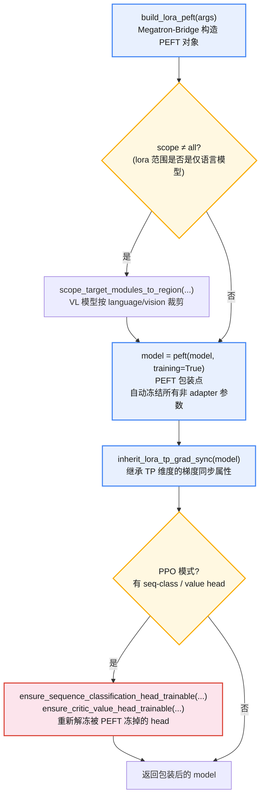
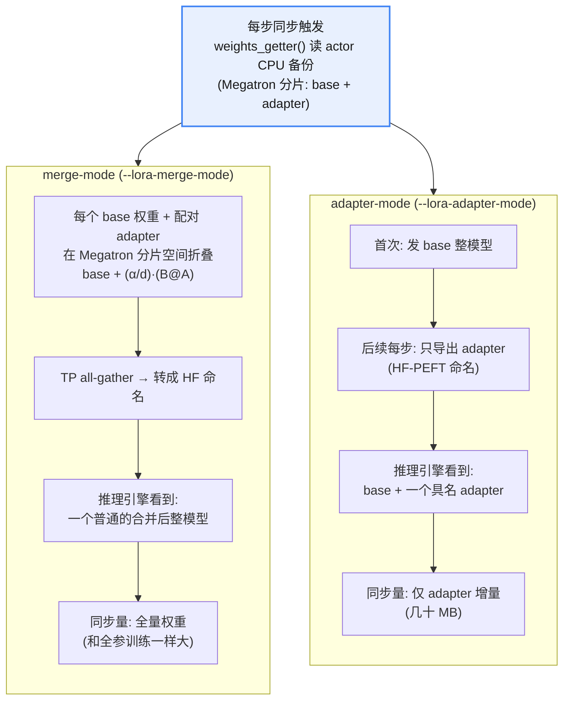
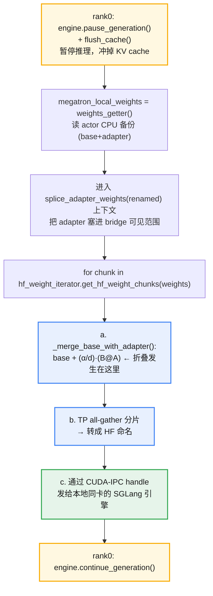
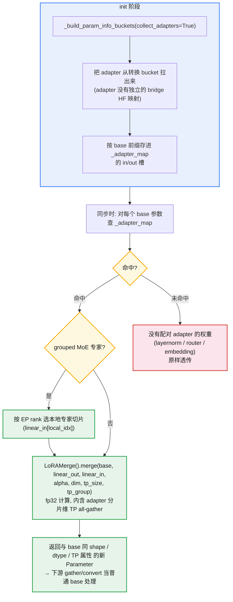
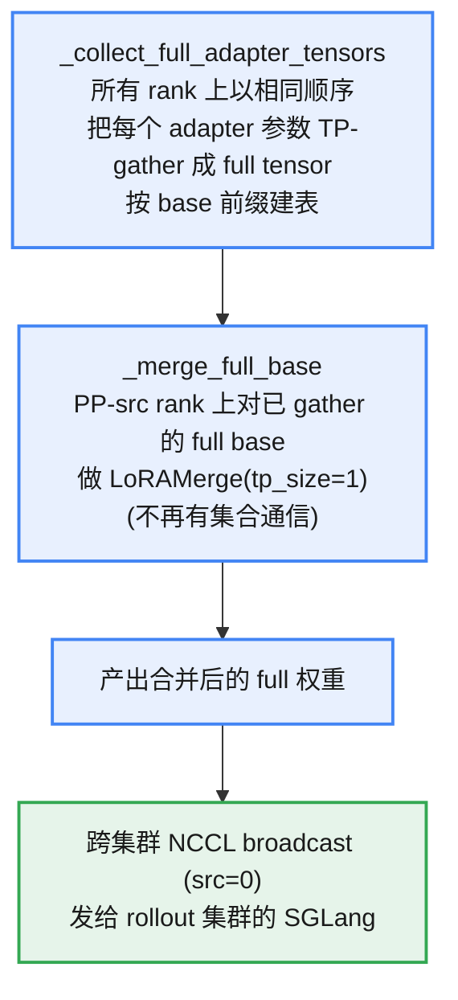
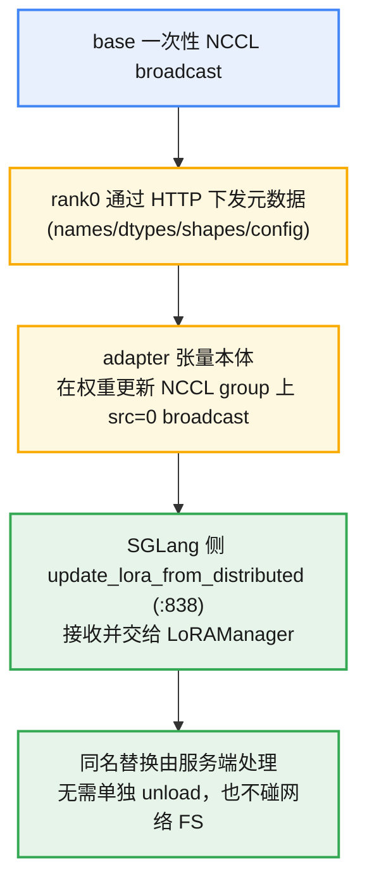
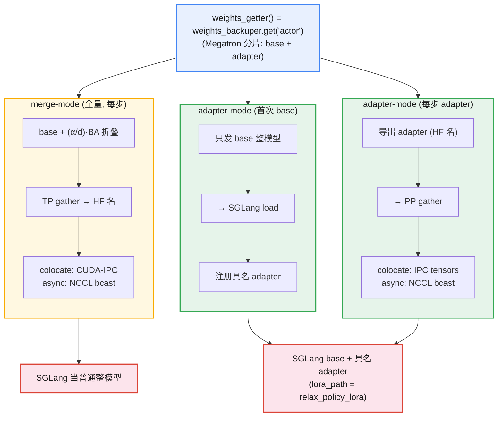

# Relax LoRA 机制

slime 当前还没有 lora 训练的支持（2026.10.23），relax（小红书） 和 miles（radixark） 是 slime 衍生出来的两个框架，具备 lora 支持，本文探索 relax lora 机制。

## 1. Train 侧适配（PEFT 包装）

唯一注入点在 model_provider.py：

```python
if is_lora_enabled(args):
    model_provider = wrap_model_provider_with_lora(model_provider, args, role)
```
`wrap_model_provider_with_lora(provider, args, role="actor")` 的流程：


**PPO 需要注意的点：critic 价值头需要解冻更新**

critic 的价值头是全新随机初始化的标量 `LinearForLastLayer`，必须可训练。但
`peft(model, training=True)` 会把它一起冻成 `requires_grad=False` →
Megatron DDP 把它排除出 param buffer → `validate_critic_value_head_registration`
的 DDP-ownership 断言在 critic 初始化时就崩。

修复在 ppo_utils.py 的
`ensure_critic_value_head_trainable(model, args, role, post_process)`，门控
`role=="critic" and post_process`，把价值头重新置 `requires_grad=True`。语义：
critic backbone 走 LoRA adapter（省显存），**价值头全秩训练**。

> 价值头不是 adapter、也不参与 rollout 的 merge-sync（只有 actor sync 到 SGLang），所以让它可训练不会污染 rollout 权重路径。
> 目前（2026.10.23） Relax 对 PPO-lora 没有适配，需要手动适配，这里采用的是 critic backbone 采用 lora adapter 的路线。
## 2. Rollout 侧适配的两种方式

训练与推理用的是两套不同的权重表示：

* 训练侧：Megatron 分片（TP/PP/EP/CP）+ LoRA adapter 旁路（`base.to_wrap.weight` 冻结 + `adapter.linear_in/out` 可训练）。
* 推理侧（SGLang）：HF 命名的整模型权重；要么是 合并后的 base（merge-mode），要么是 base + 一个具名 adapter（adapter-mode）。

所以 rollout 侧适配的本质是：每次权重同步时，把训练侧的 LoRA 表示"翻译"成 SGLang
能吃的表示。训练侧有两种 lora 权重存在的模式——merge mode & adapter mode，两种模式的翻译策略完全不同。

|**模式**|**开关**|**推理引擎看到的东西**|**每步同步内容**|
|:---|:---|:---|:---|
|**merge-mode**|`--lora-merge-mode`|一个普通的合并后整模型|base+adapter 折叠后的 **全量权重**|
|**adapter-mode**|`--lora-adapter-mode`|base + 一个具名 LoRA adapter|仅 **adapter 增量**|


### 2.1 merge-mode —— 推理侧无感知

推理引擎当成普通整模型加载，**完全不知道有 LoRA**。关键是在权重同步链路里，把每个
base 权重和它配对的 adapter 在 **Megatron 分片空间里** 折成
`base + (alpha/dim)·(B@A)`，再走和非 LoRA 完全一样的 gather→HF 转换→发送路径。

* 优点：推理侧零改动，支持分布式（fully-async）rollout
* 代价：每步同步 **全量权重**（和全参训练一样大）

### 2.2 adapter-mode —— 推理侧原生 LoRA

base 权重 **只在首次同步一次**，之后每步只推 **adapter 增量**。推理引擎用
SGLang 原生 LoRA API（`--enable-lora`，`dp_size==1`，`max_loras_per_batch=1`）
挂载一个具名 adapter（`LORA_ADAPTER_NAME = "relax_policy_lora"`），rollout 请求
带 `lora_path=lora_name`。

* 优点：每步同步量极小（只有 adapter，几十 MB）
* 约束：colocate 下 base 靠 SGLang 的 `enable_weights_cpu_backup` 跨 sleep/wake 恢复；
* colocate 的 tensor 传输用 `load_lora_adapter_from_tensors`；fully-async 用 `update_lora_from_distributed`。

## 3. 权重传输：LoRA 训练权重怎么传到 rollout 侧

先交代一个贯穿全程的事实：rollout 同步读的不是模型的 live 权重，而是
TensorBackuper 备份的权重字典。

* actor 每个 train step 之后调用 `backup("actor")`，把 Megatron 参数（含 adapter，adapter 是普通可训练参数，也会被备份）快照进 **pinned-CPU** 字典。
* 同步时的 `weights_getter()` = `weights_backuper.get("actor")` 返回这个字典。
* 这样做是因为 colocate 下 actor sleep 后 live 权重被释放 / 被 SGLang 复用，必须从一份稳定的 CPU 备份里读。adapter 的键用 `is_lora_adapter_param()` 识别
（同时匹配 bridge 的 `adapter.linear_*` 和 PEFT 的 `lora_*` 两种命名）。

权重传输与训练侧 lora 权重存在的模式和共卡/分卡部署方式有关系。下面按**模式 × 部署**拆开讲数据流。

### 3.1 merge-mode × colocate

编排入口 update_weight_from_tensor.py


lora 权重折叠逻辑：


### 3.2 merge-mode × fully-async

逻辑同上，但折叠和传输在独立的权重服务里，见下图：


### 3.3 adapter-mode × colocate

```mermaid
flowchart TB
    subgraph FIRST["首次同步 _sync_base_and_lora"]
        direction TB
        F1["暂停推理"]
        F2["weights = weights_getter()"]
        F3["发 BASE 权重<br/>迭代器 collect_adapters=True<br/>adapter 从转换 bucket 拉出、不合并<br/>只有 base 走 SGLang load_weights"]
        F4["prev_state = {adapter 参数快照}<br/>后续 delta 比较的基线"]
        F5["_push_lora_adapter(first_sync=True)<br/>注册 adapter"]
        F1 --> F2 --> F3 --> F4 --> F5
    end

    subgraph STEP["后续每步 _sync_lora_delta_only"]
        direction TB
        S1["all_params = weights_getter()"]
        S2["should_skip():<br/>gloo MAX all-reduce 的集合式 delta 判断<br/>只有 NO rank adapter 超过阈值才整体跳过<br/>"]
        S3{"有变化?"}
        S4["暂停推理"]
        S5["_push_lora_adapter(first_sync=False)"]
        S6["恢复推理"]
        S7["跳过本步同步"]
        S1 --> S2 --> S3
        S3 -- 否 --> S7
        S3 -- 是 --> S4 --> S5 --> S6
    end

    subgraph PUSH["_push_lora_adapter: adapter 导出与推送"]
        direction TB
        P1["a. export_local_adapter()<br/>在 splice_adapter_weights 上下文里用 bridge<br/>export_adapter_weights 导出 HF-PEFT 命名<br/>(TP 已被 bridge gather)<br/>再 repack_gdn_adapter_for_sglang 处理 GDN 融合"]
        P2["b. gather_full_adapter(all_gather=True)<br/>PP 维 gather (adapter 只在 PP 维变化；TP 已 gather、DP 是副本)<br/>→ 每个引擎的 gather-src rank 持有完整 adapter"]
        P3["c. 每个引擎的 gather-src rank:<br/>set_sharing_strategy('file_system')  # IPC fd 过不了 Ray→HTTP，改用 /dev/shm<br/>serialized = MultiprocessingSerializer.serialize(tensors)<br/>engine.unload_lora_adapter(name)  # 非首次：先卸旧 (容忍 already-gone)<br/>engine.load_lora_adapter_from_tensors(name, serialized, config_dict)"]
        P1 --> P2 --> P3
    end

    FIRST --> STEP
    STEP -- "有变化" --> PUSH

    classDef first fill:#E8F0FE,stroke:#4285F4,stroke-width:2px,color:#1a1a1a
    classDef step fill:#FFF8E1,stroke:#F9AB00,stroke-width:2px,color:#1a1a1a
    classDef push fill:#E6F4EA,stroke:#34A853,stroke-width:2px,color:#1a1a1a
    class FIRST first
    class STEP step
    class PUSH push
```


关键点：SGLang 把这个 blob 广播给每个 TP worker，各自 `slice_lora_a/b_weights`
切自己的分片，所以必须序列化 **host 张量**（CUDA-IPC handle 过不了 GPU-隔离的 worker
 fan-out）。

### 3.4 adapter-mode × fully-async

base 一次性 NCCL broadcast；adapter 走如下路径：


### 3.5 SGLang 引擎侧接口

|**方法**|**用途**|
|:---|:---|
|`load_lora_adapter_from_tensors`|colocate：从序列化 host 张量直接加载 adapter（无磁盘 IO）|
|`update_lora_from_distributed`|fully-async：从 NCCL broadcast 接收 adapter|
|`unload_lora_adapter`|卸载具名 adapter（同名刷新前先卸旧）|

引擎启动时 adapter-mode 需配置 `enable_lora=True` / `max_lora_rank` /
`lora_target_modules`（SGLang flavor 命名） / `max_loras_per_batch=1`。

### 3.6 一张图看清三条路径


