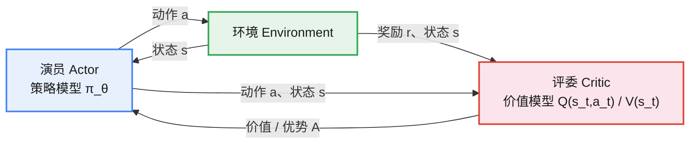
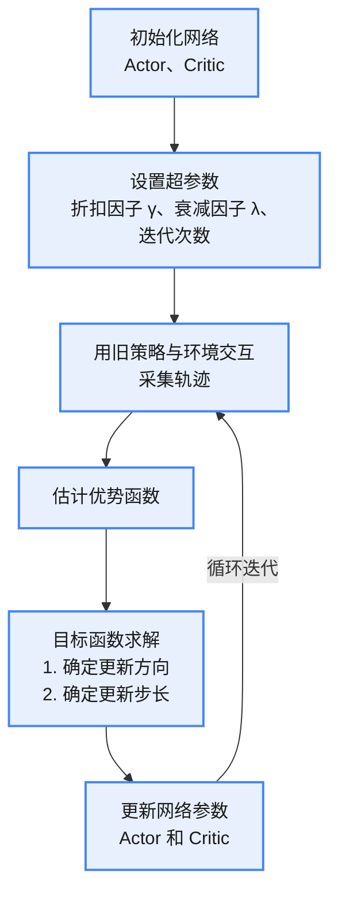
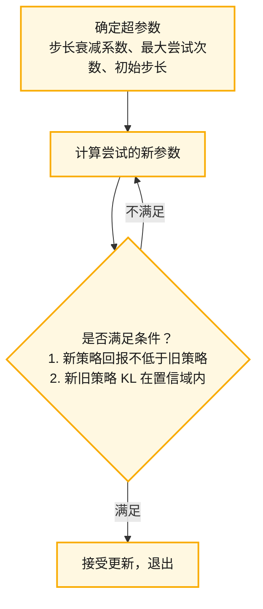

# 简介

Actor–Critic（AC）架构把**策略优化**与**价值估计**结合起来：Actor 学习策略，Critic 评估策略。Critic 通常用优势函数衡量某个动作相对平均水平的好坏，为 Actor 提供低方差、方向更准确的更新信号。

**关键技术**

* **GAE（广义优势估计）**：在偏差与方差之间折中，对多步 TD 误差做加权累计，进一步提升训练稳定性。
* **TRPO**：一种重要的 AC 方法，通过重要性采样在旧策略数据上近似新策略的期望目标，并引入置信域（Trust Region）约束，限制新旧策略之间的 KL 散度，使每一步更新都足够保守，从而在理论和实践上显著提升策略优化的稳定性与可靠性。

# 示意图

## 优化函数

基础版本的 Actor-Critic 架构存在方差大等问题。A2C 算法在此基础上引入**基线（Baseline）**，并进一步构造**优势函数**。具体步骤如下。

1. **引入基线**：基线通常采用**状态价值函数** $V(s)$，即状态 $s$ 下的预期回报。把基线设为 $V(s)$，相当于在每个状态 $s$ 下设定了一个"平均水平"。
2. **构造优势函数**：优势函数衡量在给定状态下，执行某一动作**相对于"平均水平"的优劣**，即动作 $a$ 相对于该状态下其他动作的优势。它关注的是执行某动作的相对优势，而非动作的绝对价值。

优势函数定义为：

$$A(s_t, a_t) = Q(s_t, a_t) - V(s_t) \qquad (1)$$

* $V(s_t)$ 是状态价值函数，表示在状态 $s_t$ 下按当前策略能得到的预期回报，即所有动作的平均表现；
* $V(s_t)$ 可由一个独立的价值网络学习，从而适应策略的变化、提供动态估计，优化估计效果。

将基础 Actor-Critic 策略梯度中的价值项替换为优势函数，得到 Advantage Actor-Critic（A2C）算法：

$$\nabla_\theta J(\theta) = \mathbb{E}_{\tau \sim p(\tau;\theta)}\Big[\sum_{t=0}^{T-1} \nabla_\theta \log \pi_\theta(a_t \mid s_t)\, \cdot A(s_t, a_t)\Big] \qquad (2)$$

**优势函数的作用**

引入状态价值函数 $V(s)$ 作为基线并构造优势函数 $A(s,a)$，有多方面意义：

1. **减小梯度估计的方差**：相比基础 AC，使用 $A(s,a)$ 可减小梯度估计的方差，提升训练稳定性。

> 直观理解：引入基线后，每个动作的策略梯度相对于基线的相对值变小了。
2. **增强梯度更新的区分性**：不使用基线时，各动作的 $Q$ 值可能全为正或全为负，策略只能统一地增大或减小所有动作的概率，无法区分动作的相对优劣。使用优势函数后，这些值"有正有负"，梯度更新时能够"奖罚分明"——有选择地增大较优动作的概率、抑制较差动作的概率。

> 直观理解：引入基线后，优势有大于 0 和小于 0 的区分。
**状态价值函数与价值模型的合并**

按优势函数的定义，A2C 似乎既需要一个模型算动作价值 $Q$，又需要一个模型算状态价值 $V$。幸运的是，二者可通过贝尔曼方程相互转化：

$$Q(s_t, a_t) \approx r + \gamma V(s_{t+1}) \qquad (3a)$$

优势函数随之化为：

$$A(s_t, a_t) = Q(s_t, a_t) - V(s_t) = r + \gamma V(s_{t+1}) - V(s_t) \qquad (3b)$$

策略梯度可表示为：

$$
\begin{aligned}
\nabla_\theta J(\theta)
&= \mathbb{E}_{\tau \sim p(\tau;\theta)}\Big[\sum_{t=0}^{T-1} \nabla_\theta \log \pi_\theta(a_t \mid s_t)\, \cdot A(s_t, a_t)\Big] \\
&= \mathbb{E}_{\tau \sim p(\tau;\theta)}\Big[\sum_{t=0}^{T-1} \nabla_\theta \log \pi_\theta(a_t \mid s_t)\, \cdot \big(r + \gamma V(s_{t+1}) - V(s_t)\big)\Big] \\
&= \mathbb{E}_{\tau \sim p(\tau;\theta)}\Big[\sum_{t=0}^{T-1} \nabla_\theta \log \pi_\theta(a_t \mid s_t)\, \cdot \delta_t\Big]
\end{aligned}
\qquad (3)
$$

其中 $\delta_t = r + \gamma V(s_{t+1}) - V(s_t)$ 表示 **TD 误差**。这样，只用**一个价值网络**（估计 $V$）即可估计优势函数。

# 优势函数估计方法

**广义优势估计（Generalized Advantage Estimation, GAE）**

GAE 借鉴了 **TD($\lambda$)**（TD 方法的改进）的思路：TD($\lambda$) 通过 $\lambda$ 因子在偏差和方差之间取得平衡，GAE 同样用 $\lambda$ 因子达到类似目的。

如上所述，优势函数可以写成 TD 误差的形式。GAE 用**多个时间步 TD 误差的加权和**来估计优势，并用 $\lambda$ 因子对各时间步做衰减调节：

$$
A_t^{GAE(\gamma,\lambda)} = \sum_{k=0}^{T-t-1} (\lambda\gamma)^k\, \delta_{t+k}
= \delta_t + (\lambda\gamma)\, A_{t+1}^{GAE(\gamma,\lambda)}
\qquad (4)
$$

其中 TD 误差 $\delta_{t+k} = r_{t+k} + \gamma V(s_{t+k+1}) - V(s_{t+k})$。

1. $A_t^{GAE(\gamma,\lambda)}$ 是优势估计；
2. $\gamma$ 是折扣因子，衡量即时奖励与未来奖励的权重；

    * 较小的 $\gamma$（接近 0）更关注近期奖励；较大的 $\gamma$ 更关注远期奖励；
    * 对偏差/方差的间接影响：较大的 $\gamma$ 让远期奖励对估计影响更大，有助于更准确地反映长期回报、减小偏差，但更多时间步参与会使方差增大；较小的 $\gamma$ 聚焦近期奖励，长期回报的估计偏差较大，但方差较小。

3. $\lambda$ 是衡量偏差与方差的因子，控制多个时间步 TD 误差的衰减：

    * $\lambda = 0$ 时：优势估计只依赖当前时间步的 TD 误差 $\delta_t$，方差最小、偏差最大；
    * $\lambda = 1$ 时：GAE 退化为蒙特卡洛优势估计，使用完整累积回报，方差最大、偏差最小。

# TRPO

> Trust Region Policy Optimization（置信域策略优化）
TRPO 是对策略梯度算法的改进，基于两个核心概念：**置信域和重要性采样**。置信域通过限制新旧策略之间的 KL 散度，确保每次更新幅度适中、避免策略剧烈波动；用旧策略样本估计新策略优势可能引入偏差，这一问题可用**重要性采样**修正。基于这些机制，TRPO 采用一个**替代目标函数**来优化策略。

**动机**：核心目的是解决朴素策略梯度的"步长失控"与"估计偏差"问题，确保策略性能单调提升、避免灾难性崩溃，同时提供理论可证的安全更新保证。这是对传统策略梯度训练不稳定的关键改进。

1. **步长过大导致性能崩溃**：学习率 $\alpha$ 难调——调大易让策略突变（如从优秀策略直接跳到随机策略），回报断崖式下跌；调小则收敛极慢、易陷入局部最优。
2. **目标函数的局部估计失真**：策略梯度的目标 $J(\theta)$ 依赖当前策略的状态—动作分布 $\rho_{\pi_\theta}$，但更新后分布剧变，**之前的局部梯度估计失效**，出现"越更越差"的恶性循环。
3. **无单调改进保证**：朴素策略梯度只能保证梯度方向局部最优，无法确保每步更新后策略性能严格提升，训练波动大、难以收敛到稳定最优解。

### 置信域

通过限制新旧策略之间的差异，确保每次参数更新不会偏离当前策略太远。

1. 用新的替代目标函数替代原目标函数；
2. 以置信域为限制，约束新旧策略的 KL 散度。在置信域内，真实目标与替代目标的梯度足够接近，此时按替代目标优化参数，真实目标与替代目标可同时得到优化；一旦超出置信域，新旧策略参数差异越来越大，动作概率分布差异也随之变大（参数差异大 → 动作概率分布差距大），导致真实目标与替代目标的梯度不再一致，替代目标函数会偏离正确方向。

TRPO 可表示为：

$$
\max_\theta\ \mathbb{E}_t\!\left[\frac{\pi_\theta(a_t \mid s_t)}{\pi_{\theta_{old}}(a_t \mid s_t)}\, A_t^{\pi_{\theta_{old}}}\right]
\quad \text{s.t.}\quad
\mathbb{E}_t\big[\mathrm{KL}\big[\pi_{\theta_{old}}(\cdot \mid s_t),\, \pi_\theta(\cdot \mid s_t)\big]\big] \le \delta
\qquad (5)
$$

其中：

* $\mathbb{E}_t$ 表示求期望，即在一个批次样本中对所有时间步的估计值取平均；
* $\theta_{old}$ 是用于生成当前批次数据的旧策略参数，对应的策略称为旧策略 $\pi_{\theta_{old}}$；当前参数 $\theta$ 对应的策略称为新策略 $\pi_\theta$；
* $\pi_\theta(a_t \mid s_t)$：新策略下在状态 $s_t$ 采取动作 $a_t$ 的概率；
* $\pi_{\theta_{old}}(a_t \mid s_t)$：旧策略下在状态 $s_t$ 采取动作 $a_t$ 的概率；
* $\dfrac{\pi_\theta(a_t \mid s_t)}{\pi_{\theta_{old}}(a_t \mid s_t)}$：概率比（Probability Ratio），衡量新旧策略在状态 $s_t$ 对同一动作 $a_t$ 的概率差异；
* $A_t^{\pi_{\theta_{old}}}$：旧策略参数 $\theta_{old}$ 下，在状态 $s_t$ 采取动作 $a_t$ 相对平均水平的优势，用于指导策略改进；
* $\mathrm{KL}[\cdot,\cdot]$：KL（Kullback-Leibler）散度，衡量新旧策略在每个状态 $s_t$ 下动作概率分布的差异；
* $\pi_\theta(\cdot \mid s_t)$ 中的"$\cdot$"表示基于整个动作空间计算，即考虑所有可能动作的概率分布；
* $\delta$ 是预设阈值，限制新旧策略之间的最大允许差异。

TRPO 通过在策略更新时引入置信域来限制更新幅度，确保每次更新都在安全范围内进行，从而提高稳定性。

## 重要性采样

**定义**

重要性采样是一种基于蒙特卡洛采样思想的方法，常用于估计**期望值和积分**。它**基于辅助分布进行采样**，并用**重要性权重** $w(x)$ 对估计值进行修正，从而提高采样和估计的效率。

直接从原始分布 $p(x)$ 采样可能很困难或成本极高。重要性采样引入一个**易于采样的辅助分布** $p'(x)$，从而更高效地采样并估计期望：

$$
\mathbb{E}_{x \sim p}[f(x)] = \int f(x)\, p(x)\, \mathrm{d}x = \int f(x)\, \frac{p(x)}{p'(x)}\, p'(x)\, \mathrm{d}x = \mathbb{E}_{x \sim p'}\big[f(x)\, w(x)\big]
\qquad (7)
$$

其中重要性权重 $w(x) = \dfrac{p(x)}{p'(x)}$。

**前提**：若某个 $x$ 上 $p(x) > 0$，则 $p'(x)$ 在同一位置也必须 $> 0$；此外，辅助分布与真实分布的差别不能太大，采样次数也要足够多。

**$w(x)$ 的作用**：当辅助分布与真实分布差别较大时，重要性权重会变大，起到纠错作用，避免产生较大偏差。

## TRPO 训练流程图

### TRPO 流程

### 估计优势函数流程

## 价值网络损失的计算

**目标价值（target value）的计算**

1. 对每条轨迹直接计算折扣累积回报作为目标价值——无偏但方差大；
2. 更常用：结合 GAE 优势估计来构造目标价值。

几个定义：

* 优势函数 $A_t = Q_t - V$，其中 $Q_t$ 是状态—动作价值，$V$ 是状态价值；
* $V_\phi(s)$ 是价值网络对 $V$ 的**预测值**（不是真实值）；
* $A_t$ 是 GAE 估计出来的优势，也是由轨迹数据算得的**估计值**，并非真实值。

由 $A_t = Q_t - V$ 得 $Q_t = A_t + V$，用价值网络的预测代入：$Q_t \approx A_t + V_\phi(s_t)$

于是目标价值定义为：$V_t^{\text{target}} = A_t + V_\phi(s_t)$

即 **目标价值 = 优势估计 + 价值网络当前估计**；价值网络的损失则是**目标价值与网络预测之差的平方**：$L(\phi) = \big(V_\phi(s_t) - V_t^{\text{target}}\big)^2$

**为什么损失不直接用优势函数？**

价值损失的目的不是"学优势"，而是让预测价值 $V_\phi(s_t)$ 逼近回报 $V_t^{\text{target}}$。表面上代入后像是在最小化 $A_t^2$：

$V_t^{\text{target}} - V_\phi(s_t) = A_t \ \Rightarrow\ L(\phi) = \big(V_\phi(s_t) - V_t^{\text{target}}\big)^2 = A_t^2$

但损失真正的梯度是对价值网络参数 $\phi$ 求导：$\nabla_\phi L(\phi) = 2\big(V_\phi(s_t) - V_t^{\text{target}}\big)\, \nabla_\phi V_\phi(s_t)$

代入 $V_t^{\text{target}} = V_\phi(s_t) + A_t$（此处 $V_t^{\text{target}}$ 视为常量、不回传梯度）得：$\nabla_\phi L(\phi) = -2 A_t\, \nabla_\phi V_\phi(s_t)$

> 这只是**形式上**与优势相关，并不意味着可以直接把优势函数当作损失函数——$A_t$ 在这里是被 detach 的常量，梯度只流向 $V_\phi$。

## TRPO 的求解流程

TRPO 不使用普通梯度上升，而是分两步求解：先确定更新方向，再确定更新步长。

**确定更新方向**（共轭梯度法）

> KL 是分布差异，必须用二阶展开（海森矩阵）才能精准约束。
**确定更新步长**（线性搜索 / 回溯）

