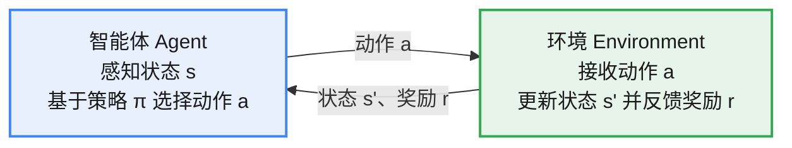

# 强化学习

强化学习（Reinforcement Learning, RL）是机器学习的一个重要分支，核心目标是让**智能体**在与**环境**的持续交互中，通过**试探与反馈**的循环，学习能够**最大化长期累计奖励的行动策略**。

**机器学习三大范式**：

1. 无监督学习：聚类、降维、自监督
2. 监督学习：分类、回归、SFT、DPO
3. 强化学习：RLHF、self-play

# 强化学习基础概念

## 智能体与环境

组成：

1. 智能体：通过感知**环境**的**状态**，基于**策略**选择并执行**动作**；
2. 环境：**环境**接收**动作**后更新**状态**并反馈**奖励**信号

基本架构组成：

* 智能体(Agent): 负责决策的实体，感知当前环境的状态，基于策略选择并执行动作。通过与环境的持续交互和奖励反馈，不断学习和优化策略，以最大化累计奖励。
* 策略(Policy): 决定智能体在给定状态下**应采取的动作规则或准则**，是智能体行为的核心。
* 动作(Action): 智能体在特定状态下可以选择并执行的操作。动作会引起环境状态发生变化。
* 环境(Environment): 智能体所处的外部环境，定义了**状态空间、动作空间、状态转移概率和奖励函数**。环境接收智能体的动作后，更新状态并反馈奖励。
* 状态(State): 环境在某一时刻的具体情况描述，包含了智能体决策所需的信息。智能体根据当前状态，利用策略选择下一步的动作。
* 奖励(Reward): 智能体执行动作后，环境给予智能体的即时反馈信号，能反映出动作的好坏。奖励用于训练和优化智能体的策略。

**智能体与环境的交互**

**交互循环**：智能体感知当前状态 $s$→ 基于策略 $\pi$ 选择动作 $a$→ 环境接收动作后转移到新状态 $s'$ 并反馈奖励 $r$→ 智能体据此更新策略 → 循环往复，直到满足终止条件。

## **经验与回合**

1. 经验(Experience): 是指智能体在与环境交互过程中所获得的信息和数据，**可用来训练智能体的策略**。例如，一条经验可以用一个四元组(S0,A0,R1,S1)表示。(S0,A0,R1,S1) = 当前状态、动作、奖励、下一个状态
2. 轨迹(Trajectory,通常简写为 r): 智能体从初始状态到终止状态所经历的一系列状态、动作和奖励的序列。例如，轨迹可以表示为{(S0,A0),(R1,S1,A1),(R2,S2,A2),(R3,S3)}。
3. 回合(Episode): 一次完整的交互过程，从智能体的初始状态开始，经过一系列**状态转移和动作选择**，直到达到终止状态。
4. 状态空间(State Space): 所有可能状态的集合。状态空间的大小直接影响强化学习问题的复杂度和求解方法。
5. 动作空间(Action Space): 所有可能动作的集合。动作空间可以是离散的或连续的，定义了智能体在每个状态下可选择的操作范围。
## 探索与利用

**探索与利用**(Exploration-Exploitation)的平衡是强化学习的核心挑战之一。智能体在学习过程中需要在“尝试新动作”（探索）与“选择当前已知的最优动作”（利用）之间进行权衡。**过度探索**可能导致学习过程缓慢，甚至无法收敛到最优解；**过度利用**则可能使智能体陷入局部最优。

- 探索（Exploration）：尝试新动作
- 利用（Exploitation）：选择当前已知的最优动作

**平衡探索和利用的策略**

ε-贪婪策略

ε-贪婪（Epsilon Greedy）是一种简单而有效的策略，用于在强化学习中平衡探索与利用。

通过引入探索概率因子 $\epsilon$，控制探索与利用的比例：

$$a_t = \begin{cases} \arg\max_a Q(a), & \text{以概率 } 1-\epsilon \\ \text{随机选择动作 } a, & \text{以概率 } \epsilon \end{cases}$$

其中 $\epsilon \in [0,1]$，$a$ 表示智能体在时间步 $t$ 选择的**动作**。具体含义如下。

1. 利用（概率 $1-\epsilon$）：选择当前预估价值最高的动作，以**最大化即时回报**。
2. 探索（概率 $\epsilon$）：智能体随机选择一个动作，以探索潜在的更优解。

在训练初期可以把 $\epsilon$ 设得较大（鼓励探索），随训练进行逐步减小 $\epsilon$（鼓励利用），使智能体在初期更多地进行探索，加深对环境的了解，逐渐转向利用，从而提高学习效率和最终策略的性能。

## 同策略和异策略

根据**收集经验时（rollout）采用的策略**与**训练时采用的策略**是否相同，分为同策略（On-policy）和异策略（Off-policy）策略π是智能体的核心，通常指智能体用于**决策和选择动作的算法或模型**。根据其所处阶段和角色的不同，策略可以分为行为策略与目标策略。

**行为策略(Behavior Policy):**

指的是智能体在与环境交互时实际执行交互行为的策略。**它负责收集用于训练的数据**，涵盖了智能体的探索行为。。

**目标策略(Target Policy):**

指的是在强化学习训练中最终希望得到的策略。目标策略决定了智能体最终希望采取的动作，以**最大化其长期回报**。

同策略：当**行为策略与目标策略相同时**，称为同策略学习。也就是说，智能体根据当前策略选择动作，并利用这些经验来更新当前策略，两者是同一个版本的策略。在同策略下，行为策略和目标策略本质上是同一个策略（模型）。例如，策略梯度方法和 SARSA 算法都是典型的同策略算法。

异策略：当行为策略与目标策略不同时，称为异策略学习。智能体可以使用某种策略进行探索，但学习（训练）和优化的是另一种策略，两者属于不同版本（或不同类型）的策略。例如，Q-learning、DQN 等算法是典型的异策略算法，尽管可能使用 ε-贪婪策略进行探索，但最终学习的是**最优策略**。

## 在线与离线强化学习

根据训练过程**是否直接与环境交互**，分为在线强化学习（Online RL）和离线强化学习（Offline RL）。

在线强化学习：在训练过程中，策略持续与环境交互并收集经验，**动态生成训练数据**，目标策略也在通过训练不断进化。

离线强化学习：又称**批量强化学习**（Batch RL），有时也被称为**完全异策略强化学习**（Fully Off-policy RL）。在训练过程中，智能体完全不与环境交互，而是在一个与线上环境隔离的环境中进行训练，**仅依赖预先收集的数据**。这些数据可能来自历史记录、其他策略的积累，或是模拟环境生成的样本。待训练完全结束后，才将策略整体部署到线上环境中应用。

注：
“同策略/异策略”与“在线/离线”方法的关系

1. 离线学习只能用异策略，因为需要利用固定数据集中的数据
2. 在线学习可以分为异策略和同策略
3. 同策略方法需要实时生成数据，只能基于在线的强化学习框架进行训练

“同策略/异策略”与“同步/异步”方法的关系

**同步与异步（Synchronous / Asynchronous）**是描述训练并行方式的维度，先简单介绍：

* **同步（Synchronous）**：多个并行 worker 各自与环境交互收集一批经验，收集齐后**统一汇总、同步更新**一次模型参数，再继续下一轮。所有 worker 始终基于同一份最新参数做决策。优点是更新稳定、实现简单；缺点是**最慢的 worker 会拖慢整体**。
* **异步（Asynchronous）**：多个 worker **各自独立**地与环境交互、各自计算梯度并更新共享模型参数，彼此不等待。不同 worker 使用的可能是不同步的旧参数，天然引入多样性（近似于探索）。优点是吞吐高、训练快；缺点是更新不一致、稳定性稍差。

同步/异步与同策略/异策略是**两个正交的维度**：

* 同步方法与同策略方法天然契合：每轮用同一批最新经验更新，正好符合"行为策略 = 目标策略"；
* 异步方法中，各 worker 更新时基于的参数快照与收集经验时的参数可能存在偏差，行为策略与目标策略并不完全同步，更像异策略的更新方式；
* 实践中两者常常组合出现，不能简单画等号。

# 马尔可夫决策过程

马尔可夫链(Markov Chain)和马尔可夫决策过程(Markov Decision Process,MDP)是强化学习领域的重要理论基础。

马尔可夫链描述**具有马尔可夫性质的系统状态转移过程**。在此基础上，马尔可夫决策过程引入了**动作和奖励**的概念，构建了用于优化决策的数学模型。

## 马尔可夫链

马尔可夫链是一种具有马尔可夫性质的随机过程，描述了一系列可能发生的事件，其中**每个事件的发生概率仅取决于前一个事件的状态**，而与更早的历史状态无关。

$$P(S_{t+1}=s_{t+1}|S_t=s_t) =P(S_{t+1}=s_{t+1}|S_t=s_t, S_{t-1}=s_{t-1},...,S_0=s_0)$$

高阶马尔可夫链是对一阶（标准）马尔可夫链的推广。在高阶马尔可夫链中，未来状态的概率不仅依赖当前状态，还受到**更早的 N-1 个状态**的影响，因此也被称为**N 阶马尔可夫链**。

## 马尔可夫决策过程

马尔可夫决策过程在马尔可夫链的基础上引入了动作 $A$ 和奖励 $R$ 的概念，不仅包含状态之间的**转移概率 $P$**，还包含每个状态下可采取的**动作**及**对应的奖励**。马尔可夫决策过程由四元组 $(S,A,P,R)$ 构成，分别表示：状态、动作、转移概率、奖励

假设在时间步 t 的状态为 s, 执行动作 a 之后，时间步 t+1 的状态变为 s' 且获得的即时奖励为 r, 则该状态转移概率可表示为 $$P(s',r|s,a) = Pr\{S_{t+1}=s',R_{t+1}=r|S_t=s,A_t=a\}$$

Pr 表示概率，P 表示转移概率

**马尔可夫决策过程的状态转移不仅取决于上一个状态，还受到执行动作的影响。**

马尔可夫决策过程与马尔可夫链：马尔可夫决策过程具有主动性，决策者可以通过采取行动来影响**系统状态的转移**；马尔可夫链则是被动的，系统状态的转移不受决策者控制。马尔可夫决策过程适用于需要选择策略以优化长期回报的场景，马尔可夫链则适用于建模**不包含决策过程**的系统状态转移

# 价值函数与贝尔曼方程

在强化学习中，智能体通过与环境持续交互以**最大化回报（上面说的是最大化累计奖励）**，而**价值函数(Value Function)**为智能体评估**不同状态或动作的未来回报提供支持**。

在强化学习中，智能体优化的目标是回报，而非**单一时间步的奖励** $R$，回报反映的是**长期收益**，需要正确区分。计算折扣回报时通常引入折扣因子 $\gamma$ 对未来奖励加权。

1.奖励

奖励是智能体在某个时间步 $t$ 采取动作 $a$ 后，从环境中获得的即时反馈，通常用 $r_{t+1}$ 表示，反映当前动作的好坏程度。奖励信号是强化学习的驱动力，它为智能体提供了关于当前动作的**即时评价**。通过不断地获取奖励，智能体可以优化策略，以在未来的决策中获得**更多的累计奖励**。

2.回报

回报常用字母 $G$ 表示（G 是 Gain 的缩写，即收益），也被称为**未来回报、累计奖励或累计折扣奖励**，是指从某一时间步开始，未来所有奖励的累计总和。它衡量了从当前时间步开始，智能体未来可能获得的总奖励，可用于评估智能体策略的长期优劣。

$$G_t = R_{t+1} + R_{t+2} + \cdots + R_n$$

表示从时间步 $t$ 到回合结束所有奖励的累计。

时间步 $t$ 的回报 $G_t$ 具有随机性，主要原因如下。

* 状态转移的随机性：同一动作在相同状态下可能有不同的后续状态，体现了环境的随机性。
* 动作的随机性：在收集经验时，为了保持探索性，智能体可能随机选择动作，因此，即使处于同样的状态，执行的动作也可能不同。

3.折扣回报和折扣因子

在某些情况下，不止有 n+1 个状态，可能存在**无限个状态**，这时计算所得的 G 可能趋近于无穷大或无穷小。此外，**近期奖励和远期奖励**对当前时刻的重要性通常不同，这主要是由于状态转移和环境的随机性使更远期的奖励具有更大的不确定性。

为了解决这些问题，引入折扣因子 $\gamma$（取值范围 $[0,1]$），可以计算出从时间步 $t$ 开始的折扣回报（Discounted Return）：

$$G_t = r_{t+1} + \gamma r_{t+2} + \gamma^2 r_{t+3} + ... = \sum_{k=0}^{\infty} \gamma^k r_{t+k+1}$$

其中，$r_{t+1}$ 表示在时间步 t 采取动作 a 后获得的即时奖励。

引入折扣因子 $\gamma$ 主要有以下作用。

* 确保回报的**收敛性**：折扣因子的引入确保了无限时间步的累计奖励是有限的，这对于理论分析和算法的稳定性至关重要。
* 平衡短期与长期奖励：较小的 $\gamma$ 值（接近0 ）使智能体更注重当前奖励，较大的 $\gamma$ 值(接近1)使智能体更注重长期收益。
* 影响训练稳定性：适当的 $\gamma$ 值可以加快学习过程，因为它影响了奖励信号的传递强度。在训练过程中，根据不同的任务和 Loss 的收敛情况，可以对 $\gamma$ 进行调节以稳定训练。

G_t 可以写成迭代的形式 $$G_t = r_{t+1} + \gamma r_{t+2} + \gamma^2 r_{t+3} + ... = r_{t+1} + \gamma G_{t+1}$$

## 价值函数

在强化学习中，价值函数用于衡量智能体在特定状态 $s$ 下、或采取特定动作 $a$ 后所能获得的**回报期望** $\mathbb{E}_\pi[G_t]$，在指导智能体决策的过程中起着至关重要的作用。

价值函数包括动作价值函数 $Q(s,a)$、状态价值函数 $V(s)$、最优状态价值函数 $V_*(s)$、最优动作价值函数 $Q_*(s,a)$，这四种函数**均表示未来回报**，但适用条件与场景略有不同。

**动作价值函数**

动作价值函数（Action-Value Function）衡量在策略 $\pi$ 下，智能体在状态 $s$ 时采取动作 $a$ 后所能获得的**回报期望值**，该值有时也被泛称为 Q 值（Q-value），通常记为 $Q(s,a)$：

$$Q_\pi(s,a) = \mathbb{E}_{\pi}[G_t \mid S_t=s,A_t=a] = \mathbb{E}_{\pi}\big[\sum_{k=0}^{\infty}\gamma^k r_{t+k+1} \mid S_t=s,A_t=a\big] = \mathbb{E}_{\pi}\big[r_{t+1} + \gamma r_{t+2} + \cdots + \gamma^k r_{t+k+1} \mid S_t=s,A_t=a\big]$$

动作价值函数依赖三个因素：状态、动作和策略

**状态价值函数**

状态价值函数（State-Value Function）记为 $V(s)$，表示在状态 $s$ 下遵循策略 $\pi$ 时智能体能获得的**回报期望值**，其数学表达式为 $$V_\pi(s) = \mathbb{E}_{\pi}[G_t \mid S_t=s] = \mathbb{E}_{\pi}\big[\sum_{k=0}^{\infty}\gamma^k r_{t+k+1} \mid S_t=s\big]$$ 与 $Q(s,a)$ 相比，$V(s)$ **仅依赖策略 $\pi$ 和状态 $s$**，不再依赖具体动作 $a$。换言之，$V(s)$ 已兼顾所有可能的动作 $a$（例如按策略 $\pi$ 对不同动作的概率加权求和），关注的是状态本身的整体价值，而非某个具体动作。

**最优状态价值函数与最优动作价值函数**

假设存在一个策略 $\pi_*$，其在所有状态下的回报期望值均不低于其他策略 $\pi$，即对所有状态 $s\in S$ 满足 $V_{\pi_*}(s)\ge V_\pi(s)$，可宽泛地用 $\pi_*\ge\pi$ 表示最优策略。

定义如下

1. 最优策略(Optimal Policy)：记为 $\pi_*$，在所有状态下，最优策略 $\pi_*$ 的回报期望值不低于其他任何策略。
2. 最优状态价值函数(Optimal State-Value Function) 

$$V_*(s) = \max_\pi V_\pi(s)$$

表示在状态 $s$ 下能够获得的最大期望回报。$V_*(s)$ 仅依赖状态 $s$，不再依赖策略 $\pi$ 和具体动作 $a$，反映遵循最优策略 $\pi_*$ 所能获得的最大回报。

3. 最优动作价值函数(Optimal Action-Value Function)

$$Q_*(s,a) = \max_\pi Q_\pi(s,a)$$

表示在状态 $s$ 下采取动作 $a$ 后能够获得的最大期望回报。$Q_*(s,a)$ 依赖状态 $s$ 和动作 $a$，不再依赖具体策略 $\pi$。

**奖励、回报和价值的关系**

奖励是即时奖励、回报是未来回报，是从当前状态开始计算，之后所有奖励的累计和，是未来的总收益，价值是回报的期望，表示平均情况下的未来总收益。

## 贝尔曼方程

贝尔曼方程(Bellman Equation)提供了一种**递归的价值函数定义**方法，能够描述和转换四种价值函数之间的关系。

给定状态 s，**状态价值函数的贝尔曼方程**为：

$$V_\pi(s) = \sum_a \pi(a|s) \sum_{s',r} p(s',r|s,a)[r+\gamma V_\pi(s')]$$

1.$\pi(a|s)$ 表示策略π下选择动作 a 的概率
2. $p(s',r\mid s,a)$ 是状态转移和奖励的联合概率分布，表示在状态 $s$ 下采取动作 $a$ 后，转移到下一个状态 $s'$ 并获得奖励 $r$ 的概率；
3.$r$ 是即时奖励
4.$\gamma$ 是折扣因子

可以拆分为：

1.$\sum_a \pi(a|s)$ 对所有动作的概率加权
2.$\sum_{s',r} p(s',r|s,a)[r+\gamma V_\pi(s')]$ 动作 $a$ 下的期望累计奖励

**动作价值函数的贝尔曼方程**

$$Q_\pi(s,a) =\sum_{s',r} p(s',r|s,a) [r + \gamma \sum_{a'}\pi(a'|s')Q_{\pi}(s',a')]$$

除此之外，在最优策略 $\pi_*$ 下，由贝尔曼方程衍生出贝尔曼最优方程，包含

**最优状态价值函数的贝尔曼方程**

$$V_*(s) = \max_a \sum_{s',r} p(s',r|s,a)[r+\gamma V_*(s')]$$

**与最优动作价值函数的贝尔曼方程**

$$Q_*(s,a) = \sum_{s',r} p(s',r|s,a)\big[r + \gamma \max_{a'} Q_*(s',a')\big]$$

**状态价值和动作价值的转换**

**Q → V**

**核心逻辑**：状态 $s$ 的价值，等于策略 $\pi$ 下所有可能动作的动作价值的**概率加权平均**。

$$V_\pi(s) = \sum_a \pi(a|s) Q_\pi(s,a)$$

意义：处于状态 $s$ 时，遵循策略 $\pi$ 随机选择动作，每个动作能带来的价值是 $Q_\pi(s,a)$，按选择概率加权后，就是这个状态的整体价值。

**V → Q**

**核心逻辑**：动作价值 $Q_\pi(s,a)$ 由两部分组成 —— 执行动作 $a$ 获得的**即时奖励期望**，加上转移后新状态 $s'$ 的价值的**折扣期望**。

$$Q_\pi(s,a) = \sum_{s',r} p(s',r|s,a) [r + \gamma V_\pi(s')]$$

意义：在状态 $s$ 执行动作 $a$ 后，会以 $p(s',r\mid s,a)$ 的概率转移到 $s'$ 并得到 $r$；当前奖励 $r$ 是即时收益，后续状态 $s'$ 的价值 $V_\pi(s')$ 是长期收益，乘以 $\gamma$ 折扣后求和，就是这个动作的总价值。

# 算法

## 蒙特卡洛算法

蒙特卡洛（Monte Carlo, MC）方法是强化学习中**无模型**（不需要环境模型）的策略评估与优化方法，核心思想是**通过大量样本轨迹的平均回报来估计价值函数**，无需依赖环境的转移概率 $p(s',r\mid s,a)$。

**目标**

给定策略 $\pi$，估计 $V_\pi(s)$ 或 $Q_\pi(s,a)$；通过**价值估计**优化策略，最终得到**最优策略 $\pi_*$**。

**关键假设**

轨迹是**完整的**：从任意状态 $s$ 出发，必须到达终止状态（即轨迹是有限长度 $T$）。

**状态价值步骤**

1. 初始化价值函数 $V(s)=0$、计数 $N(s)=0$，选择策略（贪婪或随机），设定折扣因子；
2. 遵循策略π，生成一条完整的轨迹，V(sT) =0， 最后一个状态的状态价值为0
3. 遍历轨迹
    1. 计算回报 G_t
    2. 更新动作价值（采用增量公式，在数学上和求均值是等价的） $V(s_t) = V(s_t) + \frac{1}{N}[G_t - V(s_t)]$3. 更新计数

4. 迭代以上步骤直到收敛：$|V_{\text{new}}(s)-V_{\text{old}}(s)|<\epsilon$。

PS：在蒙特卡洛方法中，最优策略 $\pi_*$ 不需要单独存储为独立的实体，而是通过最优价值函数间接保存，在实际决策时再通过实时推导。这种方式既节省存储空间，又能保证策略的灵活性。

**动作价值步骤**

> 和 状态价值类似，除了状态，增加价值信息
1. 初始化动作价值 Q(s,a)=0， 计数 N(s,a)=0
2. 生成轨迹后，对于每个时间步 t
    1. 计算回报 $G_t$
    2. 更新动作价值（采用增量公式，在数学上和求均值是等价的） $Q(s_t, a_t) = Q(s_t,a_t) + \frac{1}{N}[G_t - Q(s_t,a_t)]$3. 更新计数

3. 收敛后 $Q(s,a) \rightarrow Q_\pi(s,a)$**特点**

1. 无模型特性：无需知道转移概率 $p$($s'$,$r$∣$s$,$a$)，仅通过样本轨迹学习，适用于复杂环境。
2. 收敛性：当轨迹数趋于无穷时，首次访问型和每次访问型 MC 都能收敛到真实价值函数（大数定律保证）。
3. 局限性：

    * 必须依赖完整轨迹，无法处理持续任务（无终止状态）；
    * 学习效率较低，需要大量轨迹才能收敛；
    * 价值估计的方差较大（不同轨迹的回报波动大）。

**例子**

一、任务背景设定

1. 环境：3×3 网格世界，状态用坐标($x$,$y$)表示，共 9 个状态。

    * 起始状态：(1,1)
    * 目标状态：(3,3)（到达后获得奖励 $r$=10，任务终止）
    * 障碍状态：(2,2)（无法进入，进入后奖励 $r$=−5，回到原位置）

2. 动作空间：4 个动作 A={上，下，左，右}
3. 训练结果：通过蒙特卡洛策略迭代，得到最优动作价值函数 $Q_*$($s$,$a$)（表格形式）二、训练好的 $Q_*$ 表格（核心保存对象）

|状态($x$,$y$)|上|下|左|右||
|:---|:---|:---|:---|:---|:---|
|(1,1)|2.1|1.5|-1.0|**5.8**||
|(1,2)|3.0|2.2|1.8|**6.5**||
|(1,3)|**7.0**|2.5|5.0|-2.0||
|(2,1)|**4.5**|-1.0|-0.5|-3.0||
|(2,2)|-5.0|-5.0|-5.0|-5.0||
|(2,3)|**8.0**|3.0|-1.0|-2.0||
|(3,1)|2.0|-1.0|-0.5|**3.5**||
|(3,2)|4.0|-2.0|2.5|**9.0**||
|(3,3)|0|0|0|0|（终止状态，价值为 0 ）|

> 加粗数值是每个状态下的最大 $Q_*$ 值

三、实际推理流程（智能体决策步骤）推理的核心逻辑：输入当前状态 → 查 $Q_*$ 表 → 选最大 $Q$ 值对应的动作 → 执行动作更新状态 → 直到终止

假设智能体从起始状态(1,1)出发，推理步骤如下：

|步骤|当前状态|查 $Q_*$ 表|选择最优动作|执行动作后状态|备注|
|:---|:---|:---|:---|:---|:---|
|1|(1,1)|上：2.1 / 下：1.5 / 左:-1.0 / 右：5.8|右|(1,2)|向右移动一格|
|2|(1,2)|上：3.0 / 下：2.2 / 左：1.8 / 右：6.5|右|(1,3)|向右移动一格|
|3|(1,3)|上：7.0 / 下：2.5 / 左：5.0 / 右:-2.0|上|(2,3)|向上移动一格|
|4|(2,3)|上：8.0 / 下：3.0 / 左:-1.0 / 右:-2.0|上|(3,3)|向上移动一格，到达目标|
|5|(3,3)|所有动作 $Q_*$=0|-|任务终止|获得最终奖励 10|

## TD 算法——时间差分（Temporal Difference）算法

TD 方法基于当前的**价值估计**进行自举学习，即通过自身的估计值来更新当前的估计值。与蒙特卡洛方法类似，TD 方法也可以更新轨迹上所有状态的价值，不同之处在于，TD 不需要等待整个回合结束，而是**每前进一步就进行一次更新**。

TD 方法的核心思想是利用当前的价值估计来更新价值函数，这本质上基于贝尔曼方程。更新方式如下：

$$V(s_t) \leftarrow V(s_t) + \alpha[r_{t+1} + \gamma V(s_{t+1}) - V(s_t)]$$

1.$V(s_t)$ 是状态 s,的当前价值估计。
2.$\alpha$ 是学习率，控制更新步伐。
3.$r$ 是从状态 $s$ 转移到 $s'$ 时获得的即时奖励。
4.$\gamma$ 是折扣因子，取值范围是[0,1]，用于权衡即时奖励和未来奖励的重要性。

自举通常指通过重复使用自身的估计值来更新模型参数。在强化学习中，自举指的是利用**当前的价值估计来更新价值函数**。具体来说，TD 方法通过部分信息（下一步的奖励和下一个状态的价值估计来更新当前状态的价值。

自举方法具有以下特点。

1. 偏差大：如果价值估计不准确，那么自举会引入偏差。这种偏差来源于模型对环境的当前理解，如果估计值存在系统性误差，则偏差可能逐步累积。
2. 方差小：TD 方法的更新基于一步或少数几步的转移，不需要等待整个回合结束，受到的随机性影响较小，这减小了估计的方差。

更新公式的后半项可以分解为：

1. TD 目标：$r_{t+1} + \gamma V(s_{t+1})$
2. TD 误差：$r_{t+1} + \gamma V(s_{t+1}) - V(s_t)$

TD 误差衡量了当前价值估计与 TD 目标之间的差异，它反映了当前估计与最新信息的不一致程度，指导价值函数的更新方向和幅度。由于 TD 目标包含了最新的环境反馈信息 $r_{t+1}$，因此被认为比 $V(s_t)$ 更接近真实值，通常将 TD 目标作为价值函数拟合的目标。

**TD 的衍生**

1. 单步 TD，如上述
2. 多步 TD

更新规则变为：

$$G_t^{(n)} = r_{t+1} + \gamma r_{t+2} + \cdots + \gamma^{n-1} r_{t+n} + \gamma^n V(s_{t+n})$$

$$V(s_t) \leftarrow V(s_t) + \alpha\big[G_t^{(n)} - V(s_t)\big]$$

多步 TD 方法**结合了蒙特卡洛方法和动态规划的优势**，因此，通常可以实现更加高效的学习过程，取得比单步 TD 方法更好的效果。

3. TD（lambda）

TD（lambda）是以一种更优雅的方式结合 DP 和蒙特卡洛方法，更新规则为：

$$V(s_t) \leftarrow V(s_t) + \alpha[G_t^\lambda - V(s_t)]$$

其中 $$G_t^\lambda = (1-\lambda) \sum_{n=1}^{T-t-1} G_{t:t+n} + \lambda^{T-t-1} G_t$$ 其中：

1. λ是衰减因子，决定了在价值更新时考虑多远的未来回报。通过调整λ的值，可以在算法的偏差和方差之间取得平衡。
2. T 是任务或回合的终止时间步。T 限制了回报的计算范围，这使未来回报不再延续到无穷远。
3.$G_{t:t+n}$ 是从时间步 $t$ 开始、经过 $n$ 步的回报（ n 步 TD 回报，结合即时奖励与未来的估计价值）：$G_{t:t+1}$ 为 1 步回报，$G_{t:t+2}$ 为 2 步回报，……，$G_{t:t+n}$ 为 n 步回报。
4.$G_t$ 是从时间步 t 开始直到终止状态的回报。

(1)当 $\lambda=0$ 时：$G_t^\lambda = G_{t:t+1}$，只含一步回报，TD(λ)退化为单步 TD（即 TD(0)），方差最小、偏差最大。

(2)当 $\lambda=1$ 时：$G_t^\lambda = G_t$，TD(1)退化为蒙特卡洛方法，用完整回合的回报更新价值估计，方差最大、偏差最小。

(3)当 $0<\lambda<1$ 时：结合蒙特卡洛与 TD 的优势，在偏差与方差之间取得平衡。

**例子（背景和之前的例子一样）**

步骤 1：初始化 $Q$ 表格

所有状态 - 动作对的 $Q$ 值初始化为 0（未知价值）：

|状态($x$,$y$)|上|下|左|右|
|:---|:---|:---|:---|:---|
|(1,1)|0|0|0|0|
|(1,2)|0|0|0|0|
|(1,3)|0|0|0|0|
|(2,1)|0|0|0|0|
|(2,2)|0|0|0|0|
|(2,3)|0|0|0|0|
|(3,1)|0|0|0|0|
|(3,2)|0|0|0|0|
|(3,3)|0|0|0|0|

步骤 2：单步交互与 $Q$ 表更新（以一次探索为例）我们以智能体从(1,1)出发的一步交互为例，展示 $Q$ 表的更新过程：

1. 当前状态 $s_t=(1,1)$：按 ε-贪婪策略选动作；当前所有 Q 值为 0，随机选「右」（ $a_t=$ 右）。
2. 执行动作、观察反馈：执行「右」后转移到 $s_{t+1}=(1,2)$，未到目标/障碍，故即时奖励 $r_{t+1}=0$。
3. 下一状态选动作：$s_{t+1}=(1,2)$ 的 Q 值全为 0，随机选「右」（ $a_{t+1}=$ 右），对应 $Q(s_{t+1},a_{t+1})=0$。
4. 计算 TD 误差并更新 Q 表（取 $\gamma=0.9,\ \alpha=0.1$）：$\delta_t = r_{t+1} + \gamma\,Q(s_{t+1},a_{t+1}) - Q(s_t,a_t) = 0 + 0.9\times0 - 0 = 0$；更新 $Q((1,1),右)\leftarrow Q((1,1),右)+\alpha\,\delta_t = 0$（首次更新无变化，多次交互后 Q 值才逐步累积）。

步骤 3：多轮迭代，逐步优化 $Q$ 表

重复 “选动作→执行→更新 $Q$ 表” 的单步流程，经过数千轮迭代后，$Q$ 值会逐步收敛到最优。以下是收敛后的 $Q_*$ 表格（与蒙特卡洛最终结果一致）：

|状态($x$,$y$)|上|下|左|右|
|:---|:---|:---|:---|:---|
|(1,1)|2.1|1.5|-1.0|**5.8**|
|(1,2)|3.0|2.2|1.8|**6.5**|
|(1,3)|**7.0**|2.5|5.0|-2.0|
|(2,1)|**4.5**|-1.0|-0.5|-3.0|
|(2,2)|-5.0|-5.0|-5.0|-5.0|
|(2,3)|**8.0**|3.0|-1.0|-2.0|
|(3,1)|2.0|-1.0|-0.5|**3.5**|
|(3,2)|4.0|-2.0|2.5|**9.0**|
|(3,3)|0|0|0|0|

TD (0)的推理流程（与蒙特卡洛完全一致）收敛后，推理时切换为**纯贪婪策略**（ $\epsilon=0$），步骤如下：

|步骤|当前状态|查 $Q_*$ 表|选最优动作|执行后状态|备注|
|:---|:---|:---|:---|:---|:---|
|1|(1,1)|右的 $Q$ 值最大（5.8 ）|右|(1,2)|无奖励|
|2|(1,2)|右的 $Q$ 值最大（6.5 ）|右|(1,3)|无奖励|
|3|(1,3)|上的 $Q$ 值最大（7.0 ）|上|(2,3)|无奖励|
|4|(2,3)|上的 $Q$ 值最大（8.0 ）|上|(3,3)|获得奖励 10，任务终止|

**DP（动态规划）、MC(蒙特卡洛）、TD(时序差分）的对比**

||蒙特卡洛|TD|DP|穷举搜索|
|:---|:---|:---|:---|:---|
|是否依赖环境模型|n|n|y|n|
|方差|大|小|小|---|
|偏差|无偏估计|有偏估计|无偏估计|---|
|计算复杂度|中等|低|高|很高|
|更新方式|基于完整回报，直到回合结束更新|在线更新|递归式更新|穷举之后更新|
|学习速度|较慢（需等待回合结束）|较快（实时更新）|中等|---|
|适用场景|回合较短、能完整观测回合终止的任务|多种场景|已知环境模型、问题规模小、离散环境|状态空间小且可穷举的任务|
|优点|无环境模型依赖、无偏估计|收敛快、方差小、实时更新|精确性高|易于实施，直观|
|缺点|方差大、延迟更新|有偏估计|依赖环境模型|计算复杂度过高|

## Q-learning

Q-learning 算法用于**学习并逼近最优动作价值函数**，其训练过程基于时序差分（TD）方法。

Q-learning 算法主要有以下两种形式。

1. 基于表格的 Q-learning 算法：通过表格表示最优动作价值函数 $Q^*(s,a)$,表的每个格子记录对应的价值 Q,在经过多步训练后，表格中的价值 Q 逐步更新并趋于最优。在推理时可以查表进行。这种方法仅适用于动作离散且问题复杂度较低的简单场景。
2. DQN 及其衍生算法：最优动作价值函数 $Q^*(s,a)$**通过深度神经网络近似表示**。DQN 利用深度神经网络显著提升了价值 Q 的拟合能力，极大地拓展了应用场景。

基于表格的方法

> SARSA 算法是另一种基于价值的强化学习算法。与 Q-learning 不同，SARSA 直接拟合动作价值函数。SARSA 是一种 On-Policy 的强化学习方法，Q-learning 则是 Off-Policy 的方法。

算法的关键：

1. 不需要知道转移概率 P， 而在实际环境中探索、采样学习
2. 不计算期望，用实际观测到的样本来代替期望计算

假设 agent 从 s 执行动作 a,得到具体的 r 和下一个状态 s',则(s,a,r,s')就是对环境的一次采样，采样后得到 TD 目标，利用这个 TD 目标去更新动作价值

TD 目标：$TD \text{target} = r + \gamma \max_{a'} Q(s',a')$,其中 r 是对 R(s,a,s')的一次采样，$\max_{a'} Q(s',a')$ 是对 $\max_{a'} Q^*(s',a')$ 的当前估计

### Q-table

**训练迭代**

1. 初始化 Q-table, 每一行表示一个状态，每一列表示一个动作
2. 初始化超参数：学习率、折扣因子、探索率（epsilon）、训练回合数
3. 选择动作，如 epsilon 算法
    1. 生成0-1 的随机数 random
    2. 如果 random 小于 epsilon，随机选动作 a
    3. 如果 random 大于 epsilon，在 Q-table 中选择当前状态对应的列，选择使 Q 值最大的动作

4. 执行动作，环境返回新状态、奖励
5. 更新 Q-table
    1. 计算 TD 目标，$\max_{a'} Q(s',a')$ 表示在新状态下，查找 Q-table，确定能获得的最大的 Q 值，如果 s'是终止状态，Q 值等于0
    2. 计算 TD 误差
    3. 更新 Q 值

**推理**

在任何状态 s 下，查询 Q-table,找到使 Q 最大的动作 a，这个就是最优策略

可行性分析：

1. 每次更新只基于一次采样，不需要全局的概率分布
2. 理论上，与环境交互无限次，采样结果的平均值会收敛到理论的期望值（大数定理）

### DQN

DQN 的主要特性如下:

1.用于近**似最优动作价值函数**。

2.属于 Off-Policy 的强化学习方法。

3.主要应用于动作离散的场景。

4.训练过程基于时序差分(TD)方法。

DQN 的训练与传统的 Q-learning 算法类似，目标都是学习最优动作价值函数。DQN 使用深度神经网络来近似最优动作价值函数；为了打破数据之间的相关性，DQN 引入了经验回放（Experience Replay）机制。智能体在与环境交互的过程中，将经验样本 $(s_t,a_t,r_{t+1},s_{t+1})$ 存储到回放缓冲区 $D$ 中，并从中随机抽取小批量样本用于训练。这一方法不仅提高了数据的利用效率，还稳定了训练过程。

在训练 DQN 模型时，通常使用均方误差（MSE）作为损失（Loss），通过梯度下降来更新网络参数。

损失函数：

$$\text{loss} = (Q_{\text{target}} - Q_{\text{pred}})^2 = (y_t - Q(s_t,a_t;\theta))^2$$

目标值 $y_t$ 参考 TD 方法中的 TD 目标：

$$\text{loss} = (Q_{\text{target}} - Q_{\text{pred}})^2 = (r_{t+1} + \gamma \max_{a'} Q(s_{t+1},a';\theta) - Q(s_t,a_t;\theta))^2$$

**训练流程：**

1. 模型初始化
2. 初始化回放缓冲区
3. 收集经验：在每个时间步 $t$，智能体在状态 $s_t$ 下选择动作 $a_t$（例如使用 ε-贪婪策略）；执行动作 $a_t$ 后观察奖励 $r_{t+1}$ 和下一个状态 $s_{t+1}$，将经验存入回放缓冲区 $D$。
4. 采样并前向计算：从回放缓冲区 $D$ 中随机采样经验数据，对每个样本输入 DQN 模型，计算目标价值与当前状态 $s_t$ 的价值预测值，再计算损失。
5. 反向传播并更新模型参数：基于 PyTorch 等深度学习框架的反向传播机制自动计算梯度，并对 DQN 模型的参数进行更新。
6. 重复训练过程，直到满足训练终止条件。

**目标价值 $r_{t+1} + \gamma \max_{a'} Q(s_{t+1},a';\theta)$ 是怎么来的**

* 传统 Q-learning 的最优目标：从 Q-table 到样本近似

在传统 Q-learning（表格型）中，我们无法直接计算最优贝尔曼方程的期望（无环境模型），因此用**单步样本**近似期望，得到 Q-learning 的更新目标：

这个目标的特点：

1. **最优性体现**：$\max_{a'} Q(s_{t+1},a';\theta)$ 表示在新状态 $s'$ 下，选择**所有动作中 Q 值最大的那个**，对应最优贝尔曼方程的“未来最优价值”。
2. **无模型近似**：不需要转移概率 $p(s',r\mid s,a)$，直接用交互得到的样本 $(r,s')$ 计算，是对期望的无偏估计。

此时的目标 $y$ 就是传统 Q-learning 的**最优目标**——它直接指向 $Q_*(s,a)$，保证只要迭代足够多次，Q-table 会收敛到 $Q_*(s,a)$。

* DQN 中的最优目标：加入**目标网络**的稳定化改进

DQN 继承了 Q-learning 的最优目标逻辑，但针对**高维状态下神经网络训练不稳定**的问题，做了关键改进 —— 引入**目标网络**计算 $\max_{a'} Q(s_{t+1},a';\theta)$，最终形成 DQN 的最优目标：

为什么需要目标网络？（核心改进点）如果直接用主网络计算 $\max_{a'} Q(s_{t+1},a';\theta)$，会导致**目标值和主网络参数强耦合**：

* 主网络参数 $\theta$ 每更新一次，$\max_{a'} Q(s_{t+1},a';\theta)$ 就会变化一次；
* 目标值 $y_i$ 不断波动，训练过程会出现**震荡甚至发散**。

目标网络的参数 $\theta^-$ **定期从主网络复制，中间保持固定**，相当于提供了一个**稳定的“价值基准”**，让目标值 $y_i$ 不会随主网络的更新而实时变化，大幅提升训练稳定性。

PS: **目标网络并非一个独立训练的 “新网络”**，而是**主网络的“参数快照”**—— 它的结构和主网络完全一致，参数完全来自主网络的定期复制，不需要单独训练。下面分**训练阶段**和**推理阶段**，详细说明目标网络的创建、更新和使用方式。训练过程中，定期更新目标网络

**推理**：

训练完成后，丢弃目标网络和回放池，仅用主网络进行决策，此时关闭探索（ $\epsilon=0$），采用纯贪婪策略：输入状态 $s$，输出最优动作 $a_*$，完成任务决策。