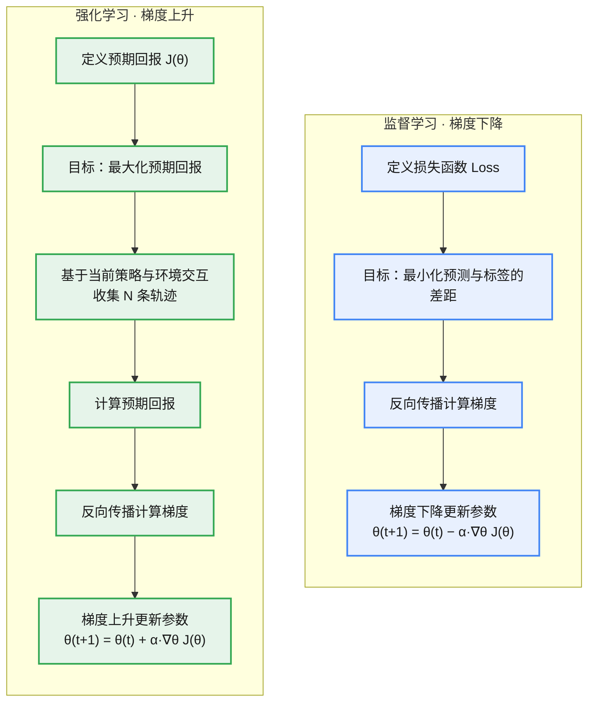
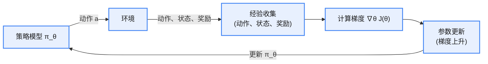
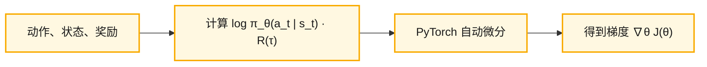

# 简介

**概念**

策略梯度是一类直接对策略进行优化的强化学习方法，核心是将**策略参数化**，并以期望累积回报作为目标函数。

**解法**

通过梯度上升更新参数，提高高回报动作的概率；这与监督学习中最小化损失函数、采用梯度下降的做法正好相反。

为降低直接使用回报带来的高方差，通常引入 Actor–Critic（AC）架构：Actor 负责优化策略目标函数，Critic 通过价值函数或优势函数估计回报，提供更稳定的梯度信号。

**与基于价值方法的区别**

基于价值的方法（如 DQN）不直接学习策略，而是先通过贝尔曼方程学习状态价值或动作价值函数，再对价值函数取最大值间接得到策略。相比之下，策略梯度方法更适合连续动作空间和随机策略，而价值方法在离散动作场景下往往更直观、高效。

# 目标函数分析

策略梯度定理将优化目标明确为**预期回报** $J(\theta)$：

$$J(\theta) = \sum_{\tau} p(\tau;\theta)\, R(\tau) = \mathbb{E}_{\tau \sim p(\tau;\theta)}\big[R(\tau)\big] \qquad (1)$$

**各符号解释**

* $\tau$：一条轨迹
* $R(\tau)$：轨迹的回报（累积奖励）
* $p(\tau;\theta)$：轨迹发生的概率，与模型参数 $\theta$ 有关

设轨迹为 $\tau = \{s_0, a_0, r_1, s_1, a_1, \dots, s_{T-1}, a_{T-1}, r_T, s_T\}$，则轨迹的概率为：

$$p(\tau;\theta) = \prod_{t=0}^{T-1} \pi_\theta(a_t \mid s_t)\, P(s_{t+1} \mid s_t, a_t) \qquad (2)$$

其中：

* $\pi_\theta(a_t \mid s_t)$：策略 $\pi$ 在状态 $s_t$ 下选择动作 $a_t$ 的概率
* $P(s_{t+1} \mid s_t, a_t)$：在状态 $s_t$ 下执行动作 $a_t$ 后转移到状态 $s_{t+1}$ 的概率

**对目标函数求导**

$$\nabla_\theta J(\theta) = \nabla_\theta \sum_{\tau} p(\tau;\theta)\, R(\tau) \qquad (3)$$

利用对数求导技巧 $\nabla_\theta p = p\, \nabla_\theta \log p$，可化简为：

$$\nabla_\theta J(\theta) = \mathbb{E}_{\tau \sim p(\tau;\theta)}\big[R(\tau)\, \nabla_\theta \log p(\tau;\theta)\big] \qquad (4)$$

将公式 (2) 代入公式 (4)，由于状态转移项 $P(s_{t+1} \mid s_t, a_t)$ 与 $\theta$ 无关、求导后为零，最终化简为：

$$\nabla_\theta J(\theta) = \mathbb{E}_{\tau \sim p(\tau;\theta)}\Big[\sum_{t=0}^{T-1} \nabla_\theta \log \pi_\theta(a_t \mid s_t)\, \cdot R(\tau)\Big] \qquad (5)$$

有了梯度公式，实际训练步骤可概括为：

1. 模型基于当前策略执行动作 $a$，与环境交互
2. 生成 $N$ 条轨迹，计算梯度
3. 结合奖励值进行梯度上升更新参数

**分析**

与一般的梯度计算不同，策略梯度中的动作偏好梯度 $\nabla_\theta \log \pi_\theta(a_t \mid s_t)$ 还要乘以回报 $R(\tau)$ 做缩放。也就是说，参数更新的幅度不仅取决于动作偏好梯度本身，还受轨迹回报的影响：

* 当 $R(\tau) > 0$ 时：公式 (5) 的更新方向与动作偏好梯度一致，更新后会**增大**在相应状态下执行该动作的概率；
* 当 $R(\tau) &lt; 0$ 时：公式 (5) 的更新方向与动作偏好梯度相反，更新后会**减小**在相应状态下执行该动作的概率。

通过这种方式，参数朝着获得更高回报的方向优化，策略效果逐步提升。结合回报缩放的更新方式让模型既能学习动作偏好的方向，又能依据实际回报大小灵活调整优化幅度，从而提高训练效率与性能。

# 监督学习的梯度下降 vs 强化学习的梯度上升

两者的核心差异只在更新方向（符号）：

* 监督学习（梯度下降）：$\theta_{t+1} = \theta_t - \alpha \nabla_\theta J(\theta)$
* 强化学习（梯度上升）：$\theta_{t+1} = \theta_t + \alpha \nabla_\theta J(\theta)$

# 求解流程与工程实现

**求解流程**

**工程实现**

# 衍生算法

基于策略梯度定理，衍生出两类经典算法：REINFORCE 和 Actor-Critic。由公式 (5) 可知，计算策略梯度前需要先得到轨迹回报 $R(\tau)$，而 $R(\tau)$ 的估计方法主要有以下两种。

**(1) 蒙特卡洛方法估计 $R(\tau)$（REINFORCE）**

直接基于实际运行采集多条**完整轨迹**（每条都是一个完整回合），计算每条轨迹的实际回报 $R(\tau)$，再按公式 (5) 计算梯度并更新参数，这种算法称为 REINFORCE。REINFORCE 属于**同策略**（on-policy）方法：学习过程中必须使用当前正在评估和优化的策略来收集经验。该方法无偏，但依赖完整轨迹，方差较大；实际使用时可引入基线（baseline）来减小方差。

**(2) 神经网络估计 $R(\tau)$（Actor-Critic 架构）**

引入一个价值模型（通常称为 Critic），用深度神经网络近似状态价值函数 $V(s)$ 或动作价值函数 $Q(s,a)$，以估计从当前状态（或状态—动作对）开始的**期望回报**，这种方法称为 Actor-Critic 架构。其中 Actor 更新策略参数 $\theta$，Critic 评估策略 $\pi$ 的价值。借助 Critic 可以减小回报估计的方差，提高训练效率。
