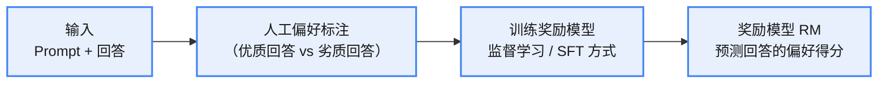
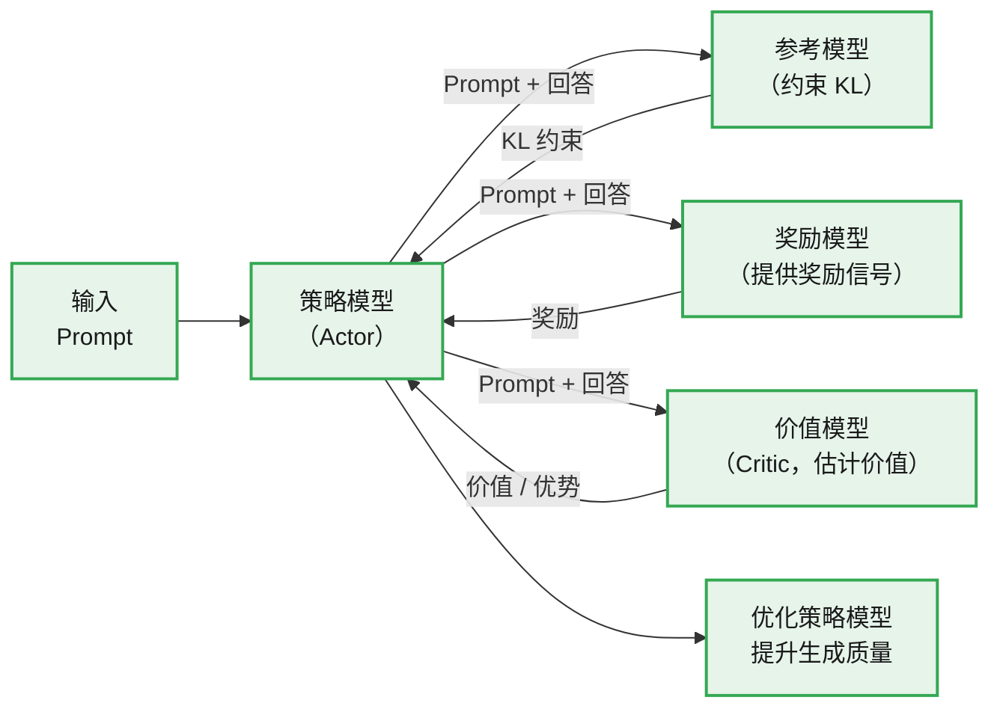
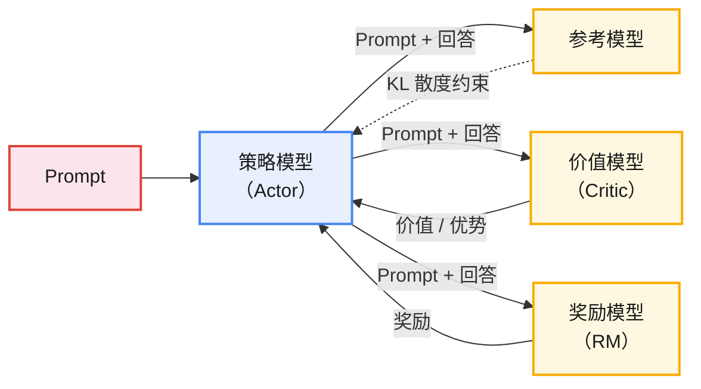
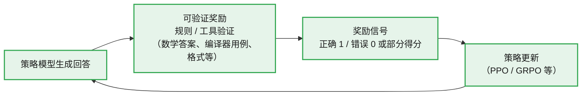
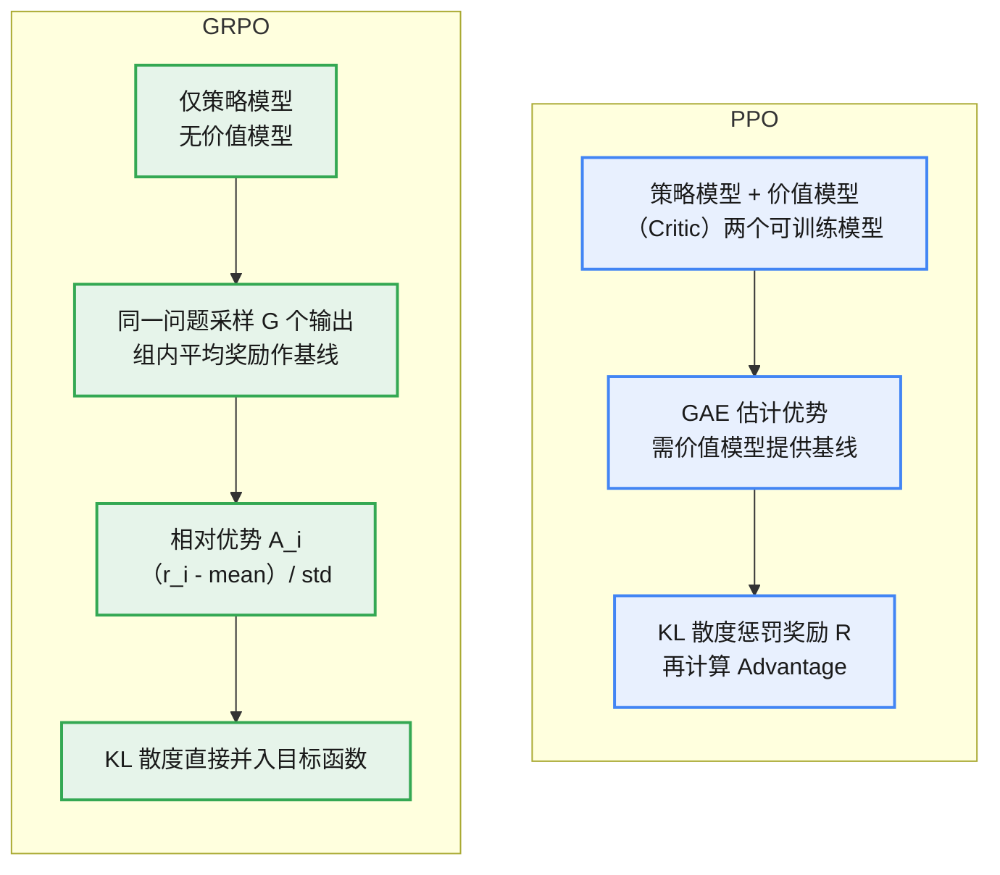

# RLHF

基于人类反馈的强化学习是一种用于**对齐智能体行为与人类偏好的技术**。该方法首先通过人类提供的**标注数据**或示范样本，训练一个**奖励模型**以拟合人类偏好。随后基于奖励模型对智能体进行强化学习训练，优化其行为，使其更加符合人类的价值观和期望。

# 背景

强化学习的效果高度依赖奖励函数的设计。然而，由于实际任务的复杂性，奖励或目标往往**难以被明确描述或量化**，这使奖励函数的设计成为一项巨大的挑战。

如果奖励函数设计得不合理，那么智能体可能通过“投机取巧”的方式利用奖励函数的漏洞进行优化。最终，尽管智能体能够获得较高的奖励分数，却无法实现预期目标。这实际上反映了**强化学习的目标与人类期望**之间的对齐偏差（Misalignment）。因此，如何将人类的目标精准传递给智能体，成为提升强化学习效果的关键突破点之一。

为了解决奖励信号不足的问题，研究人员引入了人类反馈（Human Feedback），通过让人类对系统行为进行评价来优化模型表现。这一方法在理论上符合强化学习的范式，但**直接使用人类反馈作为奖励函数会显著降低训练效率**。为此，研究人员提出用一个神经网络——奖励模型来拟合人类偏好，并将其作为奖励信号融入强化学习过程。这种方法显著提高了训练效率，这正是广为人知的 RLHF 。

# 训练流程

> 以 PPO 为例，RLHF 分为两个阶段：先训练奖励模型，再做多模型联动的 PPO 强化学习。

**(1) 阶段一：奖励模型的设计与训练**


根据用户输入生成多种候选回答，由人工进行**偏好标注**；这些标注数据作为训练样本，用监督学习（SFT）方式训练奖励模型，使其能预测不同回答的偏好得分。

**(2) 阶段二：多模型联动的 PPO 训练**


联合策略模型、参考模型、奖励模型和价值模型，基于 PPO 算法进行强化学习训练，通过迭代优化逐步提升策略模型的生成质量，使其更符合人类需求与价值观。

**四个模型联动：**


1. 策略模型（Policy Model）:RLHF 训练的核心，负责根据输入的 Prompt 生成回答。策略模型需平衡两个目标：一方面，通过**奖励模型和价值模型引导优化以符合人类偏好**；另一方面，通过**参考模型施加 KL 约束**，限制生成内容与初始行为分布的偏离，避免过度激进或不稳定的回答。
2. 参考模型（Reference Model）:为策略模型提供稳定的行为基准，通过计算策略模型与参考模型输出之间的 KL 散度，可以在训练过程中对策略模型施加约束，防止其**过度偏离参考模型的概率分布**。这样可以避免策略模型偏离 SFT 模型太远，确保生成行为的稳定性，从而有效防止策略模型因过度追求奖励而出现“奖励欺骗”现象。
3. 奖励模型（Reward Model, RM）：为策略模型生成的回答分配即时奖励 $R$，模拟人类偏好反馈。奖励模型与价值模型协作，共同引导策略模型朝着人类偏好的方向优化。
4. 价值模型（Value Model, Critic）：全面评估策略模型生成的回答，预测在特定状态下执行某个动作的长期回报，计算价值 $V$。

**四种模型的输入输出对比**

|模型|输入|输出|
|:---|:---|:---|
|策略模型|Prompt(或上下文)|回答及其对应的对数概率（LogProbs）|
|参考模型|Prompt(或上下文)+回答|**回答对应**的对数概率（LogProbs）|
|奖励模型|Prompt(或上下文)+回答|**回答对应**的每个 Token 的奖励值|
|价值模型|Prompt(或上下文)+回答|**回答对应**的每个 Token 的价值估计|

**KL 散度策略约束**

**约束奖励**

KL 散度的作用体现在计算 Advantage 的环节，通过**惩罚奖励值**来达到约束目的。在基于 GAE 算法计算 Advantage 时，需要用到奖励模型估计的奖励分数。在此基础上，可以对奖励分数进行调整，具体公式如下。

$R_{KL} = R - \beta\,KL$

其中 $R$ 为奖励模型估计的原始奖励，$\beta$ 为惩罚系数（控制 KL 惩罚强度），$KL$ 为策略模型与参考模型之间的 KL 散度。调整后的奖励 $R_{KL}$ 替代 $R$ 用于 Advantage 的计算，最终影响 Loss，从而对策略模型的更新施加约束。

实际使用的 KL 散度是一种近似估计：

$KL = \log\frac{P(x)}{Q(x)} = \log P(x) - \log Q(x) = \log p_{\theta} - \log p_{ref}$

**约束 loss**

除惩罚奖励外，KL 散度也可以**直接加入策略的 Loss**，作为正则项约束策略更新。PPO 的完整策略目标（含 KL 正则）为：

$L^{PPO}(\theta) = \mathbb{E}\big[\min\big(\rho_t(\theta)\hat{A}_t,\; \text{clip}\big(\rho_t(\theta), 1-\epsilon, 1+\epsilon\big)\hat{A}_t\big)\big] - \beta\, KL\big[\pi_\theta \| \pi_{ref}\big]$

其中 $\rho_t(\theta) = \dfrac{\pi_\theta(a_t|s_t)}{\pi_{\theta_{old}}(a_t|s_t)}$ 是策略概率比，$\hat{A}_t$ 是优势估计，$\epsilon$ 是裁剪阈值，$\beta$ 是 KL 惩罚系数。

**两种约束方式的区别**：

* **约束奖励（Reward 层面）**：先把 KL 惩罚从奖励里扣掉，得到 $R_{KL} = R - \beta\,KL$，再走 GAE 计算 Advantage——KL 的影响"藏在"优势里，间接传导到 Loss。
* **约束 Loss（目标函数层面）**：优势照常计算，KL 项作为独立正则项直接加进策略目标函数，对更新的约束更直接、可解释。

实际实现（如 DeepSpeed-Chat 等）通常采用后者：把 KL 项并入最终的 loss。参考实现：

```python
loss = L_clip - c1 * S_entropy + c2 * KL  # KL 作为正则项直接加入
```
**PPO 训练流程代码实现**

```python
for i in range(num_iter):
    # 收集轨迹 [(prompt, response_old, logP_old, adv, V_target), ...] 共 num_examples 条
    prompt_batch, response_old_batch = [], []
    logP_old_batch, Adv_batch, V_target_batch = [], [], []
    for i in range(num_examples):
        logP_old, response_old = actor_model(prompt)  # 策略模型：response_old 是旧模型的回答，logP_old 是对应的 logprob
        V_old = critic_model(prompt, response_old)  # 价值模型估计价值
        R = reward_model(prompt, response_old)  # 得到奖励
        logP_ref = ref_model(prompt, response_old)  # 参考模型的输出 logits
        
        #计算 KL 散度
        KL = logP_old - logP_ref 
        R_with_KL = R - scale_factor * KL
        
        #计算优势
        adv = GAE(R_with_KL, V_old, gamma, lambda)
        V_target = adv + V_old
        
        #记录数据
        prompt_batch += prompt
        response_old_batch += response_old
        logP_old_batch += logP_old
        Adv_batch += Adv
        V_target_batch += V_target 
    for i in range(ppo_epoch):
        mini_batches = shuffle_split((prompt_batch, response_old_batch, 
            logP_old_batch, Adv_batch, V_target_batch), mini_batch_size)
        for prompt, response_old, logP_old, Adv, V_target in mini_batches:
            logits, logP_new = actor_model(prompt, response_old)
            V_new = critic_model(prompt,response_old)
            
            #策略概率比
            ratio = exp(logP_new - logP_old)
            
            #loss
            L_clip = -mean(min(ratio * Adv, clip(ratio, 1-epsilon, 1+epsilon) * Adv))
            
            S_entropy = mean(compute_entropy(logits))
            
            Loss_V = mean((V_new - V_target) ** 2)
            
            loss = L_clip  + c1 * S_entropy  - c2 * Loss_V 
            
            loss.backward()
            
            opt.step()
```
第一个环节——样本收集的主要流程如下。

1. 旧策略生成回答：对每条 Prompt 或上下文（Context），用当前策略模型（扮演"演员"）$\mathrm{actor\_model}$ 生成**回答** $response_{old}$，并记录**对数概率** $logP_{old}$。
2. 估计当前回答的价值：用价值模型（扮演"评委"）$\mathrm{critic\_model}$ 估计当前**回答的价值** $V_{old}$。
3. 计算奖励：用奖励模型 $\mathrm{reward\_model}$ 计算回答对应的**奖励** $R$（仅取最后一个 Token 的奖励分数）。
4. 参考模型计算对数概率：用参考模型 $\mathrm{ref\_model}$ 计算参考模型的**对数概率** $logP_{ref}$。
5. 奖励调整：计算策略模型与参考模型的 KL 散度惩罚项，将奖励 $R$ 与 KL 惩罚结合为 $R_{KL}$。
6. 优势与目标价值计算：用 GAE 算法，根据**调整后的奖励** $R_{KL}$ 与**价值** $V_{old}$ 计算优势 $Adv$；再根据 $V_{old}$ 与 $Adv$ 计算目标价值 $V_{target}$。
7. 存入缓冲区：将收集到的 $\mathrm{prompt}$、$response_{old}$、$logP_{old}$、$Adv$ 和 $V_{target}$ 存入缓冲区（批量列表），供第二个环节使用。

循环多次，共收集 $\mathrm{num\_examples}$ 条样本。

第二个环节——多轮 PPO 训练的主要流程如下。

1. 打散与分割：将缓冲区中的 $\mathrm{num\_examples}$ 条样本打散，按 $\mathrm{mini\_batch\_size}$ 切分成多个小批次（mini-batches）。
2. 策略模型推理：读取一个小批次样本，用最新策略模型生成新的对数概率 $logP_{new}$ 和 $logits$。
3. 价值模型推理：基于同一批次样本，用最新价值模型估计新的价值 $V_{new}$。
4. 计算 Loss：计算策略熵 $S_{entropy}$（鼓励探索）与价值损失 $Loss_{V}$（新估计价值与目标价值的均方误差）；组合策略目标、价值损失与熵正则化项形成总损失。
5. 参数更新：反向传播更新策略模型与价值模型的参数（以 Actor 与 Critic 共享参数为例）。完成后回到步骤（2）处理下一个小批次，直到所有小批次完成。
6. 多轮训练：若 $\mathrm{ppo\_epochs} > 1$，回到步骤（1）重新打散切分同一批样本，重复 $\mathrm{ppo\_epochs}$ 轮训练，提升样本利用效率。
7. 进入下一轮迭代：完成本轮所有训练步骤后，返回第一个环节（样本收集），以最新模型重新构造样本继续训练，共完成 $\mathrm{num\_iterations}$ 轮迭代。

第一个环节第 6 步中目标价值的计算：$V_{\text{target}} = A + V_{old}$。

由优势函数 $A(s_t,a_t) = Q(s_t,a_t) - V(s_t)$ 可得 $Q(s_t,a_t) = A(s_t,a_t) + V(s_t)$。

优势函数 $A$ 衡量采取某动作相对于平均水平的优劣，提供了相对当前价值估计的额外信息；旧的价值估计 $V_{old}$ 提供基线价值。因此将 $A+V_{old}$ 作为目标价值。

# 奖励模型

奖励模型（Reward Model, RM）在 RLHF 训练中起着关键作用，与价值模型共同指策略模型的优化方向。

奖励模型的核心作用是为特定 Prompt 对应的回答结果输出一个奖励分数，用于指导策略模型的优化。

在 RLHF 训练中，使用多个奖励模型进行组合训练是一种有效的方法，主要具有以下优点。

* 分离不同的优化目标：将不同的优化目标分离开来，避免它们之间产生冲突，使训练过程更加透明，并能够更清晰地了解模型在各个维度（例如安全性、有用性等）上的表现。
* 灵活适应不同场景：不同的应用场景对模型的要求各异。使用多个奖励模型可以根据具体需求进行灵活调整。例如，在医疗咨询领域，安全性要求尤为严格；而在娱乐聊天中，创造性和有趣性可能更为重要。

> DeepSeek-V2 在使用 RLHF 对齐人类偏好时，采用了三个奖励模型——有用性奖励模型（Helpfulness RM）、安全性奖励模型（Safety RM）和基于规则的奖励模型（Rule-based RM）[28]。
最终的奖励分数采用加权的方式计算，公式如下。

$r_i = c_1\,RM_{\text{helpful}}(o_i) + c_2\,RM_{\text{safety}}(o_i) + c_3\,RM_{\text{rule}}(o_i)$

其中 $c_1,c_2,c_3$ 是权重系数，$o_i$ 代表模型的回答（Response）。

**奖励模型的缩放规律（Scaling Law）**

奖励模型的**参数量**等因素与 RLHF 的训练效果存在一定关系，即存在与奖励模型相关的扩展规律，在进行 RLHF 实践时，可以参考这些规律，以优化模型设计和训练过程。OpenAI 的研究团队对此进行了专门研究：

1.奖励模型参数量的扩展规律

策略模型的训练效果随奖励模型参数量的增加而提升：奖励模型越大，越能提供准确稳定的奖励信号，从而引导策略模型更有效地朝目标方向优化。

2.奖励模型样本量的扩展规律

奖励模型的效果随着训练数据量（偏好数据）的增加而显著提升。充足的训练数据（偏好数据）对于提升奖励模型效果至关重要，进而能够有效提高对策略模型优化的指导能力。

3.策略模型越大，相同奖励模型的提升作用越小

研究人员探讨了相同的奖励模型对不同规模策略模型的优化效果。通过保持奖励模型大小不变，评估了两种不同规模的策略模型（1.2B 个和 6B 个参数）的表现。结果显示，使用奖励模型对较大规模的策略模型（6B 个参数）进行优化时，相比于较小的策略模型（1.2B 个参数），效果提升幅度较小。这意味着，尽管策略模型规模更大，但在现有奖励模型的作用下，进一步优化所能带来的提升有限。

**奖励欺骗（Reward Hacking）**

奖励欺骗（Reward Hacking）是指在利用强化学习训练模型时，策略模型并没有真正理解或实现人类所期望的任务目标，而是利用奖励函数可能存在的薄弱环节、缺陷或模糊性，得到**更高的奖励分值**。表面上看效果在提升，实际上策略模型的行为已与目标背道而驰。

**原因**

1. 奖励函数设计不完善：奖励模型（函数）通常由人工标注数据并训练而来，难免存在偏差。
2. 训练不当或过度优化：在强化学习过程中，若策略模型为最大化奖励不断优化策略，而**奖励函数本身存在漏洞**，且缺乏正则惩罚或缺少及时停止的机制，那么过多的训练步骤会放大这些漏洞，导致最终策略偏离正轨，形成奖励欺骗行为。
3. 高维输出与复杂策略空间：LLM 具有庞大的输出空间和多维的策略组合，而奖励特征相对简单和有限。如果**奖励函数无法对复杂语境进行全面理解**，策略模型就可以利用复杂句式或无用冗余信息来获得高分。

**解决方案**

1. 精细化标注和完善奖励函数：在偏好标注数据及奖励函数设计中，应充分考虑**多重维度**（例如信息准确度、实用性、上下文相关性、伦理和安全合规性等），而**不是仅仅关注语言风格或篇幅长度**。
2. 优化训练方法：在使用 PPO 等强化学习算法时，可引入 KL 散度正则化、多任务学习（Multi-task Learning）等手段，对策略模型参数的变化进行约束。
3. 多轮清洗训练数据与迭代优化：通过对训练数据进行深入分析，可得知不同数据对于训练结果的影响，从而指导人类进行反馈收集和数据预处理。
4. 专项检测与异常识别：可将奖励欺骗问题转化为**异常检测任务**，通过专门收集和标注存在奖励欺骗的样本来训练相应的分类器或检测模型，为后续训练和对齐过程提供指导。
5. 算法优化：探索其他训练方法，例如，结合 PRM 与 CoT 技术进行训练，也可尝试对抗学习或元学习等方法，以进一步提升训练效果。

# RLHF 与 RLAIF

RLAIF 与 RLHF 在整体流程上具有较高的相似性，其主要区别在于**偏好样本的标注环节**。RLHF 依赖**人类**进行偏好标注，RLAIF 则通过**AI**完成此过程。具体而言，RLAIF 可以使用运行于**本地的大模型**，或者通过 API 调用远程更**强大的模型**进行标注。为进一步减小标注过程中的偏差，还可以采用多个模型对样本进行标注，并对标注结果进行综合评分。

# RLHF 与 RLVR

RLVR（Reinforcement Learning from Verifiable Rewards，基于可验证奖励的强化学习）与 RLHF 的主要区别在于**奖励信号的来源**。

* **RLHF**：奖励来自**训练好的奖励模型**——通过人工偏好标注数据学习人类偏好，本质是"学习出来的奖励"，存在奖励模型偏差、奖励欺骗等风险。
* **RLVR**：奖励来自**可验证的规则或工具**，无需训练奖励模型。例如数学题答案与标准答案的比对、LeetCode 用例通过与否、格式是否符合要求等，奖励信号客观、确定、可重复。


**优点**：奖励客观、不易被"欺骗"，避免了奖励模型的训练成本与偏差，适合数学推理、代码等有确定答案的任务。
**局限**：只适用于结果可验证的任务；对开放性问题（如对话质量、创意写作）难以直接定义验证规则，仍需借助 RLHF 或 AI 反馈。

# GRPO

群体相对策略优化（Group Relative Policy Optimization, GRPO）是一种基于策略的强化学习算法，由 DeepSeek 团队提出，并已在 DeepSeek 、Qwen 等模型的训练中得到应用。传统的 PPO 方法除了训练策略模型，还需额外构建一个规模相近的价值网络，这会显著增加计算和显存的开销。GRPO 摒弃了**单独的价值网络**，并通过多项改进，在保留 PPO 核心思想的基础上，显著减少了训练所需资源，同时确保了策略更新的高效性和稳定性。

PPO 与 GRPO 流程图比较


|对比维度|PPO|GRPO|
|:---|:---|:---|
|模型数量|策略模型 + 价值模型|仅策略模型|
|优势估计|GAE（依赖价值模型）|组内相对奖励 $(r_i-\text{mean})/\text{std}$|
|KL 散度|惩罚奖励值，影响 Advantage|直接并入目标函数|
|显存 / 算力|较高（需训练价值网络）|较低|
|适用场景|通用 RL 任务|LLM 生成、数学推理等（DeepSeek-R1 等）|

**GRPO 的核心思想与优化目标**

GRPO 的核心思想在于利用**群体相对优势**估计来取代传统的价值模型。具体来说，GRPO 通过采样一组候选输出，**并将这些输出的平均奖励作为基线**，来计算各个输出的优势值。这种方法不仅避免了对额外价值模型的依赖，也充分发挥了奖励模型的比较特性，从而提高了训练的效率和稳定性。

以 LLM 生成任务为例：对每个问题 $q$，旧策略模型 $\pi$ 会生成 $G$ 个输出 $\{o_1,o_2,\dots,o_G\}$。随后，通过基于规则的奖励机制或奖励模型对这些输出进行评分，得到对应的 $G$ 个奖励值，并据此计算出每个输出的优势值。

模型通过最大化目标函数来更新策略。GRPO 的目标函数与 PPO-Clip 相似，其优化目标为最大化目标函数 $J$。GRPO 的目标函数为

$J(\theta) = \mathbb{E}\Big[\frac{1}{G}\sum_{i=1}^{G}\min\big(\frac{\pi_\theta(o_i|q)}{\pi_{\theta_{old}}(o_i|q)}A_i,\; \text{clip}\big(\frac{\pi_\theta(o_i|q)}{\pi_{\theta_{old}}(o_i|q)},\; 1-\epsilon,\; 1+\epsilon\big)A_i\big) - \beta\,KL(\pi_\theta\|\pi_{ref})\Big]$

其中

1. $G$ 是 GRPO 的超参数，表示对每个问题生成的输出 $o$ 的数目；
2. $\pi_\theta(o_i|q)$：新策略下输入 $q$ 输出 $o_i$ 的概率；
3. $\pi_{\theta_{old}}(o_i|q)$：旧策略下输入 $q$ 输出 $o_i$ 的概率；
4. $A_i$ 为优势估计，表示输入 $q$ 时输出 $o_i$ 相对于全体平均水平的优势；
5. $\epsilon$ 为阈值参数，控制裁剪强度；
6. $\beta$ 为超参数，即 KL 散度的惩罚系数。

**优势**

GRPO 利用各输出之间的相对奖励来计算优势：

$A_i = \frac{r_i - \text{mean}(\{r_1,r_2,\dots,r_G\})}{\text{std}(\{r_1,r_2,\dots,r_G\})}$

**KL 散度**

GRPO 采用另一种形式计算 KL 散度

$KL(\pi_\theta \| \pi_{ref}) = \frac{\pi_{ref}(o_i|q)}{\pi_\theta(o_i|q)} - \log\Big(\frac{\pi_{ref}(o_i|q)}{\pi_\theta(o_i|q)}\Big) - 1$

这种 KL 散度的估计方式具有无偏和方差小的优点，且所有取值均为非负。此外，在 PPO 中，KL 散度主要通过对奖励值进行惩罚来影响优势的计算；而在 GRPO 中，KL 散度被直接整合到目标函数中，从而简化了优势 A 的计算过程。

**对比 PPO**

相比 PPO，GRPO 主要进行了以下改进。

1. 移除价值函数：GRPO 不再单独训练价值函数（模型），从而大幅降低了计算资源和显存的消耗，并显著提升了训练效率。
2. 群体相对优势估计：PPO 采用 GAE 算法来估计优势，GRPO 则基于组内相对奖励直接计算优势，更为直观简捷。同时，GRPO 与奖励模型的比较特性高度契合，因为奖励模型通常是在偏好数据集（同一 Prompt 下的输出偏好比较）上训练的。
3. 新的 KL 散度估计：GRPO 采用了一种新的 KL 散度估计方法，该方法具有无偏、方差小且结果非负的优点，比 PPO 的方法更加稳定可靠。
4. 正则化方式的调整：GRPO 直接将 KL 散度作为正则项融入损失函数，从而简化了优势 A 的计算过程。

**GRPO 代码示例**

```python
for iter in range(num_iter):
    # -------- 1. 收集 group 轨迹 --------
    prompt_batch = []
    response_batch = []
    logP_old_batch = []
    adv_batch = []
    for i in range(num_prompts):
        # 对同一个 prompt 采样 K 个 responses
        responses = []
        logP_olds = []
        rewards = []
        for k in range(group_size):  # group_size = K
            logP_old, response = actor_model(prompt, sample=True)
            logP_ref = ref_model(prompt, response)
            R = reward_model(prompt, response)

            # KL penalty（token-level 通常求和）
            KL = logP_old - logP_ref
            r = R - beta * KL

            responses.append(response)
            logP_olds.append(logP_old)
            rewards.append(r)

        # -------- 2. Group Relative Advantage --------
        mean_r = mean(rewards)
        std_r = std(rewards) + 1e-6

        for k in range(group_size):
            adv = (rewards[k] - mean_r) / std_r

            prompt_batch.append(prompt)
            response_batch.append(responses[k])
            logP_old_batch.append(logP_olds[k])
            adv_batch.append(adv)
            
    for epoch in range(grpo_epoch):

        mini_batches = shuffle_split(
            (prompt_batch, response_batch, logP_old_batch, adv_batch),
            mini_batch_size
        )

        for prompt, response, logP_old, Adv in mini_batches:

            logits, logP_new = actor_model(prompt, response)

            # PPO ratio
            ratio = exp(logP_new - logP_old)

            # PPO-Clip loss
            L_clip = -mean( min( ratio * Adv, clip(ratio, 1 - epsilon, 1 + epsilon) * Adv))

            # entropy（可选）
            S_entropy = mean(compute_entropy(logits))

            # 总 loss（注意：没有 critic）
            loss = L_clip - c1 * S_entropy

            loss.backward()
            opt.step()
```