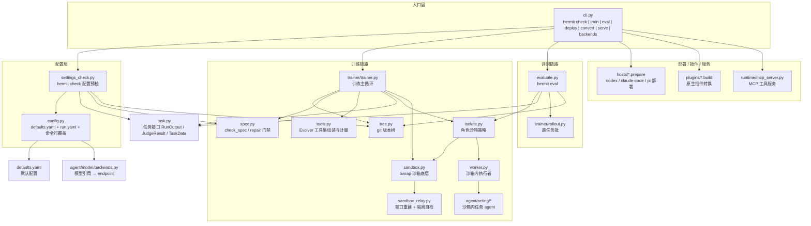
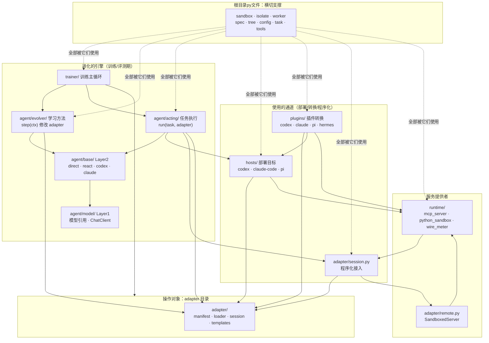
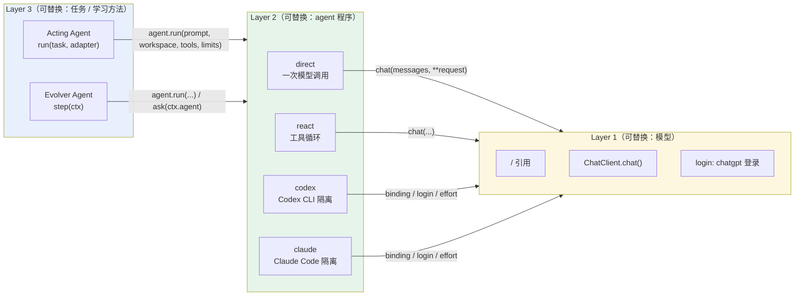
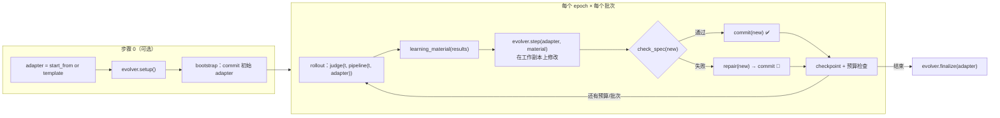

# Hermit 自进化框架

hermit 是一个 harness 自进化框架，支持许多自进化算法；核心是在原有的 harness 基础上维护一个 adapter 适配器，自进化操作实际操作的是这个适配器，原始 harness 保持不变；因此 hermit 也支持黑盒的 harness 适配；同时进化后的 adapter 可以同步到 harness，也可以作为插件形式在原始 harness 上使用。

<div style="text-align:center; margin:1em 0;">

<p style="color:#888; font-size:0.92em; margin:0.25em 0 0;">Hermit 训练循环示意图<br>Image source: <a href="https://github.com/Infini-AI-Lab/hermit">https://github.com/Infini-AI-Lab/hermit</a></p>
</div>

# 代码结构

## 主要文件

|文件|主要作用|
|:---|:---|
|`__init__.py`|包元信息（`__version__`）；惰性导出 `Session`（`from hermit import Session`）|
|`__main__.py`|`python -m hermit` 入口，调用 `cli.main`|
|`cli.py`|命令行入口与子命令参数解析；轻分发到 check / train / eval / deploy / convert / serve / backends|
|`config.py`|三层配置合并（`defaults.yaml` → `run.yaml` → 命令行覆盖），按层写法展开成扁平 `params`，模型引用解析成 endpoint|
|`defaults.yaml`|框架默认配置，三层合并的最底层|
|`settings_check.py`|`hermit check` 配置检查（模型 / 凭据 / sandbox 探针）；通过不代表训练一定成功|
|`task.py`|任务侧契约：`RunOutput` / `JudgeResult`、`load_callable` 动态加载、`TaskData` 读 `tasks.jsonl` + splits 并检查重叠|
|`evaluate.py`|`hermit eval`：用与训练相同的 pipeline + judge 在 test split 上评测，写 `results.jsonl` / `summary.json`；`--adapter final` 时回写 `CARD.md`|
|`spec.py`|`check_spec` 门禁（6 项检查）与 `repair` 最小化回滚；不合格候选在 commit 前被修复|
|`tree.py`|用 git 仓库存 adapter 进化史：模板 = root commit、adapter = commit、run = 分支、checkpoint / final = tag|
|`sandbox.py`|bubblewrap 沙箱底层：正向白名单、只读挂载、网络隔离与端口转发、遮盖秘密|
|`sandbox_relay.py`|沙箱内配套进程：重建转发端口、启动前做隔离自检，通过后才执行命令|
|`isolate.py`|角色化执行隔离（learner / rollout / eval / check / tool）；`agent_pipeline` 在沙箱 worker 中跑 agent|
|`worker.py`|沙箱内作业进程：从 stdin 收 job，跑 agent 或声明的工具，结果经专用 fd 管道交回|
|`tools.py`|Evolver 工具集：从 template / task / run 三来源组装，`MeteredModel` 计量，进程内或 MCP 两种传递|
|`_moved.py`|迁移转发工具 `forward`：旧导入路径带 DeprecationWarning 转到新路径|
|`backends.py`|shim → `hermit.agent.model.backends`（保留 `python -m hermit.backends` 旧入口）|
|`llm.py`|shim → `hermit.agent.model.llm`|
|`trajectory.py`|shim → `hermit.agent.base.trajectory`|

`hermit/` 包主目录各 py 文件的依赖关系，以 `cli.py` 为入口分发到各命令链路。



注：

* **入口**：`cli.py` 只是轻分发，真正实现都在各模块。
* **两条最容易混淆的链**：
  * 训练链：`trainer/trainer.py` → `isolate.py`（角色策略）→ `sandbox.py`（bwrap 底层）→ `worker.py`（沙箱内唯一可信进程）→ 任务 agent。
  * 配置链：`config.py` 做三层合并（defaults → run.yaml → 命令行覆盖），并把按层写法（`base`/`model`/`<base>节`）展开成扁平 `params`，再经 `backends.py` 把模型引用解析成 endpoint。
* **`sandbox.py` vs `isolate.py`**：`sandbox.py` 是通用 bwrap 底层（绑定/转发/遮盖/代理）；`isolate.py` 是上层策略（learner 严格 / rollout 防泄漏 agent 秘密 / tool 严格），定义“谁用哪种配置”。
* **`spec.py` vs `tree.py`**：`spec.py` 决定“adapter 合不合规”，`tree.py` 决定“版本怎么存、怎么回溯”；Trainer 每步是“改副本 → spec 验 → 过则 commit，不过则 repair 再提交”。

## 主要文件夹分布

|模块|角色|
|:---|:---|
|`trainer/`|编排者：批次、rollout、校验、commit、预算|
|`agent/`|引擎：三层架构。`evolver/` 学习侧（改 adapter），`acting/` 执行侧（用 adapter），`base/`+`model/` 被两者调用|
|`adapter/`|核心对象：本体文件 + 元数据 + 模板 + `session` 程序化接入 + `remote` 沙箱化|
|`hosts/`|使用通道①：部署到 workspace|
|`plugins/`|使用通道②：转原生插件|
|`runtime/`|服务提供者：`mcp_server`（adapter 工具暴露成 MCP）、`python_sandbox`、`wire_meter`（模型计量）|
|根目录文件（`sandbox/isolate/worker/spec/tree/config/task/tools`）|基础支撑|

各模块的关系**不是独立的**——所有模块围绕同一个**对象（adapter）**组织：**编排者（trainer）**、**进化的引擎（agent）**、**使用的通道（hosts / plugins / session）**、**服务提供者（runtime）**，另外根目录 py 文件提供基础支撑。



注：

1. **`adapter` 是唯一被操作的对象，其它模块是它的“前后端”**：
   1. trainer+agent 负责“进化它”（写文件→commit）
   2. hosts+plugins+session 负责“使用它”（投放/打包/加载）
   3. runtime 负责“执行它的代码”（工具走 MCP）。
2. **依赖有明确方向，没有环形 import**：
   * 进化侧：`trainer → agent → (hosts / adapter) → sandbox/spec`
   * 使用侧：`hosts/plugins → adapter → runtime → adapter.session`（runtime 和 session 的“循环”是通过**子进程命令**完成的，不是 import）
   * 基础支撑：`sandbox/isolate/worker` 几乎被所有模块引用
3. **`hosts` 是两条路线的交汇点**：训练时 `agent.acting` 内嵌调用它（每个 rollout 部署 adapter 进临时 workspace），独立使用时 `hermit deploy` 命令也调它——**同一套部署逻辑，训练和部署复用**。
4. **`runtime` 是“服务提供商”，自己不主动找活**：它只被引用（MCP 配置、serve 命令、子进程），职责是“把 adapter 的工具代码变成可被调用的服务”，谁需要谁起它。

# 框架设计

adapter 不是被 harness“调用”的，它是被 deploy“放”进 harness 一定会读的位置的。harness 的加载逻辑不变，变的只是那些位置里的内容来源。

## 三层设计：为了解耦

**核心目的**：可替换性——每层只通过下层的一个 API 使用它、把下层当黑盒，所以换模型（Layer 1）、换 agent 程序（Layer 2）、换任务或方法（Layer 3）互不影响。



要点：

* **import 只向下**：L3 能 import L2，L2 能 import L1，反向禁止（`tests/test_layers.py` 用 AST 检查）。
* **每个箭头处只有一个 API**（L2→L1 是 `chat()`；L3→L2 是 `agent.run()`）——“把下层当黑盒”的落点。
* 层外的东西（Trainer、adapter 模板、`deploy`、CLI）不属于任何层，只是使用这些层。
* 配置上也分层：`run.yaml` 里 `agent.base` 是 L2 的选择、`agent.model` 是 L1、`agent.params` 是 L3（`hermit/config.py:layered`），改一处不碰另两处。
* 规则 4（`docs/framework/agent-layers.md`）：换模型只动 Layer 1 的设置，换 agent 程序只动 Layer 2，换任务/方法只动 Layer 3。

|层|内容|对下层的唯一 API|
|:---|:---|:---|
|Layer 1 `model/`|`<backend>/<model>` 引用、backends.yaml、ChatClient、`login: chatgpt`|`chat(messages, **request) → (message, usage)`|
|Layer 2 `base/`|`direct` / `react` / `codex` / `claude` 四种 Base Agent、工具服务器、隔离、登录|`make(“codex”, settings, model)` → `agent.run(prompt, workspace, tools, limits, session, roles) → Result`|
|Layer 3 `acting/` + `evolver/`|Acting Agent（`run(task, adapter)`）、Evolver Agent（`step(ctx)`）|—|

“import 只向下” = L3 → L2 → L1，反向禁止（`tests/test_layers.py` 用 AST 检查）。效果：换模型只动 L1 设置，换 agent 程序只动 L2，换任务/方法只动 L3。

## harness 本身不变，adapter 进行注入

**前提澄清**：harness 从来不会“调用 adapter”。它只做一件事——**从自己的扩展位置按文件名/格式读文件**（`AGENTS.md`、`.codex/skills/`、`.codex/agents/`、MCP 配置）。`deploy` 做的只是**把 adapter 的内容填进这些位置**。harness 分不清“原装”和“外挂”——它按名字读，不按来源读。

```mermaid
flowchart LR
    subgraph A["adapter 目录（可学习、可版本化）"]
        C1["ADAPTER.md<br/>指令/上下文"]
        C2[".agents/skills/*/SKILL.md<br/>skill"]
        C3["sub_agents/*/AGENT.md<br/>子代理"]
        C4["exports.yaml<br/>工具声明"]
        C5["memory/NOTES.md<br/>记忆"]
    end

    subgraph D["deploy（hermit/hosts/codex.py）"]
        E1["append_context<br/>→ 追加进 AGENTS.md 的标记块"]
        E2["copy_skills<br/>→ 复制到 .codex/skills/"]
        E3["roles<br/>→ 写成 .codex/agents/*.toml"]
        E4["MCP server 注册<br/>→ .codex/config.toml"]
    end

    subgraph H["harness 启动时读自己的扩展位置（本体/模型不变）"]
        F1["project instructions"]
        F2["skill 发现机制"]
        F3["multi-agent 角色"]
        F4["工具调用（MCP）"]
    end

    A --> D
    D --> H
```



**三个关键机制**

1. **上下文注入（指令层）**

   `hermit/hosts/context.py:append_context`：把 adapter 的 `ADAPTER.md` 内容包成带标记的块，追加到 workspace 的 `AGENTS.md`：

   ```md
   <!-- hermit:<adapter_id>:start -->

   ## Adapter: `<adapter_id>`

   > Managed by Harness Adapter. Source: `ADAPTER.md` · Version: `1.1`.
   > Only this marked block is replaced when the adapter context is refreshed.

   <adapter 的指令内容>

   **End of adapter: `<adapter_id>`**

   <!-- hermit:<adapter_id>:end -->
   ```

   Codex 每次启动必读 `AGENTS.md`（project instructions），所以任务下发时模型看到的指令里就有 adapter 的内容。原有项目指令原样保留在块外；重新 deploy 时只替换标记块内，块不唯一会拒绝覆盖。

2. **skill 变成 harness 的 skill**

   `hermit/hosts/inputs.py:copy_skills`：把 adapter 的每个 `SKILL.md` 目录复制到 workspace 的 `.codex/skills/`。Codex 的 skill 机制是启动时扫描这个目录——目录里有什么，模型就能用什么。“adapter 的 skill”和“harness 原本的 skill”对 harness 没有区别；原本已有的 skill 会并进去（同名覆盖）。

3. **工具是真代码，走 MCP**

   adapter 的 `exports.yaml` 声明的工具注册成 MCP server（`.codex/config.toml`），模型按工具调用协议请求，由 `hermit serve`（`hermit/runtime/mcp_server.py`）执行 adapter 里的工具代码。这是唯一“运行时执行 adapter 代码”的地方，同样走 harness 官方的 MCP 扩展点。

**关键问题：**

1. **hermit 改动与不改动的地方：**

   |改什么|例子|hermit 能做吗|
   |:---|:---|:---|
   |**harness 程序本体**|Codex/Claude Code 的二进制或源码、加载逻辑、**模型权重**|做不了，设计边界|
   |**harness 的可编辑内容层**|`AGENTS.md` 指令、skills、sub_agents、hooks、memory、工作区脚本|这正是 hermit 的全部工作|

   边界写得很明确，`docs/framework/agent-layers.md` 的 “Outside the layers” 一节：

   > Learning a Base Agent itself: full Meta-Harness rewrites the agent's own loop; here only the adapter is learned.
   > Methods that need a model's internals, such as log-probabilities, several samples per call or training the weights: Base Agents such as Codex do not expose them.

2. **Harness² 和 Continual Harness 改的是什么**

   都是 harness 的**可编辑内容层**，模板定义把论文概念精确映射成文件。

   **Continual Harness**（`continual_harness/.hermit/adapter.yaml` 注释直接写明论文的 H = (p, G, K, M)）：

   |论文概念|模板文件|可学？|
   |:---|:---|:---|
   |p：base policy|`AGENTS.md`|✅ learnable|
   |G：sub-agents|`sub_agents/*/AGENT.md`|✅ learnable|
   |K：skills|`.agents/skills/*/SKILL.md` + `scripts/*`|✅ learnable|
   |M：memory|`memory/NOTES.md`|✅ learnable（Refiner 任务间整理，agent 任务中读写）|

   **Harness²**（`harness2_codex` 模板，README 原话：“The harness is Codex's own tree”）：

   ```yaml
   structure:
     learnable:
       - ADAPTER.md / AGENTS.md        # 指令
       - .agents/skills/*/SKILL.md     # skills
       - .agents/skills/*/scripts/*    # skill 的可执行脚本
       - scripts/*.py                  # 工作区脚本
       - sub_agents/*/AGENT.md         # 子代理
       - .codex/hooks.json             # 自动检查钩子
   ```

   Harness² 论文里“harness”的定义就是这棵树（AGENTS.md + skills + scripts + sub_agents + hooks）。INV/DOM/composer 编辑会话生成的“候选 harness”，就是这些文件的内容。在这个定义下，改“harness 组件”就是它的全部学习内容——不是在改 Codex 程序，而是在改 Codex 程序**会加载的内容**。

## adapter 可转为 harness 插件

plugins 可以把 adapter 转为对应 harness 的插件，默认修改的只是 adapter。

`hermit convert --adapter DIR --output OUT --target codex|claude-code|pi|hermes` 把 adapter 打包成宿主**原生插件格式**（`hermit/plugins/`）：

* `embed_adapter`：**整个 adapter 目录复制进插件内部**的 `adapter/` 子目录——插件自包含：“a plugin that referenced an outside directory would break the moment it was installed anywhere else”
* context/skills/roles 从 adapter 的 exports 渲染成插件的原生格式
* 工具通过 `hermit serve` 提供：插件里写 `hermit serve <adapter> --audit-log ...`（MCP stdio 服务）
* `hermit.json`（`RECORD`）：记录由哪个 adapter、哪个框架版本生成

## 与 Codex / Claude Code 的对接

组件清单来自各模板 `structure.learnable` 的汇总（`prompt_only`、`continual_harness`、`harness2_codex`、`mwm` 等）。

```mermaid
flowchart TB
    subgraph A["hermit 可改动的 harness 组件（adapter 目录，learnable）"]
        C1["ADAPTER.md / AGENTS.md<br/>指令 / policy / 上下文"]
        C2[".agents/skills/*/SKILL.md<br/>+ scripts/* 可执行脚本"]
        C3["sub_agents/*/AGENT.md<br/>子代理"]
        C4["exports.yaml<br/>tools / agents / skills 声明"]
        C5[".codex/hooks.json<br/>自动检查钩子"]
        C6["memory/NOTES.md<br/>跨任务记忆"]
        C7["scripts/*.py<br/>工作区脚本"]
        C8["mwm 等模板自有：tools/**<br/>agents/** consumption/** meta/**"]
    end

    subgraph D["对接层 hermit/hosts/<br/>codex.py / claude_code.py（不改 harness 本体）"]
        M1["append_context<br/>标记块注入"]
        M2["copy_skills<br/>目录复制"]
        M3["roles 转换<br/>原生格式"]
        M4["MCP server 注册<br/>hermit serve"]
        M5["native_hooks<br/>写入"]
        M6["copy_adapter<br/>整体副本 → hermit/<id>/"]
    end

    subgraph CX["Codex 对接落点"]
        X1["AGENTS.md（标记块）"]
        X2[".codex/skills/"]
        X3[".codex/agents/*.toml<br/>+ config.toml 注册"]
        X4[".codex/config.toml<br/>[mcp_servers.<id>]"]
        X5[".codex/hooks.json"]
        X6["hermit/<id>/<br/>（含 memory/ scripts/）"]
    end

    subgraph CC["Claude Code 对接落点"]
        Y1["CLAUDE.md（标记块）"]
        Y2[".claude/skills/"]
        Y3[".claude/agents/*.md"]
        Y4[".mcp.json<br/>mcpServers"]
        Y5[".claude/settings.json<br/>hooks（其他设置保留）"]
        Y6["hermit/<id>/<br/>（含 memory/ scripts/）"]
    end

    C1 --> M1
    C2 --> M2
    C3 --> M3
    C4 --> M4
    C5 --> M5
    C6 --> M6
    C7 --> M6
    C8 --> M6

    M1 --> X1 & Y1
    M2 --> X2 & Y2
    M3 --> X3 & Y3
    M4 --> X4 & Y4
    M5 --> X5 & Y5
    M6 --> X6 & Y6
```



注：

* **两类组件，两条对接路径**：
  * **exports**（上下文、skills、子代理、工具、hooks）→ 连接到 host **原生位置**，harness 启动时自己加载
  * **非 exports**（`memory/`、`scripts/`、模板自有的 `tools/**` 等）→ 留在副本目录 `hermit/<id>/`，由注入的指令（`folder_note`，`hosts/inputs.py`）告诉 agent 路径，在会话中按需读写/执行
* **工具是真代码**：`exports.yaml` 声明的工具注册成 MCP server（Codex 的 `config.toml` / Claude 的 `.mcp.json`），模型调用时由 `hermit serve`（`runtime/mcp_server.py`）执行 adapter 里的实现
* **hooks 落点不同**：Codex 写 `.codex/hooks.json`；Claude Code 写 `.claude/settings.json` 的 `hooks` 字段（`claude_code.py`，**保留文件里其他设置**）
* **roles 格式不同**：Codex 写 `.codex/agents/*.toml`（`codex.py`）；Claude Code 写 `.claude/agents/*.md`（subagent markdown 格式，`claude_code.py`）
* **上下文注入机制相同**：两个 host 都用 `append_context` 的标记块（`hosts/context.py`），重新 deploy 只替换块内
* **两种部署都先做**：`check_workspace`（拒绝往非本框架创建的 workspace 里写）、`adapter_files` 校验（拒绝链接逃逸出 adapter）、`not_portable` 拒绝（含 context_tool 的 adapter 不能独立部署）

## 保证验证受保护

核心原则：**“打分的人（judge）不被进化的人（Evolver）收买，学习的人看不见答案。”** 由五层机制保证：

1. **打分者冻结，且不给学习者打分工具**

   * `judge` 是任务所有者的函数（`judge.path`），Trainer 从不进化它；Evolver 的工具集（`tools.py:assemble`）里**没有 judge 工具**——能用的只有 `check_spec`、`budget`、`llm`、`run_agent` 和模板/任务声明的工具。
   * 学习材料里的分数由 Trainer 管理（`trainer/material.py`），Evolver 只能看到 Trainer 决定给它的内容。

2. **数据分裂防泄漏**

   `task.py:TaskData`（`task.py`）：读 `tasks.jsonl` + train/val/test 三个 split 文件，**`overlaps()` 检查各 split 之间是否有任务重叠**（有重叠直接报错）；训练用 train，评测用 test，Evolver 的验证数据由 `data.val` 显式提供（`needs: validation_data`）。

3. **judge 结果 / 答案对学习者隔离（沙箱）**

   |机制|代码|作用|
   |:---|:---|:---|
   |**mask**（遮盖）|`isolate.py` 把 `run_secrets`（答案文件、judge、runs/trees 目录）盖进 `masked`；`sandbox.py` 用空 tmpfs/空文件覆盖|学习者/agent 的沙箱里这些路径“不存在”|
   |**probe_absent**（断言缺席）|`evolver.py:_assert_hidden` + `sandbox_relay --deny`：答案文件必须验证不存在，检查不过命令不启动|防止沙箱绑定目录意外暴露答案|
   |**worker 结果管道**|`worker.py`：fd 不可继承 + `PR_SET_DUMPABLE=0`|沙箱里的 agent 无法伪造分数/成本|

   典型例证：Harness² 的 editor 会话“看到任务、evidence、trajectory，**看不到 judge 结果**”（`bench.py` 的 `private` 只有实验者能读）。

4. **只有合法 adapter 能进版本**

   `spec.py:check_spec` 六项：`.hermit/` 元数据和模板 `fixed` 文件 **sha256 逐一对比**（改了字节就拦）、文件必须在 `learnable` 路径内、格式限制（`max_bytes`/`text`/`frontmatter`）、真跑一次部署渲染。不合格的候选由 `repair`（`spec.py:215`）**最小回滚**后再提交——**每次 commit 都是合规的 adapter**。

5. **评测与训练同管道、在干净快照上跑**

   * `evaluate.py` 用**与训练完全相同的 pipeline 和 judge**（`agent_pipeline` + `run_tasks`），不引入新的评测代码
   * `--adapter final/root/commit` 从 git 树**导出干净快照**（`Tree.export`）再跑，不信任工作区状态
   * 结果写 `runs/<run>/eval/<label>/`，`--adapter final` 时把评测表写回 `CARD.md` 并重新 commit + 打 tag（`evaluate.py:_update_card`）

## 实现循环进化

Trainer 主循环（`trainer.py` + `CLAUDE.md:93-108` 的伪代码）：



对应代码与机制：

|环节|实现|
|:---|:---|
|**rollout**|`isolate.py:agent_pipeline` → `worker.py` 沙箱 → `acting` agent 把 adapter 部署进临时 workspace 跑任务 → judge 打分|
|**学习材料**|`trainer/material.py` + `rollout.py`：每个任务的 trajectory、prompt、judge 结果、log 组成 `learning_material/`|
|**Evolver 修改**|`evolver.step(ctx)` 只拿 `Workspace`（`adapter` 可写副本、`learning_material` 只读、`history` 只读、`state` 可写、`scratch`、`output`）——**改的是副本，不是已提交版本**|
|**门禁 + 提交**|`_commit_step`（`trainer.py:548`）：`Tree.sync` → `check_spec` → 过则 `Tree.commit`；不过则先标记 `INVALID_MARK` 提交、`repair` 最小回滚、再提交修复|
|**版本化**|`tree.py`：git 树（root commit = 模板、训练 run = 分支、checkpoint/final = 带 run 名前缀的 tag）；`Tree.history_view` 给 Evolver 只读历史|
|**恢复**|`resume_mode: auto`：崩溃后同 run_name 重跑，从最近 checkpoint 继续（`steps.jsonl` + git 状态）|
|**预算**|`trainer/budget.py`：usd/tokens/hours 硬预算，超了 `BudgetExceeded` 停跑；Evolver 的每次模型调用和工具调用都计量（`MeteredModel`）|

进化闭环一句话：**每次循环 = “用当前合法版本跑一批任务拿反馈 → 把反馈交给 Evolver 在副本上改 → 校验合法性 → 通过就提交成新版本、失败就修复回滚 → 检查点 + 预算检查 → 下一批”；版本树保证每一步都可回溯，spec 门禁保证进树的都是合规 adapter，judge 冻结保证分数的可信。**
