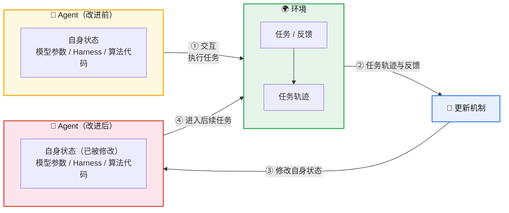
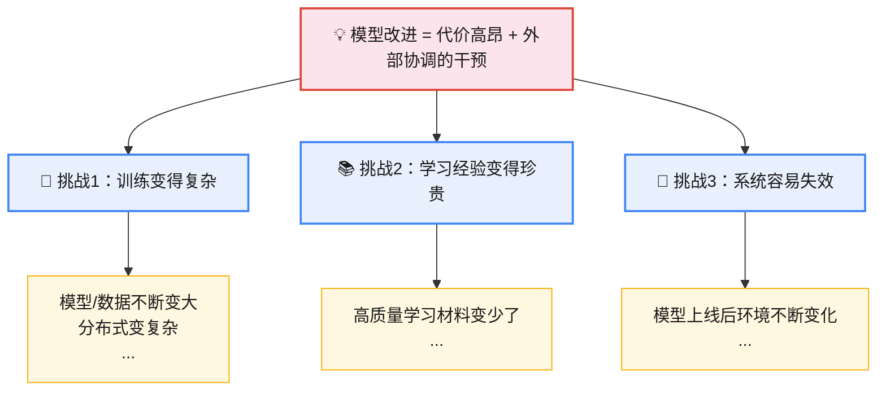
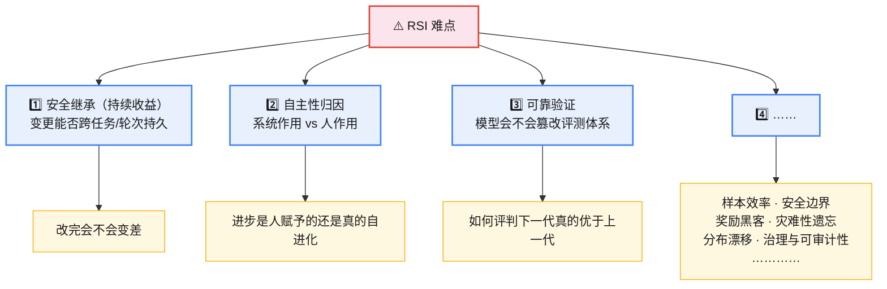
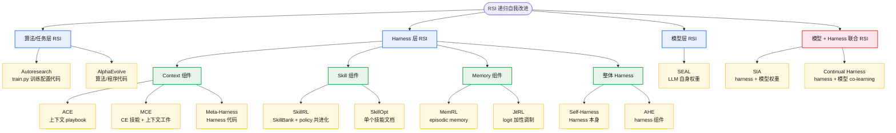
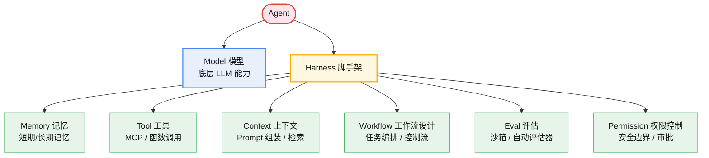
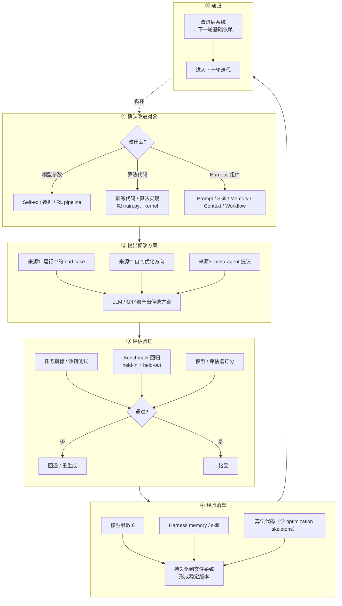
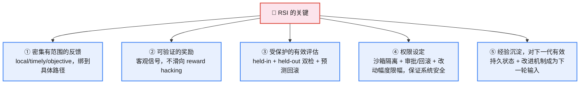

# RSI 基本概念

## RSI 是什么

RSI （Recursive Self-Improvement，递归自我改进）仍在飞速发展，尚未形成统一的技术范式。不同工作选择的改进对象和实现路径差异很大：有的更新模型参数，有的积累上下文或记忆，有的演化 Skill，还有的直接修改工具、控制流程和 Harness 代码。因此，RSI 很难用某一种具体方法或单一技术路线来概括。

粗略的定义：Agent 在与环境交互后，利用任务轨迹与反馈，通过更新机制修改自身状态，并让更新后的状态**参与后续任务**，以提升未来表现。

广义 RSI 定义：只要 AI 系统能自动/自主地改进、提升、优化自己，就归入 RSI，不再严格区分 RSI、自进化或持续学习。

> RSI 和自进化的定义就越来越模糊了。这就有点像早期的 Agent 概念，各类型的 Agent 或者 AI 应用都往里装，但也并不阻碍技术的发展。
### RSI 与相邻范式对比

|**特性**|**持续学习**|**AutoML**|**Agentic AI/ML**|**RSI**|
|:---|:---:|:---:|:---:|:---:|
|跨轮学习（Cross-round learning）|●|○|○|●|
|持久保留（Persistent retention）|●|○|○|●|
|系统自我修改（System self-modification）|○|×|●|●|
|候选提出（Candidate proposal）|×|●|●|●|
|更新验证（Update validation）|○|○|●|●|
|后继重入（Successor re-entry）|×|×|○|●|
|机制修订（Mechanism revision）|×|○|×|●|
|机制复用（Mechanism reuse）|×|×|○|●|

> ● 核心目标；○ 次要支持；× 超出范围
关键区分：

* 持续学习强在"跨轮学习 + 持久保留"，但不主动改系统本身。
* AutoML 强在"候选提出"和部分"机制修订"，但缺乏跨轮持久保留和后继重入。
* **Agentic AI/ML** 强在"系统自我修改 + 候选提出 + 更新验证"，但"机制修订/复用"基本不在范围内。
* **RSI** 的独特性正在于把"机制修订 + 机制复用 + 后继重入"作为核心，让改进机制本身成为下一轮改进的输入。

## 为什么需要 RSI（挑战与难点）

* 挑战

模型改进仍然是一系列代价高昂、外部协调的干预。

目前很多流程都需要工程师人工诊断、修改、测试再发布。是否可以设计一个流程让 AI 发现问题、提出改进、验证改进、保留改进——RSI。

* 难点

## RSI 发展路径

论文：The Last AI Built by Humans: Toward Genuine Recursive Self-Improvement，给出 RSI 的发展路线图

RSI 发展的每一个阶段

* **B0（非 RSI ）**：改进只在当前任务内，不保留持久状态。
* **L1（人定程序改什么、怎么改，AI 执行）**：AI 执行人定义的改进程序，结果保留并复用。示例：数据 / 训练方法 / 训练平台 / 评估 / 部署 / 应用系统各层（如 AIPC 部署、Codex 软件开发）。
* **L2（人定目标和评价标准，AI 决定下一步怎么改，有没有达到目标）**：人固定目标与标准，AI 决定下一个改进介入。示例：配置搜寻（TAO）、架构搜寻（AgentNAS）、训练规则搜寻（NanoGPT、autoresearch）、算子实现搜寻（AutoKernel）。
* **L3（AI 决定下一步获得经验，训练什么任务）**：AI 还决定"从什么中学习"。回路：观察状态 → 选经验 → 获取 → 更新状态 → 重塑未来经验 → 重复。
* **L4（真实部署环境中获得经验并持续适应后续环境）**：部署交互反馈修订记忆/技能/执行元件。
* **L5（怎么改进自己机制本身）**：AI 持久修订"改进器/评估器/搜寻策略"本身 。

举个例子：coding agent 修改 bug

* **B0**：改一个 bug
* **L1**：改一个 bug + 留下人定的规则
* **L2**：自己决定下一个 bug 怎么改
* **L3**：自己决定接下来学什么
* **L4**：把部署反馈变成下次能直接用的元件
* **L5**：改"改 bug 的流程"本身

# RSI 的分类

# RSI 的分类

下面讨论的工作不区分到底是不是RSI，只要对RSI有促进意义都是本次讨论的范围

# 算法/任务层的 RSI

AI coding 工具，给定一个目标，它就会写代码、自己编译、自己测试，有 bug 自己修，最终输出能达到要求的代码。产出物一版比一版强，这就是 Artifacts（算法/任务） 层面的自我进化，改的是产出物本身，不涉及模型权重，也不涉及 agent 自身的脚手架逻辑。

**Autoresearch**

Autoresearch 的工作：让 AI agent（如 Claude Code）像人类研究员一样，自主、循环、不间断地在单 GPU 上做神经网络训练实验：`改代码 → 训练 5 分钟 → 看结果 → 保留或回退 → 继续尝试`。实验设计：

* agent 只能改一个文件 `train.py`（架构、超参、优化器、batch size 随便调）
* 每次固定跑 5 分钟训练，用 `val_bpb`（验证集 bits-per-byte，越低越好）这个客观指标打分
* 根据指标改好了就留、没改好就扔，自动循环。

按这个节奏一小时能跑 12 个实验，一夜下来能跑上百个。这里的 Artifacts，就是那个被不断改进的 `train.py`/模型配置本身。

**AlphaEvolve**

**AlphaEvolve =**自动寻找更优程序的搜索系统；

1. 用户定义：用户提供 prompt 模板、模型选择、**评估代码**、初始程序，以及**哪些代码组件可以被演化**。
2. prompt 构造：从程序数据库中选取程序，构建丰富提示
3. 生成diff：依据提示生成代码差异（diff），应用到现有程序生成新候选
4. 评估：对新程序打分（适应度评估）
5. 保存演化记忆数据库：将有前景的解重新注册，成为下一轮变异的素材

**AlphaEvolve **帮 Gemini 自己的矩阵乘法核心提速 23%、FlashAttention 提速 32.5%，甚至提出过硬件层面的 Verilog 修改。这些改进又被用回 Gemini 的训练里，形成一个"AI 优化驱动自己的模型"的闭环。

应用领域：在候选解可自动评估且适应度易于量化（如矩阵乘法、GPU 核优化、算法竞赛、数据中心调度）时表现良好。

> **相似工作**
> **STOP**
> ****[Self-Taught Optimizer (STOP)](https://arxiv.org/abs/2310.02304)：种子"improver"程序（输入程序 + 效用函数 → 查询 LM 多次 → 返回最优解）被喂给它自己，LM 提出更好版本。LM 自主发现 beam search / 遗传算法 / 模拟退火改 scaffolding。作者明确说"LM 本身未被修改，不是完整 RSI"——属受限 RSI。
> **DGM**
> [Darwin Godel Machine (DGM)](https://arxiv.org/abs/2505.22954)：放弃 Gödel Machine 的形式化证明改经验验证。维护 agent 档案库 → 采样变体 → benchmark 验证 → 入档，长成"agent 进化树"并行探索。系统改自身代码 → 提升进一步改自身代码的能力，属明确 RSI。SWE-bench 20% → 50%，Polyglot 14.2% → 30.7%。
> **AIDE**
> [AIDE: AI-Driven Exploration in the Space of Code](https://arxiv.org/abs/2502.13138)：把 ML trial-and-error 形式化为**解空间树搜索**，每步识别最有希望分支，复用有用代码组件、丢弃死路。AI4AI（自动化 ML 工程任务，非递归自修改）。Kaggle / MLE-Bench / RE-Bench SOTA。
> **AIDE²**
> [AIDE²: Recursive self-improvement of AI research agents](https://arxiv.org/abs/2609.26457)：AI 研究 agent 的自身源代码成为优化目标——每个被接受的改写直接成为下一代 agent。自治 8 天 7 次连续改进；双环设计实现跨任务沉淀；reward hacking 55% → 32% 自然下降。论文自称"递归自改进"，held-out 4 基准泛化。
> **ADAS**
> [Automated Design of Agentic Systems (ADAS)](https://arxiv.org/abs/2408.08435)：把 agent 定义为代码（图灵完备）。Meta Agent Search：meta agent 迭代编程新 agent 代码，建立在"不断增长的先前发现档案"上。AI4AI（meta agent 设计其他 agent，非自改）。跨域跨模型仍优，非过拟合。
# Harness 层面的 RSI

Agent 跑任务踩了坑，把错误总结成一条新 skill 或一段新 memory 存下来，下次碰到同类任务直接调用，不用再犯一次。agent 自己把自己的Harness 越改越顺手，这就是 Harness 层面的自我进化。

模型训练成本高昂，因此一个自然的问题是，是否可以在不更新模型权重的情况下，在部署后改进 Agent。[Harness Engineering for Self-Improvement](https://lilianweng.github.io/posts/2026-07-04-harness/) 里判断，RSI 近期不太可能从模型直接改写自己的权重开始，更现实的路径是先在 Harness 层爆发，理由是：

1. 改 Harness 本身就能省钱
2. 不挑模型

## Harness 基本框架

**Harness 框架的特点**

* **工作流自动化**

* **文件系统作为持久记忆**

长程 Agent 系统中反复出现的一种模式是对状态和产物的简洁控制。Harness 不应将整个工作流和所有日志都承载在上下文中；相反，它应将持久状态保存在文件中。在长程 Agent 推进过程中，实验日志、代码 diff、论文摘要、错误追踪和过往推进轨迹等产物的规模常常远超模型训练时所用的上下文窗口。

* **子 Agent 与后台作业**

Harness 可以生成多个子 Agent 并行执行，并监控后台作业。当主 Agent 需要搜索多个假设、并发运行实验，或将隔离的子任务委派出去而不污染主上下文时，这非常有用。父 Agent 随后需要一个小型进程管理器：启动作业、检查日志、取消失败运行，并将结果合并回主 Agent 线程。

关键设计选择是让并行性显式且可检视。如果子 Agent 的输出只存在于瞬态聊天上下文中，它们很快就会过时并被隐藏。如果它们以文件、日志和状态记录的形式存储，模型就能在中断后恢复，并对自身的执行历史进行推理。

## Harness RSI

Harness 就是代码，它规定了提示词、工具调用、子智能体、控制流、记忆以及工作流逻辑之间该如何协同工作。如果一个 LLM 能够优化执行智能体所依赖的代码，那么它所能触及的设计空间，就会远大于手写提示词所能覆盖的范围。

### 各组件的 RSI

#### Context 层面

**Agentic Context Engineering**

ACE 把上下文当作一本不断演化的「playbook」，而不是一段越写越长的提示词。它维护一个由多条要点组成的上下文 playbook，每条要点都有自己的**标识符和描述**。

1. 生成器（Generator）：参照已有的要点，生成任务执行轨迹。
2. 反思器（Reflector）：从成功和失败的执行轨迹中提炼出洞见。
3. 整编器（Curator）：以增量、条目化的方式更新结构化上下文。

为了在迭代重写过程中防止上下文坍缩，ACE 输出的是一组结构化的、条目化的要点，形式为（标识符，描述），这些要点会依据确定性的逻辑被合并进结构化的上下文日志中。这些上下文条目还会被定期精炼和去重。

ACE 能够从执行轨迹中学习洞见，这有助于我们朝着「自我管理的记忆」迈进，但它的**更新规则和整体工作流仍然是人工设计的**。

**Meta Context Engineering**

MCE 的思想：ACE 的更进一步，“授人以鱼不如授人以渔”的进化版。

MCE 将「如何管理上下文」与「上下文里具体是什么」分离开来，让skill 演化发生在元优化层面，而上下文优化发生在基础层面。

类比强化学习里的 meta-RL：外层学"学习策略"，内层用策略学"具体知识"。

* meta-agent 产出的是 怎么学（methodology / SKILL.md），负责"进化技能"
* base-agent 产出的是 学到了什么（context 文件 + interfaces），负责"执行与建造"

**Meta-Harness**

Meta-Harness 优化的对象是决定「哪些信息应当被存储、检索并呈现给模型」的那段代码本身。它的名字里之所以有「Meta-」，就是因为这是一个用于优化 Harness 的 Harness。

1. **阅读文件系统**：一个 Coding Agent proposer （论文用的是 Claude Code + Opus 4.6）去读文件系统里存储的所有历史记录，包括之前每一版 Harness 的源代码、评估分数、执行 trace。
2. **跑评估**：把新提出的 Harness 拿去跑实际任务，收集成绩和轨迹。
3. **更新文件系统**：把这一轮的所有产物，代码、分数、推理过程、执行日志，全部写回文件系统，供下一轮查阅，不断循环

关键：proposer 可以看到所有的文件系统反馈，而不是压缩后的信息

可以理解为meta-harness 是一个外层搜索算法，搜索对象不是模型权重，而是 harness 代码

line4-line6 是冷启动，论文冷启动直接拿该 domain 已有的几个公开强 baseline harness 原样组成一个集合作为初始 population，跑一遍评估把 filesystem 铺底，然后交给 proposer 迭代搜索

#### Skill 层面

**SkillRL**

SkillRL 把原始轨迹蒸馏成短技能存入分层 SkillBank，SkillBank 与 RL policy 双向共进化：

policy 变强 → 暴露新失败 → 蒸馏新技能 → 反哺 policy

")
1. **经验蒸馏**：采集成功+失败轨迹 → Teacher 蒸馏成 10–20× 压缩的技能
2. **分层skill 构建**：通用技能 `S_g` + 任务特定 `S_k`，自适应检索（`S_g` 永远加载 + `S_k` TopK=6 语义相似）
3. **递归进化 + RL**：SFT 冷启 → GRPO 训练（KL 锚定 `π_sft`）→ 验证成功率 < 0.4 触发失败分析 → 扩库→ 共进化（skill & base model）

**SkillOpt**

SkillOpt 借鉴了训练模型的方式，实现 Skill 的自动优化：文本==参数权重

")
关键：

1. 冻结任务Skill：用当前的Skill去执行一批任务，收集执行轨迹与得分。
2. 优化器（LLM 充当优化器）分别分析成功与失败的案例：提出增加、删除、替换等操作建议，然后再合并掉重复或冲突的建议。
3. 用编辑数量来限制每轮的修改幅度：类似于文本空间里的“学习率”，控制修改幅度，防止改得太猛。
4. 候选修改只有在验证集上严格提分才会被接受：失败的编辑不会被丢弃，会连同其导致的分数跌幅一起存入Rejected-Edit Buffer。这些“失败教训”会被喂给后续的优化器，帮助它理解哪些修改方向是危险的，从而避免重蹈覆辙。这将流程从“无条件自我编辑”升级为严谨的 Propose-and-Test 优化闭环。
5. 跨epoch整理比较稳定的任务经验：同时维护一个优化器专用的`meta_skill`，记录“哪些编辑模式好用”、“哪些被频繁拒绝”、“哪些失败一直未解决”，从而指导优化器自身的策略调整，你可以理解为这是“调优Skill 经验的 Skill 的经验”

#### Memory 层面

**MemRL**

MemRL 由结构化记忆库、两阶段检索机制、非参数化强化学习的效用更新规则三部分构成，形成端到端的学习闭环：输入查询→检索记忆→生成输出→基于环境奖励更新记忆效用。

")
1. 结构化记忆库：（意图 Z，经验 E，效用 Q ），引入基于真实业务反馈的"效用评分（Q值）"机制
2. 两阶段检索机制：阶段A：基于相似度的召回；阶段B：基于价值的选择；
3. 基于非参数化强化学习的运行时效用更新：在记忆空间中持续优化Q值，无需修改LLM权重，依托环境反馈（如任务成功/失败、标量分数）实现效用精修：Q ← Q + alpha * (r - Q)

MemRL 的 Q 来源于把经典 Q-learning 的"动作价值"重新绑定到记忆检索决策上（$Q(s,a) \to Q(s,m)$），这一绑定由 M-MDP 框架的策略分解推导出来，具备数学解释性。

**JitRL**

JitRL（Just-In-Time Reinforcement Learning），即时强化学习：不重新训练、不更新任何梯度，而是在推理时检索历史经验、现场估计动作优势，并把优势直接加到模型输出的 logits 上

JitRL 与传统 RL 的区别：不更新模型参数、类TTT思想：

")
传统 RL 训练：收集轨迹 -> 模型进行RL训练 ->参数更新

JitRL** **推理：检索轨迹 -> 计算优势 -> 修正模型推理输出

")
整体闭环流程：

1. **推理阶段（Inference）**
    1. agent 根据当前state 从记忆库中检索到历史经验——（状态，动作，奖励）
    2. 根据检索到的经验估计优势
    3. 利用优势加到logit，从而调整模型的输出

2. **记忆更新阶段（Memory Update）**
    1. 跑完一个轨迹，利用评估器针对每一步进行奖励评估
    2. 将新的（状态，动作，奖励）存到记忆库中

关键：

1. logits 加性调制数学可解释性：理论上是 KL 约束策略优化的闭式解
2. 动作是可枚举的，否则影响检索效果
3. beta 控制探索和利用（没有见过的 action）
4. evaluator 会分段进行打分，在得到结果之后进行打分
5. 闭源模型拿不到 logits 则让模型输出置性度

> **相似工作**
> **ReasoningBank**
> [ReasoningBank: Scaling Agent Self-Evolving with Reasoning Memory](https://arxiv.org/abs/2509.25140)：从 agent 自判成功/失败中提取可泛化推理模式入**推理记忆库** → 测试时检索指导当前任务 → 折回新经验，跨任务在线沉淀。**MaTTS**（memory-aware test-time scaling）：多花算力生多样经验 → 更强记忆 → 改善未来 scaling，正反馈环。属"更接近 RSI"（记忆驱动经验扩展，非改架构或训练流程）。
### Harness-full RSI

**Self-Harness**

依靠 LLM 智能体，通过「提议—评估—接受」的循环来改进自己的 Harness。

1. **弱点挖掘**：将失败案例聚类，归纳为**有验证依据**的失败模式。

* 用当前 Harness h_t 在各项任务上进行评估，并收集执行轨迹以供分析。
* 需要注意的是，两次运行在错误日志的表层上可能得到同样的验证结果（比如都是超时或产物缺失），但背后的因果机制却可能完全不同。因此需要记录信息丰富的失败记录，其中包含终端验证层面的直接原因、相关智能体行为的因果状态，以及执行轨迹所暴露出的抽象智能体机制，以此来揭示真正的根本原因。

2. **Harness 提议**：基于挖掘出的失败模式，提出有边界限制的 Harness 修改方案。

* 由同一个模型在 h_t 之下被调用，充当提议者。
* 提供给该模型的提议上下文是有边界的，包括：（1）当前 Harness 中可编辑的部分；（2）来自评估系统、有验证依据的失败模式；（3）应当被保留的、已通过验证的行为记录；以及（4）此前尝试过的修改方案摘要。
* Harness 的修改应当优先针对那些反复出现、且可以被解决的错误模式（例如排除掉那些只是任务本身难度较大的情况），并且能够通过局部、有限的改动来解决。
* 提出的 Harness 修改候选方案彼此之间应当各不相同、足够多样化。

3. **提议验证**：验证并合并合格的修改方案，生成新的 Harness h_(t+1)。

* 候选修改方案会在 held-in 数据集 D_in（用于检验该弱点是否已被解决）和 held-out 数据集 D_out（用于检查是否引入了其他未知问题）上，通过回归测试进行评估。
* 只有在 held-in 和 held-out 数据上都没有出现回退的候选方案，才会被接受。
* 被接受的候选方案会被合并，用以更新 Harness；被拒绝的候选方案则会被记录下来，但不会改变当前正在使用的 Harness h_t。

> 相似工作
> Harness²（[https://arxiv.org/abs/2610.14224](https://arxiv.org/abs/2610.14224)），维护两套 Harness：执行 Harness负责完成当前任务，也是直接被改写的对象；改进 Harness负责诊断问题、生成候选、比较执行证据并沉淀经验；双层递归——任务级 Propose-Probe-Compose 不需 ground-truth verifier，harnessing 级把任务级经验抽到持续改进 harness 用于未来任务。
**Agentic Harness Engineering**

Agentic Harness Engineering 作者认为 harness 演化的瓶颈在于**可观测性**——当一次推进失败时，需要知道哪个组件负有责任，且每次编辑都应以证据为依据。

强调：

1. **组件可观测性：**每个可编辑的 harness 组件在文件系统中有一个表示，使动作空间显式且可追踪。一个 harness 包含 7 个组件：系统提示、工具描述、工具实现、中间件、技能、子 Agent 配置和长期记忆。每种失败模式被映射到一个组件。
2. **经验可观测性**：分析和总结大量原始轨迹为证据与失败模式的层级结构。每个 harness 生成 $k$ 条轨迹。一个"Agent 调试器"分析轨迹并生成每任务分析报告。把百万级 raw trajectory tokens 蒸馏成分层、可下钻的证据语料，而不是直接喂原始日志。
3. **决策可观测性**：每次编辑都配有一个对下一轮的预测以供验证。在新一轮任务集上跑出任务级指标。把实测结果与之前的预测对照——如果预测被证伪，就回滚这次编辑。

1. line3-rollout：让上一轮的 harness 驱动模型 M，对基准 D 中每个任务跑 k 次推理，得到原始轨迹
2. line4-clean：把高噪声的原始轨迹规范化成统一格式（经验可观测性），剥离无关 token，方便下游分析
3. line5-line10：从第 2 轮开始，把上一轮自己声明的预测清单 `C_{t-1}`（"我这次修改会修复哪些任务、可能弄坏哪些任务"）和实际的任务级 Δ对比。对预测"修复但没修复"和"未预测的回归"，按文件粒度回滚对应组件（决策可观测性）。
4. line11：对规范化后的轨迹做分层蒸馏：先做每个任务的根因分析，再做基准层面的总览报告。
5. line12：证据 `R_t` 和上一轮归因 `V_t`，对 harness 工作区做编辑
6. line13：把本轮 harness 和清单按轮次打 git tag，用于回滚
7. line14-line15：更新`H_{best}`

在 Terminal-Bench-2 上，AHE 除 Hard 档外均优于人工设计的 harness（OpenCode、Terminus-2、Codex）。同一冻结的 harness 迁移到 SWE-bench-verified 仍有效，表明演化出的 harness 编码的是工程经验，而非做基准特定的优化。

> 相似工作
> **CoMAS**
> [CoMAS: Co-Evolving Multi-Agent Systems via Interaction Rewards](https://arxiv.org/abs/2510.08529)：多 agent 互为改进器，**无外部奖励**——从 inter-agent 讨论动态生 intrinsic reward，LLM-as-a-judge 评估；各 agent 用 RL 优化自己 policy，去中心化共进化。agent 数量与多样性越多性能越好。属"更接近 RSI"（去中心化多 agent 自生成奖励）。
# 推理基础设施的 RSI 早期实践

[Toward Recursive Self-Improvement: How GLM Built Its Own Inference Infrastructure](https://z.ai/blog/glm-built-its-inference-infrastructure) 记录 GLM-5.3 驱动的 Infra Agent 为 GLM-5.3-Flash 在 10 万+ 国产加速器上从零搭了整套推理基础设施——2 周内端到端吞吐 3× 提升。作者明确说"未达到 RSI"，但"模型优化系统，系统跑模型"已经构成 Toward RSI 的早期回路，对应 RSI 等级 L1-L2。

关键设计是**稠密的反馈机制**：

* **局部性**：反馈绑到具体 kernel / 代码路径 / 输入条件 / 执行区间，帮 agent 收窄问题范围

> ×：做了融合优化后模型精度下降
> √：某次请求在改动前后的输出差异
* **成本低**：kernel 测试或局部 microbench 能验证的，不每次都跑端到端部署；缩短验证周期
* **支持客观验证**：需要通过对照实验来验证：对某条具体路径的改动是否产生了预期效果

本地验证和端到端测试在此过程中扮演不同角色。前者尽早淘汰错误或无效的改动，并筛出值得推进的候选；后者确认本地收益能否转化为真实服务提升，以及改动在实际负载下是否引入新的回退。

围绕密集反馈构建的 Infra Agent 优化回路：

工程师：

1. 定义优化目标与系统约束
2. 搭建 agent 可直接使用的反馈环境
3. 评审涉及系统架构、异步并发和生产风险的关键改动

agent：提出假设、实现改动、运行实验，再用反馈决定是保留、修改还是放弃当前方案

反馈细分

* 正确性反馈：并行策略→kernel 映射 + 分片/未分片路径对比 → KDA CP 路径 TF32 累积误差
* 系统级反馈：测试场景 + 验收标准 + timeline 归因 → DeepEP v1.2.1 未释放 GIL 阻塞 Mooncake Transfer
* 性能反馈：从已有 kernel 提取"optimization skeletons" + 分层测试 → KDA Decode v0→v3 累计 1.71× 提速

反馈的价值不在于数量，而在于是否帮助 agent 回答手头的问题。大量非结构化日志会淹没关键信号；覆盖不全的 profiling 会导致错误归因；在微基准中有效的优化未必能转化为端到端收益。因此，**搭建反馈环境**不只是提供测试、日志和性能数据，还需要说明每一类观察能支撑什么判断、其边界在哪里、哪些结论必须通过进一步实验来确认。

# 模型权重层面的 RSI

Harness 演化改变的是模型周围的非参数系统。要实现完全的自我改进，可以允许模型同时更新自身权重。

**模型权重更新工作**

**SEAL**

整体步骤：

1. 从数据集 D 中随机采样一批 N 个任务实例
2. 生成候选自我编辑（编辑生成指令数据），对于每一个任务，生成 M 个不同的候选自我编辑指令
3. 对于每一个生成的自我编辑（N x M 次微调和奖励评估，耗算力），对模型进行LoRA 微调，得到一个新的模型参数
4. 评估进行奖励，利用任务完成度进行奖励
5. 根据奖励进行强化学习策略更新模型参数

> 相似工作：Terminal-RSI（[https://arxiv.org/abs/2610.22192](https://arxiv.org/abs/2610.22192)），递归自重写 + 策略精化 5 阶段训练管线（RSR-1/RPR-1/RSR-2/RPR-2），TB-GAE + Family Dense Reward + Success-Prioritized Reward + critic 跨阶段继承；Terminal-Bench 4.0 19.84%、Terminal-Bench 3.0 16.95%。
**Harness + 模型权重联合更新的工作**

**SIA**

|**阵营**|**改什么**|**不改什么**|**局限**|
|:---|:---|:---|:---|
|**Harness-update 派**|meta-agent 重写任务 agent 的脚手架（工具/提示/重试/搜索）|模型权重|只改"怎么搜"，灌不进领域直觉|
|**Test-time training 派**|用手写 RL pipeline 更新模型权重|harness|只改"知道什么"，改不了"怎么行动"|

SIA 的主张：**两个杠杆同时拉**，由一个 Feedback-Agent 在运行时决定下一动是改 harness 还是改权重。

三个 agent：

1. Meta-Agent ：根据任务规格 （Task spec） 和参考实现，生成初代 harness A₁ 。
2. Task-Specific Agent：在沙箱里跑数据集 𝒟（数据集只读、工作目录可读写），产出完整轨迹 τ_g。
3. Feedback-Agent ：读轨迹、识别失败模式，决定下一步是改 harness 还是改权重，并产出改进报告 + 新 scaffold 或一次 RL 训练步。

完整流程：

1. 收到任务规格 𝒰 和 verifier V
2. Meta-Agent 生成初始 harness  A₁ = ℳ(𝒰, ℛ)
3. 循环直到预算耗尽：

    * Execute：A_g 在沙箱跑 𝒟，捕获完整轨迹 τ_g
    * Analyze：ℱ 接收 (A_g, τ_g, ℰ_g, 采样任务描述)
    * Decide：ℱ 根据轨迹观测选择动作类型（H 或 W）
    * Improve：
        * H：θ 固定，合成 A_{g+1} = ℱ(A_g, τ_g(π_θ), ℰ_g, 𝒰)
        * W：harness 固定，按奖励选 RL 算法，LoRA 更新 θ

    * 结果回喂任务 agent

4. 输出 SIA-H（仅 harness 最佳）和 SIA-W+H（harness + 权重最佳）

> 相似工作：MASS（[https://pub.sakana.ai/mass/](https://pub.sakana.ai/mass/)），Multi-Agent Self-Supervision——同一模型兼任 task solver / workflow optimizer / evaluator 三角色，内环改 multi-agent workflow harness，外环在自判最优 workflow 上 LoRA 更新权重；显式 homogeneous RSI（模型自己当自己的优化器和评估器），非可验证研究任务上 1.2–1.6× score-per-token。
**Continual Harness**

在 harness 和模型权重层面联合自我改进

通过在低奖励轨迹上蒸馏强教师模型标签来共同学习策略模型

* 单 Episode：Harness 自改进（θ 冻结）

    1. 初始化空壳 harness
    2. Agent 走一步
    3. 判断是否触发 Refiner
    4. Refiner 读轨迹窗口
    5. 改 harness：prompt、sub-agent、skill、memory
    6. 下一步 Agent 直接用新 harness 继续。回到步骤 b

失败信号在 episode 内单调累积，早期签名留给后续所有harness 组件，收益随 episode 长度复合增长。

* 跨训练迭代：Model + Harness Co-Learning（θ 也动）

    1. SFT warmup （KD 方式蒸馏，teacher -> student）
    2. Offline GRPO warmup （用 RL 让 student 在 teacher 访问过的状态上自己试）
    3. Online co-learning 主循环
        1. 加载上迭代末的 emulator state 和 harness ℋ
        2. harness Refiner
        3. PRM 打分
        4. 挑低分窗口 + Teacher 重标（用 teacher  对低分窗口重新写答案）
        5. 对重标数据进行soft sft权重更新

# 总结

## 工作分类总结

|**工作**|**类别**|**改进对象**|**输入**|**人类参与**|**RSI 归属**|**适合任务**|
|:---|:---|:---|:---|:---|:---|:---|
|**Autoresearch** [code](https://github.com/karpathy/autoresearch)|算法/任务层|`train.py` 训练配置代码|任务目标 + 验证指标（val_bpb）|设任务、评估指标、计算预算|AI4AI（L2 候选搜寻）|单 GPU 神经网络训练实验|
|**AlphaEvolve** [arXiv:2506.13131](https://arxiv.org/abs/2506.13131)|算法/任务层|算法/程序代码（用户标记可演化组件）|初始程序 + 评估代码 + 进化档案|设问题、定义评估器、选可演化组件|AI4AI + 弱 RSI（加速了自身 LLM 训练）|算法发现、矩阵乘法/FlashAttention/调度/硬件电路优化|
|**AIDE** [arXiv:2502.13138](https://arxiv.org/abs/2502.13138)|算法/任务层|ML 工程代码（架构/预处理/训练循环）|ML 任务规格 + 先前解尝试|设任务|AI4AI（树搜索自动化 ML 工程）|Kaggle、MLE-Bench、RE-Bench|
|**AIDE²** [arXiv:2609.26457](https://arxiv.org/abs/2609.26457)|算法/任务层|AI 研究 agent 自身源代码（search policy、memory、context 管理）|当前 agent 代码库 + R&D 基准|仅设外部约束（8 天自治运行）|**明确 RSI**（论文自称）|ML 工程、启发式算法、物理天气预报；held-out 4 基准泛化|
|**STOP** [arXiv:2310.02304](https://arxiv.org/abs/2310.02304)|算法/任务层|Python "improver" 脚手架代码|输入程序 + 效用函数|设种子 improver、效用函数、下游任务|**受限 RSI**（作者明确否认完整 RSI——权重不变）|一小批下游任务|
|**DGM** [arXiv:2505.22954](https://arxiv.org/abs/2505.22954)|算法/任务层|coding agent 自身代码（编辑工具、长上下文管理、peer-review）|档案库采样 + 基准验证|沙箱安全 + 人工监督（不设计进化组件）|**明确 RSI**（系统改进自身代码 → 提升进一步改进能力）|SWE-bench、Polyglot 软件工程|
|**ACE** [arXiv:2510.04618](https://arxiv.org/abs/2510.04618)|Harness-Context|上下文 playbook（条目化要点）|执行反馈（无需标注监督）|框架本身无需标注|弱 RSI（上下文层自改）|金融 +8.6%、通用 agent +10.6%、AppWorld|
|**MCE** [arXiv:2601.21557](https://arxiv.org/abs/2601.21557)|Harness-Context|CE 技能（meta-agent）+ 上下文工件（base-agent）协同进化|技能历史 + 执行记录 + 评估结果|极小（视人工 CE harness 为问题）|AI4AI（meta-agent 改进 base-agent 的上下文）|5 个领域（离线+在线），相对 SOTA +5.6–53.8%|
|**Meta-Harness** [arXiv:2603.28052](https://arxiv.org/abs/2603.28052)|Harness-Context|Harness 代码（信息存储/检索/呈现逻辑）|完整文件系统（所有候选源码、分数、轨迹）|自动化原本人工设计|AI4AI（优化目标 harness，非自身优化器）|文本分类（+7.7 分）、IMO 数学推理、Terminal-Bench-2|
|**SkillRL** [arXiv:2602.08234](https://arxiv.org/abs/2602.08234)|Harness-Skill|SkillBank（分层技能库）+ agent policy 共进化|原始轨迹（成功+失败）→ Teacher 蒸馏|训练流程人工设计，技能发现自动|AI4AI（训练时技能库与策略迭代）|ALFWorld、WebShop、7 个搜索增强任务|
|**SkillOpt** [arXiv:2605.23904](https://arxiv.org/abs/2605.23904)|Harness-Skill|单个技能文档（文本空间，agent 权重冻结）|打分 rollout + 文本学习率预算 + Rejected-Edit Buffer|优化流程人工设计，编辑自动|AI4AI（优化器是独立模型）|6 基准、7 模型、3 harness（GPT-5.5 上 +23.5–24.8 分）|
|**MemRL** [arXiv:2601.03192](https://arxiv.org/abs/2601.03192)|Harness-Memory|episodic memory store（运行时演化，权重不变）|过去经验（episodic memory）+ 环境反馈|框架人工设计，记忆更新自动|**运行时非参数自适应**（非典型 RSI/AI4AI）|HLE、BigCodeBench、ALFWorld、Lifelong Agent Bench|
|**JitRL** [arXiv:2601.18510](https://arxiv.org/abs/2601.18510)|Harness-Memory|推理时 logit 调制 + 经验记忆动态演化（不更新权重）|检索相关轨迹 → 在线估计 action advantages|框架人工设计，推理调制自动|**推理时非参数策略改进**|WebArena、Jericho|
|**ReasoningBank** [arXiv:2509.25140](https://arxiv.org/abs/2509.25140)|Harness-Memory|推理记忆库（蒸馏出的推理模式，非原始轨迹）|agent 交互轨迹（成功+失败）+ MaTTS 多样经验|框架人工设计，经验蒸馏自动|**更接近 RSI**（记忆驱动经验扩展）|网页浏览、软件工程基准|
|**Self-Harness** [arXiv:2606.09498](https://arxiv.org/abs/2606.09498)|Harness-整体|Harness 本身（artifact 处理/运行时控制/补丁验证/状态检索多组件）|执行轨迹 → 失败模式归因 → 提议修改|仅提供初始最小 harness + 基准|**最接近 RSI 精神**（agent 改自己 harness，权重不变）|Terminal-Bench-2.0、SWE-bench Verified、AppWorld|
|**AHE** [arXiv:2604.25850](https://arxiv.org/abs/2604.25850)|Harness-整体|harness 组件（工具/中间件/长期记忆，不改 system prompt）|蒸馏后证据语料 + 文件级组件表示|设计种子 harness（如 Codex-CLI 71.9%）|AI4AI（agent 改 agent 周边设施）|Terminal-Bench 2、SWE-bench-verified|
|**ADAS** [arXiv:2408.08435](https://arxiv.org/abs/2408.08435)|Harness-整体|完整 agent 系统设计（prompt/工具/工作流/架构，图灵完备代码）|不断增长的 agent 设计档案|设计 meta 搜索算法与框架|AI4AI（meta agent 设计其他 agent，非自改）|多领域（编码、科学、数学），跨域跨模型迁移|
|**CoMAS** [arXiv:2510.08529](https://arxiv.org/abs/2510.08529)|Harness-整体|每个 agent 的策略（多 agent RL 优化）|LLM-as-judge 评估的 inter-agent 讨论动态 → intrinsic reward|无外部监督|**更接近 RSI**（去中心化多 agent 自生成奖励）|多 agent 讨论与协作场景|
|**SEAL** [arXiv:2506.10943](https://arxiv.org/abs/2506.10943)|模型层|LLM 自身权重（self-edit → SFT 持久更新 + RL 循环）|新任务/知识/示例 → 模型生成 self-edit|设置 RL 训练循环与任务评估|**更接近 RSI**（模型生成自己的训练数据并应用到自身权重）|知识整合、few-shot 泛化|
|**SIA** [arXiv:2605.27276](https://arxiv.org/abs/2605.27276)|模型+Harness 联合|harness（工具/提示/重试/搜索）+ 模型权重（手写 RL pipeline）|任务反馈信号；Feedback-Agent 同时更新两者|RL pipeline 仍是手写；人工仍是瓶颈|AI4AI（Feedback-Agent 改任务 agent，自身未被改进）|中文法律罪名分类（+25.1%）、GPU kernel 优化（+12.4%）、单细胞 RNA 去噪（+20.4%）|
|**Continual Harness** [arXiv:2605.09998](https://arxiv.org/abs/2605.09998)|模型+Harness 联合|episode 内：prompt/sub-agents/skills/memory 自精化；跨迭代：模型 + harness co-learning|任意过去轨迹 + frontier teacher 重标注 rollout|起点：最小环境接口（无策展知识/手工工具/领域脚手架）|**混合**（episode 内偏 RSI；co-learning 偏 AI4AI）|具身 agent 长视野 POMDP（多 Pokemon 游戏首次通关）|

**RSI 归属速查**：

* **明确 RSI / 接近 RSI**：DGM、AIDE²、STOP（受限）、CoMAS、ReasoningBank、SEAL、Self-Harness、Continual Harness
* **AI4AI**：Autoresearch、AlphaEvolve、AIDE、Meta-Harness、MCE、SkillRL、SkillOpt、AHE、ADAS、SIA
* **运行时非参数自适应**：MemRL、JitRL
* **上下文层弱 RSI**：ACE

## RSI 主要流程 & 关键设计

* 流程

* RSI 的关键

# 参考文章

* 论文

1. The Last AI Built by Humans: Toward Genuine Recursive Self-Improvement：[https://arxiv.org/abs/2609.11873](https://arxiv.org/abs/2609.11873)
2. Autoresearch：[https://github.com/karpathy/autoresearch](https://github.com/karpathy/autoresearch)
3. AlphaEvolve: A coding agent for scientific and algorithmic discovery：[https://arxiv.org/abs/2506.13131](https://arxiv.org/abs/2506.13131)
4. AIDE: AI-Driven Exploration in the Space of Code：[https://arxiv.org/abs/2502.13138](https://arxiv.org/abs/2502.13138)
5. Recursive self-improvement of AI research agents (AIDE²)：[https://arxiv.org/abs/2609.26457](https://arxiv.org/abs/2609.26457)
6. Self-Taught Optimizer (STOP): Recursively Self-Improving Code Generation：[https://arxiv.org/abs/2310.02304](https://arxiv.org/abs/2310.02304)
7. Darwin Godel Machine: Open-Ended Evolution of Self-Improving Agents (DGM)：[https://arxiv.org/abs/2505.22954](https://arxiv.org/abs/2505.22954)
8. Agentic Context Engineering: Evolving Contexts for Self-Improving Language Models (ACE)：[https://arxiv.org/abs/2510.04618](https://arxiv.org/abs/2510.04618)
9. Meta Context Engineering via Agentic Skill Evolution (MCE)：[https://arxiv.org/abs/2601.21557](https://arxiv.org/abs/2601.21557)
10. Meta-Harness: End-to-End Optimization of Model Harnesses：[https://arxiv.org/abs/2603.28052](https://arxiv.org/abs/2603.28052)
11. SkillRL: Evolving Agents via Recursive Skill-Augmented Reinforcement Learning：[https://arxiv.org/abs/2602.08234](https://arxiv.org/abs/2602.08234)
12. SkillOpt: Executive Strategy for Self-Evolving Agent Skills：[https://arxiv.org/abs/2605.23904](https://arxiv.org/abs/2605.23904)
13. MemRL: Self-Evolving Agents via Runtime Reinforcement Learning on Episodic Memory：[https://arxiv.org/abs/2601.03192](https://arxiv.org/abs/2601.03192)
14. Just-In-Time Reinforcement Learning: Continual Learning in LLM Agents Without Gradient Updates (JitRL)：[https://arxiv.org/abs/2601.18510](https://arxiv.org/abs/2601.18510)
15. ReasoningBank: Scaling Agent Self-Evolving with Reasoning Memory：[https://arxiv.org/abs/2509.25140](https://arxiv.org/abs/2509.25140)
16. Self-Harness: Harnesses That Improve Themselves：[https://arxiv.org/abs/2606.09498](https://arxiv.org/abs/2606.09498)
17. Agentic Harness Engineering: Observability-Driven Automatic Evolution of Coding-Agent Harnesses (AHE)：[https://arxiv.org/abs/2604.25850](https://arxiv.org/abs/2604.25850)
18. Automated Design of Agentic Systems (ADAS)：[https://arxiv.org/abs/2408.08435](https://arxiv.org/abs/2408.08435)
19. CoMAS: Co-Evolving Multi-Agent Systems via Interaction Rewards：[https://arxiv.org/abs/2510.08529](https://arxiv.org/abs/2510.08529)
20. Self-Adapting Language Models (SEAL)：[https://arxiv.org/abs/2506.10943](https://arxiv.org/abs/2506.10943)
21. SIA: Self Improving AI with Harness & Weight Updates：[https://arxiv.org/abs/2605.27276](https://arxiv.org/abs/2605.27276)
22. Continual Harness: Online Adaptation for Self-Improving Foundation Agents：[https://arxiv.org/abs/2605.09998](https://arxiv.org/abs/2605.09998)

* 博客

1. Harness Engineering for Self-Improvement：[https://lilianweng.github.io/posts/2026-07-04-harness/](https://lilianweng.github.io/posts/2026-07-04-harness/)
2. Toward Recursive Self-Improvement: How GLM Built Its Own Inference Infrastructure：[https://z.ai/blog/glm-built-its-inference-infrastructure](https://z.ai/blog/glm-built-its-inference-infrastructure)

* 推文

1. [万字长文带你读懂RSI（自进化，Self-Evolving）](https://mp.weixin.qq.com/s/7OV42w48DTC-CymmY1WumA?t=mention&mt=doc&dt=sdk)
2. [深度解析 RSI：当 AI 开始实现自我迭代提升](https://mp.weixin.qq.com/s/5SeQEderLjF53_579jJbVQ?t=mention&mt=doc&dt=sdk)
3. [微调已死？Agentic上下文工程登场，无需微调实现模型进化](https://mp.weixin.qq.com/s/f-1h0Q-QKOWghJb7Fmrvtw?t=mention&mt=doc&dt=sdk)
4. [Meta-Harness：斯坦福让 harness 实现自我改进](https://mp.weixin.qq.com/s/4W2XwuGKki-CUBMmEVwa5w?t=mention&mt=doc&dt=sdk)

* code

1. Autoresearch：[https://github.com/karpathy/autoresearch](https://github.com/karpathy/autoresearch)
2. awesome-rsi：[https://github.com/theseus-labs-rsi/awesome-rsi](https://github.com/theseus-labs-rsi/awesome-rsi)
3. Awesome-Self-Improving-Agents：[https://github.com/selfimproving-agent/Awesome-Self-Improving-Agents](https://github.com/selfimproving-agent/Awesome-Self-Improving-Agents)

