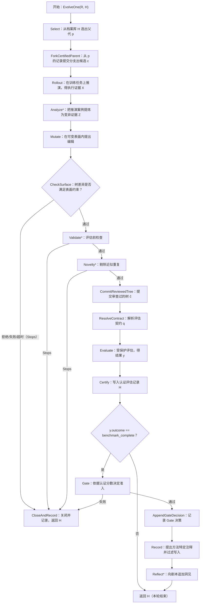
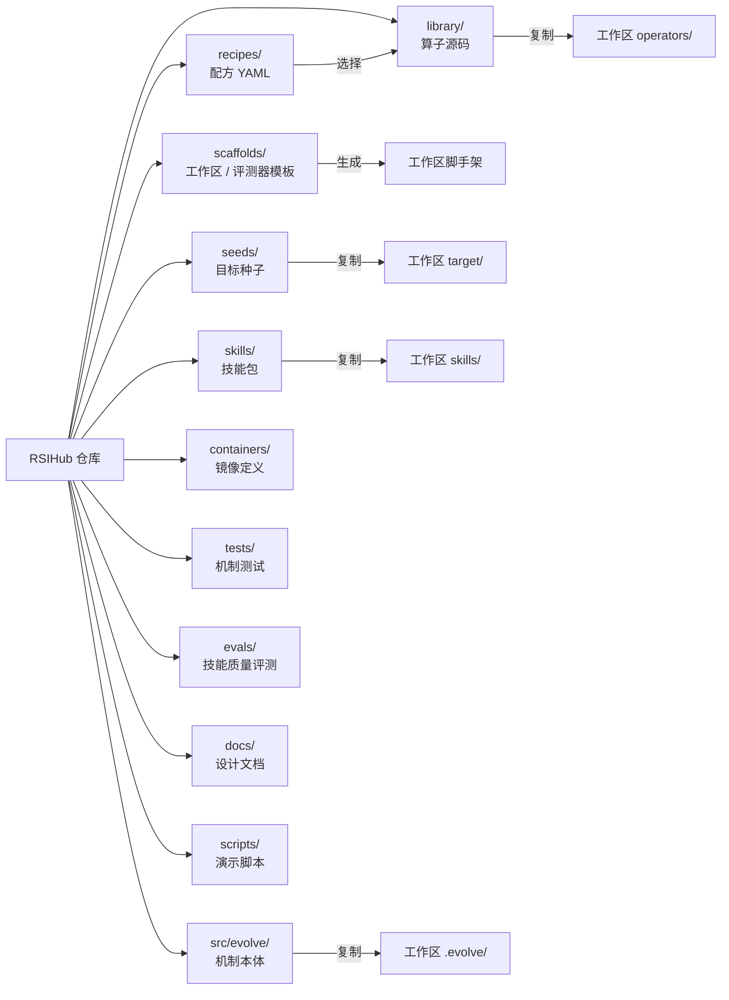
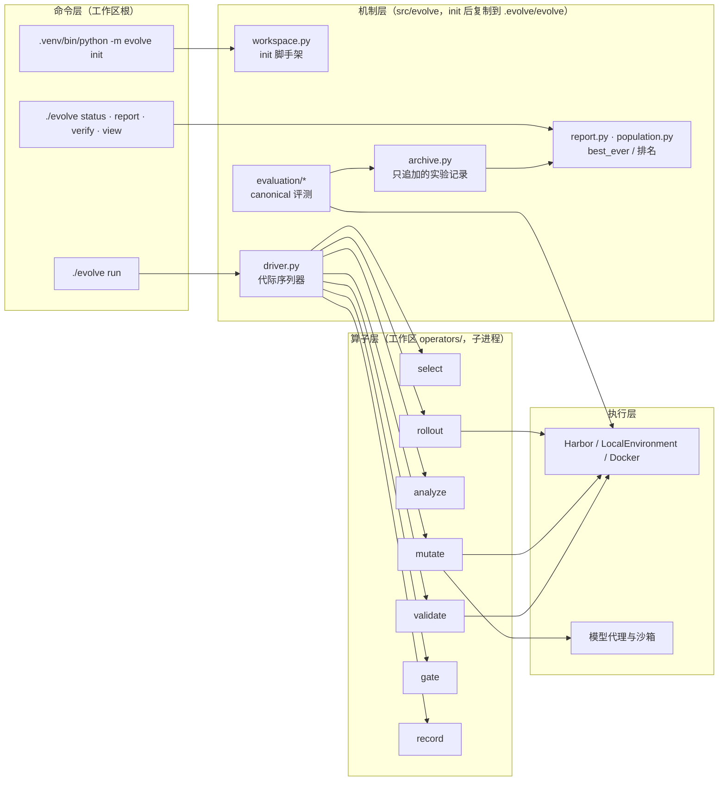
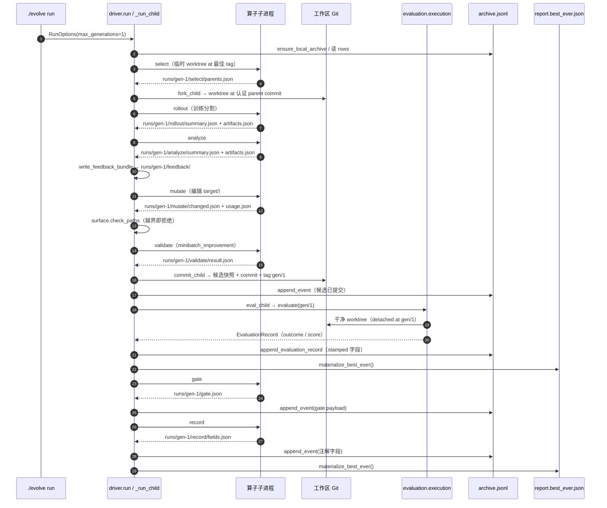

## 总体框架

* RSIHUB 是一个自进化框架，解耦算法实现和基础设施，可以适配不同的 RSI 算法。
* RSIHUB 主要提供：隔离的候选工作区、任务执行与评估、产物留存、恢复等共用功能。
* 两个抽象概念：
  * **Operator（算子）**：某个阶段的一种实现。
  * **Recipe（配方）**：把每个已启用的 Operator 接口绑定到一个具体实现，声明可变资源，并指定运行配置：目标、评估器、运行时和数据划分。

* 关键的概念：
  * 受保护的评估：评估在 Harbor 容器隔离中执行，Gate/Record/Reflect 等 Operator 只能读认证分数、添加注释，改不了已认证字段。
  * 数据划分：论文把每个基准的任务按用途分成三类，防止“演化方法偷看测试答案”：

|划分|用途|
|:---|:---|
|训练集 Train|给演化提供反馈：Rollout 在这上面跑、Mutate 依据轨迹改候选；**驱动“怎么改”**|
|门控集 Gate|候选准入：Evaluate 在此打分，Gate 算子据此决定子代能否成为父代；**决定“能不能留下”**|
|密封集 Sealed|完全排除在演化反馈之外，只用于最终的留出报告；**检验“改了有没有真的变强”**|

  * 框架控制：某些环节的决策与执行权归 RSIHub 本体所有，演化方法（Recipe、Operator、外层智能体）碰不到、改不了。

<div style="text-align:center; margin:1em 0;">

<p style="color:#888; font-size:0.92em; margin:0.25em 0 0;">RSI 总体框架图<br>Image source: <a href="https://github.com/simple-agent-lab/RSIHub">https://github.com/simple-agent-lab/RSIHub</a></p>
</div>

左边：进化的驱动模式有两种：

* **Recipe-Driven**：Recipe 在迭代过程中保持不变；
* **Agent-Driven**：外部 agent 使用每次完成迭代后获得的反馈来修订 Recipe 的操作符绑定和策略设置，以用于下一次迭代。

中间：绿色表示每一个策略阶段，橘色表示框架控制阶段，表示所有进化过程的关键步骤。

右边：受保护的环境设置，包括 Harbor 执行器、数据集划分和 workspace 设计。

## 进化流程的所有关键步骤

|生命周期阶段|算子（必需/可选）|职责与框架处理|
|:---|:---|:---|
|选择 Select|Select（必需）|依据配方搜索策略从**档案库**中选出合格父代；框架验证其身份，并从其精确记录的提交中分支出新候选|
|推演 Rollout|Rollout（必需）|在训练任务上运行父代，以摘要和产物引用形式返回执行证据；自带的 Harbor 推演**只用训练划分**，回放式推演复用父代已记录的评估结果|
|分析 Analyze|Analyze（可选）|把推演案例提炼为**有边界的变异证据**（失败模式、紧凑轨迹），格式为 Mutate 所消费的表示|
|变异 Mutate|Mutate（必需）|在声明的可变表面内**提出编辑**；通常是多轮智能体而非固定变换，可在提出改动前在训练任务上做小规模试验，表面允许时甚至可编辑 Operator 本身；报告改动的路径、说明与使用情况|
|护栏 Guardrail|框架检查 + Validate（可选）+ Novelty（可选）|框架对照可变表面**检查实际树差异**；Validate 应用方法特定的评估前检查（拒绝则在受保护评估前停止），Novelty 在已接受差异消耗评估预算前剔除近似重复|
|评估 Evaluate|框架托管|**提交审查过的树**，在门控任务上对干净检出评分并认证结果；门控任务可与训练任务重合，密封任务保留用于留出报告|
|吸收 Absorb|Gate（必需）+ Record（必需）+ Reflect（可选）|Gate 依据认证分数决定子代是否成为父代；Record 提出方法特定注释（框架过滤后写入）；Reflect 从档案库历史提炼洞见，供后续世代使用|

## 算法流程



## 代码结构

### 运行的基本步骤

本文只跟一条路径，避免概念分散：

```bash
cd /workspace/rsi/RSIHub
.venv/bin/python -m evolve init /tmp/rsihub-init-demo \
    --recipe gepa_local \
    --dataset /tmp/rsihub-demo-tasks

/tmp/rsihub-init-demo/evolve preflight
/tmp/rsihub-init-demo/evolve run --max-generations 1
```

操作上可以理解为三步：**init → preflight → run**。

|步骤|命令|做什么|是否必需|
|:---|:---|:---|:---|
|① 脚手架|`evolve init ...`|解析配方、冻结算子与评测器、建立独立 Git 仓库与 `gen/0`、写入 pending 账本行|必需|
|② 体检|`evolve preflight`|**只检查、不进化**：确认配置、运行时、依赖、凭据、数据集与评测契约可用；失败就提前停|可选（推荐）|
|③ 进化|`evolve run --max-generations 1`|进入 driver 代际循环：select → rollout → analyze → mutate → validate → evaluate → gate → record|必需|

需要注意两点：

* `preflight` **不是进化循环的一环**，也不写 `archive.jsonl`。它有两种模式：未初始化路径做只读的 init 输入检查（放在 `init` 前也可以）；已初始化工作区做运行时体检，并写一份 `runs/preflight/attempt-<n>/preflight.json` receipt。
* `evolve run` 内部自己也会调用 `ensure_evaluator_ready()`，所以 preflight 不是硬前置；它的价值是在花钱跑模型之前快速失败。加 `--smoke` 还会额外发一次模型请求，验证凭据与网络。

### `evolve init` 之后的工作区

```
/tmp/rsihub-init-demo/
├─ target/                        # 唯一允许 mutate 修改的目录：prompt、knowledge、harness 代码
├─ operators/                     # 选中的算子代码副本（每个阶段一个 .py，init 后不再从仓库读取）
│  ├─ select.py rollout.py analyze.py validate.py gate.py record.py
│  ├─ README.md PROTOCOL.md
│  ├─ engines/local.sh
│  ├─ preflight.sh
├─ library/                       # 算子共用的辅助代码（_shared/_methods_shared）
├─ evaluator/                     # 固定好的评测器：eval.sh、eval.env、splits.json、dataset.pin、runtime.json
├─ skills/evolve-agent/           # 给工作区 agent 的操作手册
├─ .evolve/                       # 复制进来的框架代码（init 后不再随仓库源码变化）
│  ├─ evolve/                     # src/evolve 的副本
│  ├─ launch_evolve.py launch_splits.py
├─ evolve.yaml                    # 最终实验配置：配方 + 命令行参数合并后的结果
├─ .evolve-components.json        # 记录配方/算子来源和 SHA-256 文件指纹
├─ archive.jsonl                  # 只追加、不修改旧行的实验记录；gen0 这一行是"待评测"
├─ best_ever.json                 # 框架重算出的当前最佳
├─ evolve                         # 工作区自带的 CLI 控制台
├─ pyproject.toml uv.lock         # 工作区独立 Python 环境
├─ runs/                          # 各阶段产物、评测 attempt、运行锁
└─ artifacts/                     # 持久上下文
```

注：

* **算子代码副本**：`evolve init` 把配方选中的算子 `.py` 从仓库 `library/` 复制到工作区 `operators/`。之后运行 `./evolve` 只读工作区里的副本，不再依赖仓库源码。
* **算子共用的辅助代码**：多个算子都会用到的函数，集中在 `library/_shared/`、`library/_methods_shared/`，init 时一并复制。
* **最终实验配置**：`evolve.yaml` 不是原样复制配方，而是把配方默认值、命令行 `--seed/--dataset/--tasks` 合并后写出的最终版本。
* **SHA-256 文件指纹**：对文件内容算出的固定长度校验值；内容改一个字节，指纹就不同，用来确认复制进来的算子确实来自记录中的来源。
* **只追加的实验记录**：`archive.jsonl` 每行是一条事件（候选提交、评测分数、gate/record 结果等），只允许往后追加，不能修改旧行。
* **gen0 是“待评测”（pending）**：第 0 代是初始工作区，刚建好还没跑评测，所以没有分数，标记为 `pending`；评测合格后它才能成为后续代的父代。

只有 `target/` 处在可变面内；其余目录即使被 `mutate` 改动，也会在 surface 检查阶段被拒绝。

Git 状态：一个提交 `evolve gen 0`，一个标签 `gen/0`（复制进来的框架代码与算子代码也在这个提交里）。

### 文件分布

* 顶层目录

|路径|角色|关键内容|
|:---|:---|:---|
|`src/evolve/`|**机制本体**（框架拥有的可信部分）|CLI、driver、workspace init、评测、归档、算子运行时、Harbor 集成、viewer|
|`library/`|**算子货架**（配方可选的进化策略）|`select/` `rollout/` `analyze/` `mutate/` `validate/` `novelty/` `gate/` `record/` `reflect/`，外加 `_shared/` 与 `_methods_shared/`|
|`recipes/`|**零代码配方**|每个方法一个目录，内含 `evolve.yaml`；`gepa_local` 是最小本地示例|
|`scaffolds/workspace/`|`evolve init` 写入工作区的**静态模板**|`launch_evolve.py`、`launch_splits.py`、`AGENTS.md`、`program.md`、`pyproject.toml`、`uv.lock`、evaluator/operators 的 README 与骨架|
|`scaffolds/evaluators/`|评测引擎资产|`harbor/` 官方引擎|
|`seeds/`|内置目标 agent 种子|`codex/`、`dsh/`、`local-smoke/`|
|`skills/`|打包给工作区 agent 的操作技能|`evolve-agent/` 与 `manifest.json`|
|`containers/`|容器镜像定义|`candidate-worker/`、`mutate/`、`mutate-codex/`、`runtime-versions.env`|
|`scripts/`|演示与辅助脚本|`run_recipe_demo.sh`、`setup_terminal_bench.sh`、`recipe_runtime.py`、`codex_agent_controller.py`|
|`tests/`|pytest 测试套件|`fixtures/`、`conftest.py`、`test_coherence.py`（强制机制模块地图与行数预算）|
|`evals/`|项目自有技能/agent 的**质量评测资产**|`skills/evolve-agent/` 行为用例、调用用例、rubric 与结果快照；不是工作区评测运行时|
|`docs/`|设计文档|`ARCHITECTURE.md`、`concepts/design.md`、`reference/operators.md`、`QUICKSTART.md`|

这些目录的生产关系可以概括为：`recipes` 选算子，`library` 提供算子代码，`scaffolds` 提供模板，`seeds` 提供目标，`src/evolve` 负责把它们复制并固定成工作区。



* `src/evolve/` 机制模块

|分组|关键文件|作用|
|:---|:---|:---|
|CLI / 编排|`cli.py`、`driver.py`、`orchestration.py`、`run_summary.py`|`evolve` 动词入口；`driver.py` 是代际序列器，负责 select→rollout→…→record 的编排与准入门|
|初始化|`workspace.py`、`config.py`、`composition/recipe.py`、`composition/materialize.py`、`composition/catalog.py`|解析配方、生成工作区、复制并固定算子代码、生成最终配置|
|候选与边界|`candidate/snapshot.py`、`git.py`、`surface.py`|干净候选快照、Git 提交/标签/工作树、`surface.include` 越界检查|
|评测|`evaluation/contract.py`、`evaluation/execution.py`、`evaluation/run_plan.py`、`evaluation/results.py`、`evaluation/evidence.py`、`evaluation/diagnostics.py`|评测契约、canonical 执行、逐 trial 记录、证据与诊断|
|归档 / 报告|`archive.py`、`population.py`、`report.py`、`splits.py`、`feedback.py`|追加式 `archive.jsonl`、`STAMPED_FIELDS`、`best_ever.json`、任务切分、给 mutate 的反馈束|
|算子运行时|`operators.py`、`operator_cli.py`、`operator_isolation.py`、`frozen/interfaces.py`、`frozen/sdk.py`、`frozen/config.py`|子进程契约、算子 ABC、SDK、声明式配置 schema；框架从不 in-process import 工作区算子|
|Harbor 集成|`integrations/harbor/`|MiniSWE/Codex 候选适配、`local_auto_agent`、隔离 worker、候选源与运行时计划|
|运行时支撑|`runtime/`、`execution_runtime/`、`harbor_local.py`、`host_runtime.py`|模型代理/经纪、认证、沙箱、uv 运行时、本地 Harbor 后端|
|预检 / 体检|`preflight/`、`doctor.py`、`evaluator_doctor.py`|init 前输入检查、已初始化工作区的 typed preflight、评测器就绪检查|
|Agent Driven|`agent*.py`|连续研究生命周期的另一种驱动方式，与 `driver.run` 互斥（`runs/agent-driven/ACTIVE`）|
|只读查看器|`viewer/`|FastAPI 应用，只读消费 archive / runs / Harbor 数据|
|模板资源|`scaffolds/`（包内副本）|`workspace._workspace_scaffold()` 读取的模板文件|

* `library/` 算子库

|Stage|必需/可选|已装算子（示例）|输出契约|
|:---|:---|:---|:---|
|`select`|必需|`pareto`、`greedy`、`newest`、`score_child_prop`、`random`|`parents.json`|
|`rollout`|必需|`harbor`、`parent_evaluation`、`failure_focused`、`noop`|`rollout/summary.json`、`rollout/artifacts.json`|
|`analyze`|可选|`gepa`、`ahe`、`failure_patterns`、`artifact_rubric`、`trajectory_only`、`trace_browser`|`analyze/summary.json`、`analyze/artifacts.json`|
|`mutate`|必需|`gepa`、`ahe`、`aevolve`、`hyperagents`|`mutate/changed.json`、`mutate/usage.json`、可选 `rationale.md`|
|`validate`|可选|`minibatch_improvement`、`hyperagents`、`node_check`|`validate/result.json`|
|`novelty`|可选|`diff_similarity`、`accept_all`|`novelty.json`|
|`gate`|必需|`parent_eligible`、`hillclimb`、`ahe_artifact_valid`|`gate.json`|
|`record`|必需|`gepa`、`hyperagents`、`jsonl`|`record/fields.json`|
|`reflect`|可选|`credit`|反思结果（如 credit）|

**`evaluate` 永远不在这个表里**——它是框架独占的受信阶段，不是可选择的算子。

### 交互流程

先看三层边界：命令层只调用机制层；机制层通过**子进程**调用算子层；评测与执行环境由机制层独占。



注：

1. **配方决定“叫哪些算子、传什么参数”，机制决定“什么时候叫、结果算不算数”**。算子只看到环境变量与 `--config`，看不到评测器的打分逻辑。
2. 框架**从不 import** `operators/` 里的代码；算子崩溃或输出畸形只会被当成一次失败尝试。
3. 拉起算子的子进程带独立进程组与超时，防止算子拖死整轮。

### 交互时序图



注：

1. 注意两个不同的运行目录：

|目录|内容|
|:---|:---|
|`runs/gen-<id>/`|**算子**阶段的输入/输出：`select/parents.json`（select 单独位于 `runs/gen<N>/select/`）、`rollout/*`、`analyze/*`、`mutate/*`、`validate/result.json`、`gate.json`、`novelty.json`、`record/fields.json`、`feedback/`|
|`runs/evaluations/<purpose>/gen-<id>/candidate-<sha>/attempt-<n>/`|**评测**的 run plan、契约、逐 trial 结果与 receipt|

2. **配方选择算子，机制独占边界**：`select → rollout → analyze → mutate` 由配方决定；`surface` 检查、`validate`/`novelty` 准入门、`evaluate` 与 `archive` 打戳由框架独占；算子只在子进程里看到环境变量和 `--config`，分数只从框架固定的 canonical 评测进来。这就是 `evolve init` 把算子代码与框架运行时一起复制进工作区的原因——**代际记录一旦建立，候选能改的越多，能碰的越少，分数才可信**。
