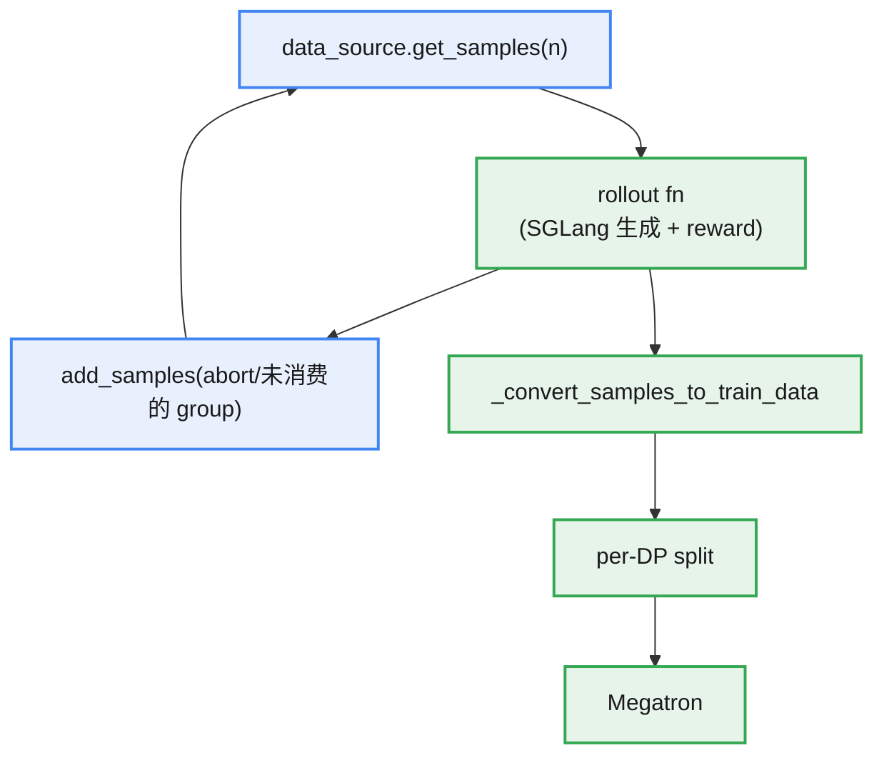
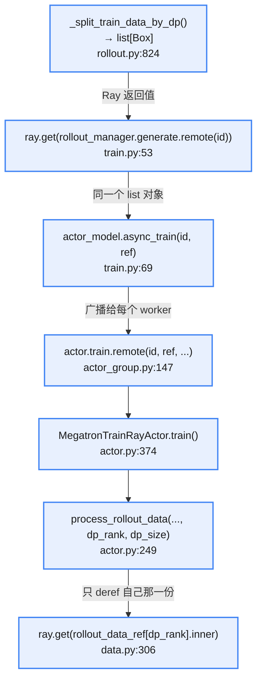

")

* 训练（Megatron）：负责主要的训练过程，从数据缓冲区读取数据，并在训练后将参数同步到 rollout 模块。
* rollout（SGLang + router）：生成新数据（包括奖励/验证器输出）并将其存储在数据缓冲区中。自定义生成函数可以将其封装在多轮循环、工具调用、环境/沙箱交互以及 verifier-based 奖励中。
* 数据缓冲区：一个桥接模块，负责管理 prompt 初始化、自定义数据和展示生成方法（包括通过相同接口生成样本的 agentic workflows）。

## data_buffer 定义

文件：slime/rollout/data_source.py


> `@abc.abstractmethod` 类说明：
> 子类必须实现全部 5 个才能实例化。这一点对 `--data-source-path` 这个插件入口很关键：用户传进来的类如果漏实现某个方法，在 `RolloutManager.__init__` 里 `data_source_cls(args)` 那一行（[rollout.py:384](https://webview-17cv2b0ke0m5askjtrgmemu4sai1bfpne5bc6a0hr1i5rbruus00.icoding.baidu-int.com/icoding/webview/comate/stable/1.108.2/slime/ray/rollout.py#L384)）就会立刻报错，而不是等到 rollout 中途调用 `add_samples` 才发现。
> **与 `NotImplementedError` 写法的区别：**
> **`NotImplementedError`** 不继承 `ABC`、只在方法里 `raise NotImplementedError` 也能表达“子类必须覆盖”，但检查时机推迟到了调用时刻。

### RolloutDataSource

* **init**

构建 dataset

```python
self.dataset = Dataset(
    args.prompt_data,
    tokenizer=tokenizer,
    processor=processor,
    max_length=args.rollout_max_prompt_len,
    prompt_key=args.input_key,
    multimodal_keys=args.multimodal_keys,
    label_key=args.label_key,
    metadata_key=args.metadata_key,
    tool_key=args.tool_key,
    apply_chat_template=args.apply_chat_template,
    apply_chat_template_kwargs=args.apply_chat_template_kwargs,
    seed=args.rollout_seed,
)
```

这里 `tokenizer` 和 `processor`，以及 `apply_chat_template` 会一起传进去，也就是说 tokenize 和 chat template 是在这里一次性做完的，不是在 rollout 时做。

* **get_samples**

先取 `num_samples` 条 prompt，再把每条 prompt 展开成 group，获取 `num_samples` 条的逻辑是：

1. 如果当前 dataset 有足够的数据，则直接获取，并确定好 sample_offset
2. 如果当前 dataset 数据不够了，则获取下一个 epoch 的数据，并把 epoch_id + 1

最后展开成 group 是因为 GRPO 需要 n_samples_per_prompt 个数据，展开过程会给每一个数据标记 sample_index

上面的 epoch_id 是为了确保可复现性，`Dataset.shuffle` 的种子是 `seed + new_epoch_id` 且总是从 `origin_samples` 重排，所以给定 epoch_id 顺序可复现，这也是 `load` 只存 `epoch_id` 就能恢复顺序的原因。

```python
prompt_samples = self.dataset.samples[self.sample_offset :]
num_samples -= len(prompt_samples) #缺省的个数
self.epoch_id += 1
if self.args.rollout_shuffle:
    self.dataset.shuffle(self.epoch_id) #根据epoch_id进行打乱
prompt_samples += self.dataset.samples[:num_samples]
self.sample_offset = num_samples
```

* **save & load**

save 为保存数据，逻辑如下，对应的 load 为读取数据

```python
state_dict = {
    "sample_offset": self.sample_offset,
    "epoch_id": self.epoch_id,
    "sample_group_index": self.sample_group_index,
    "sample_index": self.sample_index,
    "metadata": self.metadata,
}
path = os.path.join(self.args.save, f"rollout/global_dataset_state_dict_{rollout_id}.pt")
```

### RolloutDataSourceWithBuffer

* **init**

在父类的基础上，添加 self.buffer（列表）和 self.buffer_filter，其中 self.buffer_filter 为自定义函数，默认为 `pop_first`

* **get_samples**

逻辑是先从 buffer 里获取，dataset（父类 RolloutDataSource 的 get_samples）作为兜底方案

```python
samples = self._get_samples_from_buffer(num_samples)
num_samples -= len(samples)
if num_samples == 0:
    return samples

samples += super().get_samples(num_samples=num_samples)
```

* **_get_samples_from_buffer**

调用 buffer_filter 方法从 buffer 中获取数据

```python
samples = self.buffer_filter(self.args, None, self.buffer, num_samples)
```

buffer_filter 的默认实现是 `pop_first`，也在这个原文件中：

```python
def pop_first(args, rollout_id, buffer: list[list[Sample]], num_samples: int) -> list[list[Sample]]:
    num_to_pop = min(len(buffer), num_samples)
    samples = buffer[:num_to_pop]
    del buffer[:num_to_pop]
    return samples
```

* **add_samples**

覆盖了父类 add_samples 方法（父类没有实现）

```python
for i in range(0, len(samples)):
    assert (
        len(samples[i]) == self.args.n_samples_per_prompt
    ), f"the length of the elements of samples must be equal to n_samples_per_prompt, got {len(samples[i])} != {self.args.n_samples_per_prompt}"
    group = samples[i]  # type: ignore
    self.buffer.append(group)
```

关于这个 assert：agentic / partial rollout 场景下如果只收到半个 group 就写回，这里会直接 assert 失败。`add_samples` 的调用方有 `sglang_rollout` 和 `fully_async_rollout`，两者区别在于：1. `sglang_rollout` 传给它的 `aborted_samples` 是 `abort()` 里凑齐的完整 group；2. `fully_async_rollout` 则是 `add_samples([result])` 单 group 写回。

## rollout 产生数据

**RolloutManager**（slime/ray/rollout.py）是一个产生 rollout 数据，并将 rollout 数据转为训练数据的管理类

generate 调用的大体逻辑是：

1. RolloutManager.generate 会调用到 call_rollout_fn 产生数据
2. call_rollout_fn 调用的是 generate_rollout 函数（默认是 `slime.rollout.sglang_rollout.generate_rollout`），最后调用到 sglang

与 data_buffer 相关的操作：

1. init 时初始化 data_source

```python
#【1】data_buffer 初始化
data_source_cls = load_function(self.args.data_source_path) #默认是 RolloutDataSourceWithBuffer
self.data_source = data_source_cls(args)

# 【2】rollout 生成管理
self.generate_rollout = load_function(self.args.rollout_function_path) #默认是 slime.rollout.sglang_rollout.generate_rollout

#【3】rollout 到 train 数据转换自定义
self.custom_convert_samples_to_train_data_func = None #默认是 None
if self.args.custom_convert_samples_to_train_data_path is not None:
    self.custom_convert_samples_to_train_data_func = load_function(
        self.args.custom_convert_samples_to_train_data_path
    )
```

2. generate 的数据转换和 split，其中调用 call_rollout_fn 会传入 data_source


### 数据传递

* **调用链**

从 _get_rollout_data 到 data_source.get_samples 的调用链：

`_get_rollout_data` --> `call_rollout_fn`（传 data_source） ---> `generate_rollout`（slime/rollout/sglang_rollout.py）---> **`generate_rollout_async`**（传入 data_source.get_samples）

* **generate_rollout_async 的逻辑**

做的是过采样 + 竞速收集：一直提交比目标更多的请求，先跑完的先收，收够 `rollout_batch_size` 组就 abort 掉剩下的。


1. 确定目标大小：target_data_size
2. 循环产生数据
    1. data_source 获取 sample
    2. state.submit_generate_tasks 提交生成任务
    3. 等待生成完成

```python
done, state.pendings = await asyncio.wait(state.pendings, return_when=asyncio.FIRST_COMPLETED)
```

    4. 循环已经完成的任务，添加到 data list

3. abort 掉在飞的数据（`slime.backends.sglang_utils.server_control.abort_servers_until_idle`）
4. 重排数据：buffer 复用的 group 带老 index，顺序是乱的，必须重排才能保证训练数据顺序可复现
5. state.reset()
6. 最后返回 RolloutFnTrainOutput、aborted_samples

关键：

1. 这里 `GenerateState` 是 rollout 进程内的单例共享状态容器。它解决的问题是：`generate` / `generate_and_rm` / `abort` / `rollout` 主循环这些函数分散在**各处、异步并发执行**，但需要共享同一份 tokenizer、同一个并发闸门、同一个在飞任务集合。
2. 循环中，提交的量（`over_sampling_batch_size`）通常大于需要的量（`rollout_batch_size`），多余的请求最后被 abort。这是用算力换尾延迟——**不等最慢的那批**。
3. `data_source` 是个闭包（由 `RolloutManager` 传入，包装了 `data_source.get_samples`），从 buffer **优先取——partial rollout 上一轮 abort 掉的 group 会在这里被优先重新消费**。
4. `asyncio.wait(..., FIRST_COMPLETED)` 每次只处理已完成的那部分，未完成的写回 `state.pendings`。这个赋值很重要：`state.pendings` 是 `abort()` 抽干在飞任务的唯一抓手。
5. `abort()` 先置 `state.aborted = True`，再问 router 拿所有 worker url，`abort_servers_until_idle` 让引擎侧停下。`aborted` 这个标志是**软停信号**：`generate_and_rm_group` 开头查 `if state.aborted: return group` 直接返回未生成的原样，`group_rm` 也跳过。所以 abort 不是硬取消 task，而是让在飞 task 尽快自然结束。然后 `while state.pendings` 抽干。

* **数据返回**

generate_rollout_async 返回的是 RolloutFnTrainOutput 和 aborted_samples（list[list[Sample]]，对应被 abort 的样本）；后者添加到 data_source，下次 get_samples 优先从 abort 的样本中取

RolloutFnTrainOutput 类型里包含了 `list[list[Sample]]` 的类型：

```python
class RolloutFnTrainOutput:
    samples: list[list[Sample]]
    metrics: dict[str, Any] = None
```

这也是生成后由 **_convert_samples_to_train_data / _split_train_data_by_dp** 处理的 data 的数据类型

### RolloutManager sglang 产生数据后的后处理

* **_convert_samples_to_train_data**

函数功能：把 rollout 阶段的 `list[Sample]` 转成训练侧要的**列对齐 dict**：从“每个样本一个对象”变成“每个字段一个列表”，长度都等于 `len(samples)`。之后 `_split_train_data_by_dp` 才能按列切给各 DP rank。

> 如果有自定义数据转换，则直接调用自定义函数：custom_convert_samples_to_train_data_func

转换的逻辑：

1. 归一化奖励（参数 args.rewards_normalization 控制）
2. rollout_ids 补齐：为 `None` 的用未被占用的最小整数填上

> `rollout_id` 只是一个**分组键**——相同 = 同一次 rollout 产生、要合并计算；不同 = 各自独立、要分开计算。
> 补齐时全给不同值，恰恰是在表达“这些样本互不相干，每个自己就是一次 rollout”

3. 确定训练数据 dict（基础字段 + 条件字段）
4. 确定 loss mask，也存进 dict，最后返回 dict

基础字段

```python
train_data = {
    "tokens": [sample.tokens for sample in samples],
    "response_lengths": [sample.response_length for sample in samples],
    # some reward model, e.g. remote rm, may return multiple rewards,
    # we could use key to select the reward.
    "rewards": rewards,
    "raw_reward": raw_rewards,
    "truncated": [1 if sample.status == Sample.Status.TRUNCATED else 0 for sample in samples],
    "sample_indices": [sample.index for sample in samples],
    "rollout_ids": rollout_ids,
}
```

* **_split_train_data_by_dp**

计算调度表 → 按索引切列 → `ray.put` 成每个 DP rank 一个 Box。真正的调度逻辑全在 `build_dp_schedule`（dp_schedule.py）里，拆出去是为了脱离 Ray/sglang 做单测。

### 数据流动



写回 buffer 的两个典型时机：`sglang_rollout` 在 abort 后把 partial rollout 的残 group 塞回去（sglang_rollout.py:646-648）；`fully_async_rollout` 逐 group 收发（fully_async_rollout.py:154、:202）。

### 接口复用

rollout 函数签名是 `(args, rollout_id, data_source, evaluation)`，对 data source 的唯一依赖就是 `get_samples` / `add_samples` 两个名字。所以自定义 rollout 只要满足这两个方法就能接进主循环——`sft_rollout.py:42` 一行 `get_samples(rollout_batch_size)` 就完事；`slime_plugins/rollout_buffer` 则在外面挂了个 HTTP 服务异步收轨迹，再通过 `add_samples` 汇回。测试里的 fake buffer 甚至不继承 `DataSource`，纯鸭子类型也能跑。

**相关开关**

|**参数**|**默认**|**作用**|
|:---|:---|:---|
|`--data-source-path`|`slime.rollout.data_source.RolloutDataSourceWithBuffer`|换整个 buffer 实现|
|`--buffer-filter-path`|`None` → `pop_first`|换 buffer 出队策略|
|`--rollout-function-path`|sglang rollout|换生成逻辑|
|`--dynamic-sampling-filter-path`|`None`|group 级过滤|

## train 消费数据

`RolloutManager` 产出每个 DP rank 一份的 dict → Ray 传给 actor → actor 只取自己那份并搬到 GPU → 按预先算好的 micro-batch 索引表迭代 → 多次 forward 复用同一个 iterator。

### 训练侧数据处理

给到训练的数据是由 **_split_train_data_by_dp** 返回的数据，数据类型是 `list[Box]`，长度 = dp_size。每个 Box 里是一份 `rollout_data` dict，字段分两类：

* **per-sample 列表**：`tokens` / `loss_masks` / `advantages` / `total_lengths` / `response_lengths` / `raw_reward`…，已经按 `partitions[r]` 切成该 rank 的局部视图
* **调度元信息**：`micro_batch_indices[r]`（该 rank 的索引表）、`num_microbatches`、`global_batch_sizes`

调度表由 `build_dp_schedule` 在 **rollout 侧一次算完**，不在训练侧算。这样所有 rank 的 micro-batch 划分天然一致，不需要跨 rank 通信对齐。

训练数据传递流程：


> **rollout_data_ref**：是个只有 `inner` 属性的薄壳，里面藏着 `ray.put` 出来的 `ObjectRef`，包一层是为了让 Ray 传参时不自动解引用、把实际取数推迟到 worker 侧的 `ray.get(...inner)`

**_get_rollout_data** 的流程

1. 按照 rank 进行数据分片（rollout 侧已经按照 dp 进行划分了，这里只是取索引）
2. 把数据搬到 GPU（有点反常识），推理产生的数据都在 CPU 上（这些数据不大，所以放在 CPU 上了），这里搬运的数据：

|**字段**|**目标 dtype**|**备注**|
|:---|:---|:---|
|`tokens`|`torch.long`|Megatron embedding 要求 int64|
|`loss_masks`|`torch.int`|int32|
|`rollout_mask_sums`|`torch.float32`|单个 tensor 而非 list|
|`multimodal_train_inputs`|保持原样|逐 dict 遍历，只搬 Tensor 值，`None` 跳过|
|`rollout_log_probs` / `teacher_log_probs`|`torch.float32`|搬之前先按 CP 切片|

rollout 侧给的是完整 response 的 logprob，CP 下每个 rank 只负责序列的一部分，必须先切出本 rank 那段再搬，否则白搬了大部分。这里的 `total_lengths` 已经是上一步覆盖过的局部视图，和 `rollout_log_probs` 逐元素对齐。

**没被搬的字段：**

`rewards`、`advantages`、`rollout_routed_experts`、`rollout_top_p_token_ids` 这些留在 CPU。前两个由 data iterator 按 microbatch 取用时再搬；routed experts 由 `fill_routing_replay` 按 PP stage 负责的层区间挑选后才搬——它是 per-token per-layer 的，全量搬上去的话，显存放不下，只能按 `get_num_layers_to_build` / `get_transformer_layer_offset` 切出本 stage 需要的层。

这里的数据量级：

取一个偏大的配置：`rollout_batch_size=128`、`n_samples_per_prompt=16`（2048 个样本）、总长 16k token（prompt 4k + response 12k）。

|**字段**|**dtype**|**单样本**|**总计**|
|:---|:---|:---|:---|
|`tokens`|int64|16384 × 8 B = 131 KB|**268 MB**|
|`loss_masks`|int32|12288 × 4 B = 49 KB|101 MB|
|`rollout_log_probs`|fp32|12288 × 4 B = 49 KB|101 MB|
|`rewards` / `response_lengths` 等标量|—|几十字节|< 1 MB|

### rollout 和 train 的数据对接

`RolloutDataSource` 活在 `RolloutManager` 这个 Ray actor 的进程里，**train worker 进程里没有它的任何实例**。两侧的唯一接口是那个 `list[Box]`。

所以 epoch 推进、buffer 消费、shuffle、checkpoint 续训的游标，全在 rollout 侧完成；`rollout_manager.save.remote(rollout_id)` 也是发给 rollout actor 的。训练侧看到的是一个纯粹的、无状态的 dict。

> 训练不接触 data source：训练 actor 拿到的是 Ray object store 里已经 tensor 化、已经按 DP rank 切好的 dict，连 `data_source` 的 handle 都没有。`generate()` 的返回值就是训练输入，中间不经过任何 buffer。

### 数据流动


