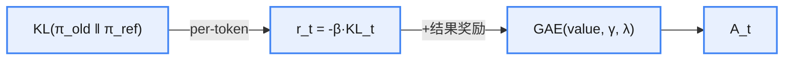

## 参数与整体结构

|参数|作用|默认值|
|:---|:---|:---|
|`--kl-coef`|KL 作为 per-token reward 惩罚，参与 advantage/return 计算|`0.0`|
|`--use-kl-loss`|启用 loss 侧的 KL 项，同时会加载 ref 模型|`False`|
|`--kl-loss-coef`|loss 侧 KL 项的系数 $\beta_{kl}$|`0.0`|
|`--kl-loss-type`|KL 估计器：`k1` / `k2` / `k3` / `low_var_kl`|`k1`|
|`--use-unbiased-kl`|用重要性采样比 $\pi_\theta/\pi_{old}$ 修正 KL，仅对 loss 路径生效|`False`|
|`--ref-update-interval`|每 N 个 rollout 把 ref 模型更新为当前 actor（moving reference）|`None`|

约束与联动：

* `kl_coef != 0` 或 `use_kl_loss` 都会让训练组加载 ref 模型，并要求 `--ref-load` 路径存在。
* `kl_coef` 与 `kl_loss_coef` **不能同时非零**：选择作用在 loss 还是 reward。
* `--kl-loss-type` 同时被 reward 路径和 loss 路径使用；`--use-unbiased-kl` 只被 loss 路径使用。

KL 相关代码主要分布在：

* `slime/utils/ppo_utils.py`：估计器 `compute_approx_kl`、GSPO 的 `compute_gspo_kl`、GRPO / REINFORCE++ 的 return 构造。
* `slime/backends/megatron_utils/loss.py`：`compute_advantages_and_returns`（reward 路径）和 `policy_loss_function`（loss 路径）。

## KL 加到 reward 还是加到 loss

### 加到 reward：`--kl-coef`（reward shaping）

PPO 分支：

<div style="text-align:center">

$$r_t = -\beta_{kl}\,\widehat{KL}_t, \qquad r_{T} \mathrel{+}= R(x, y) \qquad (1)$$

</div>

其中 $\widehat{KL}_t$ 是按 `--kl-loss-type` 计算的 per-token KL，$R(x, y)$ 是序列级结果奖励，加在最后一个 response token 上。随后：

* PPO：把 $r_t$ 交给 GAE 与 critic value：

<div style="text-align:center">

$$\delta_t = r_t + \gamma V(s_{t+1}) - V(s_t), \qquad \hat A_t = \sum_{l=0}^{T-t} (\gamma\lambda)^l \delta_{t+l} \qquad (2)$$

</div>

* `reinforce_plus_plus`：对 $-\beta_{kl} KL_t$ 与末尾结果奖励做折扣 return（`get_reinforce_plus_plus_returns`）。
* `reinforce_plus_plus_baseline`：直接把 $-\beta_{kl} KL_t$ 加到广播后的标量 advantage 上（`get_reinforce_plus_plus_baseline_advantages`）。

关键性质：

* KL 在 **advantage 计算阶段、训练开始前** 算一次；所使用的 `log_probs` 是 rollout log probs 或训练开始时 actor 的 log probs，对后续每个优化步而言是**常数**，因此 **KL 项本身不直接产生梯度，只是改变 advantage 的数值**。
* 惩罚会经过 $\gamma$ 折扣、$\lambda$ 平滑、critic baseline 以及 `--normalize-advantages` 的组内归一化，效果会随这些超参改变。
* 在 PPO 中，critic 可以学到“未来还会持续产生 KL 惩罚”的预期，从而把惩罚向前面的 token 分摊。

### 加到 loss：`--use-kl-loss` + `--kl-loss-coef`

<div style="text-align:center">

$$\mathcal{L} = \mathcal{L}_{PG} - c_{ent}\,\overline{H} + \beta_{kl}\,\overline{\widehat{KL}}, \qquad \overline{\widehat{KL}} = \text{sum\_of\_sample\_mean}\left(\widehat{KL}_t\right) \qquad (3)$$

</div>

关键性质：

* `log_probs` 来自**当前训练前向**且带梯度，KL 项在每个优化步都直接给策略一个拉回 ref 的梯度，是一个可微正则项。
* 不经过 advantage、GAE、折扣或 critic；与 `--advantage-estimator` 的选择解耦。
* 每个 mini-batch 都重新计算，约束的是“训练中的当前策略”。
* `kl_loss_coef = 0` 时仍会加载 ref、计算并记录 `train/kl_loss`，即“只监控不训练”，这是 slime 文档中 GRPO 示例的常见配方。
* 可以配合 `--use-unbiased-kl` 做重要性采样修正。

### 两条路径对比

|维度|reward 路径（`--kl-coef`）|loss 路径（`--use-kl-loss`）|
|:---|:---|:---|
|生效位置|advantage/return 计算|每次训练的 policy loss|
|梯度来源|不直接产生梯度，经 PG 影响参数|KL 项直接反向传播|
|计算频率|每个 rollout 一次|每个 mini-batch / 优化步|
|时间折扣|受 $\gamma, \lambda$ 影响|无折扣，per-token 立即生效|
|信用分配|GAE / 折扣 return / broadcast|逐 token 独立|
|与 advantage 归一化|相互影响|不受影响|
|支持的 estimator|`ppo`、`reinforce_plus_plus`、`reinforce_plus_plus_baseline`|所有 estimator（policy loss 内）|
|GRPO / GSPO / CISPO|**只计算并记录 `rollout/kl`，不影响训练**|实际生效|
|能否与另一路径共存|否|否|

关于 GRPO 这一行的说明：`get_grpo_returns(rewards, kl)` 虽然接收 `kl`，但只把它当作形状模板，直接用标量 reward 填充：

```python
returns.append(torch.ones_like(kl[i]) * rewards[i])
```

因此 `--kl-coef` 在 GRPO/GSPO/CISPO 下只会触发 KL 计算与 `rollout/kl` 日志；GRPO 论文中的 $\beta D_{KL}$ 约束对应的是 slime 的 loss 路径。

> 对于 PPO，reward / loss 路径均有效，但是互斥。

### 三个容易混淆的指标

|指标|含义|出现条件|
|:---|:---|:---|
|`rollout/kl`|reward 路径计算的 per-token ref KL 均值，即 $\widehat{KL}(\pi_{behavior}\|\pi_{ref})$|`kl_coef != 0`；否则为 0|
|`train/kl_loss`|loss 路径计算的 ref KL，$\widehat{KL}(\pi_\theta\|\pi_{ref})$|`use_kl_loss`，与 coef 是否为 0 无关|
|`train/ppo_kl`|旧策略与当前策略的采样 log-ratio，用于 clip 诊断，**不是 ref KL**|policy loss 始终上报|

`train/ppo_kl` 的定义是 `old_log_probs - log_probs`，衡量 rollout / old policy 与当前策略的漂移。

## PPO KL 与 GRPO KL 的区别

### PPO：KL 进入 reward，再由 GAE 转成 advantage



PPO 有 critic，per-token reward 有天然的承载位置。具体来说，PPO 是 token 级 MDP 上的 actor-critic 方法，状态、reward、value、advantage 的粒度天然一致：

<div style="text-align:center">

$$s_t = (x, y_{\lt t}), \qquad r_t \in \mathbb{R}, \qquad V(s_t), \qquad \hat A_t \qquad (4)$$

</div>

其中 critic 学的正是“未来 token 级 reward 的折扣和”：

<div style="text-align:center">

$$V(s_t) \approx \mathbb{E}\left[\sum_{l \ge 0} \gamma^l r_{t+l} \,\middle|\, s_t\right] \qquad (5)$$

</div>

因此想加一个 per-token 的 KL 惩罚，直接令 $r_t \leftarrow r_t - \beta_{kl}\widehat{KL}_t$ 即可：算法本来就维护一条逐 token 的 reward 流，KL 不需要改变数据结构、估计器形式或信用分配机制，critic 会自动学会“未来还会持续产生 KL 惩罚”并把惩罚向前面的 token 分摊。这就是“per-token reward 有天然的承载位置”。代价是 KL 约束经过 critic 与 GAE，属于“间接约束”。对比之下，GRPO 没有 critic，也没有逐 token 的 reward 流，只有一个序列级标量 advantage，所以 KL 没有地方可按 token 放进去。

### GRPO：KL 进入 loss

GRPO 的 advantage 是组内归一化的**标量**，广播到每个 token：

<div style="text-align:center">

$$A_i = \frac{R_i - \operatorname{mean}(R_{1:G})}{\operatorname{std}(R_{1:G})} \quad \text{（可选归一化）}, \qquad A_{i,t} = A_i \qquad (6)$$

</div>

per-token 的 KL 惩罚无法在不破坏 group 结构的情况下塞进这个标量，原因有三点：

1. **group 结构要求“每条 response 一个标量”**。$A_{i,j}$ 是由同一 prompt 的 $G$ 条 response 的**序列级** reward 做组内统计得到的，同一个 response 的所有 token 共享它。per-token KL 是位置相关的；组内不同 response 长度不同、token 无法对齐。
2. **先把 per-token KL 求和成序列标量再归一化**，则 $R'_{i,j} = R_{i,j} - \beta_{kl}\sum_t \widehat{KL}_{i,j,t}$ 会进入组内 mean/std，会污染 reward 的归一化。
3. **若保留 per-token advantage**，就需要逐 token 的 baseline（逐 token 的 value），那就回到了 actor-critic / PPO，不再是 GRPO。

所以 GRPO 把 KL 作为**独立的、逐 token 可微的正则项**放在 loss 里，policy gradient 仍使用组内标量 advantage，两者在 loss 中相加但各自保留自己的粒度，即 GRPO 论文中的：

<div style="text-align:center">

$$\mathcal{L}_{GRPO} = \mathcal{L}_{PG} + \beta\, \mathbb{E}_t\left[\widehat{KL}_t\right] \qquad (7)$$

</div>

在 slime 中就是 `--use-kl-loss --kl-loss-coef β`。GSPO 与 CISPO 的 advantage 构造和 GRPO 走同一分支，因此结论相同。

## KL 估计器：k1 / k2 / k3 / low_var_kl

### 定义

记：

<div style="text-align:center">

$$\Delta = \log \pi_\theta(a \mid s) - \log \pi_{ref}(a \mid s), \qquad r = \frac{\pi_{ref}(a \mid s)}{\pi_\theta(a \mid s)} = e^{-\Delta} \qquad (8)$$

</div>

目标是估计：

<div style="text-align:center">

$$D_{KL}(\pi_\theta \| \pi_{ref}) = \mathbb{E}_{a \sim \pi_\theta}\left[\log\frac{\pi_\theta(a \mid s)}{\pi_{ref}(a \mid s)}\right] = \mathbb{E}_{\pi_\theta}[\Delta] \qquad (9)$$

</div>

实现见 `compute_approx_kl`（`slime/utils/ppo_utils.py`）：

|类型|公式|单样本非负|无偏性（$a \sim \pi_\theta$）|
|:---|:---|:---|:---|
|`k1`|$\hat K_{k1} = \Delta$|否|无偏|
|`k2`|$\hat K_{k2} = \dfrac{1}{2}\Delta^2$|是|有偏（二阶近似）|
|`k3`|$\hat K_{k3} = e^{-\Delta} - 1 + \Delta = r - 1 - \log r$|是|无偏|
|`low_var_kl`|$\operatorname{clamp}(\hat K_{k3}, -10, 10)$|是|有偏（截断）|

> “可负”是方向问题——单个 token 的惩罚信号可能反向；“方差大”是强度问题——方向在期望上没错，但每次实现的惩罚强度不可控。两者叠加时，训练既可能被反向信号带偏，又可能被极端样本主导。

### 什么是“无偏”

设目标量是 $\mu = D_{KL}(\pi_\theta\|\pi_{ref})$，估计器为 $\hat K(a)$，样本从某个采样分布 $\mu_{sample}$ 中抽取。**无偏**的定义是：

<div style="text-align:center">

$$\mathbb{E}_{a \sim \mu_{sample}}\left[\hat K(a)\right] = \mu \qquad (10)$$

</div>

注意两点：

1. **无偏性一定依附于采样分布**。同一个估计器，换一个采样分布就可能是有偏的。
2. **无偏不代表低方差，有偏也不代表不能用**。实际训练关心的是偏差与方差的权衡，以及梯度方向的期望是否正确。

对 k1：若 $a \sim \pi_\theta$，则：

<div style="text-align:center">

$$\mathbb{E}_{\pi_\theta}[\hat K_{k1}] = \mathbb{E}_{\pi_\theta}[\Delta] = D_{KL}(\pi_\theta \| \pi_{ref}) \qquad (11)$$

</div>

因此 k1 无偏。但单样本的 $\Delta$ 可以为负，且方差较大。

对 k2：$\mathbb{E}[\Delta^2/2]$ 一般不等于 KL，它来自 $\log(1+\epsilon) \approx \epsilon - \epsilon^2/2$ 的二阶近似，等价于 $\chi^2/2$ 近似。它恒非负、方差较小，但**有偏**。

对 k3：

<div style="text-align:center">

$$\mathbb{E}_{\pi_\theta}\left[e^{-\Delta}\right] = \sum_a \pi_\theta(a \mid s)\frac{\pi_{ref}(a \mid s)}{\pi_\theta(a \mid s)} = \sum_a \pi_{ref}(a \mid s) = 1 \qquad (12)$$

</div>

所以：

<div style="text-align:center">

$$\mathbb{E}_{\pi_\theta}[\hat K_{k3}] = 1 - 1 + \mathbb{E}_{\pi_\theta}[\Delta] = D_{KL}(\pi_\theta \| \pi_{ref}) \qquad (13)$$

</div>

即 k3 无偏。同时令 $f(x) = e^{-x} - 1 + x$，有 $f(0) = 0$、$f'(x) = 1 - e^{-x}$，故 $x \lt 0$ 时 $f' \lt 0$、$x > 0$ 时 $f' > 0$，$f$ 在 $x = 0$ 取全局最小值 0，所以 **k3 逐样本非负**。这正是 DeepSeekMath / GRPO 使用的 KL 估计器：非负、无偏、方差低于 k1。

`low_var_kl` 与 k3 公式相同，只是对结果做 $[-10, 10]$ 截断。由于 k3 本身非负，下界基本只用于兜底数值误差；上界会截掉少量大值样本，而这些样本对期望贡献最大，因此 `low_var_kl` 是**有偏但更稳**的版本。

### 采样分布带来的偏差与 `--use-unbiased-kl`

训练样本实际来自 rollout / old 策略 $\pi_{old}$，而不是当前 $\pi_\theta$。以 k1 为例：

<div style="text-align:center">

$$\mathbb{E}_{\pi_{old}}[\Delta] = \mathbb{E}_{\pi_{old}}\left[\log\frac{\pi_\theta}{\pi_{ref}}\right] = -D_{KL}(\pi_{old} \| \pi_\theta) + D_{KL}(\pi_{old} \| \pi_{ref}) \ne D_{KL}(\pi_\theta \| \pi_{ref}) \qquad (14)$$

</div>

k3 的“无偏 + 非负”同样是在 $a \sim \pi_\theta$ 的前提下证明的。当一次 rollout 跑多个 inner epoch、策略已经偏离 $\pi_{old}$ 时，这个偏差会累积。

重要性采样修正：

<div style="text-align:center">

$$\hat K^{IS} = \frac{\pi_\theta(a \mid s)}{\pi_{old}(a \mid s)}\,\hat K(a), \qquad a \sim \pi_{old} \qquad (15)$$

</div>

<div style="text-align:center">

$$\mathbb{E}_{\pi_{old}}\left[\hat K^{IS}\right] = \mathbb{E}_{\pi_{old}}\left[\frac{\pi_\theta}{\pi_{old}}\hat K\right] = \mathbb{E}_{\pi_\theta}[\hat K] \qquad (16)$$

</div>

代码对应 `slime/backends/megatron_utils/loss.py`：

```python
importance_ratio = torch.exp(log_probs - old_log_probs)   # π_θ / π_old
kl = compute_approx_kl(log_probs, ref_log_probs, ..., importance_ratio=importance_ratio)
```

其中 `old_log_probs` 是 `rollout_log_probs`（若 `--use-rollout-logprobs`）或训练开始时计算一次的 actor log probs。

注意：

* `--use-unbiased-kl` 只修正**采样分布**带来的偏差；k2 本身作为 KL 估计器依然有偏，`low_var_kl` 的截断偏差也依然存在。
* 该选项只在 loss 路径生效；reward 路径不乘 IS ratio。
* reward 路径使用的 `log_probs` 是固定的（rollout 或训练开始时的策略），因此那里实际度量的是 $\widehat{KL}(\pi_{behavior}\|\pi_{ref})$ 这一常数，而不是关于当前参数的可微 KL。

---

## GSPO KL 的特殊之处

GSPO 的 KL 实现是 `compute_gspo_kl`（`slime/utils/ppo_utils.py`），在 `policy_loss_function` 中替换普通 per-token `ppo_kl`（`slime/backends/megatron_utils/loss.py`）：

<div style="text-align:center">

$$d_i = \frac{1}{|y_i|}\sum_{t=1}^{|y_i|}\left[\log \pi_{old}(y_{i,t} \mid x_i, y_{i,\lt t}) - \log \pi_\theta(y_{i,t} \mid x_i, y_{i,\lt t})\right] \qquad (17)$$

</div>

<div style="text-align:center">

$$d_{i,t} = d_i \quad \forall t, \qquad s_i(\theta) = e^{-d_i} = \left(\frac{\pi_\theta(y_i \mid x_i)}{\pi_{old}(y_i \mid x_i)}\right)^{1/|y_i|} \qquad (18)$$

</div>

特殊之处：

1. **序列级而非 token 级**。KL 先在整条 response 上取平均，再 `expand_as` 广播回每个 token。这与 GSPO 的序列级重要性比 $s_i(\theta)$ 一致：`compute_policy_loss` 内 `ratio = exp(-ppo_kl) = s_i`，所有 token 共享同一个 ratio，clip 决策也在序列粒度上保持一致。
2. **长度归一化**。分母是 response 的 loss mask 之和，因此 $d_i$ 是每 token 平均对数比，$s_i$ 是长度归一化的序列重要性比，避免长序列比值指数爆炸。
3. **它比较的是 old/rollout 与当前策略，不是 ref 模型**。因此这个 KL 是 PPO-clip 意义的漂移诊断量（对应 `train/ppo_kl`），不需要 ref 模型，也不受 `--kl-loss-type`、`--use-unbiased-kl` 影响。
4. **CP 下必须先 all-gather**。GSPO 分支在序列级归约前会通过 `all_gather_with_cp` 拿到完整 response 的 log probs，再在本地 chunk 上 expand，保证均值是在整条序列上算的，而不是某个 context-parallel 分片。
5. **GSPO 的 ref KL 约束仍走普通 loss 路径**。`--use-kl-loss` 内的 $\widehat{KL}$ 依旧是 `compute_approx_kl` 的 per-token k1/k2/k3/low_var_kl；GSPO 的“序列级特殊 KL”只用于策略比/裁剪。并且 GSPO 与 GRPO 一样不会把 `--kl-coef` 用于 reward，因此 GSPO 的 KL 约束只能通过 `--use-kl-loss` 生效。

---

## OPD 的 reverse KL

`--use-opd` 是另一套机制，与 advantage estimator 正交。它对每个采样 token 计算 student 对 teacher 的 reverse KL 采样贡献（`slime/backends/megatron_utils/loss.py`）：

<div style="text-align:center">

$$\hat d_t = \log \pi_\theta(a_t \mid h_t) - \log \pi_T(a_t \mid h_t), \qquad a_t \sim \pi_\theta \qquad (19)$$

</div>

<div style="text-align:center">

$$\hat A_t = A_t - \lambda_{opd}\,\hat d_t \qquad (20)$$

</div>

注意方向：student 是 KL 的第一个参数，期望在 student 分布上取，与 ref KL 的用法不同。
