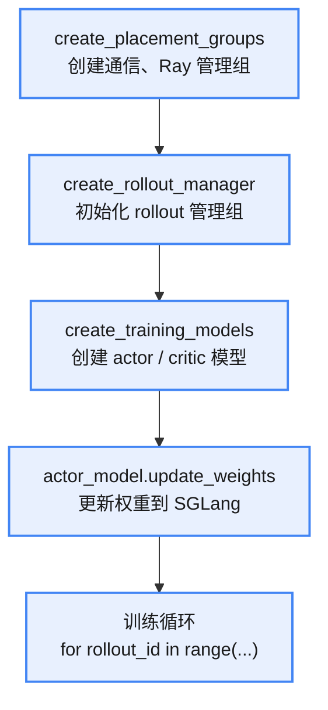
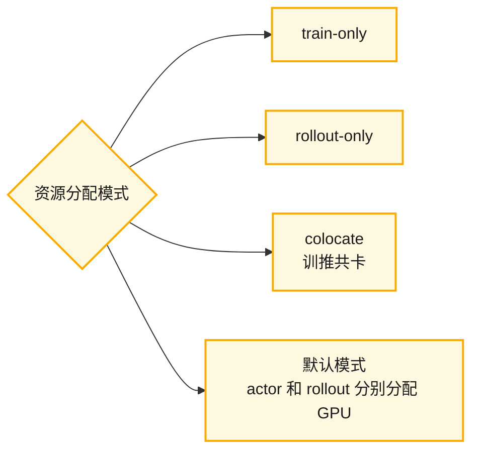
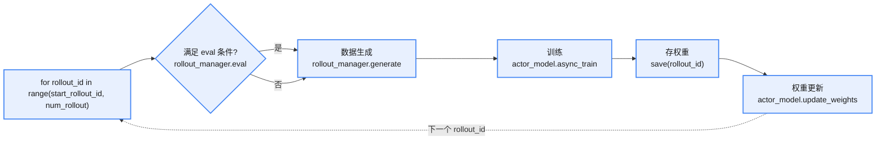
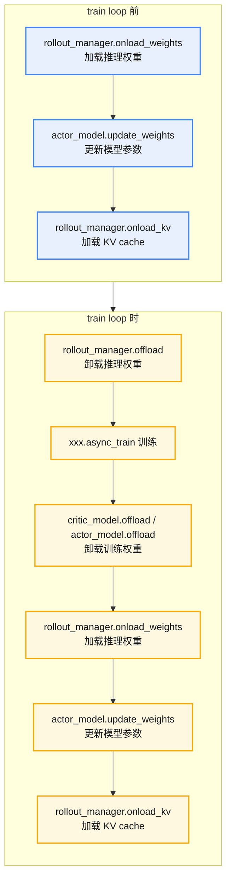
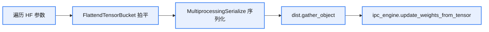
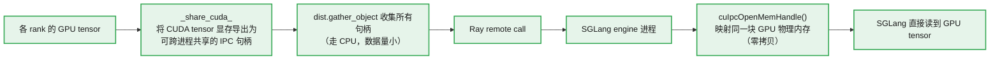

大体流程（省略 offload 和 critic 流程）：

## 初始化流程

### create_placement_groups（通信、Ray 管理组）

1. 根据 GPU 数量和训练策略（训推一体 / 训推分离）确定资源分配；
2. 创建 Ray placement group 对象。

### create_rollout_manager（rollout 管理组）

初始化 rollout 管理组：统计 GPU 数据，用 Ray 管理资源。

返回对象：`ray_placement_group`。

步骤：

1. 用 Ray 创建一个远程 actor（分布式对象）实例；
2. 调用 remote 的 `get_num_rollout_per_epoch` 获取 rollout 数量（`num_rollout`）；
3. 若开启 `check_weight_update_equal`，会调用 `check_weight.remote(action="snapshot")` 和 `check_weight.remote(action="reset_tensor")`。

### create_training_models（actor/critic 模型）

创建 actor/critic 模型。`create_training_models` 初始化时会实例化 `RayTrainGroup`，它实际上就是 `MegatronTrainRayActor`。

步骤：

1. 调用 `allocate_train_group`，返回 `actor_model`（一个 Ray `RayTrainGroup` 对象）；
2. 调用 `actor_model.async_init`，返回 rollout id，用于后续采样流程；
3. `actor_model.set_rollout_manager`：把 rollout_manager 传入 actor_model。

init 调用链（最终调用 `MegatronTrainRayActor.init`）：

## 训练循环

## offload 流程

## 权重更新与通信

权重更新实际调用的是 `weight_updater.update_weights` 方法。

### 权重更新（update_weights）

**actor.update_weights 步骤**

1. 获取需要更新的 engines：`get_updateable_engines_and_lock`；
2. 若有新 engine 加入，调用 `connect_rollout_engines` 重新建立拓扑；
3. 更新参数：`megatron → hf → flatten/序列化 → ipc/nccl → rollout`（调用 `UpdateWeightFromTensor.update_weights` / `UpdateWeightFromDistributed.update_weights`）。

**colocate 模式**下调用 `UpdateWeightFromTensor.update_weights`，大体逻辑：

1. 获取当前权重；
2. 调用 `get_hf_weight_chunks` 转为 HF 权重；
3. 调用 IPC（`__send_hf_params`）发送给 SGLang：
   - 拍平、序列化；
   - CPU 通信 metadata；
   - IPC 共享内存 tensor。

### 初始化与更新相关对象（create_rollout_manager / create_training_models）

`create_training_models` 初始化时会实例化 `RayTrainGroup`（即 `MegatronTrainRayActor`），详见上文"初始化流程"。权重更新依赖这些对象：`actor_model`、`rollout_manager` 与 `weight_updater` 协作完成权重从 Megatron 到 rollout（SGLang）的同步。

### IPC 通信链路

`_send_hf_params` 大体逻辑（colocate 调用 `_send_to_colocated_engine`）：

整体链路：`GPU → CPU serialize → gather_object（Gloo CPU）→ Ray IPC to engine`。

### IPC 通信开销分析

colocate 是训练推理共卡模式，不能通过 tensor 指针传递数据（因为跨进程），需要通过 IPC 通信：

