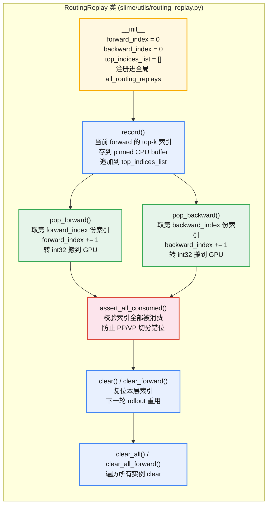
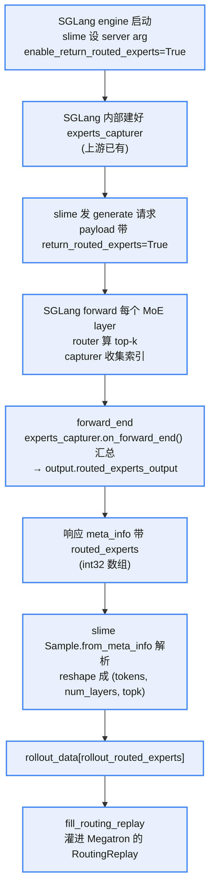

# MoE 训推不一致

## MoE 计算

MoE 计算过程包括两个阶段：

1. **Dispatch**：Router 算出每个 token 要去往哪个专家；把 token 发送到该专家所在 rank
2. **Combine**：专家计算完成，把 token 输出发回 token 原始所在 rank，恢复原来的 batch 排布

为了缓解专家负载均衡，通常会采用 top-k 策略：

KeepTopK 策略：每个 token 会被送到少数几个专家那里处理；Top-k 路由则把每个 token 同时送给 k 个专家，再根据它们的输出**加权合并**。这种方法的优点是：可以根据每个专家的权重贡献，融合多个专家的知识，更灵活。

## MoE 训推不一致原因

MoE 训推不一致的根因，可以分为「路由决策不一致」和「专家计算不一致」两大类。

### 路由决策

1. **Router 精度差异**

* SGLang rollout 通常用 bf16 router（为了延迟）
* Megatron 训练默认 fp32 router
* 当多个专家分数接近时，bf16 量化误差会让 top-k 边界上的 token 翻转

2. **top-k sorted 顺序差异**

SGLang 的 DeepSeek/GLM biased top-k 用 `torch.topk(..., sorted=False)`，Megatron 默认 `sorted=True`。选中的专家集合相同，但**列序不同**，而 owner reduction 是按 top-k 列序做 BF16 累加的——列序变了，BF16 累加的舍入路径就变了，这在路由还没分歧前就能产生数值差异。

### 专家计算不一致

即便路由完全相同，专家 FFN 的输出也可能不同：

1. **GEMM 精度/算法差异**

* 训练侧 Megatron 的 BF16 GEMM 用 cuBLAS 默认路径
* 推理侧 SGLang 用 DeepGEMM 的 block-FP8 forward

同一个 `W @ x`，两条 kernel 的累加顺序、舍入策略不同，BF16 输出会有 `~1e-3` 量级差异。在长序列、多层 stack 之后被放大。

2. **All-to-all / dispatch 实现差异**

SGLang low-latency DeepEP dispatch 和 Megatron normal DeepEP dispatch 的 owner reduction（同一 token 在多个 expert 间聚合时的加权累加）顺序不同，BF16 累加不满足结合律，结果就不一样。

### RL 对数值敏感

普通 SFT 里训推不一致只是数值噪声，loss 该降还是降。RL 里它会造成两个具体问题：

1. **KL 失真**：policy KL = `log π_train(a) − log π_rollout(a)`。如果两侧 log-prob 因为路由/数值差异天然就有 `1e-3` 量级偏差，那 KL 的“零点”就不在 0，optimizer 会把这个**虚假 KL** 当成信号去优化，要么把策略推离 rollout 分布，要么抑制有效梯度。
2. **Advantage 错配**：rollout 用 rollout 路由算出来的 reward 和 advantage，训练时如果路由变了一个 token，那个 token 的 logit → log_prob 就完全不可比，advantage 估计偏置严重。

# R2/R3 算法

**R2（routing replay）**：在训练引擎中重放**旧策略**的路由

**R3（rollout routing replay）**：在训练引擎中重放 rollout policy 在**推理引擎**中确定的路由

R2/R3 路由重放策略：

* R2 解决的是**训练 mini-step 内部 forward/backward 的路由一致**
    * old_actor forward 时 `record` 路由
    * 训练 forward 用 `replay_forward` 重放同一份路由
    * 训练 backward 用 `replay_backward` 重放同一份路由

* R3 做的事：训练 forward 和 backward 都用 rollout 时刻录下的路由。这消除的是「训推不一致」中的路由分量，R3 把路由钉死，但参数还是会被 optimizer 更新，logit 还是会漂移：
    * R3 开启时，第二次 mini-step 的 `π_train(a|s)` 跟 `π_rollout(a|s)` 仍然有差异，差来自参数变化导致的所有 expert 输出整体移动
    * PPO ratio `π_train / π_rollout` 仍然需要 clip，KL 项仍然非零
    * R3 让 Policy Staleness（参数漂移导致的策略分布偏移）不再被路由噪声放大，但不消除 Policy Staleness 本身。

* R2 与 R3 的区别

R2 与 R3 在工程上的差别在于掩码来源：R2 的掩码在训练引擎内部多做一次 old policy 前向即可得到，R3 的掩码必须由推理引擎在采样时导出并跨引擎传输。

# slime 对 R2/R3 的支持

|**开关**|**论文**|**语义**|
|:---|:---|:---|
|`--use-routing-replay`|[arXiv:2507.18071](https://arxiv.org/abs/2507.18071)（GSPO 的 Routing Replay）|训练内部前向/反向路由一致|
|`--use-rollout-routing-replay`|[arXiv:2510.11370](https://arxiv.org/abs/2510.11370)（R3）|直接重放 rollout 引擎的路由|

## RoutingReplay 类

slime/utils/routing_replay.py 中实现了 RoutingReplay 重放类，实现很简单：



* `__init__`

```python
self.forward_index = 0
self.backward_index = 0
self.top_indices_list = []
RoutingReplay.all_routing_replays.append(self) # all_routing_replays 是全局列表，所有实例共享
```

* `record`

记录索引，把当前 forward 算出的 top-k 索引存到 pinned CPU buffer，记录到 `top_indices_list`，大体逻辑是：

1. 对象带 `materialize_for_routing_replay` 方法：直接 append 对象本身，不拷贝
2. 已经是 pinned + contiguous 的 CPU tensor：直接 append，不拷贝
3. GPU tensor 或非 contiguous view：分配 pinned CPU buffer，`copy_` 拷过去再 append

`materialize_for_routing_replay` 的作用是让对象实现一个接口：“我现在不给你真数据，给你一个 promise；等你 `pop` 的时候我再物化”。避免长期持有大 tensor。

* `assert_all_consumed`

assert 检测：防止 PP/VP 切分错位导致路由索引没被消费。

* `pop_forward`

取出第 `forward_index` 份索引，`forward_index += 1`，转 int32 搬到 GPU。

* `pop_backward`

取出第 `backward_index` 份索引，`backward_index += 1`，转 int32 搬到 GPU。

* `clear`、`clear_forward`

复位本层 `forward_index`、`backward_index`、`top_indices_list`，供下一轮 rollout 重用。

* `clear_all`、`clear_all_forward`

遍历所有实例进行 clear

## hook 方法

* `get_routing_replay_compute_topk` 函数

Megatron patch 里在 `TopKRouter.__init__` 把它套到 `compute_topk` 上，从而拦截每个 MoE layer 的 top-k 调用。

|**Stage**|**行为**|
|:---|:---|
|`fallthrough`|走原始 `compute_topk`（仍可能被 `_compute_topk_for_current_router` 改成 `sorted=False`），不 record、不 replay。给 ref/teacher 模型用|
|`record`|走原始 `compute_topk`，把得到的 `top_indices` 喂 `ROUTING_REPLAY.record()` 存到 pinned CPU buffer。R2 在 old_actor forward 时进这个 stage|
|`replay_forward`|**不调原 `compute_topk`**，直接 `pop_forward()` 拿之前存的 `top_indices`，再用 `scores.gather(1, top_indices)` 取对应分数。R3 在 train forward 用|
|`replay_backward`|同上，但 `pop_backward()`。R2/R3 在 train backward 用|

* `register_routing_replay`

在 Megatron patch 里 `TopKRouter.__init__` 末尾调一次，给这个 router 挂上 R2/R3 运行时所需的全部状态。

`get_routing_replay_compute_topk` 和 `register_routing_replay` 两者的调用方：**Megatron-LM**，以同一个 patch 的形式注入。

## 重放函数的调用

主要调用处：slime/backends/megatron_utils/actor.py


<div style="text-align:center; margin:1em 0;">

<p style="color:#888; font-size:0.92em; margin:0.25em 0 0;">重放函数调用链</p>
</div>


1. `prepare_routed_experts_for_routing_replay` 进行对齐：

* 按 CP（context parallel）rank 切分
* 按 SP（sequence parallel）切分
* 按 `data_pad_size_multiplier` 补 padding
* 把每个样本的 routed_experts 拼成整个 microbatch 的连续 tensor

2. `fill_routing_replay` 直接 import RoutingReplay 使用（不负责创建，实例创建发生在 Megatron patch 中）：

```python
from slime.utils.routing_replay import RoutingReplay
RoutingReplay.all_routing_replays[routing_replay_offset].record(layer_routed_experts)
```

`all_routing_replays` 是全局注册表，记录每个 MoE layer 的路由，所以直接 import RoutingReplay 即可获取。

3. slime 通过环境变量控制 Megatron 走原始 MoE 计算还是 hook 计算；这 3 个环境变量都在 actor.py 源文件里设置：

|**环境变量**|**谁设**|**作用**|
|:---|:---|:---|
|`ENABLE_ROUTING_REPLAY`|actor_group.py:98，ray 启动 actor 进程时注入|总开关，`1` 才进状态机；critic 进程不设|
|`ROUTING_REPLAY_STAGE`|slime actor.py 在训练各阶段切换|当前阶段：`record`/`replay_forward`/`replay_backward`/`fallthrough`|
|`ENABLE_ROUTING_REPLAY` + `ROUTING_REPLAY_STAGE`|patch 里的 `compute_topk` 读|决定本次 router forward 走哪个分支|

`ENABLE_ROUTING_REPLAY` 是**进程级**的（ray 启动时设一次，进程生命周期内不变），决定“这个进程要不要参与 R2/R3”。`ROUTING_REPLAY_STAGE` 是**阶段级**的（每次 forward 前切换），决定“当前这次 forward 走状态机的哪个分支”。

## 推理路由的获取

SGLang 的 MoE 实现里，router 算完 top-k 后索引本来就存在显存里（dispatch 要用）。capturer 只是在 forward 结束时把这些索引 copy 出来、压成连续数组、塞到 response 里——纯读取，不改 forward 逻辑。所以上游加这个能力很轻量，slime 复用也几乎零成本。

启动服务时，通过 `enable_return_routed_experts` server arg 把它打开，调用流程：


