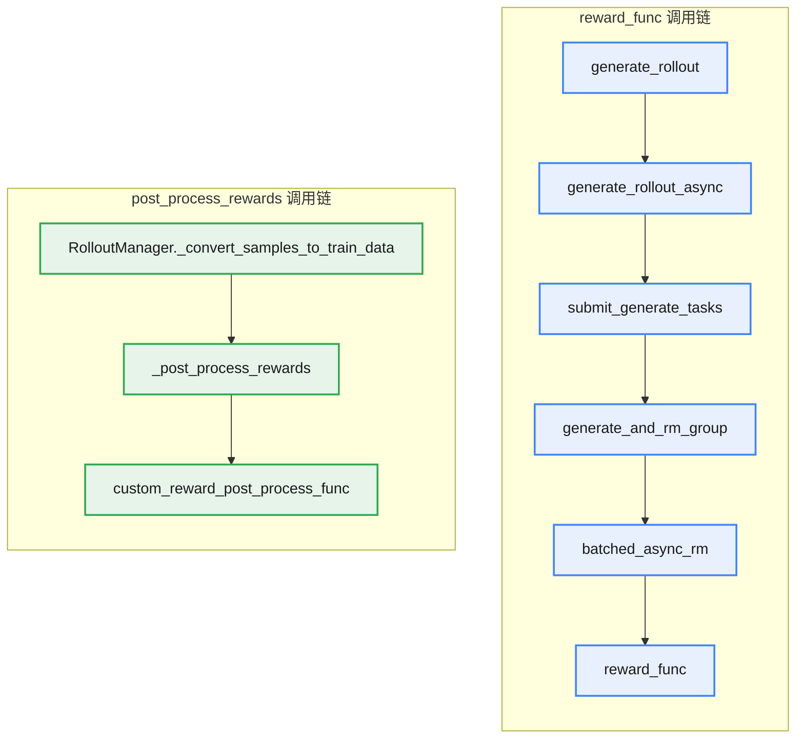
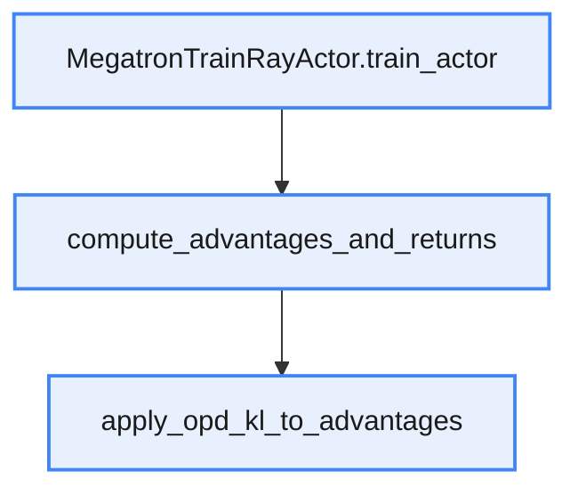

# KL 散度

KL 散度（Kullback-Leibler Divergence），又称相对熵，是用来衡量两个概率分布之间差异程度的非对称性指标。对于学生分布 $q_\theta(x)$ 拟合目标分布（教师）$p(x)$ 的任务，前向 KL 和反向 KL 分别表示为：

* 前向 KL：$D_{KL}(p \parallel q_\theta)$
* 反向 KL：$D_{KL}(q_\theta \parallel p)$

## 前向 KL

<div style="text-align:center">

$$D_{KL}(p \parallel q_\theta) = -\mathbb{E}_{x \sim p}\left[\log q_\theta(x)\right] - H(p)$$

</div>

其中后一项是目标分布（教师）的熵，与参数无关，因此最小化前向 KL 等价于最小化前一项，即最小化交叉熵损失。

用从 $p(x)$ 采样的样本（即训练数据）做蒙特卡洛近似后，就变成最大化样本对数似然之和 $\sum_i \log q_\theta(x_i)$，因此前向 KL 其实也就是**最大似然估计**。可以理解为，前向 KL 散度就是从目标分布中采样样本点，最大化其在拟合分布 $q_\theta(x)$ 下的概率。

由于上面这个特性，前向 KL 会强迫 $q_\theta(x)$ 在其所有高概率区域都必须分配足够的概率质量，因为任何被频繁 $p(x)$ 采到却被 $q_\theta(x)$ 赋予低概率的点，都会被推高损失。即前向 KL 要求：**在所有 $p(x)$ 有高概率的地方，$q_\theta(x)$ 也必须有高概率**。而对于 $q_\theta(x)$ 概率较高但 $p(x)$ 本身概率不高的位置，由于几乎采样不到，前向 KL 基本不会惩罚。这种“宁可摊开也不能漏掉任何一个峰（mode）”的倾向称为 **mean-seeking**，因为当 $q_\theta(x)$ 表达力受限时（例如单峰高斯拟合多峰），最优解会落在 $p(x)$ 的均值附近，把概率质量摊在所有峰之间。


蓝色：目标拟合分布；橘色：前向 KL 拟合的结果

## 反向 KL

<div style="text-align:center">

$$D_{KL}(q_\theta \parallel p) = -\mathbb{E}_{x \sim q_\theta}\left[\log p\right] - H(q_\theta)$$

</div>

前一项是在拟合分布中采样样本点，最大化其在目标分布下的概率。这一项的分析与前向 KL 中是对称的：从拟合分布 $q_\theta(x)$ 中采样样本点，要求其在目标分布 $p(x)$ 下的概率尽可能大。

由于是在自己的分布上进行采样，$q_\theta(x)$ 就不需要保证在**所有** $p(x)$ 概率高的地方自己的概率也高了，因为如果自己在哪些地方的概率足够低，就基本不会采样到那些样本。可以理解为，反向 KL 只需要保证 $q_\theta(x)$ **在所有高概率的区域（自己频繁采样出来的地方），目标分布 $p(x)$ 也有高概率**就好了。

后一项是拟合分布的熵，它与参数有关，不能忽略。在这里，可以把它看作一个正则项。反向 KL 中只需要在所有 $q_\theta(x)$ 概率较高的地方，$p(x)$ 的概率也比较高。

那对 $q_\theta(x)$ 来说就有一个比较保险的选择：坍缩到 $p(x)$ 概率最高的一个点。但这显然不是我们想要的，这里将 $q_\theta(x)$ 自己的熵作为正则项，就能要求 $q_\theta(x)$ 本身有一定的多样性，从而避免这种坍缩的情况。

所以说，反向 KL 最终会“尽可能地拟合一个峰，但不保证每个峰都有概率”，这种行为称为 **mode-seeking**。


蓝色：目标拟合分布；橘色：反向 KL 拟合的结果

# OPD

## KD

传统知识蒸馏（Supervised KD）通常采用离线（Offline）范式，流程是：

1. 利用 Teacher 模型在给定输入 x 下生成高质量序列 y
2. 利用 y 指导 student 学习

训练目标定义为前向 KL：

<div style="text-align:center">

$$L_{SD}(\theta) = \mathbb{E}_{(x,y) \sim D}\left[D_{KL}\left(P_T(\cdot \mid y_{<n}, x) \parallel P_S^\theta(\cdot \mid y_{<n}, x)\right)\right]$$

</div>

其中 $P_T$ 和 $P_S$ 分别表示教师和学生的分布。

该方法隐含了一个强假设：

Student 在推理阶段自回归生成时的**前缀分布**，与训练阶段 Teacher 所暴露出的**前缀分布完全一致**。

然而，在自回归生成中，这一假设并不成立。传统 KD 存在严重的 Train-Inference Distribution Mismatch（又称 Exposure Bias）：

* **训练时**：Student 始终在“正确的”（Teacher 生成的）前缀上进行预测。
* **推理时**：Student 依赖自身的历史输出。一旦某一步采样出现偏差（例如生成了低概率 Token），后续所有预测都将基于这个**从未在训练中见过**的错误前缀展开。

## OPD：让 Student 在自己的轨迹上学习

不再使用 Teacher 提前生成的固定轨迹，而是让 Student 根据当前策略**自行生成样本**，并由 Teacher 在 Student 实际会遇到的状态上提供 token-level 监督信号。

OPD 的数据来源于学生模型：$y \sim p_S^\theta(\cdot \mid x)$

步骤为：

1. 输入 x，Student 自回归生成轨迹 $y \sim p_S^\theta(\cdot \mid x)$
2. Teacher 模型以 $(x, y_{<t})$ 为条件计算 token 概率分布 $p_T(\cdot \mid x, y_{<t})$
3. Student 更新参数，向 teacher 靠拢

这里的 **On-Policy** 指的是：训练过程中使用的数据来自 Student 当前的策略分布，而不是来自离线数据集或 Teacher 的生成结果。

## 特点 1：token-level 的监督

Teacher 并不是读取 Student 的最终答案进行打分，而是将 Student 已生成的 prefix 作为输入，通过一次 forward，计算当前位置的 next-token probability distribution。

假设 Student 生成的序列是 $y = (y_1, y_2, \dots, y_T)$，在第 t 个 token 位置，Teacher 和 Student 都以相同的上下文 $(x, y_{<t})$ 预测下一个 token 的概率分布：

Student：$p_S(\cdot \mid x, y_{<t})$

Teacher：$p_T(\cdot \mid x, y_{<t})$

OPD 比较的不是最终生成的 token，而是两个模型对整个词表的概率分布，并通过 KL 散度约束 Student 逼近 Teacher：

<div style="text-align:center">

$$L_{opd} = \sum_{t=1}^{T} D_{KL}\left(p_T(\cdot \mid x, y_{<t}) \parallel p_S(\cdot \mid x, y_{<t})\right)$$

</div>

这里的 KL 散度衡量的是两个概率分布之间的差异。对于每一个 token 位置，Teacher 都会给出整个词表上的概率分布，KL loss 会推动 Student 调整自己的预测，使其逐渐逼近 Teacher 的分布，而不仅仅是学习某一个正确 token。因此，OPD 学习的是 Teacher 的决策偏好（decision distribution），而不是单一答案。这也是知识蒸馏通常采用 KL 散度而非交叉熵监督的重要原因。

## 特点 2：更适合 Reasoning Model

Reasoning Model 的推理过程通常包含较长的自回归轨迹，每一步生成都会影响后续的推理状态。

一旦早期 token 出现偏差，后续生成的上下文也会随之发生变化，误差会在整个推理过程中不断累积。

传统 Offline KD 只能学习 Teacher 提供的标准轨迹，而 OPD 则直接在 Student **自己生成的轨迹**上进行蒸馏，使监督信号覆盖 Student 实际会访问到的状态分布，从而有效缓解长链推理中的 train-inference distribution mismatch。

因此，对于数学、代码、Agent 等依赖长程推理的任务，OPD 能够更有效地完成能力迁移，这也是其成为近年来 Reasoning Model 后训练重要技术路线的原因之一。

几种训练方法对比：

|**方法**|**训练状态（Prefix）**|**监督信号**|**优化目标**|
|:---|:---|:---|:---|
|SFT|固定数据集（Ground Truth）|One-hot Label|学习标注数据|
|Offline KD|Teacher / 固定数据集|Teacher Probability Distribution|模仿 Teacher|
|OPD|Student 当前策略|Teacher Probability Distribution|在 Student 轨迹上迁移 Teacher 能力|
|GRPO|Student 当前策略|Reward|优化当前策略|

# slime 中使用 OPD

OPD 让 student 在自身当前策略采样出的 response token 上进行训练。在轨迹上的每个已访问前缀处，一个固定的 teacher 会对 student 采样到的下一个 token 打分，从而在 student 自己的轨迹上提供密集的 token 级学习信号。在 slime 中，这一信号以采样 reverse-KL 惩罚的形式作用于 advantage，因此可以与 GRPO、PPO、REINFORCE++ 等 advantage 估计器组合使用。当任务奖励为零时，同一机制即退化为纯蒸馏。

## 关键参数

|**参数**|**说明**|
|:---|:---|
|`--use-opd`|启用在线策略蒸馏。使用 OPD 时必须开启。|
|`--opd-type`|OPD 类型：`sglang` 或 `megatron`。设置 `--use-opd` 时必填。|
|`--opd-kl-coef`|OPD KL 惩罚系数（默认：1.0）。控制蒸馏信号相对于 RL advantage 的权重。|
|`--opd-teacher-load`|teacher Megatron checkpoint 路径。`--opd-type=megatron` 时**必填**，`--opd-type=sglang` 时**不可设置**。|
|`--opd-teacher-ckpt-step`|teacher 模型的 checkpoint step（可选）。|

## 工作原理

记 student 为 $\pi_\theta$，teacher 为 $\pi_T$，$h_t$ 为 student 生成的轨迹中 token $a_t$ 之前的历史。每个 token 上的 reverse KL 为：

<div style="text-align:center">

$$D_{\mathrm{KL}}\left(\pi_\theta(\cdot \mid h_t) \parallel \pi_T(\cdot \mid h_t)\right)
= \mathbb{E}_{a_t \sim \pi_\theta(\cdot \mid h_t)}\left[
\log \pi_\theta(a_t \mid h_t) - \log \pi_T(a_t \mid h_t)
\right].$$

</div>

顺序很重要：student 是 KL 的第一个参数，且期望也是在 student 分布上取的。teacher 并不生成训练轨迹，它只是对 student 实际采样到的 token 进行评估。

slime 不会枚举整个词表来计算这个期望。对每个采样到的 token，使用蒙特卡洛估计（单个样本）：

<div style="text-align:center">

$$\hat d_t = \log \pi_\theta(a_t \mid h_t) - \log \pi_T(a_t \mid h_t),
\qquad a_t \sim \pi_\theta(\cdot \mid h_t),$$

</div>

并按如下方式修改基础 advantage：

<div style="text-align:center">

$$\hat A_t = A_t - \lambda_{\mathrm{opd}}\hat d_t.$$

</div>

其中，$A_t$ 是来自所配置估计器的 advantage（纯蒸馏时为零），$\lambda_{\mathrm{opd}}$ 即 `--opd-kl-coef`。单个 $\hat d_t$（蒙特卡洛估计）可能为负，尽管 KL 在期望意义上是非负的。policy loss 使用的是 $\hat A_t$，这使得 OPD 项与 GRPO、PPO、REINFORCE++、GSPO 或其他支持的 advantage 估计器的选择可以叠加。

## 两种 Teacher 模式

### SGLang 模式（`--opd-type sglang`）

teacher 运行在外部 SGLang server 上，teacher log-prob 在 rollout 阶段获取。

**适用场景**：teacher 与 student 架构不同，或 teacher 太大无法与训练模型一同加载。由于 teacher 是对 student 的确切 token ID 打分，teacher 与 student 仍须使用兼容的分词器和词表。

**工作流程**：

1. 外部 SGLang server 运行 teacher 模型。
2. rollout 期间，自定义奖励函数（`slime.rollout.on_policy_distillation.reward_func`）将 student 采样到的 token ID 发送给 teacher server，并获取这些 token 在 teacher 下的对数概率。
3. 自定义后处理函数（`slime.rollout.on_policy_distillation.post_process_rewards`）将 teacher log-prob 截取到 response 区间，并存入 `sample.teacher_log_probs`。
4. 训练期间，slime 将采样对数概率差乘以 `--opd-kl-coef` 后从基础 advantage 中减去。

**配置**：

```bash
--use-opd
--opd-type sglang
--opd-kl-coef 1.0
--custom-rm-path slime.rollout.on_policy_distillation.reward_func
--custom-reward-post-process-path slime.rollout.on_policy_distillation.post_process_rewards
--rm-url http://<TEACHER_IP>:<TEACHER_PORT>/generate
```

### Megatron 模式（`--opd-type megatron`）

teacher 模型通过 `--opd-teacher-load` 直接加载进 Megatron，teacher log-prob 在训练 forward 过程中计算。

**适用场景**：teacher 与 student/reference 模型架构相同，且能放进 GPU 显存。

**工作流程**：

1. 初始化时将 teacher 模型作为额外的 Megatron 模型加载。
2. 训练 forward 过程中，teacher 模型为每个样本计算 log-prob。
3. KL 惩罚在线计算并应用到 advantage 上。

**配置**：

```bash
--use-opd
--opd-type megatron
--opd-kl-coef 1.0
--opd-teacher-load /path/to/teacher_torch_dist
```

> **注意**：teacher checkpoint 必须为 Megatron 格式（`torch_dist` 或 `torch`）。可使用 `tools/convert_hf_to_torch_dist.py` 从 HuggingFace 格式转换。

## 运行示例

完整示例脚本位于 `examples/on_policy_distillation/`：

### SGLang Teacher

```bash
# 1. 下载模型与数据
hf download Qwen/Qwen3-32B --local-dir /root/Qwen3-32B
hf download Qwen/Qwen3-8B --local-dir /root/Qwen3-8B
hf download --repo-type dataset zhuzilin/dapo-math-17k --local-dir /root/dapo-math-17k

# 2. 转换 student 模型
cd /root/slime
source scripts/models/qwen3-8B.sh
PYTHONPATH=/root/Megatron-LM python tools/convert_hf_to_torch_dist.py \
    ${MODEL_ARGS[@]} \
    --hf-checkpoint /root/Qwen3-8B \
    --save /root/Qwen3-8B_torch_dist

# 3. 运行
bash examples/on_policy_distillation/run-qwen3-8B-opd.sh
```

### Megatron Teacher

```bash
# 1. 将 student 与 teacher 模型都转换为 Megatron 格式
# 2. 运行
bash examples/on_policy_distillation/run-qwen3-8B-opd-megatron.sh
```

## 相关代码

### on_policy_distillation.py

文件：slime/rollout/on_policy_distillation.py

定义了 `reward_func` 和 `post_process_rewards` 两个函数。

1. **`reward_func`：单样本向 teacher 发请求**

`reward_func` 是个 `async` 函数，slime 在 rollout 时对每个 sample 调用一次，问 teacher server：“student 刚刚采样的这串 token，在 teacher 看来每个 token 的 log-prob 是多少？”

关键点是 payload 怎么构造：

* `input_ids: sample.tokens`——把 student 整条轨迹（prompt + response）的原 token id 序列发过去，而不是文本。
* `max_new_tokens: 0`——teacher 不生成任何新 token，只做一次 prefix forward 给 prompt+response 上每个位置算 log-prob。
* `return_logprob: True` + `logprob_start_len: 0`——让 teacher 返回整条序列上每个 token 的 log-prob。
* `temperature: args.rollout_temperature`——注意这里是 student rollout 时的温度，影响的是 student 采样的分布，不影响 teacher 的 forward。
* 多模态场景下把 images 一起塞进 payload。

注意这个函数名字叫 `reward_func`，但它返回的不是标量 reward，而是 teacher server 的原始 JSON——一个包含 `meta_info.input_token_logprobs` 的字典。真正把它变成 reward 的活儿交给了下一个函数。

2. **`post_process_rewards`：把原始响应切齐并挂到 sample**

* 抽取 teacher log-prob

SGLang 返回的“输入序列每个 token 的 log-prob”列表，每个元素是 `(logprob, token_id, ...)` 元组，所以取第一个 log-prob 分量。

* 截到 response 区间

OPD 只在 student 自己生成的 response 上做 KL 惩罚，prompt 段的 log-prob 不能用。用 `[-response_length:]` 从尾部截取正好等于 response 长度的那段。

**两个函数的调用：**通过命令行指定

```shell
--custom-rm-path slime.rollout.on_policy_distillation.reward_func
--custom-reward-post-process-path slime.rollout.on_policy_distillation.post_process_rewards
```

具体调用链：



### loss.py

文件：slime/backends/megatron_utils/loss.py

定义 `apply_opd_kl_to_advantages` 函数，计算反向 KL 并加权：

```python
reverse_kls = []
for i, adv in enumerate(advantages):
    reverse_kl = student_log_probs[i] - teacher_log_probs[i]
    advantages[i] = adv - args.opd_kl_coef * reverse_kl
    reverse_kls.append(reverse_kl)

# Store reverse KL for logging
rollout_data["opd_reverse_kl"] = reverse_kls
```

调用链：


