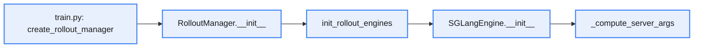
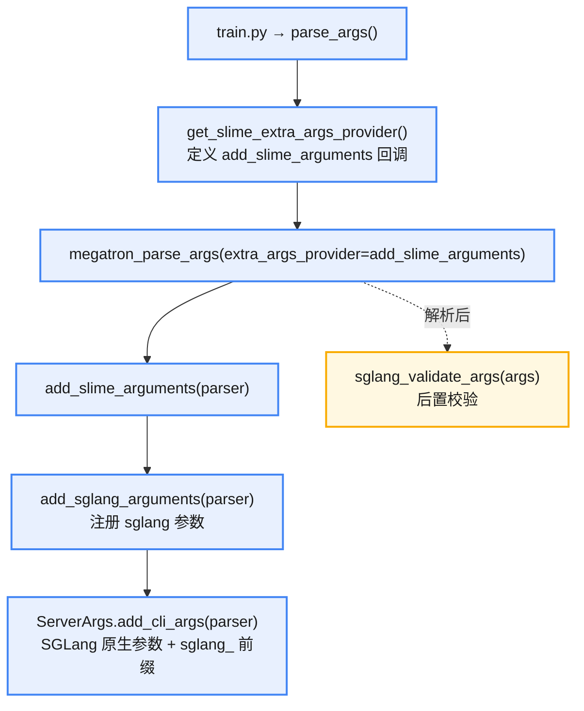
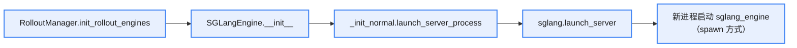

# sglang 的启动和请求方式

## 启动

* **API**

```python
from sglang import Runtime

runtime = Runtime(
    model_path="Qwen/Qwen3-8B",
    tp_size=2,
)

runtime.launch()
```

* **CLI**

```bash
python -m sglang.launch_server \
  --model-path Qwen/Qwen3-8B \
  --port 30000
```


## 请求

* **OpenAI API**

```python
from openai import OpenAI

client = OpenAI(
    base_url="http://localhost:30000/v1",
    api_key="EMPTY"
)

resp = client.chat.completions.create(
    model="default",
    messages=[
        {"role": "user", "content": "hello"}
    ]
)
```

* **curl**

```bash
curl http://localhost:30000/v1/chat/completions \
  -H "Content-Type: application/json" \
  -d '{
    "model": "default",
    "messages": [
      {"role": "user", "content": "hello"}
    ]
  }'
```

* **requests**
    * get

```python
import requests

resp = requests.get("http://localhost:30000/v1/models")

print(resp.json())
```

    * post

```python
import requests

url = "http://localhost:30000/v1/chat/completions"

data = {
    "model": "default",
    "messages": [
        {"role": "user", "content": "hello"}
    ],
    "stream": True  # 不等整个 response 完成，而是边生成边返回
}

resp = requests.post(url, json=data)

print(resp.json())
```


# slime SGLang 参数解析

在 `sglang_engine.py` 中会调用 `_compute_server_args` 函数进行参数解析，解析步骤为：

1. 读取 `args`，跳过 `_EXTERNAL_ENGINE_SKIP_CHECK_FIELDS` 参数；
2. 自动匹配：遍历 `ServerArgs` 字段，匹配 `sglang_` 前缀的参数。

```python
kwargs[attr.name] = getattr(args, f"sglang_{attr.name}")
```

调用逻辑是：



`ServerArgs` 是 `sglang.srt.server_args`，在参数解析时会被加入参数，逻辑是 `arguments.py` 的 `add_sglang_arguments()` 自动添加前缀，并加入 `ServerArgs`。

```python
def add_sglang_arguments(parser):
    """
    Add arguments to the parser for the SGLang server.
    """
    parser = add_sglang_router_arguments(parser)
    parser.set_defaults(router_balance_abs_threshold=10, router_balance_rel_threshold=1.2)
    parser.add_argument("--sglang-server-concurrency", type=int, default=512)

    parser.add_argument = new_add_argument_wrapper
    ServerArgs.add_cli_args(parser)
```

add_sglang_arguments 的调用栈



# slime SGLang 的启动和调用

大体过程是通过 RolloutManager 进行管理，通过 **sglang_router 进行调度**。RolloutManager 的 **init** 中会进行 router 和 engines 的初始化，三者（。RolloutManager、router、engines）的关系是：

| |RolloutManager|sglang_router|
|:---|:---|:---|
|**是什么**|Ray Actor，slime 的推理调度中枢|独立子进程，sglang 官方的请求路由器|
|**生命周期**|贯穿整个训练循环|由 RolloutManager 拉起，作为 daemon 子进程|
|**职责**|数据准备、推理调度、奖励计算、数据转换|接收推理请求，分发到可用的 Engine|
|**直接调用 Engine**|是（权重同步、显存管理通过 Ray RPC 直连 Engine）|是（推理请求通过 HTTP 转发给 Engine）|

关键：

1. sglang 是如何启动的？
2. sglang 是如何调用的？

关键文件：

1. `slime/ray/rollout.py`：RolloutManager 的定义
2. `slime/backends/sglang_utils/sglang_engine.py`：SGLangEngine 的定义
3. `slime/rollout/sglang_rollout.py`：generate_rollout 等方法

* RolloutManager 是"run rollout and convert rollout data to training data"，里面有对 SGLangEngine 的初始化和调用；
* SGLangEngine 主要对 sglang 方法做包装，会发送对应请求到 sglang server，比如 health_generate、flush_cache、get_weight_version、check_weights；
* generate_rollout 方法主要是异步提交任务，直到满足 target_size，最终给 sglang 发送生成请求。

## sglang 的启动

大体的启动逻辑是：



启动时会创建一个新进程来启动 sglang_engine。

> 创建进程会使用 `spawn` 的方式：`spawn` 会创建一个全新的 Python 进程（而非 `fork` 复制父进程），这在 GPU/CUDA 场景下是必须的——`fork` 会继承 CUDA context，导致子进程无法正确初始化 GPU。`force=True` 确保即使之前设置过其他方式也覆盖。

调用关系：


## sglang 的调用

在 RolloutManager 的 generate 方法中，默认调用 `slime.rollout.sglang_rollout.generate_rollout` 方法进行数据产生，也可以调用外部自定义方法。generate_rollout 是异步的生成调用方法，最终调用 sglang 的生成方法。

调用关系：


> 更完整的 RolloutManager 与 SlimeRouter 细节见下篇《slime 的 SGLang 调用（下：RolloutManager 与 SlimeRouter）》。
