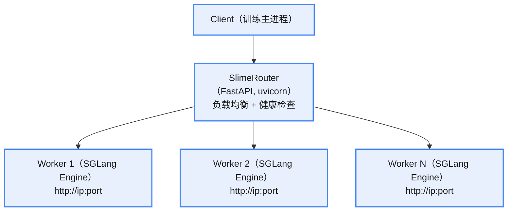
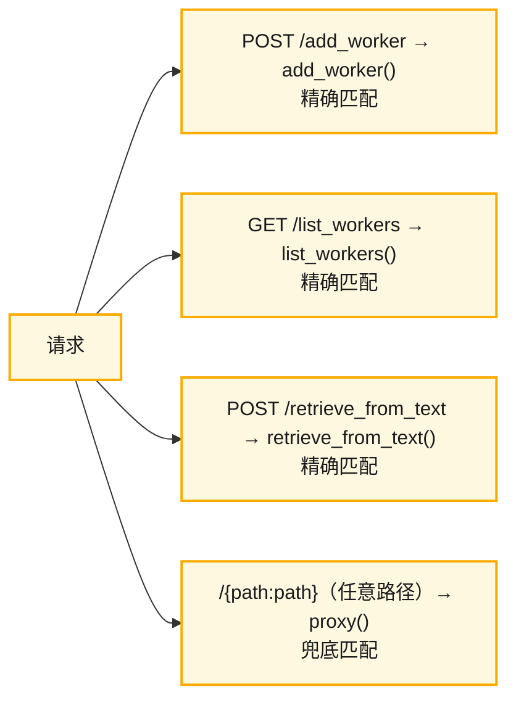

# RolloutManager

文件：`slime/ray/rollout.py`

Ray Remote Actor 的初始化函数，负责搭建整个 rollout（推理采样）阶段的运行环境。

## 上层调用和部分方法

主文件调用（详见上篇）：


## 初始化方法


### _start_router

`_start_router` 函数的作用是**启动一个 HTTP 路由服务**，用于在多个推理引擎（SGLang 或 PRM）之间做负载均衡和请求分发。

slime run_router 的实现：



|功能|实现|
|:---|:---|
|**负载均衡**|`_use_url()`：选活跃请求数最少的 worker（最少连接数策略）|
|**请求代理**|`proxy()`：透传所有请求到选中的 worker，返回响应|
|**健康检查**|`_health_check_loop()`：后台定期 `GET /health`，连续失败超阈值则标记为 dead|
|**动态注册**|`add_worker()`：运行时动态添加 worker URL|
|**故障隔离**|dead_workers 不会被路由选中，避免请求打到崩溃的引擎|

与 sglang router 的对比：

|特性|Slime Router|SGLang Router|
|:---|:---|:---|
|实现|自定义 FastAPI|SGLang 原生|
|负载均衡|最少连接数|SGLang 内置策略|
|健康检查|自实现（可标记 dead）|SGLang 内置|
|Prefill/Decode 分离|不支持|支持（`pd_disaggregation`）|
|可扩展性|支持自定义中间件|无|

### init_http_client

建立与 SGLang/PRM 推理引擎的 HTTP 通信管道。分布式模式解决的是**单点网络瓶颈**——当引擎数量多、请求量大时，把 HTTP 请求分发到各节点发送，而非全从一个节点发出。


### load_function

`load_function` 根据 `module_path` 调用 `importlib.import_module`，导入用户自定义的 `data_source`、`generate_rollout`、`eval_generate_rollout`、`custom_reward_post_process_func`、`custom_convert_samples_to_train_data_func`。

### init_rollout_engines

负责初始化 Rollout 推理引擎（基于 SGLang 的 Ray Actor），用于 RL 训练中的 rollout 阶段（即模型采样生成轨迹）。主要分为：实例化 `RolloutRayActor` 和端口分配，最后结构放到 `self.all_rollout_engines`。


实例化 SGLangEngine 为 RolloutRayActor 时，会进行 sglang 初始化。

## generate 方法

负责一次完整的 rollout 数据生成流程：

1. `health_monitoring_resume` 恢复健康监控（监控类定义在 `RolloutHealthMonitor`，`slime/utils/health_monitor.py`）；
2. `_try_ci_fault_injection`：CI（持续集成）环境下的故障注入测试方法，用于验证系统容错机制是否正常——故意"杀死"一个 rollout engine，然后等待健康监控器发现并处理该故障；
3. 产生数据、存数据、转换数据、切分数据。


`call_rollout_fn` 产生数据调用的是 `self.generate_rollout` 函数，这个函数来自 `load_function`，可手动指定函数句柄，默认是 `slime.rollout.sglang_rollout.generate_rollout`。

## 动态采样：_compute_dynamic_global_batch_size

generate 采样里，在采样完成后会判断是否进行截断：丢弃一部分数据，让数据正好能够符合分布式要求。

截断处理会对齐"产生的数量"和"gbs"，其中 gbs 由 `args.batch_size` 或动态 gbs 决定（参数 `use_dynamic_global_batch_size` 控制）。

动态 gbs 的计算逻辑：

1. 计算每一步理想处理的样本数；
2. 向下对齐到 `dp_size` 的整数倍。

```python
per_step_target = max(1, num_samples // desired_steps)
dynamic_gbs = (per_step_target // dp_size) * dp_size
```

`desired_steps` 步数的计算：

1. 如果指定了 `num_steps_per_rollout` 数值，则直接使用这个数值；
2. 没有指定时默认值为 1，即尽量把所有样本在一个 step 内消耗完，动态 gbs 尽量大。

举例：

```bash
ROLLOUT_ARGS=(
   --prompt-data /workdir/dapo-math-17k/dapo-math-17k.jsonl
   --input-key prompt
   --label-key label
   --apply-chat-template
   --rollout-shuffle
   --rm-type deepscaler
   --num-rollout 3000
   --rollout-batch-size 4
   --n-samples-per-prompt 8
   --rollout-max-response-len 8192
   --rollout-temperature 1.0
   --global-batch-size 16
   --balance-data
   --debug-rollout-only
)
```

rollout 会生成 4×8 个数据，gbs 设置为 16，不会用到动态 gbs，所以每次 rollout 的数据会分给两个 step 训练。

# SlimeRouter

文件：`/slime/router/router.py`

这是 slime 自己实现的 router，与 sglang 的原生 router 不同：SlimeRouter 不支持 PD 分离。

|功能|实现|
|:---|:---|
|**负载均衡**|`_use_url()`：选活跃请求数最少的 worker（最少连接数策略）|
|**请求代理**|`proxy()`：透传所有请求到选中的 worker，返回响应|
|**健康检查**|`_health_check_loop()`：后台定期 `GET /health`，连续失败超阈值则标记为 dead|
|**动态注册**|`add_worker()`：运行时动态添加 worker URL|
|**故障隔离**|dead_workers 不会被路由选中，避免请求打到崩溃的引擎|

## 调用逻辑

### add_worker 的调用

```python
# SGLangEngine._init_normal() -> add_worker
response = requests.post(
    f"http://{self.router_ip}:{self.router_port}/add_worker?url=http://{self.server_host}:{self.server_port}"
)
```

将 SGLang Engine 的 URL 注册到 Router 的 `worker_request_counts` 字典中，后续 proxy 路由时会选择这个 worker。

### list_workers 调用

```python
# sglang_rollout.abort -> list_worker
response = await get(f"http://{args.sglang_router_ip}:{args.sglang_router_port}/list_workers")
```

返回所有已注册 worker 的 URL 列表。abort 时需要拿到所有 worker 地址来逐个发送 `/abort_request`。

### proxy（核心方法，catch-all）

```python
# RolloutManager.generate -> sglang_rollout.generate -> proxy
url = f"http://{args.sglang_router_ip}:{args.sglang_router_port}/generate"
output = await post(url, payload)
```

1. `_use_url()` 选择当前**活跃请求数最少**的 worker（最小负载均衡）；
2. 将请求原样转发到该 worker 的对应路径（如 `/generate`）；
3. 返回 worker 的响应；
4. `_finish_url()` 将该 worker 的活跃请求计数 -1。

## init 函数

1. 初始化全局成员：

|状态字段|类型|作用|
|:---|:---|:---|
|`worker_request_counts`|`dict[str, int]`|每个 worker 的**当前活跃请求数**，用于负载均衡|
|`worker_failure_counts`|`dict[str, int]`|每个 worker 的**连续健康检查失败次数**|
|`dead_workers`|`set[str]`|被判定为死亡的 worker URL，不再路由|
|`max_weight_version`|`None`|预留字段，用于追踪最新权重版本|
|`client`|`httpx.AsyncClient`|HTTP 客户端，用于代理请求和健康检查，连接池大小 = `server_concurrency * num_gpus / gpus_per_engine`|

2. `_setup_routes`：注册 API 路径，注册四条路径：

|路径|方法|处理函数|作用|
|:---|:---|:---|:---|
|`/add_worker`|POST|`add_worker`|动态注册新 worker|
|`/list_workers`|GET|`list_workers`|列出所有已注册 worker|
|`/retrieve_from_text`|POST|`retrieve_from_text`|文本 token 化 + logprob|
|`/{path:path}`|GET/POST/PUT/DELETE|`proxy`|兜底路由，代理所有其他请求|

`proxy` 是一个 **catch-all 通配路由**，匹配所有路径。FastAPI 按注册顺序匹配路由：



所以当请求 `/generate` 时：

* 前三条都不匹配；
* 命中第 4 条，FastAPI 自动调用 `proxy(request, path="generate")`；
* `proxy` 内部拼接出 `http://{worker_url}/generate` 转发。

## proxy

请求代理转发到 sglang：根据当前负载最小的 worker URL，把请求直接通过 HTTP 发送到对应的 worker URL。


## 其他子方法

> 带下划线开头的函数供内部调用，其他的为外部调用。

* `add_worker`：添加 worker，并计数；
* `list_worker`：列出 `worker_request_counts`；
* `retrieve_from_text`：将文本 token 化，返回 token-id，使用的是 RadixTreeMiddleware 中间件注入的方法；
* `_use_url`：选择负载最小的 worker（proxy 内调用）。

```python
url = min(self.worker_request_counts)
self.worker_request_counts[url] += 1
```

* `_finish_url`：与 `_use_url` 配合使用（proxy 内调用）。

```python
self.worker_request_counts[url] -= 1
```

* `_start_background_health_check`：FastAPI startup 事件回调，在服务启动时创建一个后台 asyncio task 运行健康检查循环。调用 `_health_check_loop` 函数，后台无限循环，定期检查所有非 dead worker 的健康状态。
