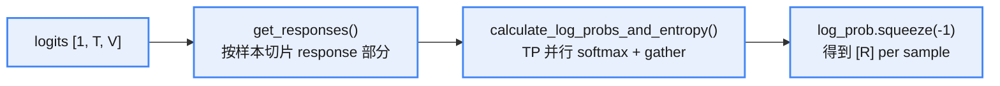
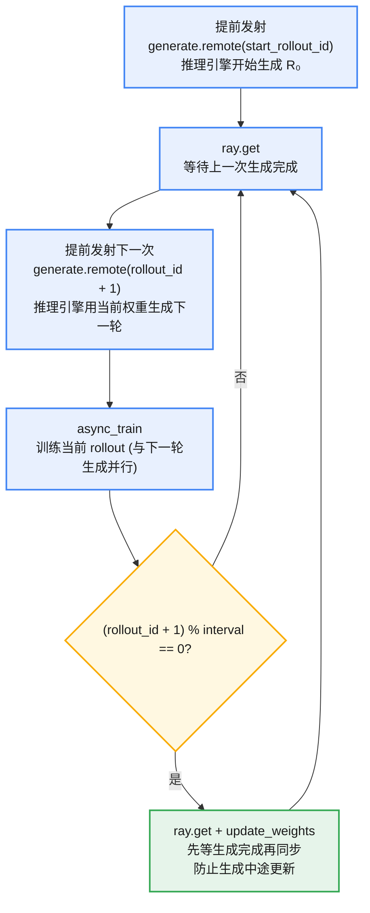
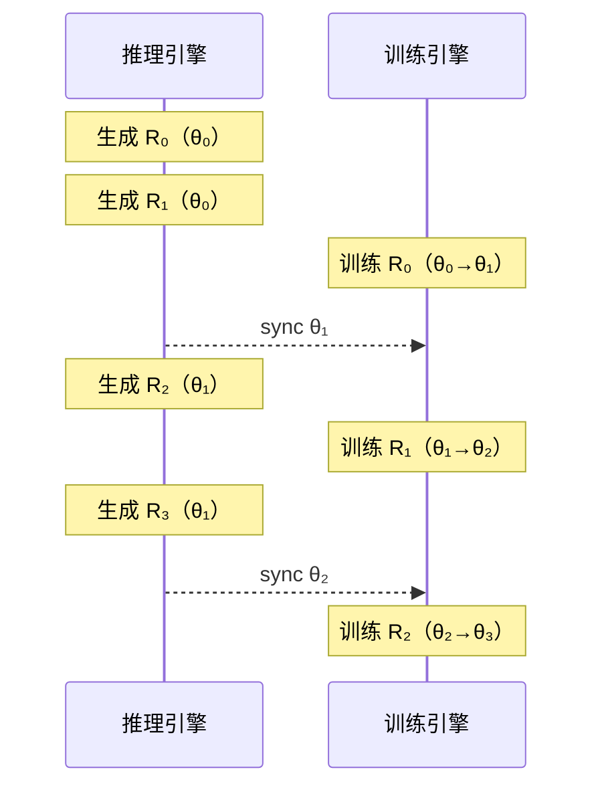
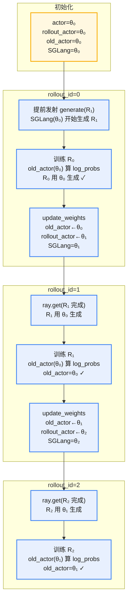

**总结**

1. 进行 RL 时，可以通过 `train_rollout_logprob_abs_diff` 指标观察训推不一致的现象。
2. TIS 可以修正分布对齐：通过重要性采样权重，缓解训推引擎不一致的现象（同步、异步都有效）。
3. 异步情况下，interval=1 时，会存在一步差异导致训推不一致，可以开启 `keep_old_actor` 保存 actor 快照，保证重要性采样使用的是推理生成时的权重。
4. 异步情况下，interval > 1 时，会存在一定步数的不一致，需要在“推理的吞吐”和“不一致的严重性”之间做 trade-off。

# 什么是 TIS/MIS

原理参考：[off-policy RL](https://fengyao.notion.site/off-policy-rl)

* **TIS**（Truncated Importance Sampling，截断重要性采样）：把重要性采样权重截断到上限以内，控制训推分布偏移带来的方差。
* **MIS**（Multi-level / Mismatch Importance Sampling，多粒度 / 训推不匹配重要性采样）：TIS 的通用化超集，支持不同粒度（token / sequence / geometric）与不同约束方式（truncate / clip / mask）。


**PPO 原始算法**：

<div style="text-align:center">

$$L^{CLIP}(\theta) = \mathbb{E}_t\left[\min\left(\frac{\pi_\theta(a_t \mid s_t)}{\pi_{\text{old}}(a_t \mid s_t)}\hat{A}_t,\ \operatorname{clip}\left(\frac{\pi_\theta(a_t \mid s_t)}{\pi_{\text{old}}(a_t \mid s_t)},\ 1-\epsilon,\ 1+\epsilon\right)\hat{A}_t\right)\right] \qquad (1)$$

</div>

标准 PPO 的 clip 目标：对重要性采样比率 $r_t(\theta) = \pi_\theta / \pi_{\text{old}}$ 先截断到 $[1-\epsilon,\ 1+\epsilon]$，再与未截断项取 min，限制每次策略更新的幅度。

**使用不同的后端进行 rollout 和 train**（sample 表示 rollout，learn 表示 train）：

<div style="text-align:center">

$$L(\theta) = \mathbb{E}_{a \sim \pi_{\text{sample}}}\left[\min\left(\frac{\pi_{\text{learn}}(a \mid s)}{\pi_{\text{sample}}(a \mid s)}\hat{A},\ \operatorname{clip}\left(\frac{\pi_{\text{learn}}(a \mid s)}{\pi_{\text{sample}}(a \mid s)},\ 1-\epsilon,\ 1+\epsilon\right)\hat{A}\right)\right] \qquad (2)$$

</div>

同一公式，但比率改为 $\pi_{\text{learn}} / \pi_{\text{sample}}$：数据由 sampler（rollout）采出，概率却由 learner（train）侧重算，两端不一致时， on-policy 假设会被破坏。

**训推不一致现象**：


<div style="text-align:center; margin:1em 0;">

<p style="color:#888; font-size:0.92em; margin:0.25em 0 0;">训推不一致现象<br>Image source: <a href="https://fengyao.notion.site/off-policy-rl">https://fengyao.notion.site/off-policy-rl</a></p>
</div>


左图：训推不一致问题带来的 token 概率差异；右图：正常 RL 训练与修复不一致问题后训练的性能对比。

如上图所示，尽管 $\pi_{\text{fsdp}}$ 与 $\pi_{\text{vllm}}$ 共享同一份模型参数 $\theta$，仍能产生显著不同的 token 概率；对某些 token $a$ 甚至给出互相矛盾的预测，即 $\pi_{\text{vllm}}(a, \theta) = 1$ 而 $\pi_{\text{fsdp}}(a, \theta) = 0$。这种意外行为隐式破坏了 on-policy 假设，使 RL 训练在不知不觉中变成 off-policy。

**修复方法**——截断重要性采样（truncated importance ratio）：

一个简单的方法是做**梯度修正**——把当前的梯度计算从：

<div style="text-align:center">

$$\mathbb{E}_{a \sim \pi_{\text{sampler}}(\theta)}\left[R(a) \cdot \nabla_\theta \log \pi_{\text{learner}}(a, \theta)\right] \qquad (3)$$

</div>

改为：

<div style="text-align:center">

$$\mathbb{E}_{a \sim \pi_{\text{sampler}}(\theta)}\left[\frac{\pi_{\text{learner}}(a, \theta)}{\pi_{\text{sampler}}(a, \theta)} \cdot R(a) \cdot \nabla_\theta \log \pi_{\text{learner}}(a, \theta)\right] \qquad (4)$$

</div>

截断重要性采样（truncated importance sampling）让训练更稳定，表示为：

<div style="text-align:center">

$$\mathbb{E}_{a \sim \pi_{\text{sampler}}(\theta)}\left[\underbrace{\min\left(\frac{\pi_{\text{learner}}(a, \theta)}{\pi_{\text{sampler}}(a, \theta)},\ C\right)}_{\text{截断的重要性比率}} \cdot R(a) \cdot \nabla_\theta \log \pi_{\text{learner}}(a, \theta)\right] \qquad (5)$$

</div>

其中 $C$ 是超参数。

**PPO 中的 TIS 可以表示为**：

<div style="text-align:center">

$$\mathbb{E}_{a \sim \pi_{\text{sampler}}(\theta_{\mathrm{old}})}\left[\underbrace{\min\left(\frac{\pi_{\text{learner}}(a, \theta_{\mathrm{old}})}{\pi_{\text{sampler}}(a, \theta_{\mathrm{old}})},\ C\right)}_{\text{截断的重要性比率}} \cdot \nabla_\theta \min\left(\frac{\pi_{\text{learner}}(a, \theta)}{\pi_{\text{learner}}(a, \theta_{\mathrm{old}})}\,\hat A,\ \mathrm{clip}\left(\frac{\pi_{\text{learner}}(a, \theta)}{\pi_{\text{learner}}(a, \theta_{\mathrm{old}})},\ 1-\epsilon,\ 1+\epsilon\right)\,\hat A\right)\right] \qquad (6)$$

</div>


## MIS

MIS 是 slime 在 [examples/train_infer_mismatch_helper/mis.py](https://webview-17cv2b0ke0m5askjtrgmemu4sai1bfpne5bc6a0hr1i5rbruus00.icoding.baidu-int.com/icoding/webview/comate/stable/1.108.2/examples/train_infer_mismatch_helper/mis.py) 里提供的**更通用、更细粒度的重要性采样修正实现**，可以理解为 **TIS 的超集**。内置 `vanilla_tis_function` 只能做“token 级 + clamp 截断”这一种；MIS 把它扩展成一个完整的框架，通过 `--custom-tis-function-path examples.train_infer_mismatch_helper.mis.compute_mis_weights_with_cp` 挂进来使用。

MIS 相比内置 TIS 多出的能力（见目录 README）：

* **多种模式（mode）**：`truncate`（截断）/ `clip`（裁剪）/ `mask`（直接屏蔽，即拒绝采样 RS）
* **多种粒度（level）**：
    * `token`：每个 token 独立算权重（默认，有偏但简单）
    * `sequence`：整条序列 logprob 差求和后 exp（无偏但方差大）
    * `geometric`：几何平均（有偏低方差，折中）

* **拒绝采样 RS**：把 IS 权重超阈值的 token/序列直接 mask 掉，不参与 loss 平均
* **Veto 机制**：某个 token 概率极低（catastrophic，如 < 1e-4 ~ 1e-6）时整条序列否决，防止灾难性更新
* **batch normalize**：把 IS 权重归一化到均值 1.0
* **丰富的监控指标**：`mis_truncate_fraction`、`mis_clip_fraction_*`、`mis_mask_fraction_*`、`ois`、`mis_batch_norm_factor` 等

总结：**TIS 是 MIS 的一个特例（token 级 + 截断）。需要更精细控制（不同 level、RS、veto、归一化）或做 3-policy 解耦 PPO 时，就用 MIS。** 只需要基础纠偏时，`--use-tis` 就够了。


# slime 重要性采样和 TIS 策略

`train_rollout_logprob_abs_diff`（监控训推不一致的指标）的计算逻辑：

文件：slime/backends/megatron_utils/loss.py

## 重要性采样

* 重要性采样分母确认（old_log_probs）：

1. `old_log_probs`：旧策略（`use_rollout_logprobs=False`，默认），训练引擎用 `old_actor` 权重重算的 `batch["log_probs"]`，即 π_Megatron
2. `rollout_log_probs`：推理引擎生成时记录的 `batch["rollout_log_probs"]`（`use_rollout_logprobs=True`），即 π_SGLang

* 重要性采样分子计算：

1. `get_log_probs_and_entropy` 函数进行当前策略 log_prob 的计算（从当前步模型 logits 出发，经 softmax + gather 得到每个 response token 的 log 概率），内部逻辑是：




## TIS

* TIS（Truncated Importance Sampling）修正

> 通过 `use_tis` 控制，只有 `use_rollout_logprobs=False` 时（采用训练引擎重算的 old_log_probs）才能走到这一步

```python
# vanilla_tis_function 函数：先对损失进行 TIS 加权
tis = torch.exp(old_log_probs - rollout_log_probs)
tis_weights = torch.clamp(tis, min=args.tis_clip_low, max=args.tis_clip)
pg_loss = pg_loss * tis_weights # 乘上 tis_weights 权重
```

这样实现了**三策略解耦**：`ratio = π_θ / π_train`（PPO 部分）× `π_train / π_rollout`（TIS 修正），合并等价于 `π_θ / π_rollout`（实际上不完全等价，主要因为 clip 作用域不同）：

```text
最终 pg_loss = -clip(π_θ/π_train) * A  ×  (π_train/π_rollout)
                   ↑ PPO 部分              ↑ TIS 部分
```

TIS 修正的作用是把 ratio 从“以 π_train 为基准”校正为“以 π_rollout 为基准”，使得分母真正对齐采样分布。

> 实际采样是由 SGLang 做的，所以采样分布是 `π_rollout`，不是 `π_train`。但默认 PPO 的 ratio 分母用的是 `π_train`：

||采样分布|ratio 分母|是否正确|
|:---|:---|:---|:---|
|默认 PPO|π_rollout|π_train|错，分母 ≠ 采样分布|
|× TIS 修正|π_rollout|π_rollout|对，分母 = 采样分布|
|use_rollout_logprobs|π_rollout|π_rollout|对，但一步到位|

`π_train / π_rollout` 本质上就是 importance sampling 的**自重要性权重**，校正“我以为采样来自 π_train”到“实际采样来自 π_rollout”之间的分布偏移。偏移越大，这个权重离 1 越远，也就越需要 TIS 的 truncate/clip/mask 来控制方差。

* 直接使用推理 log_prob

`use_rollout_logprobs=True` 时，PPO ratio 直接变为 `π_θ / π_SGLang`，完全消除了训练引擎重算这一步，但**算法变为 off-policy**。

## 监控指标

```python
train_rollout_logprob_abs_diff = sum_of_sample_mean((old_log_probs - rollout_log_probs).abs())
```

`train_rollout_logprob_abs_diff` 衡量的是：**同一策略权重下，训练引擎 vs 推理引擎重算的 log_prob 数值差异**——纯引擎实现层面的不一致度量。

1. 默认时（`use_rollout_logprobs=False`），它不是“当前策略 vs 旧策略”的差，而是同一策略权重下训练引擎 vs 推理引擎的数值差异；
2. `use_rollout_logprobs=True` 时，这个指标恒为 0，失去监控意义。

▲ 总结：loss.py 对训推不一致的处理体现在以下两处：

1. `use_rollout_logprobs=False`（默认）时，用 `train_rollout_logprob_abs_diff` 指标进行监控；
2. TIS 对重要性采样进行修正，修正因子是 `π_train / π_rollout`，作用是对齐采样分布。

# 异步训练不一致控制策略

`train_async.py` 实现了**流水线异步**：当前 rollout 的训练与下一个 rollout 的生成并行执行。



## 关键参数

* `--keep-old-actor`：三模型快照队列

异步模式下 `--keep-old-actor` 维护三份权重快照（CPU）：

- `actor`：当前训练权重（持续更新）
- `rollout_actor`：上一次发送给推理引擎的权重
- `old_actor`：推理引擎生成当前 rollout 时使用的权重

权重更新时执行队列式拷贝：

```python
if args.update_weights_interval == 1:
    self.weights_backuper.copy(src_tag="rollout_actor", dst_tag="old_actor")  # rollout → old
    self.weights_backuper.backup("rollout_actor")                              # actor → rollout
else:
    self.weights_backuper.backup("old_actor")   # interval > 1 时直接从当前 actor 备份
```

* **`update_weights_interval`** 控制 stale 程度：interval 越大，推理引擎权重越滞后，吞吐量越高，但不一致性也越严重。

## 异步时序关系

异步训练和推理的时序图：



`--keep-old-actor`（队列拷贝）开启后会维持三份权重（update_weights_interval=1），**保证了 old_actor 始终对齐“生成当前 rollout 时 SGLang 使用的权重”**。

```mermaid
flowchart TB
    subgraph INIT["初始化"]
        direction TB
        A["actor=θ₀<br/>rollout_actor=θ₀<br/>old_actor=θ₀<br/>SGLang=θ₀"]
    end

    subgraph R0["rollout_id=0"]
        direction TB
        B0["L31 提前发射 generate(R₀)<br/>SGLang(θ₀) 开始生成 R₀"]
        C0["L35 ray.get(R₀ 完成)"]
        D0["L39 提前发射 generate(R₁)<br/>SGLang(θ₀) 开始生成 R₁"]
        E0["L66 训练 R₀<br/>old_actor(θ₀) 算 log_probs ✓<br/>actor θ₀→θ₁"]
        F0["L84 update_weights<br/>old_actor←rollout_actor(θ₀)<br/>rollout_actor←actor(θ₁)<br/>SGLang→θ₁"]
        G0["状态<br/>actor=θ₁ rollout_actor=θ₁<br/>old_actor=θ₀ SGLang=θ₁"]
        B0 --> C0 --> D0 --> E0 --> F0 --> G0
    end

    subgraph R1["rollout_id=1"]
        direction TB
        B1["L35 ray.get(R₁ 完成)"]
        C1["L39 提前发射 generate(R₂)<br/>SGLang(θ₁) 开始生成 R₂"]
        D1["L66 训练 R₁<br/>old_actor(θ₀) 算 log_probs ✓<br/>actor θ₁→θ₂"]
        E1["L84 update_weights<br/>old_actor←rollout_actor(θ₁)<br/>rollout_actor←actor(θ₂)<br/>SGLang→θ₂"]
        F1["状态<br/>actor=θ₂ rollout_actor=θ₂<br/>old_actor=θ₁ SGLang=θ₂"]
        B1 --> C1 --> D1 --> E1 --> F1
    end

    subgraph R2["rollout_id=2"]
        direction TB
        B2["L35 ray.get(R₂ 完成)"]
        C2["L39 提前发射 generate(R₃)<br/>SGLang(θ₂) 开始生成 R₃"]
        D2["L66 训练 R₂<br/>old_actor(θ₁) 算 log_probs ✓"]
        B2 --> C2 --> D2
    end

    A --> B0
    G0 --> B1
    F1 --> B2

    classDef init fill:#FFF8E1,stroke:#F9AB00,stroke-width:2px,color:#1a1a1a
    classDef node fill:#E8F0FE,stroke:#4285F4,stroke-width:2px,color:#1a1a1a
    classDef state fill:#E6F4EA,stroke:#34A853,stroke-width:2px,color:#1a1a1a
    class A init
    class B0,C0,D0,E0,F0,B1,C1,D1,E1,B2,C2,D2 node
    class G0,F1 state
```



对于 `update_weights_interval > 1` 的情况，不做队列拷贝，直接从当前 actor 备份。此时 `old_actor` = **同步权重那一刻的 actor**，而不是推理引擎实际使用的权重。

这带来的问题是：推理引擎在 interval 内多个 step 用同一个旧权重生成，但 `old_actor` 只记录最后一次同步时的权重。中间那些 rollout 的 old policy log probs 是近似值，引入额外偏差。这是**吞吐量和一致性的 trade-off**——interval 越大，推理引擎越不卡，但 PPO ratio 越不精确。

总结表：

||同步模式|异步模式 (interval=1)|异步模式 (interval>1)|
|:---|:---|:---|:---|
|不一致来源|仅引擎实现差异|引擎差异 + 1步权重延迟|引擎差异 + N步权重延迟|
|old_actor|不需要|队列式拷贝，精确对齐|近似（只记录同步时快照）|
|PPO ratio 正确性|`π_θ / π_train`（分母≠采样分布）|`π_θ / π_old_actor`（分母=采样权重）|近似正确|
|吞吐量|低（串行）|中|高|
|可否 + TIS|可以|可以（修正引擎差异）|可以（同时修正权重延迟+引擎差异）|

核心思路：**`keep_old_actor` 用三快照队列解决权重延迟导致的 ratio 偏差，TIS 在此基础上进一步修正训推引擎实现差异**。两者正交，可以叠加使用。

`update_weights_interval=1` 时，如果不开启 `keep_old_actor`，就会出现差一步的权重差异，导致进一步的训推不一致：



# 参数总结

|参数|默认值|说明|
|:---|:---|:---|
|`--colocate`|False|训练和推理共享 GPU|
|`--update-weights-interval`|1|推理引擎权重同步频率|
|`--keep-old-actor`|False|维护 old_actor 快照用于异步 PPO|
|`--use-rollout-logprobs`|False|直接用推理 log_probs（跳过重算）|
|`--use-tis`|False|启用截断重要性采样修正|
|`--tis-clip`|2.0|IS 权重上界|
|`--tis-clip-low`|0|IS 权重下界|
|`--tis-mode`|-|truncate / clip / mask|
|`--tis-level`|token|token / sequence / geometric|
|`--tis-upper-bound`|-|IS 权重上界|
|`--tis-lower-bound`|-|IS 权重下界|
|`--tis-batch-normalize`|False|IS 权重归一化到均值=1|
|`--use-rs`|False|启用拒绝采样|
|`--rs-lower-bound` / `--rs-upper-bound`|-|RS 边界|
|`--rs-level`|-|token / sequence / geometric|
|`--rs-veto-threshold`|None|否决阈值|
|`--get-mismatch-metrics`|False|监控不一致指标（不改 loss）|
|`--custom-tis-function-path`|None|自定义 TIS 函数路径|
|`--use-routing-replay`|False|MoE 路由重放|
|`--true-on-policy-mode`|False|禁用编译保一致性|

## TIS 三档 Level 计算参数

IS 权重在哪个粒度计算：

|Level|公式|偏差|方差|直觉|
|:---|:---|:---|:---|:---|
|token|`exp(log_diff_t)` 逐 token|有偏（局部修正不代表整条序列的分布偏移）|低|每个 token 独立修正|
|sequence|`exp(Σ log_diff_t)` 全序列连乘|**无偏**（整条序列的 IS 权重是标准重要性采样）|**高**（连乘指数爆炸/衰减）|整条序列用一个权重|
|geometric|`exp(mean log_diff_t)` 几何均值|有偏（除以 T 破坏了 IS 的无偏性）|低|序列级但被 T 压住了|

**核心 trade-off**：sequence level 是唯一无偏的，但连乘导致方差爆炸——假设序列有 1000 个 token，每个 token ratio 略微偏离 1，连乘后可能极端到 0 或 ∞。geometric 是 sequence 的低方差近似（除以 T 做了归一化），token 则是更粗粒度的近似。

## TIS Mode：算出权重后的约束参数

|Mode|越界 token 怎么处理|梯度|分母|
|:---|:---|:---|:---|
|truncate|权重压到 upper_bound|有梯度，但被削弱|正常计入|
|clip|权重压到 [lower, upper]|有梯度，但被削弱|正常计入|
|mask|mask 置零，token 整体剔除|**无梯度**|不计入分母|

核心区别：truncate/clip 是**软化**——越界的 token 仍然贡献梯度，只是贡献被压低；mask 是**硬删除**——越界 token 直接不参与训练，loss 分母也相应缩小。
