> 论文：**ADAFLASH: Adaptive Speculative Decoding via On-Policy Distilled Diffusion Drafters**（[arXiv:2607.19223](https://arxiv.org/abs/2607.19223)）

## 一句话总结

扩散草稿模型（DFlash 一类）的**双向注意力**在带来并行草稿生成的同时，引入了草稿质量的**高方差**；固定草稿模型 + 恒定验证长度的静态推测系统因此退化。ADAFLASH 用两个组件做**在线自适应**：**同策略蒸馏**（OPD）持续把草稿模型适配到部署分布，**自适应长度头**动态截断验证长度；配合异步训练—推理基础设施，相对标准 AR 解码最高取得 **5.3×** 加速，高并发下吞吐比此前 SOTA 高约 **66%**。

## 背景与核心问题

**关键观察——高方差是扩散草稿模型的固有缺陷**：

* **领域层面方差**：接受率在不同任务领域（chat/code/math）间大幅波动（Qwen3-8B 上 $\tau$ 从 ShareGPT 的 3.40 到 MathQA 的 7.09，比值约 2.1×），远甚于 AR 草稿模型（EAGLE-3 仅约 1.2×）——双向注意力对领域漂移更敏感。
* **词元层面方差**：单条草稿序列内逐位置接受概率差异大；固定候选长度时，接受概率低的位置浪费目标模型算力，高并发下尤为致命（DFlash 在 $C=128$ 时跌到 0.76×，低于标准 AR 基线）。

## 方法：ADAFLASH 框架

### 同策略蒸馏（OPD）——应对领域层面方差

利用推测解码天然的“草稿—反馈—适配”闭环：每轮目标模型在候选位置给出分布作为监督，持续更新草稿模型。扩散草稿模型有两个特有挑战，用两个机制解决：

* **反向 KL 混合损失**：扩散草稿的双向注意力倾向产生高熵（宽分布）输出，而推测解码只需覆盖目标高概率区域，前向 KL（模式覆盖）反而有害；反向 KL 惩罚草稿在目标概率低处放质量，直接提升接受率。额外加目标 top-1 的硬标签交叉熵加速收敛：

<div style="text-align:center">

$$\ell_{\text{OPD}} = \alpha\, \ell_{\text{hard}} + (1-\alpha)\, \ell^{\text{clip}}_{\text{rkl}}, \qquad \ell_{\text{hard}} = -\frac{1}{k}\sum_{i=1}^{k} \log q_w(x_i^\star \mid x_{&lt;t+i}) \qquad (1)$$

</div>

* **逐条目散度裁剪**：反向 KL 是词表条目之和，少数条目上 $q(y)/p(y)$ 极大，会支配损失产生异常梯度；逐 $(i, y)$ 把单项裁剪到阈值 $\delta$（默认 0.01）：

<div style="text-align:center">

$$\ell^{\text{clip}}_{\text{rkl}} = \frac{1}{k}\sum_{i=1}^{k}\sum_{y \in \mathcal{V}} \min\left\{ q_w(y \mid x_{&lt;t}, z)_i \log \frac{q_w(y \mid x_{&lt;t}, z)_i}{p_v(y \mid x_{&lt;t+i})},\ \delta \right\} \qquad (2)$$

</div>

### 自适应长度头——应对词元层面方差

轻量头附加在草稿模型上：输入草稿块隐状态 $h_t$ → 线性投影 + SiLU → 均值池化 $\hat h_t$ → sigmoid 得到预测接受率 $\hat a_t \in [0,1]$，验证长度截断为

<div style="text-align:center">

$$\hat{k}_t = \mathrm{clamp}\big(\lfloor \hat{a}_t \cdot k \rfloor,\ 1,\ k\big), \qquad (3)$$

</div>

实践中可再乘负载因子 $\gamma$。长度头以真实接受率 $a_t^\star$ 的 MSE 在线更新：$\ell_{\text{len}} = (\hat a_t - a_t^\star)^2$，且与草稿模型**梯度分离**，两类目标完全解耦。

### 基础设施

* **异步训练—推理流水线**：推理服务器与训练服务器通过共享缓冲区解耦；训练侧用 OPD 更新草稿模型与长度头，权重经**热重载**换入（目标模型不动），训练永不阻塞生成。
* **自适应请求调度**：支持变长候选，打包成紧凑验证批 $\sum_i \hat k_i$；用 EMA 估计可准入请求数，显存超预算时退回超额请求，避免溢出并最大化 GPU 利用率。

## 实验

### 主结果（6 数据集平均加速比，Qwen3-8B）

|方法|C=1|C=32|C=64|C=128|
|:---|:---|:---|:---|:---|
|EAGLE-3|2.34×|0.68×|0.43×|0.33×|
|DFlash|3.53×|1.54×|1.01×|0.76×|
|OSD（前向 KL 在线蒸馏）|3.95×|1.70×|1.12×|0.83×|
|**ADAFLASH**|**4.06×**|**1.74×**|**1.33×**|**1.15×**|

* 单并发下相对 AR 解码最高 **5.32×**（MathQA）；接受长度 $\tau$ 在 MathQA 上从 7.09（DFlash）→ 9.44（OSD）→ **9.83**（ADAFLASH），证明同策略蒸馏优于 OSD 的标准蒸馏。
* **高并发是最大优势点**：$C=128$ 时 OSD/DFlash 已跌破 AR 基线（0.83×/0.76×），ADAFLASH 仍保持 1.15×——固定验证长度在并发下浪费算力，而自适应长度头按需截断。
* 这一优势跨架构泛化：混合专家模型 Qwen3-Coder-30B-A3B 上同样全程领先。

## 与 DSpark 的对比

* DSpark 估计**逐位置条件接受概率**并需事后校准累积误差；ADAFLASH 长度头直接预测**整体接受率**，形式更简单、免校准。
* DSpark 置信度头**离线训练、推理时固定**；ADAFLASH 长度头**在线持续演化**，与不断演进的草稿模型协同适配。
* 二者**互补**：DSpark 的硬件感知调度可集成进 ADAFLASH 获得进一步提升。

## 代码实现

### 整体流程

```mermaid
flowchart TD
    subgraph PREP["阶段 0 数据准备"]
        direction TB
        RAW["原始数据集<br/>gsm8k / perfectblend / math_qa / ..."]:::data
        PREP_CMD["bin/prepare_data.py<br/>normalize 为 prompt + response"]:::data
        NORM_JSONL[("cache/dataset/*_train.jsonl")]:::store

        TGT_PREP["Target 模型<br/>Qwen/Qwen3-8B"]:::target
        INIT_DRAFT["初始 DFlash drafter<br/>z-lab/Qwen3-8B-DFlash-b16<br/>(无 thresh head)"]:::draft
        REGEN_CMD["bin/regenerate_dataset.py<br/>target + initial draft 联合生成"]:::data
        REGEN_JSONL[("cache/dataset/*_regen_4096.jsonl<br/>prompt + target response")]:::store

        RAW --> PREP_CMD --> NORM_JSONL
        NORM_JSONL --> REGEN_CMD
        TGT_PREP --> REGEN_CMD
        INIT_DRAFT --> REGEN_CMD
        REGEN_CMD --> REGEN_JSONL
    end

    subgraph INIT["阶段 1 离线初始化 adaptive length head (pipeline.offline.init_thresh_head)"]
        direction TB
        I_DRAFT_IN["plain DFlash checkpoint"]:::draft
        I_LOAD["DFlashDraftModel.from_pretrained<br/>load_state_dict(strict=False)<br/>→ thresh_head_two_model 随机初始化"]:::draft
        I_TH["thresh_head_two_model<br/>Linear(2d→256) + SiLU + Residual<br/>Linear(256→1) + sigmoid<br/>输出 candidate_len / block_size"]:::thresh

        I_TGT["Target 模型 (sglang backend)"]:::target
        I_EMB["embed_tokens + lm_head<br/>从 target safetensors 切片, 冻结"]:::target

        I_DATA["regen JSONL rows<br/>prompt + response 拼接"]:::data
        I_ANCHOR["每条样本随机采 anchor<br/>num_anchors=64, block_size=16"]:::data

        I_TGT_FWD["target.forward(output_hidden_states=True)<br/>→ ctx_all (target 层 hidden)"]:::target
        I_DRAFT_FWD["drafter 在 anchor 生成 block_size 个 token<br/>noise_embedding → draft_hidden [1, B, d]"]:::draft
        I_LMHEAD["lm_head(draft_hidden) → logits<br/>[1, B, V]"]:::target

        I_LABEL["compute_thresh_head_labels_rkl<br/>labels_hard = (argmax(logits) == target_ids)<br/>accept_lens = cumprod(labels_hard[:, :, 1:]).sum<br/>thresh_label = (accept_lens + lookahead) / block_size"]:::data

        I_FREEZE["drafter 主体冻结<br/>_freeze_module(draft)<br/>只解冻 thresh_head_two_model"]:::draft
        I_OPT["AdamW(thresh_head.parameters())<br/>lr=5e-5, loss=MSE / MAE"]:::thresh
        I_SAVE[("drafter + 已训练 thresh head<br/>→ models/*-DFlash-AdaFlash-init<br/>(含 dflash.py remote code)")]:::store

        I_DRAFT_IN --> I_LOAD --> I_TH
        I_TGT --> I_EMB
        I_DATA --> I_ANCHOR --> I_TGT_FWD
        I_TGT_FWD --> I_DRAFT_FWD
        I_EMB --> I_DRAFT_FWD
        I_DRAFT_FWD --> I_LMHEAD --> I_LABEL
        I_LABEL --> I_OPT
        I_TH --> I_OPT
        I_FREEZE -.->|"约束"| I_OPT
        I_OPT --> I_SAVE
    end

    REGEN_JSONL ==>|"训练数据"| I_DATA

    subgraph ASYNC["阶段 2 异步 on-policy 训练 (run_async_pipeline_adaflash.sh)"]
        direction TB

        subgraph INFER["Inference Worker (GPU 0, setsid bash)"]
            direction TB
            A_TGT["Target 模型 (SGLang Engine)<br/>mem-fraction-static=0.80"]:::target
            A_DRAFT["当前 drafter 主体<br/>热重载"]:::draft
            A_TH["thresh_head_two_model<br/>candidate_len = sigmoid(h) * block_size * threshold_rate<br/>rate=1.3"]:::thresh
            A_GEN["推测解码生成轨迹<br/>prompt → response<br/>含 accept_len 统计"]:::data
            A_BUFFER[("data_buffer/<br/>JSONL 轨迹")]:::store
            A_STATS["inference_stats.jsonl<br/>每个版本的吞吐指标"]:::data

            A_TGT --> A_GEN
            A_DRAFT --> A_GEN
            A_TH --> A_GEN
            A_GEN --> A_BUFFER
            A_GEN --> A_STATS
        end

        subgraph TRAIN["Training Worker (GPU 1,2, torchrun --standalone)"]
            direction TB
            T_BUFFER[("读 data_buffer<br/>TRAIN_THRESHOLD=128 触发")]:::store
            T_TGT["Target 模型 (SGLang)<br/>mem-fraction-static=0.40"]:::target
            T_DRAFT["drafter 主体<br/>参数组 1, lr=3e-4"]:::draft
            T_TH["thresh_head_two_model<br/>参数组 2, lr=2e-4"]:::thresh

            T_RKL["RKL 主损失<br/>alpha * CE(teacher argmax) + (1-alpha) * KL(p_S‖p_T)<br/>alpha=0.8, T=1.0, div_clip_tau=0.01"]:::draft
            T_DETACH["thresh head 前向用 DETACHED hidden states<br/>梯度不回传 drafter (critical!)"]:::thresh
            T_TH_LOSS["thresh head loss = MSE(pred, thresh_label)<br/>标签定义与 init 阶段完全一致 (direct_len + lookahead=1)"]:::thresh

            T_OPT["AdamW 双参数组<br/>独立 LR / 独立梯度<br/>grad_accum=2, buffer_epochs=2"]:::data
            T_SNAP[("版本化快照<br/>draft_models/v{N}<br/>DRAFT_SNAPSHOT_INTERVAL")]:::store
            T_SAVE[("model_weights/<br/>最新热重载权重")]:::store
            T_VERSION["version.txt 哨兵<br/>发布完成的标记"]:::store

            T_BUFFER --> T_TGT
            T_BUFFER --> T_DRAFT
            T_TGT --> T_RKL
            T_DRAFT --> T_RKL
            T_RKL --> T_OPT
            T_DRAFT -.->|"detach"| T_DETACH
            T_DETACH --> T_TH
            T_TH --> T_TH_LOSS --> T_OPT
            T_OPT --> T_SNAP
            T_OPT --> T_SAVE --> T_VERSION
        end

        A_BUFFER ==>|"swap buffer 轨迹流"| T_BUFFER
        T_VERSION -.->|"热重载 version.txt 触发"| A_DRAFT
        T_VERSION -.->|"同步更新"| A_TH
    end

    I_SAVE ==>|"INITIAL_DRAFT_PATH<br/>作为 on-policy 起点"| A_DRAFT
    I_SAVE ==>|"INITIAL_DRAFT_PATH<br/>thresh head 已初始化"| A_TH

    classDef data fill:#e3f2fd,stroke:#1976d2,color:#0d47a1
    classDef target fill:#fff3e0,stroke:#f57c00,color:#e65100
    classDef draft fill:#f3e5f5,stroke:#7b1fa2,color:#4a148c
    classDef store fill:#e8f5e9,stroke:#388e3c,color:#1b5e20
    classDef thresh fill:#e0f2f1,stroke:#00897b,color:#004d40
```



注：

1. 大体流程：

* 阶段 0：数据获取，用 target model 生成 query 的回答，记录到 json 文件。
* 阶段 1：训练自适应头：获取 target model 的 hidden state → draft + head 得到预测解码 → 计算接受长度标签 → 对自适应头进行预训练。
* 阶段 2：在线训练：收集训练数据 → 获取 target model 的回答 → 获取 target model 的 hidden state → draft + head 得到预测解码 → 计算反向 KL 损失 → 更新权重。

2. 阶段 0 可以使用不带草稿模型的权重，主要是为了收集 target 的回答（prefill + decode）。
3. 阶段 1 的 draft 主体是冻结的，sglang 服务只做 prefill、获取 hidden state（获取时不能开 CUDA graph）。
4. 阶段 2 有两个 sglang，把“生成回复”和“获取 hidden state”两个阶段分开；第二个 SGLang 配置成 `enable_return_hidden_states=True` + `disable_cuda_graph=True` + `SpeculativeAlgorithm.NONE`，**它根本没法跑推测解码**——`CaptureHiddenMode.FULL` 模式下 SGLang 只做一次 prefill forward，不进入 decode loop。所以“生成回复”只能由第一个 SGLang 完成，第二个 SGLang 只是把它当输入数据用。
5. 阶段 2 的第一个 SGLang 需要开启投机解码，用于热权重更新和训推分布统一。

|**对比项**|**第一个（inference）**|**第二个（training）**|
|:---|:---|:---|
|是否需要回复|必须生成文本|只跑 prefill 拿激活|
|输入|prompt|`tokenize(prompt + response)`|
|调用|`engine.generate()` → decode loop|`generate_dflash_data()` → `_extend()` → `forward()` 一次|
|产出|response 文本（进 buffer）|hidden_states 张量（直接进训练）|
|推测解码|DFLASH|`SpeculativeAlgorithm.NONE`|

### loss 计算

总损失：`total_loss = L_hard + L_kd + L_prob（可选）+ L_thresh（可选）`

* **L_hard**：`hard label` 交叉熵。注意这里的 hard label **不是 ground-truth token id**，而是 **teacher 在同一位置的 argmax**——这是 KD（知识蒸馏）的关键特征。

```python
# teacher 在 anchor 前一个位置的 logits 取 argmax 当 hard label
ptr = lab - 1                                # lab 是 anchor+offset
h_sel = h_teacher[bb, ptr].detach()          # ← 用 response 区的 teacher hidden
t_logits = lm_head(h_sel)                    # teacher 的预测分布
flat_teacher_targets = argmax(t_logits)      # hard label

loss_per_token = CE(draft_logits, flat_teacher_targets)  # reduction="none"
hard_loss = (loss_per_token * flat_weights).sum() / valid_token_count
```

teacher hidden 就是 `last_hidden_state`。

* **L_kd**：反向 KL。`kd_raw` 还有 `rkl_div_clip_tau` 截断，防止个别位置 KL 过大把梯度炸掉。

```python
T = rkl_temperature
p_s = softmax(draft_logits / T)                          # 学生分布
log_p_t = log_softmax(t_logits / T).detach()             # teacher 分布
kd_raw = F.kl_div(log_p_t, p_s, reduction="none").sum(-1) * T*T
# = p_s * (log p_s - log p_t) → 这是 KL(p_S ‖ p_T)，反向 KL
```

* **L_prob**（Prob Head）

如果有 Prob Head（旧版接受概率预测头），训练它预测每个位置 token 是否会被 teacher 接受：

```python
accept_labels = (draft_argmax == target_ids).float()   # 硬匹配
prob_loss = BCE_with_logits(prob_logits, accept_labels)
loss = loss + prob_loss
```

* **L_thresh**（Thresh Head）

用 detached hidden states 前向：

```python
output_hidden_3d = output_hidden.view(bsz, n, block_size, -1)
thresh_in = output_hidden_3d.detach().reshape(bsz*n, block_size, -1)  # ← detach!
thresh_pred = thresh_head(thresh_in).squeeze(-1).view(bsz, n)
```

```python
labels_hard = (draft_argmax == target_ids).float()    # 每个位置是否硬匹配
accept_lens = cumprod(labels_hard[:,:,1:]).sum(dim=2) # 期望连续接受长度
# direct_len 模式
thresh_labels = (accept_lens + lookahead) / block_size  # clamp [0,1]

# 损失
loss_per_block = (thresh_pred - thresh_labels) ** 2     # MSE
thresh_loss = (loss_per_block * block_mask).sum() / valid_count

loss = loss + thresh_loss
```

Prob Head 是历史遗留，新模型默认用 Thresh Head，两者不会同时开启。

||**Prob Head（旧）**|**Thresh Head（新）**|
|:---|:---|:---|
|预测目标|每个位置 token 是否被接受 `[B, n, block_size]`|整个 block 的期望接受长度 `[B, n]`|
|形状|`[block_size]` 逐位置|`[1]` per block|
|标签来源|`draft_argmax == target_argmax`（硬匹配）|`cumprod(labels_hard).sum()`（连续接受长度）|
|损失|BCE-with-logits|MSE / MAE|

### 其他说明

1. **数据传递**

* **第一个 SGLang（inference worker）**：`speculative_algorithm=DFLASH`，跑 decode loop 出 response 文本 → 写 buffer
* **第二个 SGLang（training worker）**：`SpeculativeAlgorithm.NONE` + `enable_return_hidden_states=True`，跑 prefill 拿 hidden_states → 直接喂给 PyTorch drafter

两者配置完全不同，不能合并。

2. **on-policy 体现在哪里？**

drafter 和 Thresh Head **都**在线训练，但“online”的核心价值在 Thresh Head——它的标签随 drafter 演化而变化，离线训完固定会失准。这是 ADAFLASH 相对 DSpark 的实质创新。
