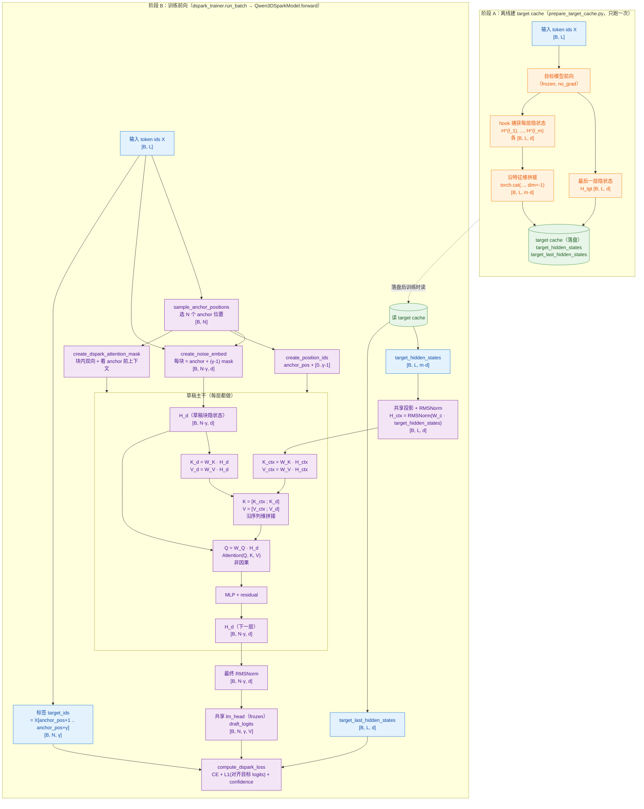

## 1. 背景

大语言模型以自回归方式生成文本，推理时延与**输出长度**成正比，由此带来了低 GPU 利用率和高用户感知等待时间。投机解码提供了一种原理性的解决方案：一个轻量草稿模型提出**一整块候选 token**，全尺寸目标模型通过**拒绝采样**在**单次前向传播**中验证整块，接受与目标分布一致的**最长前缀**，并追加一个 **bonus token**。由于验证是并行的、且接受规则精确保持目标分布，投机解码可以在不损失任何生成质量的前提下加速生成。

> **bonus token == anchor token**：指目标模型在上一解码轮次生成的最后一个 token。

### 1.1 投机解码分类

* 自回归

自回归草稿模型顺序生成草稿 token，每个位置以先前采样的 token 为条件。这种显式依赖带来**强建模能力**，但草稿开销随块大小线性增长。

* 并行

并行草稿模型在**单次前向传播**中产出全部 $\gamma$ 个草稿 token。这使得可以在时延不成比例增长的情况下使用大得多的块（例如 $\gamma=16$）。

### 1.2 DFlash

")

DFlash 的草稿模型以**目标模型中间层的隐状态作为额外上下文，沿 K/V 的序列维拼进去**。在 prefill 阶段，来自一组目标层 $\{l_1,\dots,l_m\}$ 的隐状态被拼接并投影到草稿隐空间：

$H_\text{ctx} = \mathrm{RMSNorm}\big(W_c[H^{(l_1)};\dots;H^{(l_m)}]\big)$

其中 $W_c \in \mathbb{R}^{d \times md}$ 是共享投影。这些上下文特征沿键值KV的序列维度与**草稿块表示**拼接，注入到每个草稿层：

$K_i = [W_{K_i}H_\text{ctx}; W_{K_i}H_d], \quad V_i = [W_{V_i}H_\text{ctx}; W_{V_i}H_d]$

草稿模型共享目标模型的 embedding 层和语言建模头。它以一个 anchor token 的 embedding 加上 $\gamma$ 个 mask token embedding 作为输入，**在单次前向传播中产出所有 mask 位置的 logits**。由于无论块大小如何草稿模型都只需一次前向传播，在相同时延预算下 DFlash 能承担比自回归草稿模型更深的架构和更大的块。

特点：

* **块内双向**：$\gamma$ 个 draft 位置并行出 logits、互相不依赖采样结果，所以可以让后面的位置反过来帮前面的位置预测得更准（mask-prediction 思路）。这是「一次前向出 $\gamma$ 个 logits」还能保持质量的关键。
* **跨块不可见**：不同 anchor 块各自独立填空，块间不互相污染；如果块间双向，远端块会看到近端块的草稿（可能错），误差会耦合传播。
* **上下文因果到 anchor**：保证草稿只基于 anchor 之前的真实信息预测 anchor 之后的 token，不偷看未来真 token（否则训练会泄漏、推理也无法使用）。
* **`is_causal=False`**：把因果性完全交给 `block_mask`，内核不再叠下三角，块内双向才成立。

")

* 目标模型提供上下文特征（蓝色），这些特征为草稿模型提供条件。输入包括干净的提示标记 $p$ 和干净的响应标记 $r$。
* 在每个掩码块内，随机抽取一部分干净响应标记（黄色）作为锚点，而掩码标记 $m$（绿色）则标记用于并行预测的位置。
* 不可见标记（白色）表示注意力掩码，它在训练过程中确保因果一致性并防止块间信息泄露。

### 1.3 投机解码的三个杠杆

记 $\tau$ 为每周期被接受的 token 数，$T_\text{draft}$ 与 $T_\text{verify}$ 分别为草稿与验证过程的实际耗时，则每生成 token 的平均时延为：

$$L = \frac{T_\text{draft} + T_\text{verify}}{\tau}$$

因此提升加速比归结为三个杠杆：降低 $T_\text{draft}$（草稿更快）、提高 $\tau$（草稿更准）、或降低有效 $T_\text{verify}$（验证更聪明）。

## 2. 方法

DSpark 从两个方向改进 DFlash：让草稿生成更准（半自回归——Markov 头/RNN 头），以及让验证更聪明（置信度头 + 硬件利用率自适应）。

")

算法流程：

* 给定提示标记 ABC，目标模型执行一步以生成下一个标记 D，该标记作为起草阶段的锚点。
* 以 D 为输入，DSpark 采用重型并行主干（Parallel Block）和轻量级顺序头部（Sequential Block）来生成草稿标记 EFGH 及其相应的置信度分数 $c_1,\dots,c_4$。
* 硬件感知前缀调度器评估这些分数，保留前缀 EFG 并丢弃低置信度标记 H。最后，目标模型并行验证调度的前缀。E 和 F 被接受，而 G 被拒绝，这促使模型生成一个更正的标记 $G^*$ 以完成当前轮次。

### 2.1 半自回归生成

* **并行阶段。** DFlash 对整块执行一次前向传播，产出隐状态 $h_1,\dots,h_\gamma$ 和基础 logits $U_1,\dots,U_\gamma$。DSpark 对原始 DFlash 主干只做一处小改动：不再输入一个 anchor token 加 $\gamma$ 个 mask token、仅预测 mask 位置，而是把 anchor 自身当作第一个预测位置，于是 $\gamma$ 个输入 token（anchor + $\gamma-1$ 个 mask）产出 $\gamma$ 个草稿 logits。这在保持相近草稿质量的同时减少了草稿计算。
* **序列化阶段。** 序列化阶段为基础 logits 补上一个依赖前缀的**转移偏置** $B_k(x_0, x_{<k}, x_k)$，使每个草稿位置都能以块内先前采样的 token 为条件。做法是通过自回归分解诱导出一个因果的块分布：

$$P(X \mid x_0) = \prod_{k=1}^{\gamma} p_k(x_k \mid x_0, x_{<k}), \quad p_k(v \mid x_0, x_{<k}) = \frac{\exp(U_k(v) + B_k(x_0, x_{<k}, v))}{\sum_{u \in \mathcal{V}} \exp(U_k(u) + B_k(x_0, x_{<k}, u))}$$

其中 $x_0$ 表示上一验证周期的 anchor token，$U_k$ 是并行主干在位置 $k$ 产出的基础 logit 向量，$\mathcal{V}$ 是词表。推理时，序列化块按 $p_k(\cdot \mid x_0, x_{<k})$ 从左到右采样。由于该采样过程本质上是串行的，这个块必须计算上足够轻量（$T_\text{sequential} \ll T_\text{parallel}$），以保证整体草稿时延仍由并行阶段主导。下面是 DSpark 序列化块的两种实例化。

* **Markov 头。** 最简单的实例化把 $B_k$ 限制为只依赖紧邻的前一个 token，退化为一阶转移 $B(x_{k-1}, x_k)$。原则上这是一个完整的 $V \times V$ 矩阵 $B$；我们用低秩分解 $B = W_1 W_2$ 近似它，其中 $W_1 \in \mathbb{R}^{V \times r}$、$W_2 \in \mathbb{R}^{r \times V}$。给定前一个 token $x_{k-1}$，位置 $k$ 的转移偏置为：

$$B(x_{k-1}, \cdot) = W_1[x_{k-1}]\,W_2 \in \mathbb{R}^V$$

其中 $W_1$ 充当 embedding 查表，$W_2$ 充当 logit 投影。低秩分解（默认 $r=256$）让存储和每步计算都很小，即使面对大词表也能保持序列化循环高效。

* **RNN 头。** Markov 头对一步之外的历史无记忆——位置 $k$ 无法访问 $x_{k-1}$ 之前的 token。RNN 头通过维护一个循环状态 $s_k$ 来放松这一限制，该状态累积块内完整的前缀历史。每一步，模块把当前状态 $s_{k-1} \in \mathbb{R}^r$、前一 token 的 embedding $W_1[x_{k-1}] \in \mathbb{R}^r$ 以及主干隐状态 $h_k \in \mathbb{R}^d$ 拼成输入向量 $z_k = [s_{k-1}; W_1[x_{k-1}]; h_k] \in \mathbb{R}^{2r+d}$，然后施加一次门控更新：

$$s_k = \sigma(W_g z_k) \odot s_{k-1} + \big(1 - \sigma(W_g z_k)\big) \odot \tanh(W_c z_k), \quad B_k(x_{<k}, \cdot) = W_2^\top \tanh(W_o z_k)$$

其中 $W_g, W_c, W_o \in \mathbb{R}^{r \times (2r+d)}$ 由单个线性投影联合参数化，再拆分为门、候选和输出三部分。状态 $s_0$ 初始化为零。

### 2.2 高效验证

半自回归架构使 DSpark 能高效生成大尺寸草稿块。然而，产出更多草稿 token 并不会自动转化为更高的端到端加速。不加区分地验证整个草稿块实际上会拖累整体系统吞吐，在高并发场景下尤为明显。

这一性能瓶颈源于两个因素：

1. 在数据侧，草稿接受率天然因领域而异：代码这类结构化文本接受率高，而开放式闲聊的接受率显著更低。
2. 在系统侧，多验证一个 token 的实际代价严格取决于引擎负载。系统轻载时，多一次验证即便被拒绝也几乎无惩罚；但在高并发部署下，每一次不必要的验证都会占用目标模型的 batch 容量，而这些容量本可用于服务其他活跃请求。

因此，要完全释放大草稿块的潜力，需要一个统一机制，把目标模型算力只导向期望收益为正的 token。DSpark 通过耦合两个部件实现这一点：预测**前缀存活**概率的置信度头，以及基于当前**系统负载**动态确定最优验证长度的硬件感知前缀调度器。

#### 2.2.1 置信度头

置信度头为每个草稿位置 $k$ 输出一个标量 $c_k \in (0,1)$。关键在于，$c_k$ 建模的是“在块内所有前序 token 都已被接受的条件下，位置 $k$ 的草稿 token 能通过目标验证”的条件概率。其架构是一个轻量线性投影后接 sigmoid：

$c_k = \sigma\big(w^\top [h_k; W_1[x_{k-1}]]\big)$

其中 $h_k$ 是主干的隐状态，$W_1[x_{k-1}]$ 是来自前一个草稿 token 的 Markov Embedding。监督目标 $c_k^*$（用于 loss 计算）由草稿分布 $p_{d_k}$ 与目标分布 $p_{t_k}$ 之间的统计距离决定：

$$c_k^* = 1 - \tfrac{1}{2}\|p_{d_k} - p_{t_k}\|_1$$

**接受率后处理：**

与基于阈值的验证启发式不同，这里只要求置信度分数能正确排序草稿 token 的质量。

DSpark 的硬件感知调度方法精确地需要**累积接受概率**的绝对数值，以便计算**期望接受长度** $\tau$。由于神经网络的置信度估计往往过度自信，直接使用原始置信度分数会扭曲吞吐估计，导致次优调度。

为此 DSpark 引入**序列化温度缩放**（Sequential Temperature Scaling, STS）。由于每个 $c_i$ 建模的是条件概率，链式法则决定了一个草稿前缀被接受的联合概率可分解为**累积乘积** $\prod_{i \le k} c_i$。利用一个留出验证集，STS 从左到右逐位置地校准该联合概率。具体来说，在每个位置 $k \in \{1,\dots,\gamma\}$，做一次简单的一维网格搜索，找到使累积乘积的期望校准误差（ECE）最小的最优温度标量，同时保持所有前序位置已校准的分数不变。

#### 2.2.2 关于最优温度标量的一个例子

温度系数是一个正实数（$T_k > 0$），每个草稿位置 $k$ 一个，共 $\gamma$ 个。它作用在置信度头的 raw logit 上：

$c_k = \mathrm{sigmoid}(\mathrm{logit}_k / T_k)$

* $T_k = 1$：不变，就是原始 $c_k$。
* $T_k > 1$：logit 被压缩向 0，$c_k$ 往 0.5 靠——降温、去过度自信。网络预测 0.99、真实率 0.85 时，需要 $T_k > 1$ 把 0.99 拉低。
* $T_k < 1$：logit 被放大，$c_k$ 往两端推——升温、更自信。网络欠自信时用。
* $\mathrm{sigmoid}(z/T)$ 对 $z$ 单调——保序，不改变样本间的相对排序。

所以温度标量就是「这一个位置上，把置信度头的概率值整体往 0.5 拉还是往两端推、推多少」的一个旋钮。每个位置独立一个，因为不同位置的过度自信程度不一样（通常越靠后的位置累积越不准）。

**最优温度**指的是在温度网格上使 ECE 最小的那个 $T$，在 1D 网格（如 `linspace(0.5, 5.0, 50)`）上扫一遍，取 ECE 最小的那个 $T$。一维网格搜索不需要梯度，ECE 本身不可导，用网格扫描最稳妥。

假设位置 $k=3$，留出集上原始网络预测的累积乘积集中在 0.93~0.99，但实际前缀接受率只有 0.80，属于过度自信。

|**候选 T**|**sigmoid(logit/T) 后的 P_hat_3 范围** （P_hat_3 = c_1_cal * c_2_cal * c_3_cal）|**实际前缀接受率**|**ECE**|
|:---|:---|:---|:---|
|1.0（不缩放）|0.93~0.99|0.80|大（预测系统性偏高约 0.15）|
|1.5|0.85~0.97|0.80|中|
|2.0|0.78~0.92|0.80|小|
|2.3|0.74~0.88|0.80|最小|
|3.0|0.65~0.82|0.80|小但开始偏低|
|5.0|0.55~0.70|0.80|又大了（欠自信）|

ECE 随 $T$ 先降后升，呈 U 形，$T_k^* = 2.3$ 是谷底。这就是「最优温度标量」。

#### 2.2.3 硬件负载感知器

验证一个草稿 token 是否有效严重依赖于当前系统负载。DSpark 把验证长度选择建模为一个全局吞吐最大化问题。

")

算法原理：有 $R$ 个并发请求同时在跑推测解码。每个请求已经草稿出 $\gamma$ 个 token，每个位置有校准过的置信度。要决定的是：每个请求拿多少个草稿 token 去让目标模型验证。多验证可能多接受，但批量变大、目标模型每步变慢，需要在「多接受」和「每步变慢」之间找吞吐最大的点。

输入：

* 活跃请求 $r = 1,\dots,R$：当前并发等验证的请求数。
* $c_{r,1},\dots,c_{r,\gamma}$：请求 $r$ 的 $\gamma$ 个位置的**校准后**条件接受概率。
* $\mathrm{SPS}(B)$：画像得到的步速曲线——目标模型在批量 $B$ 下每秒能跑几个验证步。这条曲线是**提前在硬件上实测**的：$B=1$ 时最快，$B$ 增大每步变慢（显存带宽、算力饱和），但每步处理的 token 多。单调递减。

输出：

* $\ell_1,\dots,\ell_R$：每个请求最终选定的验证前缀长度。

算法步骤：

1. 计算前缀存活概率
    1. $a_{r,j} = c_{r,1} \cdot c_{r,2} \cdots c_{r,j}$

2. 构造候选空间并排序
    1. $E = \{(r, j) \mid a_{r,j} > 0\}$，按 $a_{r,j}$ 降序排序
    2. 把所有「请求 $r$ 的第 $j$ 个位置」当成一个候选动作，按存活概率从大到小排。排序后 $E$ 是一个一维列表，最前面是「最可能存活的前缀位置」

3. 初始化
    1. 所有 $r$：$\ell_r = 0$，每个请求暂时不验证任何草稿
    2. $B = R$（批量 = 请求数）
    3. $\tau^* = R$（期望接受数 = R，每个请求至少接受 1 个 fallback token（目标模型重采的 token））
    4. $\Theta_{\text{best}} = R \times \mathrm{SPS}(R)$（吞吐 = 每步期望接受数 × 每秒步数）

4. 贪心主循环
    1. $\ell_r = j$，把请求 $r$ 的验证长度延到 $j$
    2. $B = B + 1$，多验证一个位置 → 批量 +1
    3. $\tau^* = \tau^* + a_{r,j}$，期望接受数 $+ a_{r,j}$
    4. $\Theta = \tau^* \times \mathrm{SPS}(B)$，当前吞吐；大于 $\Theta_{\text{best}}$ 则更新，小于则直接 break 退出

5. 返回

## 3. 训练和实验

### 3.1 损失函数

训练目标由三项组成：交叉熵损失 $\mathcal{L}_\text{ce}$、分布匹配损失 $\mathcal{L}_\text{tv}$ 和置信度损失 $\mathcal{L}_\text{conf}$。三者都按位置加权 $w_k = \exp(-(k-1)/\gamma)$，以强调块内靠前的位置——在基于前缀的验证下，它们对期望接受长度贡献更大。

* 交叉熵损失 $\mathcal{L}_\text{ce}$ 训练草稿模型预测正确的下一个 token：

$$\mathcal{L}_\text{ce} = -\sum_{k=1}^{\gamma} w_k \log p_{d_k}(x_k^*)$$

其中 $x_k^*$ 是真实 token，$p_{d_k}$ 是草稿分布。

* 分布匹配损失 $\mathcal{L}_\text{tv}$ 惩罚草稿分布与目标分布之间的统计距离：

$$\mathcal{L}_\text{tv} = \sum_{k=1}^{\gamma} w_k \|p_{d_k} - p_{t_k}\|_1$$

由于统计距离是接受率的直接代理，逐步接受概率等于 $1 - \tfrac{1}{2}\|p_d - p_t\|_1$，所以最小化 $\mathcal{L}_\text{tv}$ 就是直接最大化期望接受率。

* 置信度损失 $\mathcal{L}_\text{conf}$ 是一个二元交叉熵，训练置信度头预测软接受标签 $c_k^*$：

$$\mathcal{L}_\text{conf} = -\sum_{k=1}^{\gamma} w_k \big[c_k^* \log c_k + (1-c_k^*)\log(1-c_k)\big]$$

总目标是三项的加权组合（默认权重 $\alpha_\text{ce}=0.1$、$\alpha_\text{tv}=0.9$、$\alpha_\text{conf}=1.0$）：

$$\mathcal{L} = \alpha_\text{ce}\mathcal{L}_\text{ce} + \alpha_\text{tv}\mathcal{L}_\text{tv} + \alpha_\text{conf}\mathcal{L}_\text{conf}$$

### 3.2 训练流程

### 3.3 实验分析

#### 3.3.1 每个位置的接受率

")

DSpark 的优势在于起点高，且随着长度增加衰减更慢。

* **位置 1 的容量优势。** 在第一个草稿位置，两种架构都只基于目标上下文来预测下一个 token。此处的性能分化严格源自**架构容量**：Eagle3 这类自回归模型因 $O(\gamma)$ 的时延而被限制在**浅层网络**，而 $O(1)$ 的并行草稿模型能使用深得多的网络。这一结构性差距在位置 1 带来显著的精度优势，DFlash 的起点明显高于 Eagle3（例如数学上 0.88 vs. 0.81，闲聊上 0.72 vs. 0.53）。由于投机解码是一个严格的前缀匹配存活过程，第一个 token 的杠杆最大——此处一次拒绝会立即让整块失效。因此，这一初始容量优势会不成比例地推高最终接受长度，这解释了为什么并行草稿模型尽管在后段位置接受率迅速衰减，全局上仍能胜过自回归模型。
* **后段位置上独立性的局限。** 考察曲线尾部（位置 2 到 7），暴露出独立并行生成的固有局限。随着前面的 token 锁定了一条特定语义路径，后续 token 自然变得更可预测。Eagle3 这类自回归模型有效利用了这种条件确定性，在块内更深处仍能维持甚至提升条件接受率（例如闲聊上从 0.53 升到 0.74）。相反，DFlash 出现迅速的接受率衰减，代码上从 0.87 降到 0.78，闲聊上从 0.72 降到 0.63。由于每个并行位置是在所有可能的前序 token 上做边缘化、而非以确切的采样前缀为条件，模型常常提出**不一致的后缀组合**。
* **用半自回归缓解后缀衰减。** 上述分析指明了一个清晰的架构目标：把并行主干在首 token 上的高容量，与自回归模型在后续 token 上的依赖建模结合起来。这直接激励了 DSpark 的半自回归设计。DSpark 继承了深层并行草稿模型的高初始接受率（例如数学上起点 0.93），同时其轻量序列化头缓解了并行生成典型的迅速接受率衰减。通过化解这一取舍，DSpark 在整个草稿块上都维持了高且稳定的条件接受率。

#### 3.3.2 半自回归的影响

* 从草稿模型结构（模型深度）角度看：

")

2 层 DSpark 在所有领域上都胜过 5 层 DFlash 基线。这说明通过一个轻量序列化头注入局部自回归，能带来非常有利的精度-参数权衡，比单纯堆叠更深的并行层获得更好的序列连贯性。

* 从接受长度的变化看：

")

DSpark 在每一种提议长度上都稳定优于 DFlash，更重要的是性能差距随 $\gamma$ 增大而持续扩大。由于纯并行生成（DFlash）存在迅速的接受率衰减（见左图 2），其在长块上的边际效用递减；DSpark 缓解了这种衰减，使其相对 DFlash 的增益不断增长。另外，RNN 头相对 Markov 头只带来边际的额外增益，且主要出现在较长的提议长度上。考虑到其实现复杂度更高、部署特性更不友好，DSpark 把 Markov 头作为默认选择。

* 从时延角度看：

上图中最右侧的图（左起第 4 张）报告了每轮引擎时延——包含一次目标验证传播、并行草稿块前向、以及串行采样循环——在 batch size 为 128 下测得。为防止序列长度偏差，报告的时延是不同上下文长度（$\{512, 1024, 2048, 4096\}$ token）下的算术平均。由于在该 batch size 下目标模型主导了验证计算时间，序列化块的时延开销可以忽略。因此，把草稿长度从 4 扩到 16，相对 DFlash 基线只给整轮时延增加 0.2% 到 1.3%，却带来最高 30% 的接受长度提升。

#### 3.3.3 置信度头的影响

")

上图绘制了不同置信度阈值下的每步平均 token 数（柱状）和整体接受率（折线）。随着阈值升高，接受率稳步上升，因为估计器过滤掉了最终会被拒绝的 token。这表明置信度头能识别低价值的后缀 token，且这种裁剪在闲聊（chat）负载上最为显著——那里更高熵的 token 分布限制了固定长度验证的效率。

")

尽管原始置信度估计器具备很强的判别力，其预测本质上过度自信。施加事后校准有助于把前缀存活概率与经验接受率对齐。上图背景的浅色直方图表示样本数在各置信度分箱上的频率分布。（位置 1：ECE 5.7% → 2.0%，AUC 0.818；位置 3：ECE 8.2% → 1.7%，AUC 0.812；位置 5：ECE 5.8% → 0.8%，AUC 0.864；位置 7：ECE 3.3% → 0.4%，AUC 0.907。）
