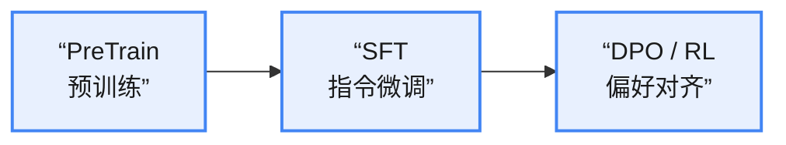

本篇概述训练全流程，流程分为：

# PreTrain

**学习目标**：学习通用基础能力。

预训练阶段（Pretraining）旨在从大规模无标注或弱标注数据中学习真实数据分布的通用表示能力。

通过最大似然或等价的分布匹配目标，模型被训练去近似真实数据的整体概率分布，从而掌握基础语义、结构先验和统计规律。

预训练阶段，模型并不显式关注指令遵循或人类偏好，而是专注于提升**覆盖性、稳定性和泛化能力**。预训练为后续的指令微调和强化学习阶段提供了高质量的初始化，使模型具备良好的分布建模能力和优化可塑性，是整个训练流程中决定**性能上限**和**稳定性**的关键基础。

对于自回归语言模型（LLM），预训练通过最大化序列似然来建模条件概率分布，逐步学习从**历史上下文**到未来 token 的生成规律；

对于扩散模型，则通过噪声注入与反演过程，学习数据分布的 score 或噪声预测函数，从而刻画数据在连续噪声空间中的演化结构。

## LLM-自回归

LLM 通常以 Causal Language Models（因果语言模型）的形式实现，这类模型也被称为 Autoregressive Language Models（自回归语言模型）。其核心生成机制为自回归式：以**输入的文本序列**（或**已生成的序列**）为条件，逐步预测下一个词元，直到形成完整的回答。

1. 初始预测：模型接收到输入，一次性处理**完整的输入序列**并计算其隐藏状态，这一过程通常被称为预填充阶段（Prefill Stage），为后续的生成阶段（Decode Stage）做好准备。
2. 扩展上下文：上下文扩展 → 新的输入 → 再次计算下一步的概率。
3. 继续生成。
4. 生成后续内容：模型继续迭代计算，逐步生成其余 token，直至生成完整的回答。
5. 完成输出：最终，模型生成完整回答。

由此可见，**模型在每个生成步骤中都需要重复计算相同的前缀**。为提升推理效率，通常会采用 **KV Cache** 等缓存机制来减少冗余计算。

下面是自回归推理和训练的流程示意图：

自回归推理示意图

自回归训练示意图

diffusion 简而言之可以分为两个阶段：

**第一阶段：加噪**。通过逐步加噪，可以把原始清晰图片变为高斯分布的噪声图片。这里的“逐步”可以简化为一步：通过指定噪声强度，直接加到指定步数的噪声图。

**第二阶段：去噪**。去噪是难点，通常是通过网络去预测噪声或向量场，经典算法是 DDPM、flow matching。去噪需要分多步，步数少了效果就不好（可以优化步数加快推理，这也是目前一个主流研究方向）。

# SFT

**学习目标**：指令跟随能力。

SFT（Supervised Fine-Tuning，监督微调）分为全参数微调与部分参数微调。

## 全参数微调

全参数微调对模型的**所有参数**进行训练和更新，以适应特定的**下游任务**。这是最为直接且传统的微调方式，优点在于实现简单，通常可以带来较大的效果提升。然而，由于所有参数都参与反向传播梯度更新，全参数微调**对 GPU 资源的需求较高**。此外，由于全参数微调自由度较大，如果**数据量不足**，那么模型可能面临较高的**过拟合风险**。

## 部分参数微调

部分参数微调在微调过程中，仅对模型的**部分参数**进行训练和更新，而其他参数保持冻结状态。这种方法在节省 GPU 资源、**降低过拟合风险**，以及提高微调效率方面具有显著优势。

根据应用场景和微调部位的不同，部分参数微调可以进一步分类如下：

1. 输出层微调：当下游任务的输出要求与原模型不同时，可以选择仅微调输出层或与之相连的几层。
2. 输入层微调：当**输入发生较大变化**时（例如数据模态不一致或数据分布差异较大），可以选择仅微调输入层。此时可以分两步训练：首先冻结模型的其他层，仅微调 Token Embedding；然后解冻所有参数，进行全模型训练，以实现更好的融合。
3. 局部结构微调：可以针对模型各层中的特定局部结构进行微调。例如，BitFit 方法仅微调模型的**偏置参数**；LayerNorm Tuning 仅微调模型的 **LayerNorm 参数**。

除此之外，实际场景中也常用 LoRA 技术进行 SFT 训练。

## LoRA

LoRA 的核心思想：**微调前后模型的参数差异** $\Delta w$ **具有低秩性**。因此，能够用**低秩矩阵表征**预训练模型与目标模型之间的差异 $\Delta w$。

一个矩阵具有低秩性，意味着它包含较多的冗余信息，将其分解为多个低维矩阵后，不会损失过多有用信息。

LoRA 基本原理如下图：

LoRA 基本原理

# DPO/RL

**学习目标**：学习偏好能力。

几个关键的问题：

* SFT 的问题（为什么需要 RL）：1. SFT 容易过拟合；2. SFT 的训练并非渐进式的；使用 RL 可以增强模型的探索能力。
* RL 之前为什么需要 SFT：直接在 pretrain 模型上进行 RL 会导致大部分采样样本没有奖励信号，训练效率低。
* SFT 训练到什么程度需要使用 RL：

**效果判断**：

1. 事实幻觉无法通过数据清洗解决：一本正经地胡说八道；
2. 缺乏“有用性”和“无害性”的权衡：输出过于冗长、堆砌辞藻但没有实质内容的回答；
3. 无法处理复杂的人类偏好；
4. 指令遵循能力达到瓶颈；
5. 拒绝能力不足。

**指标判断**：

1. 训练集拟合度饱和，loss 无法下降，或者出现过拟合。

**一个恰当的比喻**：

SFT 是“打底子”，RL 是“修性格”。

* 如果你的模型连人话都听不懂，或者完全不会按指令做事，请继续做 SFT（或者数据有问题）。
* 如果你的模型能听懂人话，也能做事，但经常乱说、废话多、或者不知道什么是“好”，那么就需要上 RL 了。

## DPO

直接偏好优化（Direct Preference Optimization, DPO）是一种可用于大模型的**对齐训练**方法。该算法在基于 PPO 的 RLHF 基础上进行了大幅简化。

DPO 是一种基于监督学习的对齐方法，它直接利用人类偏好数据（成对“好/坏”回答）来优化策略模型，通过一个解析形式的目标函数隐式地建模奖励函数（可以比作：“不用 RL 的 RL”，具体推导可见之前笔记），从而避免显式训练奖励模型与在线强化学习。

### DPO 损失函数和前向传播过程

DPO 损失函数与前向传播

### DPO 隐式奖励模型

1. DPO 训练过程中不显式地学习或表示单独的 reward function，而是把“奖励”直接吸收到优化目标里，通过参数化策略之间的相对偏好来起作用。
2. Bradley–Terry 模型是一种成对比较模型，用于刻画给定两个候选 $i, j$ 时，$i$ 被偏好于 $j$ 的概率。

Bradley–Terry（BT）模型对偏好概率建模如下：

$$P(y^+ \succ y^-) = \frac{e^{R(y^+)}}{e^{R(y^+)} + e^{R(y^-)}} \qquad (1)$$

转化为（省略推导过程）：

$$\log \frac{P(y^+ \succ y^-)}{1 - P(y^+ \succ y^-)} = R(y^+) - R(y^-) \qquad (2)$$

上式不关心绝对的 reward，只关心 reward 差。

RLHF 中 PPO 实际优化的是带 KL 正则的最大熵强化学习问题：

$$\max_{\pi}\; \mathbb{E}_{y \sim \pi(\cdot \mid x)}\left[R(x, y)\right] - \beta\, \mathrm{KL}\left(\pi(\cdot \mid x)\,\|\,\pi_{\mathrm{ref}}(\cdot \mid x)\right) \qquad (3)$$

最优解表示为（省略一大堆推导）：

$$\pi^*(y \mid x) \;\propto\; \pi_{\mathrm{ref}}(y \mid x)\, e^{R(x,y)/\beta} \qquad (4)$$

进一步转化为（省略一大堆推导）：

$$R(x,y) = \beta\left(\log \pi^*(y \mid x) - \log \pi_{ref}(y \mid x)\right) + C(x) \qquad (5)$$

结合式 (2) 和式 (5) 可以得到：

$$P(y^+ \succ y^-) = \sigma\left(\beta\left(\log \pi_\theta(y^+ \mid x) - \log \pi_{ref}(y^+ \mid x)\right) - \beta\left(\log \pi_\theta(y^- \mid x) - \log \pi_{ref}(y^- \mid x)\right)\right) \qquad (6)$$

其中 $\sigma$ 为 sigmoid 函数。

DPO 之所以可以用隐式奖励，是因为在 KL 正则的最大熵 RL 框架下，最优策略与奖励函数存在解析等价关系；而人类偏好只约束奖励差值，从而可以直接在策略空间中用监督学习恢复最优策略，而无需显式训练奖励模型。

DPO 的特点是：训练流程更简单、稳定、计算成本更低，但本质上仍在优化偏好诱导的策略改进目标，**表达能力有限**，不适合复杂 reward。

## RL

**RL 作为训练流程的最后一个环节**，是在 SFT 模型的基础上进行的策略优化阶段。它的目标不是让模型“学会生成语言”，而是：**约束模型“如何生成”，以及“生成得是否符合人类偏好或任务目标”。**

RL 的目标并非教会模型语言能力，而是在 KL 约束下调整生成分布，使模型输出更符合人类偏好或任务目标，同时避免偏离已有语言能力。奖励建模是 RL 的关键前置步骤，用于定义“什么是好”，而 RL 本身则体现为 reward 与 KL 约束之间的动态博弈，本质上是探索与利用平衡问题的具体体现。

整个 RL 过程，本质上是两个相反“力”的拉扯：

* **Reward**：把模型拉向「看起来更好 / 更符合偏好」的方向；
* **KL 约束**：把模型拽住，「别跑太远，别丢语言能力」。

RL 的成败，取决于这两个力是否平衡。
