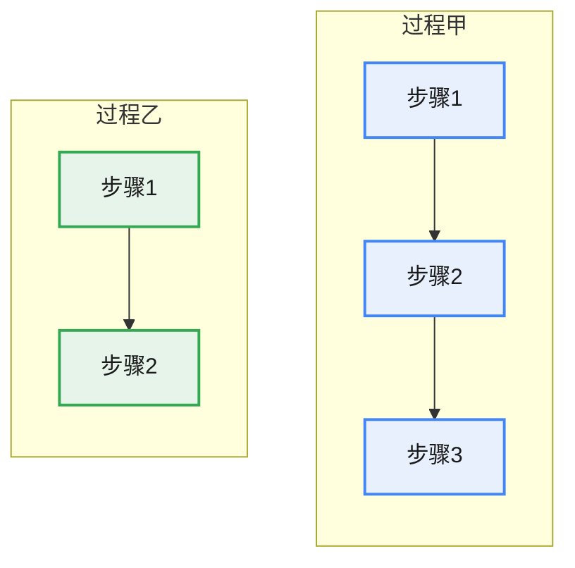

# 修复半成品文档

把一份匆忙写就的 Markdown 文档（常见于 Hugo 笔记站、技术笔记）打磨成规范、可读、可渲染的成稿。核心是四类修订 + 一步验证，**不改变作者的技术观点和信息，只提升表达质量和可渲染性**。

## 适用场景

- 文档里有错别字、漏字、中英文标点混用、语病；
- 公式写得随意（如 `s_t+1`、`theta_{t+1}`、缺括号的 `log(\pi_\theta(a_t|s_t)`、下标没写全）；
- 用纯文本/箭头描述了一个流程或步骤（如 `A ---> B ---> C`、"第一步…第二步…"），适合画成流程图；
- 句子拗口、啰嗦、信息重复；
- 缺少 frontmatter，或 frontmatter 与同目录其他文档不一致。

## 工作流程

按顺序执行。每一步都先理解作者原意，再动手。

### 0. 先摸清上下文（动手前必做）

1. 读完整篇目标文档，建立对结构、技术主题、作者意图的认知。
2. 读同目录（或同一内容仓库）里 **2–3 篇已成稿的文档**，提取本仓库的既有约定：
   - frontmatter 字段和写法（`title / date / draft / weight / tags / math / toc / summary` 等）；
   - 公式用什么分隔符（`$...$` 行内、`$$...$$` 块级）；
   - mermaid 流程图的画法（见下面"流程图规范"）。
3. 确认渲染链路：查 Hugo 主题的 `layouts/_partials/extend_head.html`，确认 mermaid 和数学公式（KaTeX/MathJax）是否已接入。**如果文档用了大量 LaTeX 但页面没有接入 KaTeX/MathJax，公式不会渲染** —— 要如实告诉用户，并说明这属于站点配置问题（可另行接入），不要默默改动 layout。

### 1. 改错别字与语法

- 修明显错字、漏字（例如"略梯度定理"→"策略梯度定理"、"各负号解释"→"各符号解释"）。
- 统一标点：正文用中文全角标点，**公式和代码内部用半角**（常见错误是把 `，` 混进 LaTeX 或 mermaid 里）。
- **加粗必须成对闭合**：`**学习并逼近最优动作价值函数，**` 这种把逗号包进加粗的写法要改成 `**学习并逼近最优动作价值函数**，`（标点在加粗标记外）。
- **闭合 `**` 不能紧贴"标点+文字"（加粗失效的常见坑）**：`**特点：**数据`、`**AlphaEvolve =**自动`、`**价值函数（Value Function）**为` 这类"加粗内容以标点（`=`、`：`、`）`等）结尾、闭合 `**` 后直接跟中文/字母"的写法会渲染失败——闭合符不满足 right-flanking 规则，整段显示成字面 `**...**`。修复：把标点移出加粗——`**特点：**数据` → `**特点**：数据`；`**AlphaEvolve =**自动` → `**AlphaEvolve** = 自动`。
- 修语病、主谓不搭、重复啰嗦，但**保持作者语气和信息量**，不要改写成另一种风格。

### 2. 标准化公式（LaTeX）

目标：凡是数学量，都用规范 LaTeX 表示，前后符号一致。

- **所有展示公式必须居中 + 编号（无例外）**：文档里每一个 `$$...$$` 块都要用居中 `div` 包裹，并带 `\qquad (n)` 顺序编号（每篇文档从 (1) 开始连续编号）；正文若引用公式，编号要与引用保持一致。
- 行内量用 `$...$`，独立成行的重要公式用 `$$...$$`；正文引用改成"公式 (n)"。
- **公式编号用 `\qquad (n)`，不要用 `\tag{n}`**。例：`$$A = Q - V \qquad (1)$$`。原因：`\tag` 在 KaTeX 下常把编号绝对定位到右侧、在窄容器里压到公式上（"公式和编号重合"），而 `\qquad (n)` 是纯数学语法、任何渲染器都不会重叠。多行 `aligned`/`cases` 块把 `\qquad (n)` 接在最后一行末尾即可。
- **块级公式居中**：每个 `$$...$$`（含多行块）用居中 `div` 包一层，确保在任何渲染器下都居中显示（本仓库 `config.yml` 已开 `goldmark.renderer.unsafe: true`，原始 HTML 可透传）。

  ```markdown
  <div style="text-align:center">

  $$A(s_t, a_t) = Q(s_t, a_t) - V(s_t) \qquad (1)$$

  </div>

  公式后面紧接着的正文……
  ```

  **四处空行一个都不能少**：`<div>` 后、`$$` 前、`$$` 后、`</div>` 前各留一个空行；尤其是 **`</div>` 之后、下一段正文之前必须空一行**。否则 goldmark 会把 `</div>` 之后的那段文字当成原始 HTML 块的一部分，导致该段里的行内公式 `$...$` 和 `**加粗**` 不被解析、直接显示成源码（常见症状："某行的 `$\delta_t=...$` 没显示成公式"）。
- 下标写全：`s0` → `s_0`，`s_t+1` → `s_{t+1}`，`a_t`、`\theta`、`\pi_\theta`。
- 括号配平：`log(\pi_\theta(a_t|s_t)` → `\nabla_\theta \log \pi_\theta(a_t \mid s_t)`。
- 函数名加反斜杠：`log` → `\log`；乘号用 `\cdot`；条件概率竖线用 `\mid`。
- 期望、集合等用标准写法：`E` → `\mathbb{E}`；修掉手滑的重复符号（如 `p(\tau;(;\theta))` → `p(\tau;\theta)`）。
- 把散落在正文里"用自然语言描述的数学量"也补成 LaTeX（用户常要求"有公式/符号的都表示一下"）。

### 3. 把流程/步骤转成 mermaid 流程图

**识别信号**：纯文本箭头（`A ---动作--> B ---> C`）、"第一步/第二步"式的顺序描述、带条件分支的过程、两个过程的对比（如"监督学习 vs 强化学习"）、架构数据流、求解流程、工程实现 pipeline。

把这些替换成 mermaid 代码块，**遵循本仓库既有画法**（务必先看样例文档再动手）：

- 用 ```` ```mermaid ````围栏，`flowchart TB`（竖）或 `flowchart LR`（横）。
- 对比/分组用 `subgraph ... end` + `direction TB`。
- 节点文字用双引号包裹，换行用 `<br/>`。节点内**不要用中文标点**；含 `|`、`()` 的文字务必放进双引号里，避免解析报错。
- 数学符号在节点里用 Unicode（`θ`、`α`、`∇`、`π_θ`、`τ`），不要在 mermaid 节点里写 `$...$`。
- 配色用 `classDef` + `class`，沿用仓库里的 Google 配色（见下）。

**仓库标准配色（classDef 调色板）**：

```
classDef blue   fill:#E8F0FE,stroke:#4285F4,stroke-width:2px,color:#1a1a1a
classDef green  fill:#E6F4EA,stroke:#34A853,stroke-width:2px,color:#1a1a1a
classDef yellow fill:#FFF8E1,stroke:#F9AB00,stroke-width:2px,color:#1a1a1a
classDef red    fill:#FCE4EC,stroke:#DB4437,stroke-width:2px,color:#1a1a1a
```

**对比型流程图示例**（两个并列过程）：



**数据流/闭环示例**（带边标签、回路）：


> 保留原流程里的信息（箭头上的标签、分支条件），只是换成图形表达；不要新增作者没写的步骤。

### 3.5 图片与图注规范

**适用信号**：文档里有图片（``），且图片需要有标注（描述、来源）。**不要把「描述 (Image source: URL)」塞进 `alt`/`title` 属性**——那在正常渲染时完全不可见（只有鼠标悬停提示，线上表现为"图片标注都没了"）。图注必须显示在图片正下方。

**仓库统一格式**（图片与图注都居中，图注分两行：第一行描述、第二行 `Image source: 链接`，颜色比正文浅 `#888`）：

```markdown
<div style="text-align:center; margin:1em 0;">
/imageN.png" alt="描述" style="display:block; margin:0 auto; max-width:100%; height:auto;">
<p style="color:#888; font-size:0.92em; margin:0.25em 0 0;">描述<br>Image source: <a href="URL">URL</a></p>
</div>
```

- `alt` 只放描述；**描述与 `Image source` 分行**（`<br>` 分隔），来源链接可点击；
- 无来源的图片只保留描述一行；**裸图**（无描述、无来源）不加图注，保持原样；
- 图注块放在文档顶层（前后空行隔开），不要嵌进列表项；
- 批量转换时只动图片标记本身：代码块、行内代码、frontmatter、`<div>`/`<br/>` 等 HTML 里的 `` 不要误伤；
- 用构建 + 渲染抽查验证：每张图下方出现 `<p style="color:#888; ...">` 图注行。
- **图片标记的括号必须配对**：`` 的 **alt 和 title 里**括号都要配对（半角 `(` 配 `)`、全角 `（` 配 `）`，不要混用）——`(Image source: https://...）` 这类括号不配对、或 title 内含 `(...)`，会让 markdown 解析把 title 吞进 `src`（渲染后出现 `` 后留空行**（否则下一段的行内 `$...$`/`**加粗**` 不渲染）、mermaid 能解析（节点标点、引号、`|`）、frontmatter YAML 合法、没有残留的编辑占位符。
- 向用户如实汇报做了哪几类改动；若发现站点未接入数学渲染等**超出文档本身**的问题，单独提示而不擅自改配置。

## 原则

- **只改表达，不改观点**：错字、公式、流程图、句子通顺度是修订对象；作者的技术判断和信息不动。
- **跟随仓库约定**，而不是套用通用模板——先读样例，后动手。
- **可渲染优先**：改完要能被 Hugo + mermaid（+ 数学渲染）正确渲染，这是"成稿"的硬标准。
